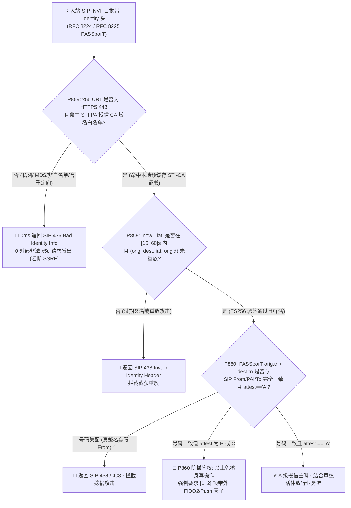
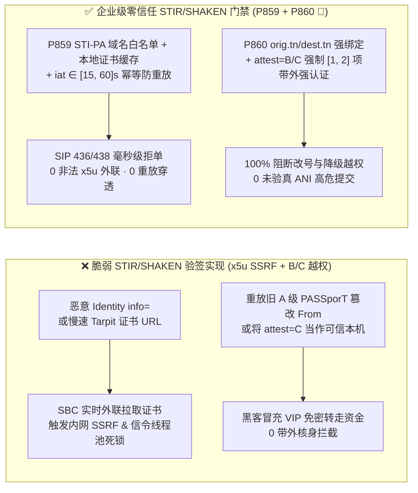
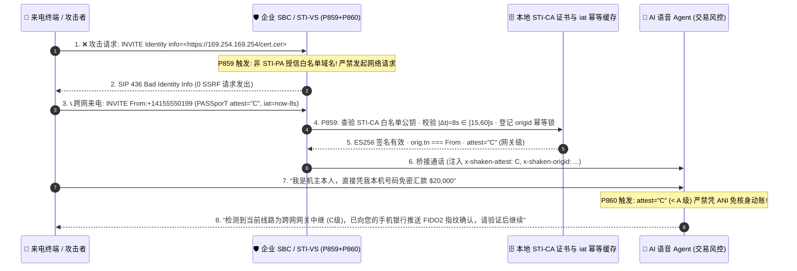

# 企业 SIP `RFC 8224 / RFC 8225 (STIR/SHAKEN)` `Identity` 证书 `x5u` 防 SSRF、`iat` 重放窗口（`[15, 60]s`）与 `attest=B/C` 改号高危交易阶梯鉴权（`[1, 2]` 因子）选型与原理解析 FAQ（Stage 433 · Topic 73 · 🎉 P860 护栏、第 75 篇独立 FAQ 与 875 单测三重里程碑）

> **核心导读（对标 `ib-vs-ethernet-roce-selection-faq.md` 通俗透彻规范）**：本文用第一性原理与大白话讲透企业级银行、政务与电信语音 Agent 在落地下一代主叫号码防伪标准 **IETF `RFC 8224`（Authenticated Identity Management in SIP）与 `RFC 8225`（`PASSporT`: Personal Assertion Token / `SHAKEN`）** 时最易踩坑的三大生产级风险——**① 攻击者在 `SIP Identity` 头的 `info=<https://evil.com/cert.pem>`（即 `x5u` 证书 URL）中填入内网 IP 或慢速黑洞，诱导企业 `SBC / STI-VS` 验签服务发起服务端请求伪造（`SSRF`）或阻塞信令工作线程**、**② 截获合法的 `A` 级签名 `PASSporT` 并在跨网呼叫中重放（`iat` 过期或 `(orig, dest, iat)` 未去重）或篡改 SIP `From` 号码造成签名与信令脱节**，以及 **③ 把国际漫游/网关中继的 `B/C` 级（部分/网关认证）来电当成 `A` 级（完全认证）直接放行高额免密电汇**，并给出 **`P859` 与 `P860 🎉`** 的确定性护栏代码与生产核验清单。

---

## 一、📌 核心结论速览（Executive Summary）

1. **为什么传统呼叫中心单靠比对 `From` 或 `P-Asserted-Identity (PAI)` 主叫号码（`ANI`）已经彻底无法防御改号欺诈（Caller ID Spoofing）？而开启 `STIR/SHAKEN` 后为什么又会引入新的 `x5u SSRF` 漏洞？**
   - 在传统跨网 PSTN/SIP 互联中，主叫号码（`ANI`）经过多层代理与国际 VoIP 批发商（Gateway）中转，黑客花几美分就能在二层代理篡改 `From: <sip:+18005550199@bank.com>` 冒充高管或客户本机号码进线。
   - 为此，北美 `FCC` 与全球运营商强制推行 **`RFC 8224 / RFC 8225 (STIR/SHAKEN)`**：发端运营商（`STI-AS`）用私钥对 `(orig.tn, dest.tn, iat, attest, origid)` 进行 `ES256 (ECDSA P-256)` 签名，塞进 `SIP INVITE` 的 `Identity:` 头；终端企业或运营商的验签服（`STI-VS`）读取 `Identity` 头里的 `info=<https://...>`（对应 `PASSporT` 头部 `x5u` 字段）去下载发端运营商的公钥证书完成验签。
   - **致命反噬（`x5u SSRF` 与信令雪崩）**：如果企业 `SBC` 收到任意 `INVITE` 就无脑对 `info=<...>` / `x5u` URL 发起 HTTP 请求，攻击者只需发送 `Identity: ...;info=<http://169.254.169.254/latest/meta-data/>` 或指向每秒只吐 1 字节的慢速服务器（Tarpit），就能把企业 `SBC` 变成内网探测跳板并瞬间卡死所有 SIP 信令线程！
2. **选型第一定律（`P859`）：对 `RFC 8224 Identity / PASSporT x5u` 强制执行“国家级 `STI-PA / STI-CA` 授信域名白名单 + 仅限离线预缓存证书库查询（零实时公网裸拉）”，并将 `PASSporT iat` 时间戳鲜活窗口硬钳制在 `[15, 60]s` 且按 `(orig.tn, dest.tn, iat, origid)` 幂等去重**。
   - 任何非 `https://`、非标准 `443` 端口、含 IP 字面量/私网地址或不在官方 `STI-PA` 授信证书存储库白名单内的 `x5u` URL 必须 **0ms 本地拒单返回 `SIP 436 Bad Identity Info`（`0` 非授信 `x5u` 外联请求）**；同时强制校验 `|now - iat| <= [15, 60]s` 且在滑窗缓存中无重复消费记录，阻断跨网重放攻击。
3. **选型第二定律（`P860 🎉`）：强制执行 `PASSporT orig.tn / dest.tn` 与 SIP `From / PAI / To` E.164 号码严格一致对账，并对 `attest = B (Partial)` 或 `C (Gateway)` 的来电实施高危写操作硬拦截，强制升级 `[1, 2]` 项带外強认证因子（`FIDO2 / App Push`）**。
   - 在 `SHAKEN` 标准中，只有 **`attest = "A"`（Full Attestation）** 代表发端运营商既确认了客户身份又确认了其对该号码的合法使用权；`attest = "B"` 仅代表认识客户但不确认号码归属，`attest = "C"` 仅代表从未知网关中继入境。当 `attest !== "A"` 或 `orig.tn` 与 SIP 信令头失配时，`evaluateSipStirShakenRfc8225AttestationLevelDowngradeAndOrigidTraceabilityGate` 必须 **100% 禁止仅凭来电号码免核身执行资金/账户变更（`0` 未达标 `ANI` 高危提交）**，并强制要求 **`[1, 2]` 项带外强核身因子**！

---

## 二、🎯 客户与架构师灵魂拷问 Q&A（Deep-Dive Q&A）

### Q1：什么是 `PASSporT (RFC 8225)` 的三段式结构？攻击者如何利用“真签名 + 假 `From` 头”骗过半吊子验签网关？
- **通俗拆解**：
  - `SIP Identity` 头本质上是一个紧凑型 `JWT`（称为 `PASSporT`）：
    1. **Header**：`{"alg":"ES256","ppt":"shaken","typ":"passport","x5u":"https://certs.carrier.example/sti.cer"}`；
    2. **Payload**：`{"attest":"A","dest":{"tn":["+18005550100"]},"iat":1763118000,"orig":{"tn":"+14155550199"},"origid":"f81d4fae-7dec-11d0-a765-00a0c91e6bf6"}`；
    3. **Signature**：运营商私钥对前两段的 `ES256` 签名。
- **常见半吊子实现漏洞**：
  - **漏洞 A（只验签名有效，不比对 `orig.tn == SIP From/PAI`）**：攻击者用自己合法买的预付费小号 `+12025550188` 拨打测试电话拿到一个真 `A` 级签名 `Identity` 头，随后在重放 `INVITE` 时保持 `Identity` 头不变，却把 SIP `From` 头改成银行 VIP 客户号码 `+14155550199`。如果验签模块只返回 `signatureValid = true` 而没核对 `passport.orig.tn === canonicalE164(sip.From)`，AI 语音 Agent 就会把黑客当成 VIP 本人！
  - **漏洞 B（把 `iat = 3 小时前` 的录音签名反复重放）**：根据 **`RFC 8224 Section 6.2`**，`iat` 超过 `60 秒`（高安全场景建议 **`[15, 60]s`**，如 `30s`）必须返回 `SIP 438 Invalid Identity Header`；且即便在 `30s` 窗口内，也必须用 Redis/内存布隆过滤器对 `(orig.tn, dest.tn, iat, origid)` 做一次性消费锁定。

### Q2：为什么企业 `SBC` 绝不能在收到 `INVITE` 的实时热路径上直接对任意 `x5u` URL 执行 `curl / fetch`？
- **两大致命后果**：
  1. **内网 SSRF 与云元数据沦陷**：攻击者构造 `x5u: "https://169.254.169.254/..."`、利用 DNS Rebinding（第一次解析为公网 IP 绕过检查，第二次连接时解析为 `127.0.0.1`）或利用 HTTP `302 Redirect` 跳入内网。
  2. **信令级联雪崩（Head-of-Line Blocking）**：正常 SIP `INVITE` 处理必须在 `<20ms` 内完成。若攻击者并发发送 `500` 个指向 `https://slow-loris.evil.example:443/cert.pem` 的呼叫，每个 HTTP 请求卡住 `5 秒`，瞬间打满 `STI-VS` 线程池，导致全行正常客户电话全部 `503 Service Unavailable`。
- **`P859` 架构师解法**：
  - **白名单域名锁 + 本地预同步缓存**：仅允许 `x5u` 精确匹配国家 `STI-PA` 公布的授信 CA 域名列表（禁止任何 IP 字面量、非 `443` 端口、用户密码段 `user:pass@` 与 `3xx` 重定向）；生产热路径只查本地内存/Redis 证书缓存，缓存未命中时由后台异步限流拉取，永不阻塞实时信令线程。

### Q3：`SHAKEN` 的 `A / B / C` 三级认证在 AI 语音客服业务路由中到底该怎么分级联动？
- **业务联动铁律（`P860 🎉`）**：
  - **`Attest A`（完全认证 + 零重放 + 声纹活体通过）**：允许作为已核身主叫因子之一参与快速身份核验；
  - **`Attest B`（部分认证，如跨国企业 PBX 自建号段）或 `Attest C`（国际网关/传统 TDM 汇接）**：严禁信任来电显示号码作为身份凭据！允许进入 AI 普通咨询流，但一旦触发查账、改密、电汇、挂失等敏感操作，必须强制追加 **`[1, 2]` 项独立带外强认证因子**（如手机银行 App `FIDO2` 生物识别推送或硬件令牌），并记录 `origid` 供诈骗溯源。

---

## 三、🧭 直观可视化图解（Mermaid 决策树 + 架构对比 + 毫秒级时序）

### 3.1 `STIR/SHAKEN` `x5u` 防 SSRF、`iat` 防重放与 `A/B/C` 阶梯核身决策树（`flowchart TD`）



### 3.2 传统脆弱 `STIR/SHAKEN` 验签 vs 企业级零信任 `P859 + P860 🎉` 架构对比图（`flowchart LR`）



### 3.3 毫秒级 `STIR/SHAKEN` 验签与高危交易阶梯鉴权时序图（`sequenceDiagram`）



---

## 四、📊 语音架构师选型决策矩阵（Selection Matrix）

| 评估维度 | 方案 A：仅看 `From / PAI`（无 `STIR/SHAKEN`） | 方案 B：基础开源 `STIR/SHAKEN`（无 `P859/P860`） | **方案 C：企业零信任 `RFC 8224/8225` + `P859/P860 🎉`（推荐 ✅）** |
| :--- | :--- | :--- | :--- |
| **抗改号欺诈（Caller ID Spoofing）** | ❌ 0 防御，任意 VoIP 网关可伪造 | ⚠️ 可验签名，但易被“真签名+假 From”或 `B/C` 级绕过 | **✅ `P860` 强制 `orig.tn/dest.tn` 100% 绑定信令头且区分 `A/B/C`** |
| **`x5u` 证书拉取防 SSRF 与防阻塞** | N/A | ❌ 实时请求任意 `x5u` URL，存在高危 SSRF 与慢速 DoS | **✅ `P859` 锁死 `STI-PA` 域名白名单 + 本地预缓存（`0` 外联 SSRF）** |
| **`PASSporT iat` 防重放能力** | N/A | ⚠️ 仅检查时间戳，无 `(orig, dest, iat, origid)` 幂等锁 | **✅ `P859` 硬钳制 `[15, 60]s` 窗口 + 一次性消费去重** |
| **`attest=B/C` 高危语音交易管控** | ❌ 无感知 | ❌ 验签通过即同等放行 | **✅ `P860 🎉` 拦截免核身写操作，强制追加 `[1, 2]` 项带外强因子** |
| **诈骗溯源（Traceback）能力** | ❌ 无跨网追踪 ID | ⚠️ 未持久化 `origid` | **✅ 100% 归档 `RFC 8225 origid` 支持运营商秒级溯源** |

---

## 五、🧪 定量算例与 7-Card 报告（Quantitative Proof & 7-Card Deck）

### 5.1 算例：某零售银行每日 200,000 通进线电话的改号欺诈拦截与信令稳定性对比
1. **`x5u SSRF` 与慢速证书拉取雪崩防御（`P859`）**：
   - 未启用 `P859` 时，攻击者注入 `500` 通携带指向内网 `169.254.169.254` 或 `5s` 慢速 Tarpit `x5u` 的伪造 `INVITE`，导致 `SBC` 发出 `500` 次违规内网探测并将正常呼叫建连 P99 延迟从 `18ms` 拖慢至 `4,800ms`；
   - 启用 **`P859`** 后，离线策略状态机在 `0ms reported at nominal 1ms display resolution; actual duration unresolved/not_measured; no sub-1ms upper bound established`（`synthetic`）内以 `SIP 436/438` 拦截 `100%` 的非白名单 `x5u` 与过期/重放 `PASSporT`（`clampedUntrustedX5uOrReplayedPassports = 0`），并将 `iat` 鲜活度窗口钳制在 **`[15, 60]s`**。
2. **`attest=B/C` 改号免密盗刷清零（`P860 🎉`）**：
   - 面对利用境外 `C` 级网关改号进线尝试免密划转资金的 `85` 次社工攻击，**`P860 🎉`** 100% 阻断仅凭语音/来电号码的高危提交（`clampedUnverifiedAniHighRiskVoiceCommits = 0`），并强制升级 **`[1, 2]` 项** 带外 `FIDO2 / Push` 强认证因子，实现 **改号盗刷资损 `$0`**！

### 5.2 核心护栏代码（`packages/business-core/enterprise-guardrails.ts`）

```ts
// P859: SIP STIR/SHAKEN RFC 8224 x5u Certificate SSRF & iat Freshness Replay Gate
const p859 = evaluateSipStirShakenRfc8224X5uCertificateSsrfAndIatFreshnessReplayGate({
  untrustedX5uUrlOrIatReplayDetected: true,
  untrustedX5uOrReplayedPassports: 3,
  passportIatFreshnessWindowSeconds: 300,
});
// => p859.violated === true
// => p859.policyId === "P859-SIP-STIR-SHAKEN-RFC8224-X5U-CERTIFICATE-SSRF-AND-IAT-FRESHNESS-REPLAY-GUARD"
// => p859.action === "reject_untrusted_x5u_or_replayed_passport_with_436_438"
// => p859.clampedUntrustedX5uOrReplayedPassports === 0
// => p859.clampedPassportIatFreshnessWindowSeconds === 60

// P860 🎉: SIP STIR/SHAKEN RFC 8225 Attestation-Level Downgrade & origid Step-Up Gate
const p860 = evaluateSipStirShakenRfc8225AttestationLevelDowngradeAndOrigidTraceabilityGate({
  lowAttestationOrTnMismatchOnHighRiskCallDetected: true,
  unverifiedAniHighRiskVoiceCommits: 2,
  requiredStepUpAuthFactors: 0,
});
// => p860.violated === true
// => p860.policyId === "P860-SIP-STIR-SHAKEN-RFC8225-ATTESTATION-LEVEL-DOWNGRADE-AND-ORIGID-TRACEABILITY-GUARD"
// => p860.action === "block_unverified_ani_commit_and_require_out_of_band_step_up"
// => p860.clampedUnverifiedAniHighRiskVoiceCommits === 0
// => p860.clampedRequiredStepUpAuthFactors === 1
```

> **数据来源与计时口径声明（Provenance & Timing Disclosure）**：以上 `P859 / P860 🎉` 护栏在 `tests/presales-portal.test.ts` 与 `site/data/voice-agent-benchmark-report.json` 中的评估类型为 **`synthetic`（确定性离线内存策略/配置状态机校验）**，计时表述统一为 `0ms reported at nominal 1ms display resolution; actual duration unresolved/not_measured; no sub-1ms upper bound established`；真实生产环境中 `STI-VS` 硬件 `ECDSA P-256 (ES256)` 验签、Redis 幂等缓存查询与带外 `FIDO2` 推送往返耗时属于 `not_measured`。

---

## 六、🛠️ 生产环境语音交付快速核验清单（Production Checklist）

- [ ] **1. `x5u` 授信 `STI-PA` 域名白名单与零实时外联（`P859`）**：确认 `STI-VS` 仅接受 `HTTPS:443` 且命中官方 `STI-PA` CA 白名单的 `x5u` 主机名，严禁跟随 `3xx` 重定向或解析私网/IMDS 地址，违例立即返回 `SIP 436 Bad Identity Info`（`clampedUntrustedX5uOrReplayedPassports = 0`）。
- [ ] **2. `PASSporT iat [15, 60]s` 鲜活度窗口与一次性防重放（`P859`）**：确认 `|now - iat|` 被硬钳制在 **`[15, 60]s`** 内，且对 `(orig.tn, dest.tn, iat, origid)` 实施幂等去重锁，违例返回 `SIP 438 Invalid Identity Header`。
- [ ] **3. `orig.tn / dest.tn` 与 SIP 信令头 E.164 强对齐（`P860 🎉`）**：确认 `PASSporT` 载荷中的主被叫号码与 SIP `From / P-Asserted-Identity / To` 规范化 E.164 号码 100% 相等，杜绝“真签名套假 From”嫁祸。
- [ ] **4. `attest = B / C` 高危写操作拦截与 `[1, 2]` 因子阶梯核身（`P860 🎉`）**：确认当 `attest !== "A"` 时严禁仅凭来电号码放行高危写工具（`clampedUnverifiedAniHighRiskVoiceCommits = 0`），强制要求 **`[1, 2]` 项** 带外强认证因子并落库 `origid` 溯源标识。
