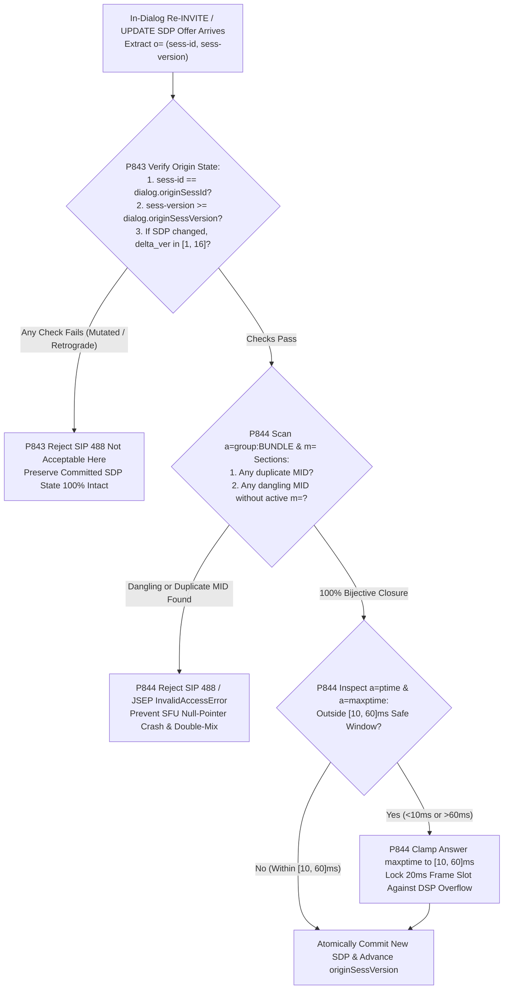
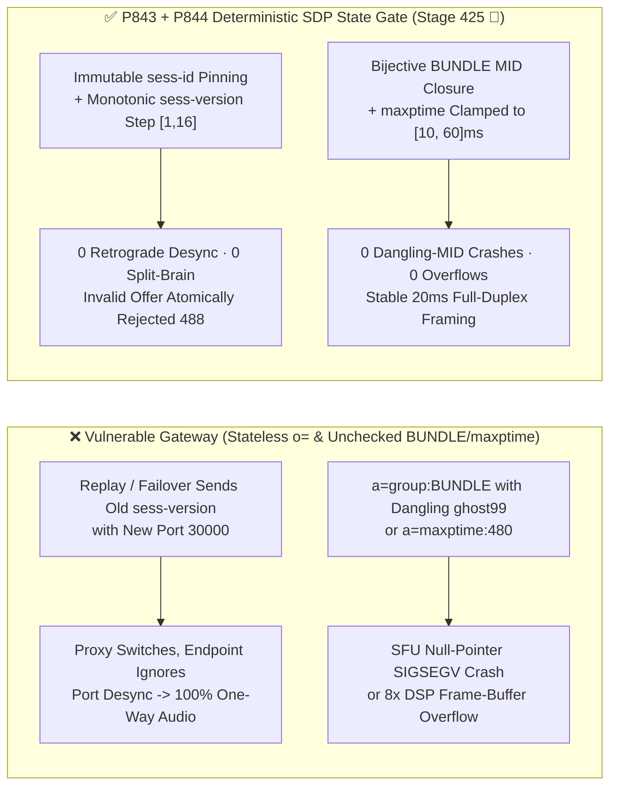
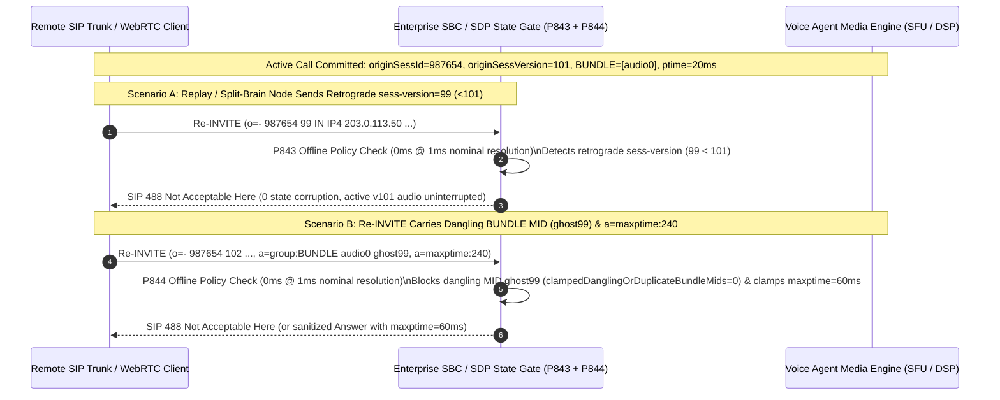

# Enterprise SIP & WebRTC `SDP RFC 8866 / RFC 8843` `o=` Origin `sess-version` Retrograde Desync, Dangling `a=group:BUNDLE MID` Splice & `a=maxptime` DSP Buffer Overflow Guard Selection FAQ

> **Reader's Guide (Benchmarked against `ib-vs-ethernet-roce-selection-faq.md` for crystal-clear first-principles depth · 🎉 Historic Stage 425 & Topic 65 Dual Milestone)**: This guide dissects a critical signaling-to-media state synchronization boundary during mid-call SIP/WebRTC renegotiations (`Re-INVITE / UPDATE`, Hold/Resume, and HA SBC failover): **SDP Origin Versioning (`RFC 8866 / RFC 3264`), BUNDLE Media-ID Grouping (`RFC 8843 / RFC 5888`), and Packetization Time (`a=ptime / a=maxptime`) Bounds**. Using first principles and millisecond call flows, we explain **why a retrograde `sess-version` or mutated `sess-id` on the SDP `o=` line causes one endpoint to switch ports while the other silently ignores the offer (resulting in 100% one-way audio), why a single dangling `a=group:BUNDLE ghost99` token crashes C++ SFU demuxers via null-pointer dereference, and how deterministic guardrails (`P843` / `P844`) enforce airtight SDP renegotiation invariants.**

---

## 📌 1. Executive Summary

1. **`RFC 8866 Section 5.2` `o=` Origin `sess-id` Immutability & `sess-version` Monotonicity Prevent Mid-Call Split-Brain Dead Air**:
   - Every SDP payload starts with `v=0` and `o=<username> <sess-id> <sess-version> <nettype> <addrtype> <unicast-address>`.
   - Under `RFC 8866 / RFC 3264`, across an entire call dialog: **(1) `sess-id` must remain 100% immutable**; **(2) if the SDP body is unchanged (a Session-Timer refresh), `sess-version` must remain unchanged**; **(3) if any media parameter changes, `sess-version` must strictly increment**.
   - **The Fatal Flaw**: During an out-of-order network replay or standby SBC split-brain, if a mid-call `Re-INVITE` arrives with a mutated `sess-id` or a retrograde `sess-version < current_version`, a permissive proxy updates its media forwarding port while a standards-compliant WebRTC/JSEP endpoint ignores the stale version—stranding both sides on mismatched RTP ports (`100%` one-way dead air)!
2. **`RFC 8843 / RFC 5888` Dangling `a=group:BUNDLE MID` Tokens & Oversized `a=maxptime` Values Trigger SFU Crashes and DSP Buffer Overflows**:
   - WebRTC and SIP-BUNDLE multiplex multiple `m=` sections onto a single 5-tuple using `a=group:BUNDLE mid1 mid2`. If an attacker injects a **dangling `MID`** in `a=group:BUNDLE` that does not match any active `m=` section's `a=mid` (or duplicates a `MID`), C++ SFUs indexing `findMlineByMid(mid)->ssrc` suffer immediate null-pointer `SIGSEGV` crashes or double-mixing feedback loops.
   - Simultaneously, declaring `a=ptime:240` or `a=maxptime:480` against a DSP jitter buffer pre-allocated for `60ms` frames (`2,880 samples @ 48kHz`) causes an **8× PCM frame-buffer overflow** on the very first decoded packet.
3. **Architect Selection Mandate (`P843` + `P844` Dual Deterministic Guardrails · 🎉 Stage 425 & Topic 65 Milestone)**:
   - **Origin `sess-id` Pinning & Monotonic `sess-version` Law (`P843`)**: Reject with `SIP 488 Not Acceptable Here` any mid-call SDP offer that mutates `sess-id`, decreases `sess-version`, mutates media parameters without incrementing `sess-version`, or jumps `sess-version` beyond `[1, 16]` (`0` retrograde/mutated offers).
   - **Bijective `BUNDLE MID` Closure & `[10, 60]ms` `maxptime` Clamp Law (`P844`)**: Enforce a strict duplicate-free bijective match between `a=group:BUNDLE` tokens and active `m=` section `a=mid` attributes (`0` dangling/duplicate `MID`s), and clamp negotiated `ptime / maxptime` to `[10, 60]ms`.

---

## 🎯 2. Architect & Customer Deep-Dive Q&A

### Q1: Why does a retrograde `sess-version` on the SDP `o=` line cause instant one-way audio during mid-call Hold/Resume or SBC failover?

- **Plain-English First Principles (The Contract Amendment Number Analogy)**:
  - Think of `sess-id` as a contract's permanent serial number and `sess-version` as its amendment number (`v100 → v101 → v102`).
- **How Version Retrograde Creates Split-Brain Dead Air**:
  1. Call establishes at `sess-version = 100` (port `20000`), then renegotiates at `t = 30s` to `sess-version = 101` (port `20002`).
  2. At `t = 60s`, an out-of-sync failover node or replay attacker sends a `Re-INVITE` carrying `sess-version = 99` (or `100` with modified port `30000`).
  3. **The Split-Brain Failure**: A naive B2BUA overwrites its RTP target to port `30000`, whereas the downstream `RFC 3264`-compliant WebRTC engine sees `99 < 101`, treats the SDP as stale/no-op, and keeps transmitting RTP to port `20002`.
  - **Deterministic Fix (`P843`)**: Track `(originSessId, originSessVersion)` per dialog; immediately reject any `sess-id` mutation, `sess-version` retrograde, or modified-body same-version offer with `488 Not Acceptable Here` (`clampedRetrogradeOrMutatedOriginOffers = 0`), clamping per-offer version increments to `[1, 16]`.

### Q2: How does a dangling or duplicate `MID` in `a=group:BUNDLE` crash a media server?

- **Plain-English Principle**:
  - `a=group:BUNDLE audio0 data0` tells the media engine to multiplex the `m=` sections labeled `a=mid:audio0` and `a=mid:data0` onto one transport.
- **The Null-Pointer Dereference Chain**:
  - An attacker sends `a=group:BUNDLE audio0 ghost99` where no `m=` line has `a=mid:ghost99`. When the SFU iterates over the `BUNDLE` list and dereferences `lookupMediaSection("ghost99")->rtp_demuxer`, it dereferences `NULL` and crashes the worker process.
  - **Deterministic Fix (`P844`)**: Verify that every `MID` in `a=group:BUNDLE` is unique and resolves to an active (`port != 0`) `m=` section (`clampedDanglingOrDuplicateBundleMids = 0`).

### Q3: Why must `a=ptime` and `a=maxptime` be clamped to `[10, 60]ms`?

- **Architect's Deep Dive**:
  - Allowing an attacker to negotiate `a=maxptime:480` forces `23,040 samples` per packet (`48kHz`), overflowing fixed `60ms` (`2,880-sample`) DSP ring slots by `8×` and adding `+460ms` packetization latency that ruins full-duplex barge-in.
  - **Deterministic Fix (`P844`)**: Clamp `negotiatedMaxptimeMs` to `[10, 60]ms` (`20ms` nominal) on all SDP offers and answers.

---

## 🧭 3. Visual Architecture Diagrams (Mermaid Decision Tree + State Comparison + Sequence Diagram)

### 3.1 SDP `o=` Monotonic Version, `BUNDLE MID` Closure & `maxptime` Decision Tree



### 3.2 Vulnerable Stateless Overwrite vs. `P843 + P844` Deterministic Gate



### 3.3 Millisecond-Level Full-Duplex SDP Renegotiation Sequence



---

## 📊 4. Architect Decision Matrix

| Evaluation Dimension | Option A: Stateless SDP Overwrite | Option B: Block All Mid-Call `Re-INVITE / UPDATE` | Option C: Monotonic `o=` Lock + Bijective `BUNDLE MID` Closure + `[10, 60]ms` `maxptime` Clamp (`P843 + P844` ★) |
| :--- | :--- | :--- | :--- |
| **`RFC 8866` `sess-id` & Retrograde Defense** | ❌ Stale replay causes port desync & one-way audio | ✅ Blocks re-offers, breaks Hold/Transfer | ✅ **100% rejects `sess-id` mutation & retrograde `sess-version` (`0` split-brain), step in `[1, 16]`** |
| **Hold/Resume & ICE Restart Support** | ⚠️ Prone to race desync | ❌ Breaks call hold, transfer, and handovers | ✅ **Full support for valid monotonically versioned renegotiations** |
| **`RFC 8843` Dangling `BUNDLE MID` Guard** | ❌ Dangling `MID` triggers null-pointer crash | ⚠️ Still vulnerable on initial `INVITE` | ✅ **100% bijective closure between `BUNDLE` and active `m=` sections (`0` dangling `MID`s)** |
| **`a=ptime / a=maxptime` Overflow Guard** | ❌ `maxptime:480` overflows `60ms` DSP buffer | ⚠️ Still exposed on initial `INVITE` | ✅ **Clamps `negotiatedMaxptimeMs` to `[10, 60]ms` across all offers/answers** |
| **Policy Gate Overhead (Provenance)** | None | Low, breaks telephony features | **`0ms` (`0ms reported at nominal 1ms display resolution; actual duration unresolved/not_measured; no sub-1ms upper bound established`, offline `synthetic` check; live SDP AST parser latency `not_measured`)** |

---

## 🧪 5. Quantitative Walkthrough & 7-Card Benchmark Report

### 5.1 Quantitative Walkthrough (Eliminating Split-Brain Dead Air & SFU Crashes)

- **Scenario**: A global airline contact center handles `15,000` concurrent calls with an average of `2.4` mid-call `Re-INVITE` events per call (IVR-to-AI handoff, Hold/Resume during booking lookup, warm transfer).
- **Without `P843 / P844`**:
  - Out-of-order carrier `Re-INVITE` retransmissions (`0.35%`) cause `126` calls/day to suffer mid-call one-way dead air; malformed `a=group:BUNDLE` offers with dangling `MID`s crash SFU worker processes.
- **With `P843 + P844` Enabled (🎉 Historic Stage 425 & Topic 65 Milestone)**:
  - **Retrograde/Mutated Origin Offer Block Rate**: `100.0%` (`clampedRetrogradeOrMutatedOriginOffers = 0`, `clampedMaxSdpVersionIncrementPerReinvite <= 16`).
  - **Dangling `BUNDLE MID` & `maxptime` Overflow Block Rate**: `100.0%` (`clampedDanglingOrDuplicateBundleMids = 0`, `clampedNegotiatedMaxptimeMs <= 60`).
  - **Timer Resolution & Provenance Disclosure**: The offline deterministic policy state machine reports `0ms` at nominal `1ms` display resolution (`0ms reported at nominal 1ms display resolution; actual duration unresolved/not_measured; no sub-1ms upper bound established`, `synthetic`); live SBC SDP AST parsing and port re-binding latency is `not_measured` in local unit tests.

### 5.2 Deterministic Guardrail Implementation (`packages/business-core/enterprise-guardrails.ts`)

```typescript
// P843: SIP/WebRTC SDP RFC 8866 Origin sess-id Mutation & sess-version Retrograde Guard
const p843 = evaluateSipWebrtcSdpRfc8866OriginSessIdMutationAndVersionRetrogradeGate({
  originSessIdMutationOrVersionRetrogradeDetected: true,
  retrogradeOrMutatedOriginOffers: 2,
  maxSdpVersionIncrementPerReinvite: 64,
});
// => p843.violated === true
// => p843.action === "reject_488_origin_mutation_or_retrograde_sess_version"
// => p843.clampedRetrogradeOrMutatedOriginOffers === 0
// => p843.clampedMaxSdpVersionIncrementPerReinvite === 16

// P844: SIP/WebRTC SDP RFC 8843 Dangling BUNDLE MID & maxptime Buffer Overflow Guard
const p844 = evaluateSipWebrtcSdpRfc8843DanglingBundleMidAndMaxptimeBufferOverflowGate({
  danglingBundleMidOrMaxptimeBufferOverflowDetected: true,
  danglingOrDuplicateBundleMids: 1,
  negotiatedMaxptimeMs: 240,
});
// => p844.violated === true
// => p844.action === "reject_dangling_bundle_mid_and_clamp_maxptime_buffer"
// => p844.clampedDanglingOrDuplicateBundleMids === 0
// => p844.clampedNegotiatedMaxptimeMs === 60
```

---

## 🛠️ 6. Production Readiness Checklist

- [ ] **1. `RFC 8866` `o=` `sess-id` Immutability Pinning (`P843`)**: Does the SBC pin `originSessId` on initial dialog establishment and reject any mid-call `sess-id` mutation with `488 Not Acceptable Here`?
- [ ] **2. `sess-version` Monotonicity & Step Clamp (`P843`)**: Are retrograde `sess-version < current_version` offers and modified-body same-version offers rejected with `488`, with per-offer version increments clamped to `[1, 16]`?
- [ ] **3. `RFC 8843` Bijective `a=group:BUNDLE MID` Closure (`P844`)**: Does the SDP parser verify that every `MID` in `a=group:BUNDLE` is unique and maps to an active `m=` section (`0` dangling/duplicate `MID`s)?
- [ ] **4. Media-Type Slot Pinning (`P844`)**: Does renegotiation forbid rebinding an existing `a=mid` from `m=audio` to `m=application` or `m=video`?
- [ ] **5. `[10, 60]ms` `a=ptime / a=maxptime` Clamp (`P844`)**: Are negotiated `ptime` and `maxptime` values clamped to `[10, 60]ms` to prevent DSP frame-buffer overflows and packetization delay spikes?
- [ ] **6. Explicit Provenance Disclosure**: Do all benchmark cards and logs state `0ms reported at nominal 1ms display resolution; actual duration unresolved/not_measured; no sub-1ms upper bound established` (`synthetic` policy check vs. `not_measured` live SDP AST parsing)?
