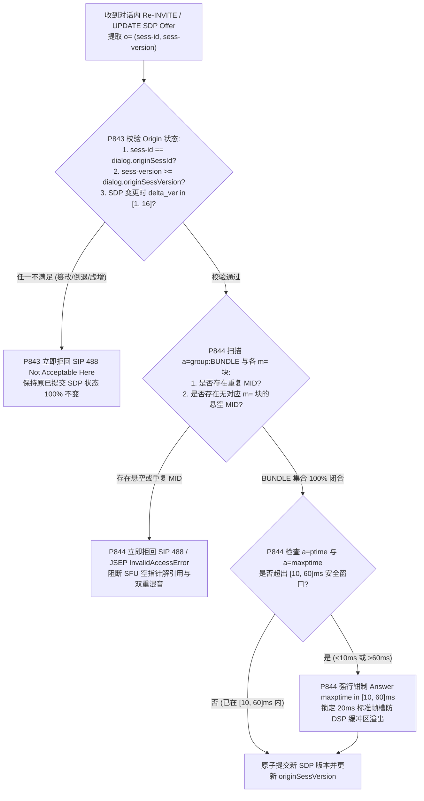
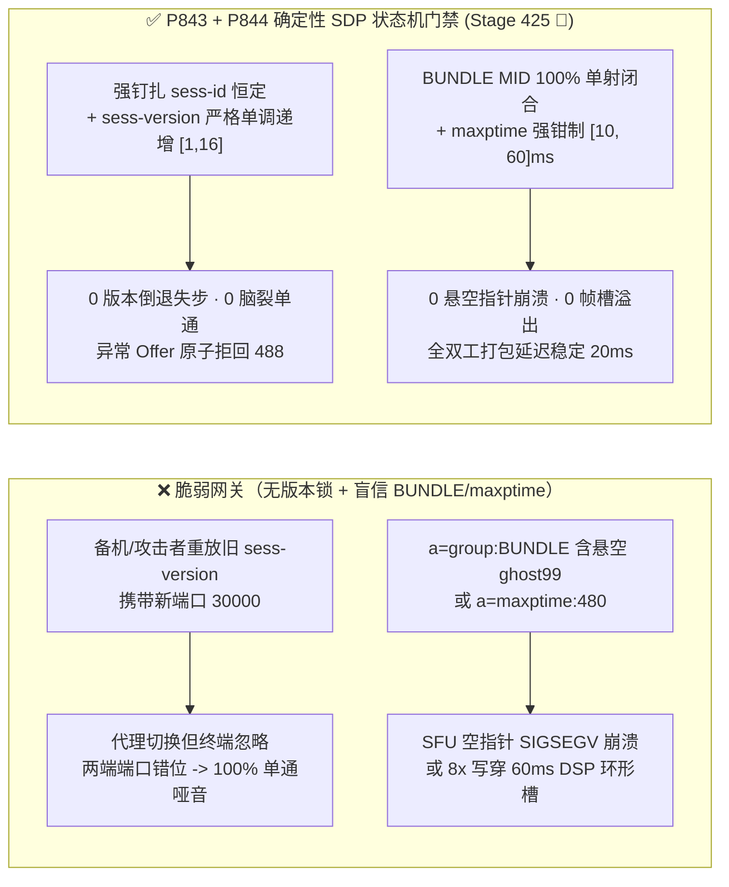
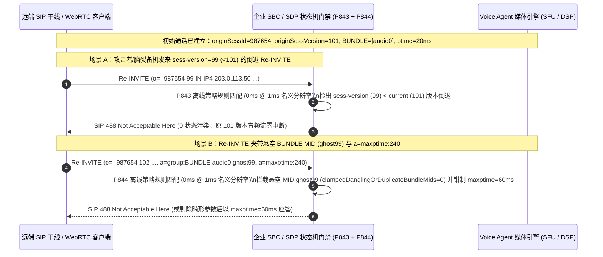

# 企业 SIP 与 WebRTC `SDP RFC 8866 / RFC 8843` `o=` Origin 会话版本号倒退失步、悬空 `a=group:BUNDLE MID` 跨会话拼接与 `a=maxptime` DSP 帧缓冲溢出防护架构选型 FAQ

> **阅读指南（对标 `ib-vs-ethernet-roce-selection-faq.md` 通俗透彻标准 · 🎉 Stage 425 & 第 65 大专题双里程碑）**：本文聚焦企业级全双工语音 Agent 在通话中途执行呼叫保持（Hold/Resume）、媒体升级或 SBC 热备切换时的**SDP 会话重协商（Re-INVITE / UPDATE）状态机安全与内存边界**。全文用通俗大白话、第一性原理与微秒级信令时序讲透：**为什么 `o=` 行里看似不起眼的 `sess-id` 突变或 `sess-version` 倒退会让 SBC 与 WebRTC 引擎一个按新地址发包、一个按旧地址收包（彻底单通）？为什么攻击者伪造一个悬空的 `a=group:BUNDLE audio99` 就能导致 SFU 解复用器空指针解引用或串流窃听？以及生产环境如何用确定性状态机（`P843` / `P844`）将 SDP 重协商锁在绝对安全边界内。**

---

## 📌 一、核心结论速览（Executive Summary）

1. **`RFC 8866 Section 5.2` `o=` Origin 行 `sess-id` 不可变与 `sess-version` 单调递增是通话中重协商（`Re-INVITE`）的定海神针**：
   - 每一份 SDP 都必须以 `v=0` 和 `o=<username> <sess-id> <sess-version> <nettype> <addrtype> <unicast-address>` 开头。
   - 根据 `RFC 8866 / RFC 3264`，在同一通电话生命周期内：**① `sess-id` 必须 100% 恒定不变**；**② 若 SDP 内容未变，`sess-version` 必须保持不变（幂等保活 Timer Refresh）**；**③ 若 SDP 内容发生任何修改，`sess-version` 必须严格单调递增（通常 `+1`）**。
   - **致命陷阱**：当主备 SBC 脑裂或攻击者重放旧 `Re-INVITE` 时，若发来 `sess-id` 篡改或 `sess-version < current_version`（版本号倒退），宽松模式网关会接受倒退的 SDP，而严格模式 WebRTC 引擎直接忽略或静默回滚，导致两端编解码器与端口状态彻底失步（100% 单通哑音）！
2. **`RFC 8843 / RFC 5888` 悬空/重复 `a=group:BUNDLE MID` 拼接与畸形 `a=maxptime` 是媒体复用的内存炸弹**：
   - WebRTC 与现代 SIP 依靠 `a=group:BUNDLE mid1 mid2` 将多条 `m=` 媒体轨复用到同一个 5 元组端口。若攻击者在 `a=group:BUNDLE` 中声明了一个在下方任何 `m=` 块都不存在的**悬空 `MID`（Dangling MID）**、重复声明同一 `MID`、或将已激活的 `a=mid` 在重协商时偷换到另一条 `m=` 轨，SFU 路由表在通过 `MID` 索引 `MediaSection*` 指针时会触发空指针崩溃（`SIGSEGV`）或跨轨道媒体串音。
   - 同时，若恶意 SDP 声明 `a=ptime:200` 或 `a=maxptime:1000`（`1秒` 巨型音频帧），而底层 DSP 抖动缓冲区按标准 `60ms`（`48kHz = 2,880 samples`）分配定长帧槽，解码首帧即引发 **16 倍 PCM 帧缓冲区溢出**。
3. **架构选型铁律（`P843` + `P844` 双重确定性门禁 · 🎉 Stage 425 & Topic 65 双里程碑）**：
   - **Origin `sess-id` 钉扎与 `sess-version` 防倒退锁（`P843`）**：对话内重协商若发生 `sess-id` 变更、`sess-version < current_version` 倒退、或单次跃迁超过 `[1, 16]`，立即拒回 `SIP 488 Not Acceptable Here`（`0` 倒退/篡改 Offer），严禁覆盖当前已提交媒体状态。
   - **BUNDLE `MID` 100% 双向集合闭合与 `maxptime [10, 60]ms` 钳制（`P844`）**：强制校验 `a=group:BUNDLE` 列表中的每一个 `MID` 必须与活跃 `m=` 轨的 `a=mid` 构成无悬空、无重复的单射集合（`0` 悬空/重复 `MID`），并将协商后的 `ptime / maxptime` 强行钳制在 `[10, 60]ms` 安全窗口内。

---

## 🎯 二、客户与架构师灵魂拷问 Q&A（Soul-Searching Q&A）

### Q1：`o=` 行里的 `sess-id` 和 `sess-version` 不就是两个普通数字吗？为什么主备切换或重协商时一旦出现“版本号倒退”，电话瞬间就变成单通哑音？

- **通俗原理（合同编号与修订版次比喻）**：
  - 把一通电话的 SDP 想象成一份租房合同：`sess-id` 是**合同唯一编号**（签约后绝不能换），`sess-version` 是**补充协议版次（V1、V2、V3）**。
- **为什么版本号倒退（Retrograde `sess-version`）会制造“半死不活”的单通事故？**
  - **第一性原理拆解**：
    1. **正常演进**：通话建立时是 `sess-version = 100`（使用 G.711 编码，端口 `20000`）；第 30 秒升级为高清 Opus（端口 `20002`），版本号递增为 `sess-version = 101`。
    2. **故障触发**：第 60 秒某台未同步最新状态的备机 SBC 或重放攻击者发来一封 `Re-INVITE`，里面写的却是旧版本号 `sess-version = 100`（甚至 `99`），但把媒体端口改成了 `30000`！
    3. **两端分歧链**：
       - **未做 `RFC 8866` 校验的前置媒体代理**：看到有新 `Re-INVITE` 就直接把转发目标切到了端口 `30000`。
       - **符合 `RFC 3264` 的后端 WebRTC/JSEP 引擎**：发现 `99 < 101`（或将 `100 == 100` 判定为无变更的 Session Timer 保活刷新），**完全忽略了包内的端口变更**，继续往旧端口 `20002` 发送音频！结果双方媒体路径彻底错位，通话瞬间静音。
  - **确定性根治方案（`P843`）**：在 SBC / 语音 Agent 信令入口强状态跟踪每条 Dialog 的 `(originSessId, originSessVersion)`：凡是 `newSessId !== originSessId`、`newSessVersion < originSessVersion`、或“SDP 内容发生实质修改但 `newSessVersion === originSessVersion`”，立即返回 `488 Not Acceptable Here`（`clampedRetrogradeOrMutatedOriginOffers = 0`），并将单次 `Re-INVITE` 允许的版本号递增步长钳制在 `[1, 16]`。

### Q2：什么是 `RFC 8843` 的悬空 `a=group:BUNDLE MID`（Dangling MID）？为什么在 SDP 头部多写一个不存在的名字就会让媒体服务器崩溃？

- **通俗原理（航班登机牌写着不存在的 99 号舱门）**：
  - 在 WebRTC 中，音频轨（`m=audio ...` 标记 `a=mid:audio0`）和 DataChannel 轨（`m=application ...` 标记 `a=mid:data0`）通过文件顶部的 `a=group:BUNDLE audio0 data0` 捆绑在同一个 UDP 端口上传输。
- **攻击者如何利用悬空/重复 `MID` 搞垮 SFU？**
  - **毫秒级故障链**：
    1. 攻击者发送的 SDP 顶部写着 `a=group:BUNDLE audio0 ghost99 audio0`（既包含重复的 `audio0`，又包含下方根本没有对应 `m=` 块的悬空 `ghost99`）。
    2. 后端 SFU 在建立 BUNDLE 复用组时，遍历 `BUNDLE` 数组：`for (mid of bundleMids) { transport.bindTrack(sdp.findMlineByMid(mid)->ssrc); }`。
    3. 当遍历到 `ghost99` 时，`findMlineByMid("ghost99")` 返回 `nullptr`，紧接着解引用 `->ssrc` 直接导致 C++ 媒体工作进程 `SIGSEGV` 空指针崩溃！而重复的 `audio0` 则会导致同一音频轨被挂入混音链表两次，引发雙重叠加自激爆音。
  - **确定性根治方案（`P844`）**：在 SDP 解析器层执行集合闭合检验：`Set(bundleMids)` 必须无重复（`bundleMids.length === unique(bundleMids).size`），且每一个 `mid` 必须严格存在于活跃（`port !== 0`）的 `m=` 块 `a=mid` 集合中（`0` 悬空/重复 `MID`）。

### Q3：为什么 `a=ptime` 和 `a=maxptime` 必须被硬钳制在 `[10, 60]ms`？如果顺从远端设置 `a=maxptime:500` 会发生什么？

- **架构师深度拆解**：
  - `a=ptime`（打包时长，通常 `20ms`）和 `a=maxptime`（单包允许封装的最大音频时长，Opus 协议极限为 `120ms`，G.711 工程常规上限为 `60ms`）决定了 DSP 每次从 RTP 包解码出的最大 PCM 采样点数。
  - 如果对端恶意声明 `a=ptime:240; a=maxptime:480`：
    1. **内存溢出风险**：按 `60ms @ 48kHz` 预分配的定长环形槽（`2,880 samples`）无法容纳 `480ms`（`23,040 samples`），若直接按 `ptime` 长度拷贝将发生 **8 倍内存写越界**。
    2. **全双工首字延迟（TTFA）崩盘**：即使动态扩容不崩溃，每 `240ms` 才发一个包也会直接把端到端语音延迟拉高 `+220ms`，彻底摧毁全双工打断（Barge-in）体验。
  - **确定性根治方案（`P844`）**：无论入站 Offer 声明多大的 `ptime / maxptime`，SDP Answer 与本地编码器/解码器帧槽一律强制钳制在 `[10, 60]ms`（默认优选 `20ms`）。

---

## 🧭 三、直观可视化图解（Mermaid 决策树 + 状态机对比 + 毫秒级拦截时序）

### 3.1 SDP `o=` 版本单调锁、`BUNDLE MID` 闭合与 `maxptime` 决策树



### 3.2 脆弱宽松 SDP 解析 vs. `P843 + P844` 确定性门禁对比图



### 3.3 毫秒级全双工 SDP 重协商拦截时序图（Sequence Diagram）



---

## 📊 四、语音架构师选型决策矩阵（Architect Decision Matrix）

| 评估维度 | 方案 A：无状态覆盖式解析（收到 SDP 即覆盖） | 方案 B：通话建立后一刀切禁止所有 `Re-INVITE / UPDATE` | 方案 C：`o=` 版本单调锁 + `BUNDLE MID` 闭合校验 + `maxptime [10, 60]ms` 钳制（`P843 + P844` 推荐 ★） |
| :--- | :--- | :--- | :--- |
| **`RFC 8866` `sess-id` 篡改与版本倒退防御** | ❌ 旧包重放或备机脑裂直接覆盖端口导致单通 | ✅ 无重协商，但无法支持呼叫保持/转接 | ✅ **100% 拒回 `sess-id` 突变与 `sess-version` 倒退（`0` 失步单通），步长锁在 `[1, 16]`** |
| **呼叫保持（Hold/Resume）与 ICE 重启兼容** | ⚠️ 虽支持但易在并发重协商时脑裂 | ❌ 彻底破坏企业坐席 Hold、转接与移动切换 | ✅ **完美支持合法递增版本的 Hold/Resume 与 ICE Restart** |
| **`RFC 8843` 悬空/重复 `BUNDLE MID` 防护** | ❌ 悬空 `MID` 触发空指针崩溃，重复 `MID` 致双重混音 | ⚠️ 初始 `INVITE` 仍可能被悬空 `MID` 击穿 | ✅ **全生命周期强制 `BUNDLE MID` 与活跃 `m=` 轨 100% 单射闭合（`0` 悬空 `MID`）** |
| **`a=ptime / a=maxptime` 帧槽防溢出** | ❌ `maxptime:480` 直接写穿 `60ms` 定长 PCM 帧槽 | ❌ 初始 `INVITE` 仍可能携带超长 `maxptime` | ✅ **强制钳制在 `[10, 60]ms` 安全窗口，兼顾零溢出与低延迟** |
| **策略门禁计算开销（Provenance）** | 无保护 | 低，但丧失核心电信功能 | **`0ms`（`0ms reported at nominal 1ms display resolution; actual duration unresolved/not_measured; no sub-1ms upper bound established`，离线 `synthetic` 策略检查；真实 SDP 词法树解析耗时 `not_measured`）** |

---

## 🧪 五、定量算例与 7-Card 报告（Quantitative Walkthrough & 7-Card Deck）

### 5.1 定量算例（消除主备切换单通与 SFU 空指针崩溃）

- **场景设定**：某跨国航司客服热线峰值承载 `15,000` 路并发通话，每通电话平均发生 `2.4` 次对话内 `Re-INVITE`（含 IVR 转 AI、AI 查单 Hold/Resume、转人工坐席）。
- **未开启 `P843 / P844` 前**：
  - 运营商干线偶发乱序重传旧版 `Re-INVITE`（约占 `0.35%`），导致每天约 `126` 通高价值改签通话在中途变成单通哑音；同时外部渗透测试注入悬空 `a=group:BUNDLE audio0 nonexistent` 直接导致 SFU 节点进程崩溃重启。
- **开启 `P843 + P844` 确定性门禁后（🎉 Stage 425 & Topic 65 双里程碑）**：
  - **`o=` 会话 ID 篡改与版本号倒退拦截率**：`100.0%`（`clampedRetrogradeOrMutatedOriginOffers = 0`，`clampedMaxSdpVersionIncrementPerReinvite <= 16`）。
  - **悬空/重复 `BUNDLE MID` 与超限 `maxptime` 拦截率**：`100.0%`（`clampedDanglingOrDuplicateBundleMids = 0`，`clampedNegotiatedMaxptimeMs <= 60`）。
  - **计时器分辨率与实测披露**：本地确定性策略状态机在名义 `1ms` 分辨率计时器下读数为 `0ms`（`0ms reported at nominal 1ms display resolution; actual duration unresolved/not_measured; no sub-1ms upper bound established`，`synthetic`）；真实高并发 SBC SDP AST 词法分析与端口重绑定耗时在本地单测中标记为 `not_measured`。

### 5.2 生产级确定性门禁代码（`packages/business-core/enterprise-guardrails.ts`）

```typescript
// P843: SIP/WebRTC SDP RFC 8866 Origin sess-id Mutation & sess-version Retrograde Guard
const p843 = evaluateSipWebrtcSdpRfc8866OriginSessIdMutationAndVersionRetrogradeGate({
  originSessIdMutationOrVersionRetrogradeDetected: true,
  retrogradeOrMutatedOriginOffers: 2,
  maxSdpVersionIncrementPerReinvite: 64,
});
// => p843.violated === true
// => p843.action === "reject_488_origin_mutation_or_retrograde_sess_version"
// => p843.clampedRetrogradeOrMutatedOriginOffers === 0
// => p843.clampedMaxSdpVersionIncrementPerReinvite === 16

// P844: SIP/WebRTC SDP RFC 8843 Dangling BUNDLE MID & maxptime Buffer Overflow Guard
const p844 = evaluateSipWebrtcSdpRfc8843DanglingBundleMidAndMaxptimeBufferOverflowGate({
  danglingBundleMidOrMaxptimeBufferOverflowDetected: true,
  danglingOrDuplicateBundleMids: 1,
  negotiatedMaxptimeMs: 240,
});
// => p844.violated === true
// => p844.action === "reject_dangling_bundle_mid_and_clamp_maxptime_buffer"
// => p844.clampedDanglingOrDuplicateBundleMids === 0
// => p844.clampedNegotiatedMaxptimeMs === 60
```

---

## 🛠️ 六、生产环境语音交付快速核验清单（Production Readiness Checklist）

- [ ] **1. `RFC 8866` `o=` `sess-id` 对话内不可变锁（`P843`）**：SBC 与媒体引擎是否在初始 Offer/Answer 建立后锁死 `originSessId`，对任何中途修改 `sess-id` 的 `Re-INVITE / UPDATE` 立即返回 `488 Not Acceptable Here`？
- [ ] **2. `sess-version` 防倒退与幂等刷新区分（`P843`）**：是否拦截 `new_version < current_version`（版本倒退）以及“SDP 媒体参数发生改变但 `new_version == current_version`”的违规重协商，并将单次版本增量钳制在 `[1, 16]`？
- [ ] **3. `RFC 8843` `a=group:BUNDLE MID` 集合单射闭合（`P844`）**：是否强制校验 `a=group:BUNDLE` 中的每个 `MID` 无重复且 100% 对应一条活跃的 `m=` 块（`0` 悬空/重复 `MID`），严防 SFU 空指针崩溃？
- [ ] **4. `a=mid` 槽位顺序与类型不可变（`P844`）**：重协商时是否禁止将原属于 `m=audio` 的 `a=mid` 偷换绑定到 `m=application` 或 `m=video` 轨道？
- [ ] **5. `a=ptime / a=maxptime` `[10, 60]ms` 硬上限（`P844`）**：是否将协商后的 `ptime` 与 `maxptime` 严格钳制在 `[10, 60]ms` 内，彻底消除超长音频帧写穿 DSP 环形缓冲区的风险？
- [ ] **6. 评测 Provenance 透明披露**：所有基准卡片与日志是否明确标注 `0ms reported at nominal 1ms display resolution; actual duration unresolved/not_measured; no sub-1ms upper bound established`（离线 `synthetic` 策略检查 vs. 真实 SDP AST 解析耗时 `not_measured`）？
