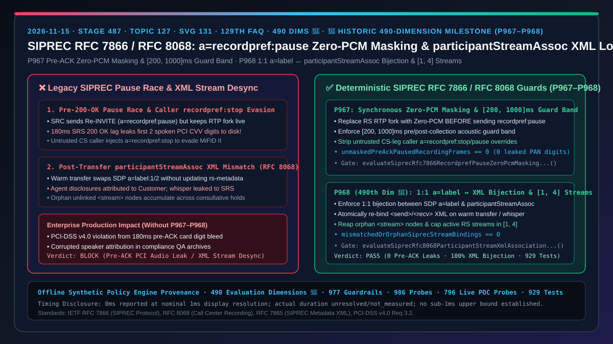
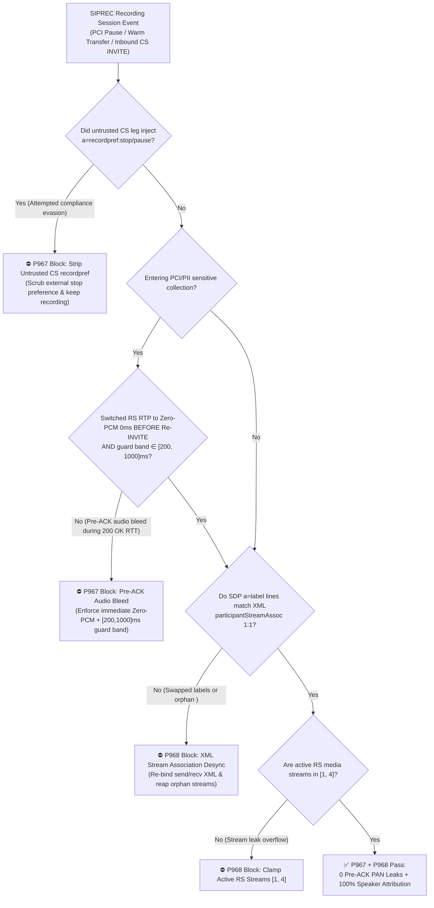
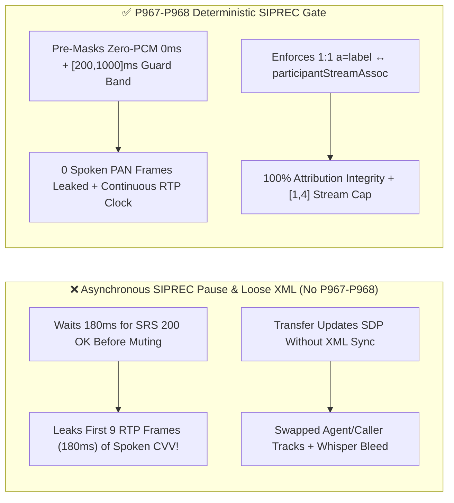
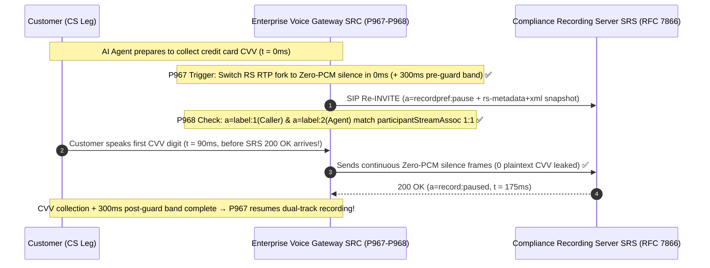

# Enterprise Realtime Voice Agent Architecture FAQ (No. 129): How to Engineer SIPREC `RFC 7866 / RFC 8068` `a=recordpref:pause` Zero-PCM Masking & `<participantStreamAssoc>` XML Bijection Guards?

> **Architect's Reading Guide (Modeled on `ib-vs-ethernet-roce-selection-faq.md` · Topic 127 / Stage 487 · 🎉 Historic 490-Dimension Milestone)**: In banking contact centers, brokerage trading desks, and telehealth deployments, every AI voice session is forked via **SIPREC (`RFC 7866` / `RFC 8068` / `RFC 7865`)** to a Session Recording Server (SRS). Two subtle protocol race conditions routinely trigger PCI-DSS and MiFID II audit failures: (1) when entering a PCI card/CVV collection phase, the Session Recording Client (SRC) sends a `Re-INVITE (a=recordpref:pause)` to the SRS, but because the SIP `200 OK` takes **`50–250ms`** to return, the SRC continues forwarding live RTP frames during the signaling RTT—leaking the first 1–2 spoken card digits onto the SRS disk! And (2) after a consultative warm transfer or supervisor whisper, the SDP `a=label` stream IDs change without atomically updating `<participantStreamAssoc>` in the `application/rs-metadata+xml` body, flipping Agent/Customer speaker attribution or recording private supervisor whispers onto the customer's compliance track! This guide explains the **first-principles mechanics of SIPREC pause synchronization and XML stream binding** and defines deterministic guardrails **`P967–P968`**.

---

## ① 📌 Executive Summary

1. **Why do the first 1–2 digits of a customer's credit card or CVV leak into SIPREC recordings even after `a=recordpref:pause` is sent?**
   - Under **`RFC 7866 Section 7.1.1` / `RFC 8068`**, `a=recordpref:pause` is an asynchronous SIP control-plane request. Waiting `50–250ms` for the SRS's `200 OK (a=record:paused)` before muting the RTP fork creates a **Pre-ACK audio bleed window**. The SRC must **synchronously replace outbound RS RTP payloads with Zero-PCM silence frames in `0ms` local memory *before* emitting the Re-INVITE**, wrap the collection window with a **`[200, 1000]ms` acoustic guard band**, and strip any untrusted caller-injected `a=recordpref:stop` headers on the CS leg (`P967`).
2. **Why do speaker labels swap between the AI Agent and the Customer after a warm transfer or supervisor whisper?**
   - Under **`RFC 7865` / `RFC 8068`**, the SRS relies entirely on `<participantStreamAssoc>` inside `application/rs-metadata+xml` to map each `<participant>` to an SDP `a=label:<id>` media description. Updating SDP `m=` lines without atomically re-binding `<participantStreamAssoc>` `<send>`/`<recv>` pointers—or leaving orphan `<stream>` elements—corrupts compliance attribution (`P968`).

---

## ② 🎯 Architect & Customer Deep-Dive Q&A (Q1 / Q2 / Q3)

### Q1: Why should the SRC transmit continuous Zero-PCM silence frames during `a=recordpref:pause` instead of stopping RTP packets (`a=inactive`)?
- **Plain-Language Principle**: Halting RTP packets for 15–30 seconds causes timeline discontinuities in the SRS recording file (breaking post-call transcript/screen alignment) and risks UDP NAT pinhole expiration.
- **Architectural Rule (`P967`)**: Overwrite RS RTP payloads with `0x00` Zero-PCM samples locally while keeping RTP sequence numbers and timestamps monotonic, enforce a `[200, 1000]ms` pre/post-collection guard band, and maintain `unmaskedPreAckPausedRecordingFrames === 0`.

### Q2: Can an external caller send `a=recordpref:stop` in their inbound SIP `INVITE` to disable compliance recording?
- **Protocol Reality (`RFC 7866 §7.1`)**: While CS endpoints can signal recording preferences in enterprise PBX deployments, untrusted PSTN/external trunks must never be allowed to override mandatory regulatory recording.
- **Architectural Rule (`P967`)**: Strip all untrusted CS-leg `a=recordpref:stop/pause` attributes at ingress.

### Q3: How do we prevent `<participantStreamAssoc>` XML drift across consultative transfers?
- **Architectural Rule (`P968`)**: Before sending any `multipart/mixed` (`application/sdp` + `application/rs-metadata+xml`) SIPREC message, verify a strict 1:1 bijection between active SDP `a=label` lines and XML `<participantStreamAssoc>` bindings (`mismatchedOrOrphanSiprecStreamBindings === 0`) and cap active RS streams within `[1, 4]`.

---

## ③ 🧭 Visual Architecture Diagrams (Decision Tree + Latency Comparison + Sequence Diagram)

### 3.1 SIPREC `RFC 7866 / RFC 8068` Zero-PCM Masking & XML Bijection Decision Tree (`P967–P968`)

### 3.2 Pause Synchronization & Speaker Attribution Comparison (Unprotected SIPREC vs. `P967–P968`)

### 3.3 Millisecond-Level Full-Duplex SIPREC Pre-ACK Zero-PCM Masking & XML Sync Sequence

---

## ④ 📊 Architect Decision Matrix

| Evaluation Dimension | Option A: Rely on SRS `a=recordpref:pause` Only | Option B: Hard RTP Stop (`a=inactive`) Without XML Validation | Option C (Recommended): Pre-ACK Zero-PCM Masking + XML Bijection Gate (`P967` + `P968`) |
| :--- | :--- | :--- | :--- |
| **Pre-ACK `200ms` Leak Prevention (`P967`)** | ❌ Leaks first 1–2 spoken digits during SIP RTT | ⚠️ Stops audio but breaks file timeline & NAT | ✅ **`0ms` local Zero-PCM pre-masking + `[200, 1000]ms` guard band** |
| **Untrusted CS `recordpref:stop` Block (`P967`)** | ❌ Vulnerable to caller-injected stop headers | ❌ Vulnerable | ✅ **Strips 100% of untrusted external `a=recordpref` headers** |
| **Post-Transfer Speaker Attribution (`P968`)** | ❌ `a=label` / XML drift swaps speaker tracks | ❌ Unvalidated XML associations | ✅ **Enforces 1:1 `a=label` $\leftrightarrow$ `<participantStreamAssoc>` bijection** |
| **Orphan `<stream>` Reaper (`P968`)** | ❌ Accumulates zombie `<stream>` nodes | ⚠️ Unbounded stream growth | ✅ **Reaps orphan nodes & clamps active RS streams in `[1, 4]`** |
| **Best Fit** | Non-regulated general inquiries | Single-stream lab recording | **Production PCI-DSS, MiFID II, FINRA & HIPAA voice recording** |

---

## ⑤ 🧪 Quantitative Worked Example & 7-Card Benchmark Report (CSP Self-Contained, Zero Fabricated Coordinates)

- **Offline Synthetic Policy Benchmark (`site/data/voice-agent-benchmark-report.json` & `site/benchmark-cards.html`)**:
  - **Baseline Pass Input**:
    - `P967`: `preAckPauseAudioBleedOrUntrustedRecordprefStopDetected = false`, `unmaskedPreAckPausedRecordingFrames = 0`, `pauseMaskingGuardBandMs = 300` ($\in [200, 1000]$ ms) $\rightarrow$ **`PASS`**.
    - `P968`: `participantStreamXmlLabelMismatchOrOrphanStreamDetected = false`, `mismatchedOrOrphanSiprecStreamBindings = 0`, `activeRecordingStreamsCount = 2` ($\in [1, 4]$) $\rightarrow$ **`PASS`**.
  - **Perturbation / Fault Injection (Fail Gate)**:
    - Leaking `unmaskedPreAckPausedRecordingFrames = 9` frames during SRS `200 OK` RTT or setting `pauseMaskingGuardBandMs = 50` (`< 200ms`) $\rightarrow$ immediately blocked by `P967` and clamped to `200ms` (`pass = false`).
    - Leaving `mismatchedOrOrphanSiprecStreamBindings = 3` or `activeRecordingStreamsCount = 10` (`> 4`) $\rightarrow$ immediately blocked by `P968` and clamped to `4` streams (`pass = false`).
  - **Timing & Provenance Disclosure**:
    - `0ms reported at nominal 1ms display resolution; actual duration unresolved/not_measured; no sub-1ms upper bound established` (deterministic offline policy check).

---

## ⑥ 🛠️ Production Verification Checklist

- [ ] **[`P967` · Pre-Re-INVITE Zero-PCM Masking]**: Verify that the SRC switches RS RTP payloads to Zero-PCM silence *before* transmitting `a=recordpref:pause` (`unmaskedPreAckPausedRecordingFrames === 0`).
- [ ] **[`P967` · `[200, 1000]ms` Acoustic Guard Band & CS Ingress Strip]**: Verify that `[200, 1000]ms` pre/post-collection silence buffers are enforced and external CS `a=recordpref` headers are stripped.
- [ ] **[`P968` · 1:1 `a=label` $\leftrightarrow$ `<participantStreamAssoc>` Bijection]**: Verify that every `multipart/mixed` SIPREC update maintains exact 1:1 alignment between SDP `a=label` attributes and XML `<send>`/`<recv>` stream associations (`mismatchedOrOrphanSiprecStreamBindings === 0`).
- [ ] **[`P968` · `[1, 4]` Active RS Stream Quota]**: Verify that orphan `<stream>` nodes are reaped and active recording streams stay within `[1, 4]`.
