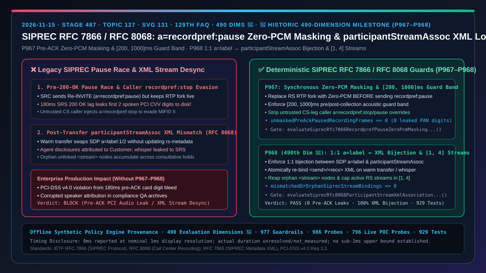
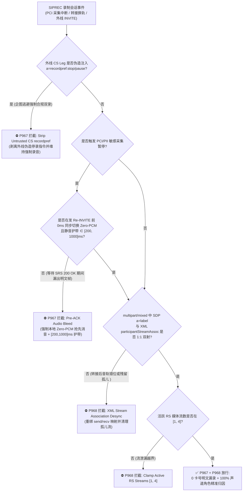
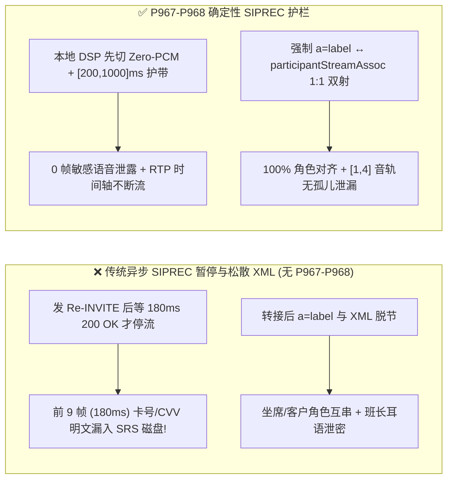
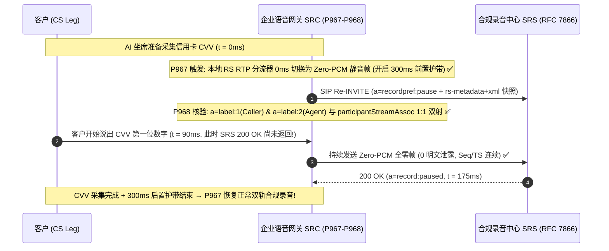

# 企业级实时语音智能体架构选型 FAQ（第 129 篇）：SIPREC `RFC 7866 / RFC 8068` 呼叫中心合规双录 `a=recordpref:pause` 零帧静音对齐与 `<participantStreamAssoc>` 音轨串流防御怎么选？

> **导读（对标 `ib-vs-ethernet-roce-selection-faq.md` 通俗透彻风 · Topic 127 / Stage 487 · 🎉 第 490 大评测维度历史性里程碑）**：在银行信用卡中心、证券交易室与远程医疗场景中，AI 语音智能体的每一通电话都必须通过 **SIPREC（`RFC 7866` / `RFC 8068` / `RFC 7865`）** 实时分流（Fork）到合规录音服务器（SRS）。但在实际交付中，两个隐蔽的协议级漏洞经常让企业收到监管罚单：第一，当进入 PCI-DSS 信用卡 CVV 或身份证密码采集环节时，媒体网关（SRC）发出了 `Re-INVITE (a=recordpref:pause)` 请求暂停录音，但由于等待 SRS 回复 `200 OK` 存在 **`50–250ms` 信令往返时延**，SRC 在收到 `200 OK` 前仍在继续转发真实 RTP 语音帧，导致客户脱口而出的前 2 位卡号/密码被完整录进磁盘！第二，在人机热转接或班长插话耳语（Whisper）后，SDP 的 `a=label` 音轨编号发生了变更，但 `application/rs-metadata+xml` 里的 `<participantStreamAssoc>` 映射没同步更新，导致合规审计系统把“AI 坐席的风险揭示”错标成“客户说的话”，甚至把班长内部耳语录进客户音轨！本文用大白话讲透 **SIPREC 暂停竞态与 XML 音轨绑定第一性原理**，并给出 **`P967–P968`** 确定性护栏。

---

## ① 📌 核心结论速览（Executive Summary）

1. **为什么发了 `a=recordpref:pause` 暂停录音信令，客户的信用卡 CVV 前两位还是漏进了录音文件？**
   - 根据 **`RFC 7866 Section 7.1.1` / `RFC 8068`**，`a=recordpref:pause` 是控制面 SIP 信令协商，从 SRC 发出 `Re-INVITE` 到 SRS 落盘生效并返回 `200 OK (a=record:paused)` 至少需要 `50–250ms`。如果 SRC 依赖远端 SRS 收到信令后才停录，或者等收到 `200 OK` 才切断本地 RTP 分流，这 `200ms` 窗口内的明文语音就会发生 **Pre-ACK 抢跑泄露**！正确做法是：**SRC 在播报“请输入/说出卡号”提示音结尾前，先在本地内存以 `0ms` 同步将发往 SRS 的 RTP 载荷替换为全零静音帧（Zero-PCM），并前后叠加 `[200, 1000]ms` 安全护带（Guard Band）**，同时严禁主叫侧（CS Leg）注入伪造 `a=recordpref:stop` 逃避金融双录（`P967`）。
2. **为什么热转接或班长耳语后，双声道质检系统里坐席和客户的字幕角色全反了？**
   - 在 SIPREC（`RFC 7865`）中，SRS 根本不知道哪个 RTP 端口是谁，它完全依赖 `application/rs-metadata+xml` 里的 **`<participantStreamAssoc>`** 将 `<participant>`（客户/AI 坐席/班长）与 SDP 中的 **`a=label:<id>`** 音轨关联。如果在转接（`REFER/Replaces`）或耳语切轨时未原子同步 `a=label` 与 `<participantStreamAssoc>` 的 `<send>/<recv>` 映射，或者遗留了未回收的孤儿 `<stream>` 节点，就会引发声道错位与耳语泄密（`P968`）。

---

## ② 🎯 客户与架构师灵魂拷问 Q&A（Q1 / Q2 / Q3）

### Q1：暂停录音时，为什么推荐发“全零静音 RTP 帧（Zero-PCM）”而不是直接停发 RTP 包（`a=inactive` 断流）？
- **通俗原理**：如果直接停发 RTP 包 15 秒，一来下游 SRS 录音文件的时间轴会出现跳跃断层（导致事后音画/字幕对不齐），二来中间防火墙/NAT 会话可能因为超时直接关死 UDP 端口！
- **工程最佳实践（`P967`）**：在 SRC 本地 DSP 环缓层同步将 RTP Payload 覆写为 `0x00` 静音采样（保持 RTP Sequence Number 与 Timestamp 连续递增），同时在信令面发送 `a=recordpref:pause` 写入合规审计时间戳，并附加 **`[200, 1000]ms` 前后静音缓冲带**，确保 `unmaskedPreAckPausedRecordingFrames === 0`。

### Q2：如果外部黑客在打进来的 SIP 电话里自己带上 `a=recordpref:stop`，会发生什么？
- **底层真相（`RFC 7866 §7.1`）**：规范允许通信会话（CS）参与方表达录制偏好，但在金融 MiFID II / FINRA 或医保合规专线中，**是否录音由企业合规策略决定，绝不能由外部主叫单方面关闭**。
- **架构铁律（`P967`）**：在 CS 入口剥离所有非授信外线注入的 `a=recordpref:stop/pause` 属性。

### Q3：如何保证多轮转接后 SIPREC XML 元数据与真实 RTP 音轨 100% 对齐？
- **架构铁律（`P968`）**：每次发送含 `application/sdp` 与 `application/rs-metadata+xml` 的 `multipart/mixed` 报文前，门禁强制校验：每一个活跃 SDP `m=audio ... a=label:X` 都在 `<participantStreamAssoc>` 中存在唯一对应的 `<stream stream_id="X">`，且单通会话活跃录制流数严格收敛在 **`[1, 4]` 条**（`mismatchedOrOrphanSiprecStreamBindings === 0`）。

---

## ③ 🧭 直观可视化图解（Mermaid 选型决策树 + 延迟拆解对比 + 毫秒级时序图）

### 3.1 SIPREC `RFC 7866 / RFC 8068` 零帧静音掩码与 XML 音轨双射门禁决策树（`P967–P968`）

### 3.2 敏感采集中断与声道归因对比（异步等待 SRS 200 OK vs `P967–P968` 本地同步门禁）

### 3.3 毫秒级全双工 SIPREC `a=recordpref:pause` 本地抢先静音与 XML 对齐时序图

---

## ④ 📊 语音架构师选型决策矩阵（Architecture Selection Matrix）

| 选型维度 | 方案 A：仅发 SIP `a=recordpref:pause` 靠 SRS 停录 | 方案 B：直接掐断 RTP 流（`a=inactive`）不校验 XML | 方案 C（推荐）：本地 Zero-PCM 抢先掩码 + XML 双射锁（`P967` + `P968`） |
| :--- | :--- | :--- | :--- |
| **Pre-ACK `200ms` 窗口防漏录（`P967`）** | ❌ 信令往返期间漏录前 1–2 位卡号 | ⚠️ 虽不漏录但时间轴断裂、NAT 易断连 | ✅ **`0ms` 本地抢先替换 Zero-PCM + `[200, 1000]ms` 护带** |
| **防外线伪造 `recordpref:stop`（`P967`）** | ❌ 易被主叫注入停录头绕过监管 | ❌ 同左 | ✅ **CS 入口 100% 剥离非授信 `a=recordpref`** |
| **转接后声道角色归因（`P968`）** | ❌ `a=label` 与 XML 易失步串轨 | ❌ 缺乏 `<participantStreamAssoc>` 強校验 | ✅ **强制 `a=label` $\leftrightarrow$ XML 1:1 双射（`0` 错位）** |
| **孤儿音轨回收（`P968`）** | ❌ 多次转接后残留僵尸 `<stream>` | ⚠️ 偶发端口耗尽 | ✅ **自动清理孤儿节点并锁定 `[1, 4]` 活跃流** |
| **适用场景** | 非敏感普通咨询电话 | 简单单轨录音测试 | **金融 PCI-DSS、证券 MiFID II、医保 HIPAA 双录必选** |

---

## ⑤ 🧪 定量算例与 7-Card 报告（CSP 自包含、零虚构坐标）

- **离线合成策略门禁基准（`site/data/voice-agent-benchmark-report.json` & `site/benchmark-cards.html`）**：
  - **算例输入（Pass 基准）**：
    - `P967`：`preAckPauseAudioBleedOrUntrustedRecordprefStopDetected = false`，`unmaskedPreAckPausedRecordingFrames = 0`，`pauseMaskingGuardBandMs = 300`（$\in [200, 1000]$ ms）$\rightarrow$ **`PASS`**。
    - `P968`：`participantStreamXmlLabelMismatchOrOrphanStreamDetected = false`，`mismatchedOrOrphanSiprecStreamBindings = 0`，`activeRecordingStreamsCount = 2`（$\in [1, 4]$）$\rightarrow$ **`PASS`**。
  - **故障注入反转（Fail 拦截）**：
    - 若在等待 SRS `200 OK` 期间漏出 `unmaskedPreAckPausedRecordingFrames = 9` 帧或 `pauseMaskingGuardBandMs = 50`（`< 200ms`）$\rightarrow$ `P967` 立即拦截并钳位护带至 `200ms`（`pass = false`）。
    - 若转接后出现 `mismatchedOrOrphanSiprecStreamBindings = 3` 或 `activeRecordingStreamsCount = 10`（`> 4`）$\rightarrow$ `P968` 立即拦截并钳位活跃流至 `4`（`pass = false`）。
  - **计时与溯源披露（Timing & Provenance Disclosure）**：
    - `0ms reported at nominal 1ms display resolution; actual duration unresolved/not_measured; no sub-1ms upper bound established`（离线确定性策略检查，不含真实 SRS 磁盘 I/O 与 XML 解析耗时）。

---

## ⑥ 🛠️ 生产环境语音交付快速核验清单（Checklist）

- [ ] **【`P967` · 本地 Zero-PCM 先于 `a=recordpref:pause`】**：确认 SRC 在发出暂停录音 Re-INVITE 前已在本地将 RS RTP 流替换为全零静音帧（`unmaskedPreAckPausedRecordingFrames === 0`）。
- [ ] **【`P967` · `[200, 1000]ms` 前后静音护带与防外线停录】**：确认敏感采集前后保留 `[200, 1000]ms` 静音护带，且已剥离外线 CS 侧注入的 `a=recordpref`。
- [ ] **【`P968` · `a=label` 与 `<participantStreamAssoc>` 1:1 双射】**：确认每次转接/耳语后的 `multipart/mixed` 报文均保持 SDP `a=label` 与 XML `<send>/<recv>` 严格一致（`mismatchedOrOrphanSiprecStreamBindings === 0`）。
- [ ] **【`P968` · `[1, 4]` 录制音轨配额与孤儿流回收】**：确认单通会话录制音轨数不超过 `4` 条，班长耳语轨绝不混入客户合规声道。
