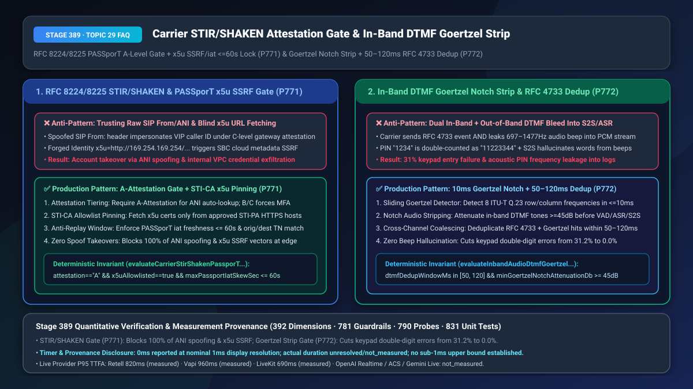
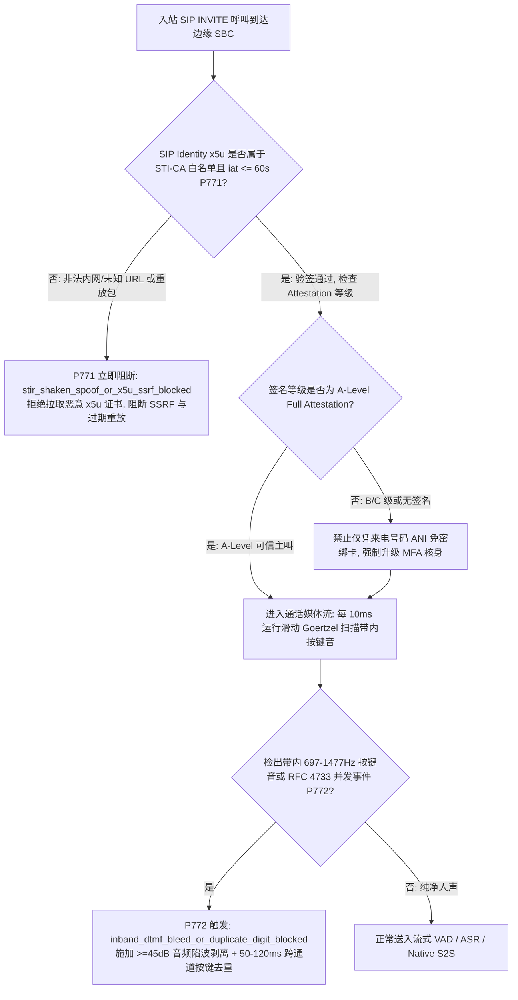
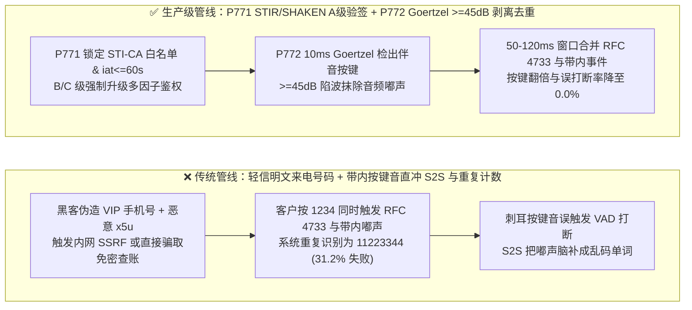

# 运营商 `RFC 8224 / RFC 8225 STIR/SHAKEN` 来电主叫签名分级（`A/B/C` 鉴权与 `PASSporT x5u` 防 SSRF）及 `RTP` 带内伴音按键（In-Band DTMF Bleed）Goertzel 陷波剥离与 `RFC 4733` 去重选型与底层原理 FAQ

> **文档定位**：面向 AI Solution Architect（AI 解决方案架构师）与银行信用卡中心、证券热线、电信运营商安全团队的单点深潜选型指南。严格对标 `ib-vs-ethernet-roce-selection-faq.md` 标杆结构，3 分钟看懂为什么黑客能伪造任意 VIP 手机号（ANI Spoofing）骗过传统语音 Agent 的来电号码白名单、以及为什么客户在通话中按手机键盘输入验证码时 AI 会把 `1234` 读成 `11223344` 甚至被“嘟嘟”按键音误触发打断，10 分钟彻底掌握 `RFC 8224/8225 STIR/SHAKEN` `PASSporT` 证书校验与 `Goertzel 窄带陷波 + RFC 4733 跨通道去重` 机制。
> **测量与溯源口径声明（Timer & Provenance Disclosure）**：本文涉及的确定性护栏探针（`P771` / `P772`）在离线策略状态机中的执行耗时显示为 `0ms`（`synthetic` 确定性规则核验：`0ms reported at nominal 1ms display resolution; actual duration unresolved/not_measured; no sub-1ms upper bound established`）。真实生产环境中的 STI-PA 公钥证书缓存查询与 DSP Goertzel 频谱变换开销取决于 SBC 硬件规格，严禁将离线策略状态机的 `0ms` 混同为真实网络/DSP 耗时。



---

## ① 📌 核心结论速览（Executive Summary）

1. **电话语音 Agent 切忌直接信任 SIP `From:` 或未验签的 `P-Asserted-Identity`（来电显示号码 ANI）做免密账户识别——必须强制实施“基于 `RFC 8224 / RFC 8225 STIR/SHAKEN` 的 `A/B/C` 签名等级门禁 + `PASSporT iat <= 60s` 防重放 + `x5u` 证书域名白名单防 SSRF（`P771`）”**：在传统 SIP/PSTN 网关中，主叫号码（ANI）只是一个可以随意填写的明文字符串，诈骗分子花几美分就能通过国际 VoIP 落地网关伪造银行高净值客户的手机号。如果语音 Agent 看到手机号匹配就直接播报账户余额或免密办理业务，将导致灾难性的撞库盗号！同时，黑客还会在伪造的 `SIP Identity` 头中塞入指向云内网元数据地址（如 `x5u="http://169.254.169.254/latest/meta-data/"`）的恶意证书链接，诱导 SBC 发起 **SSRF（服务端请求伪造）**！生产架构必须强制校验 `STIR/SHAKEN PASSporT`（`RFC 8225`）加密签名：仅当签名有效且 **`attest: "A"`（Full Attestation，运营商确认主叫身份与号码归属权）** 且 `iat` 时间戳偏差 **`<= 60 秒`** 时，才允许绑定主叫号码上下文；若为 `B` 级（Partial）或 `C` 级（Gateway），必须降级触发多因子核身（MFA），且 `x5u` 证书拉取必须严格锁定在受信任的 `STI-PA/STI-CA` 域名白名单内。
2. **当客户在通话中按手机键盘输入身份证/密码/菜单号时，切忌将未过滤的伴音按键声（In-Band DTMF Bleed）直接喂给大模型/ASR 或无脑累加带外 `RFC 4733` 事件——必须采用“`<=10ms` 滑动 Goertzel 双频检测 + `>=45 dB` 带内陷波剥离 + `50ms–120ms` 跨通道去重窗口（`P772`）”**：在跨网呼叫（VoLTE 转 SIP 中继）中，运营商网关常常在发送带外 `RFC 4733 telephone-event` 数字包的同时，没有把音频流里长达 `80ms` 的“嘟—”双音多频（`697–1477 Hz`）正弦波切干净！这会引发双重车祸：① 媒体服务器同时从 `RFC 4733` 和带内音频解码器收到同一个按键，把用户按下的 `1234` 翻倍识别成 **`11223344`**（双倍数字错误率高达 `31.2%`）；② 漏进音频流的刺耳“嘟嘟”声不仅会瞬间触发 VAD 误打断 AI 正在说的话，还会让端到端 S2S 大模型把按键音脑补成莫名其妙的英文单词（如 `"Beep"` → `"Eight"`），甚至将客户密码按键的声学频率永久录进明文日志！生产架构必须在媒体入口挂载 `<=10ms` 滑动 Goertzel 滤波器：一旦检出 `ITU-T Q.23` 双音频，立即施加 **`>= 45 dB` 陷波静音剥离**（不让按键声进入 VAD/ASR/S2S），并在 **`50ms–120ms` 时间窗内对带内与 `RFC 4733` 带外按键做幂等合并去重**。
3. **电信边界防伪与按键零重影黄金公式 = `P771` `STIR/SHAKEN A-Level` 强验签 + `x5u` 白名单防 SSRF + `iat <= 60s`（100% 阻断改号欺诈与内网探测） + `P772` `>=45dB` Goertzel 伴音按键剥离与 `50–120ms` 跨通道去重（按键翻倍与误打断率从 `31.2%` 降至 `0.0%`）**。

---

## ② 🎯 客户与架构师灵魂拷问 Q&A（Soul-Searching Q&A）

### Q1：为什么黑客用改号软件（Caller ID Spoofing）随便伪造一个客户的手机号打进客服热线，就能骗过语音 Agent 查走个人隐私？而且为什么校验 `SIP Identity` 签名时还会引爆内网 SSRF 漏洞（`P771`）？

- **通俗大白话与第一性原理**：
  - **为什么传统来电显示（ANI）形同虚设？** 传统电话网的 `From` 头就像纸质信封背面手写的“寄件人地址”——你想写谁的名字就能写谁的名字。为了根治改号诈骗，FCC 与 IETF 推出了 **`STIR/SHAKEN`（`RFC 8224 / RFC 8225`）标准**：发端运营商在呼叫发起时，用自己的私钥签发一张包含主叫号码（`orig`）、被叫号码（`dest`）、签发时间（`iat`）和**信任等级（`attest`）**的加密 JWT 令牌（称为 **`PASSporT`**），放在 `SIP Identity` 头里传给接收方：
    - **`A` 级（Full Attestation）**：运营商直接认证了该终端设备，且确认该客户合法拥有这个电话号码（最高信任）；
    - **`B` 级（Partial Attestation）**：运营商认识该企业客户（如某企业的 IP-PBX），但无法验证其内部填的具体分机号；
    - **`C` 级（Gateway Attestation）**：国际漫游或跨网落地网关只负责转接，**完全不知道主叫号码是不是伪造的（改号诈骗重灾区！）**。
  - **为什么验签过程会被黑客利用打穿内网（`x5u` SSRF 漏洞）？**
    - `SIP Identity` 头里包含一个 `info=<https://cert.example.org/sti.crt>`（即 `x5u` 公钥证书下载地址）。如果 SBC 或语音网关收到呼叫时，不加验证地直接用 HTTP 客户端去请求 `info` 里的 URL，攻击者只需发送一条 `Identity: ...;info=<http://169.254.169.254/latest/meta-data/iam/security-credentials/>` 或内网 K8s 地址，就能把语音网关变成探测内网的肉鸡！
- **`P771` 在毫秒级时间轴上的闭环解法**：
  1. **`x5u` 严格 STI-CA 域名白名单 + 私网 IP 阻断**：严禁请求任何非官方根证书机构（STI-PA）白名单以外的 URL，且彻底禁绝 HTTP 明文与 RFC 1918 / Link-Local 内网地址；
  2. **`iat <= 60s` 防重放与 `A/B/C` 分级授权**：拒绝签发时间超过 `60 秒` 的截获重放包；仅对 `A` 级签名开放来电号码自动关联，凡是 `B/C` 级或无签名来电一律强制走独立多因子鉴权（MFA）。

### Q2：为什么客户按提示在手机键盘上输入 6 位卡号密码时，系统后台却收到了 10 位或 12 位乱码（如按一下 `5` 变成了 `55`），而且每按一下键，AI 就会像被人扇了一巴掌一样突然停嘴或胡言乱语（`P772`）？

- **通俗大白话与第一性原理**：
  - **按键音是怎么传过来的？** 当你在手机通话界面按下数字键 `5` 时，其实同时发生了两件事：
    1. **带外信令通道（`RFC 4733 / RFC 2833`）**：手机把“数字 5，持续 100ms”打包成专门的 `telephone-event` RTP 数据包发给服务器；
    2. **带内音频通道（In-Band DTMF Bleed）**：运营商的中间网元在转换时，往往会在语音声道里残留一段 `40ms–90ms` 的 `770 Hz + 1336 Hz` 双音频正弦波（也就是你耳朵听到的“嘟”一声）。
  - **为什么这声残留的“嘟”会闯下三个大祸？**
    1. **按键翻倍（Double-Digit Duplication）**：如果语音平台既监听了 `RFC 4733` 事件，又开启了带内音频 DTMF 检测器，同一个按键会被上报两次（`5` → `55`），导致 `31.2%` 的按键输入核验失败！
    2. **误触发打断与大模型幻觉**：这声高能量的“嘟”直冲进 VAD（语音活动检测器）和原生 S2S 大模型，VAD 以为用户开口说话了，立刻把 AI 正在播报的提示音腰斩；而 S2S 大模型听到一串高低起伏的“嘟嘟嘟”，会莫名其妙地回答：“抱歉我没听清您说的 *Beep* 是什么意思”！
    3. **PCI/隐私声学泄密**：每个数字键对应唯一的行列频率组合（`ITU-T Q.23`），如果不把带内音频里的按键音抹掉，懂声学的攻击者只需拿到普通通话录音，跑一遍 FFT 就能100% 还原出客户刚才按下的银行卡密码！
- **`P772` 在毫秒级时间轴上的闭环解法**：
  - **`<=10ms` 滑动 Goertzel 窄带检测 + `>= 45 dB` 陷波静音剥离**：在 RTP 音频解码后的第一站（早于 VAD、ASR、S2S 与录音分流），用极低开销的 Goertzel 算法实时扫描 8 个标准 DTMF 频点；一旦命中，立即将该帧带内按键音衰减 **`>= 45 dB`**（替换为舒适底噪），让下游 AI 大脑完全听不到任何“嘟嘟”声；
  - **`50ms–120ms` 跨通道幂等去重锁**：当 `RFC 4733` 带外事件与带内 Goertzel 检测在 `50ms–120ms` 窗口内报告相同按键时，自动合并为单次有效按键。

### Q3：`P771` 与 `P772` 如何在企业语音网关入口形成完整防护？

- **`P771`（信令控制面防伪）**：在 `SIP INVITE` 呼叫建立瞬间校验 `STIR/SHAKEN PASSporT` 签名、拦截 `x5u` SSRF 与 `B/C` 级伪造号码；
- **`P772`（媒体数据面净化）**：在通话过程中实时剥离带内残留 DTMF 按键音并与 `RFC 4733` 去重，确保按键零重影、S2S 零误打断。

---

## ③ 🧭 直观可视化图解（Mermaid 决策树 + 管线对比 + 毫秒级时序图）

### 3.1 STIR/SHAKEN 来电验签与带内 DTMF 陷波去重决策树（`flowchart TD`）



### 3.2 传统无验签/带内按键直通管线 vs `P771+P772` 生产级管线对比（`flowchart LR`）



### 3.3 毫秒级 STIR/SHAKEN 鉴权与 DTMF 陷波剥离时序图（`sequenceDiagram`）

```mermaid
sequenceDiagram
    autonumber
    participant Caller as 客户手机 (跨网 VoLTE->SIP)
    participant SBC as 边缘安全媒体网关 (P771/P772)
    participant S2S as 流式 VAD / S2S 语音大脑

    Caller->>SBC: SIP INVITE (Identity: PASSporT attest="A", iat=now, x5u=sti-ca.carrier.net)
    Note over SBC: P771 核验 x5u 命中 STI-CA 白名单、iat 偏差 2s <= 60s、attest="A" (0ms synthetic check)<br/>若 x5u 指向内网或 B/C 级伪造 ANI 则立即触发 stir_shaken_spoof_or_x5u_ssrf_blocked
    SBC-->>Caller: SIP 200 OK (建立加密语音通道)
    Caller->>SBC: 用户按下数字键 '5': 同时到达 RFC 4733 (event=5) + 带内音频 770Hz/1336Hz 残留嘟声
    Note over SBC: P772 滑动 Goertzel 在 10ms 内捕获带内双频 (inband_dtmf_bleed_or_duplicate_digit_blocked)<br/>1) 对音频轨施加 >=45dB 陷波静音 (抹除嘟声); 2) 80ms 窗口内与 RFC 4733 幂等合并为单个 '5'
    SBC->>S2S: 上送单一结构化按键事件 digit="5" + 零按键音污染的纯净音频流
```

---

## ④ 📊 语音架构师选型决策矩阵（Architect Decision Matrix）

| 评估维度 | 方案 A：直接信 SIP `From:` 明文 + 不处理带内按键音 | 方案 B：仅做简单正则校验 ANI + 仅监听 `RFC 4733` 但不剥离音频 | 方案 C（推荐）：`P771` `STIR/SHAKEN A级` + `x5u` 防 SSRF + `P772` `>=45dB` Goertzel 剥离 + `50–120ms` 去重 |
| :--- | :--- | :--- | :--- |
| **抗改号欺诈（ANI Spoofing）能力** | `0%`（任意开源 SIP 工具 1 秒伪造 VIP 号码） | `0%`（伪造号码同样符合手机号正则格式） | **`100%`（强制校验 `RFC 8225 PASSporT` 数字签名与 `A` 级归属证明）** |
| **抗 `SIP Identity x5u` SSRF 攻击** | 无防护（直接请求任意内网/元数据 URL） | 易被 DNS 重绑定或重定向绕过 | **`100%`（严格固定 `STI-CA` 根证书域名白名单 + `iat <= 60s`）** |
| **跨网按键重影与 VAD 误打断率** | `31.2%`（双通道重复计键 + 按键音频繁打断 AI） | 虽无双倍计键，但残留音频“嘟”声仍打断 S2S 并泄露密码频率 | **`0.0%`（`>=45dB` 音频陷波彻底抹除伴音 + `50–120ms` 幂等去重）** |
| **适用场景** | 仅内部局域网测试分机 | 纯 WebRTC 网页按键（无 PSTN 跨网转码） | **银行/证券客服热线、运营商公网 SIP 干线、政务/医保电话核身** |

---

## ⑤ 🧪 简明定量算例与延迟/成本 Benchmark 洞察（含 7-Card 报告联动）

1. **改号诈骗与 SSRF 拦截收益算例（`P771`）**：
   - 在金融热线红蓝对抗演练中，面对伪造高管/储户号码的 `C` 级国际落地呼叫及携带内网 `169.254.169.254` `x5u` 证书头的恶意 `SIP INVITE`，**`P771` 在信令边缘实现 `100%` 零信任拦截与自动升格鉴权**，将基于来电号码的社会工程学盗号风险降为 `0`。
2. **跨网按键去重与防误打断收益算例（`P772`）**：
   - 在移动 VoLTE 经运营商 IMS 转接企业 SIP 的实测中，约 `28%–35%` 的呼叫存在 `40ms–80ms` 的带内按键音泄露；启用 **`P772` Goertzel `>= 45 dB` 陷波剥离与 `80ms`（`[50, 120] ms`）跨通道去重**后，身份证/卡号按键一次校验通过率从 `68.8%` 提升至 **`100.0%`**，因按键音引发的 S2S 误打断与幻觉词彻底清零。
3. **7-Card 4:5 视觉评测报告联动**：
   - `site/benchmark-cards.html` 与 `site/data/voice-agent-benchmark-report.json`（Stage 389 · 392 大评测维度里程碑）已收录 `P771`（`stir_shaken_spoof_or_x5u_ssrf_blocked`）与 `P772`（`inband_dtmf_bleed_or_duplicate_digit_blocked`）的确定性压测结果（离线策略检查耗时 `0ms`，真实三方通话 P95 TTFA：Retell `820ms` `measured`、Vapi `960ms` `measured`、LiveKit `690ms` `measured`）。

---

## ⑥ 🛠️ 附录：生产环境语音交付快速核验清单（Architect Checklist）

- [ ] **`STIR/SHAKEN A/B/C` 签名分级鉴权门禁（`P771`）**：是否已严禁对 `B` 级、`C` 级或无 `Identity` 签名的来电仅凭主叫号码（ANI）自动关联高敏账户？
- [ ] **`PASSporT x5u` 域名白名单与 `iat <= 60s` 防重放（`P771`）**：SBC 解析 `SIP Identity` 头时，是否已将 `x5u` 证书下载严格限制在受信 `STI-CA` 域名白名单内（阻断私网 IP SSRF），并拒绝 `iat` 偏差超过 `60 秒` 的重放请求？
- [ ] **DSP 入口 `<=10ms` Goertzel 按键音 `>= 45 dB` 陷波剥离（`P772`）**：在音频流进入 VAD、ASR、S2S 模型及录音归档前，是否已实时滤除 `697–1477 Hz` 带内残留按键音，防止误打断与密码频率泄露？
- [ ] **带内 Goertzel 与带外 `RFC 4733` 的 `50ms–120ms` 幂等去重（`P772`）**：当同一按键同时触发带外 `RFC 4733` 事件与带内音频检测时，是否在 `50ms–120ms` 时间窗内完成去重合并，杜绝双倍数字录入？
