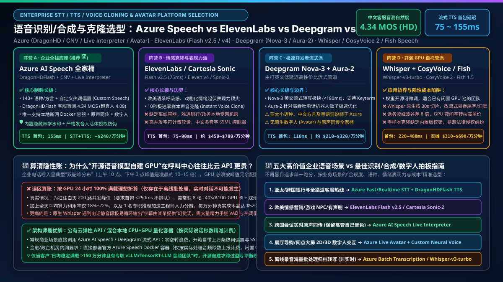
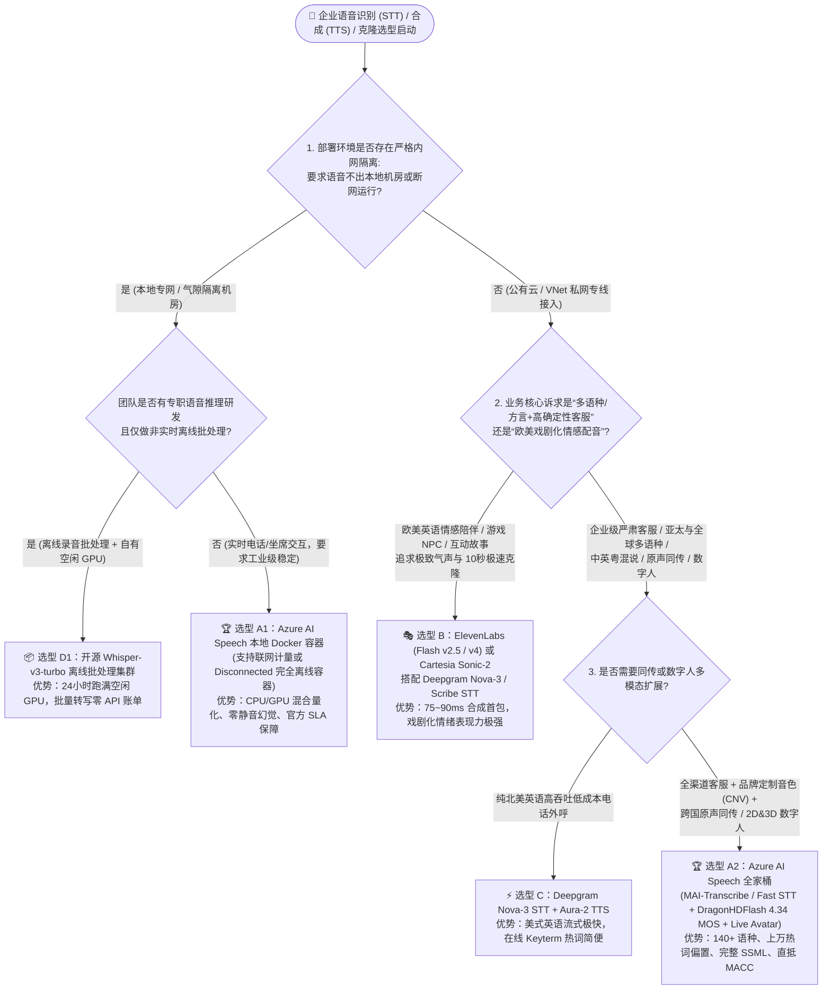
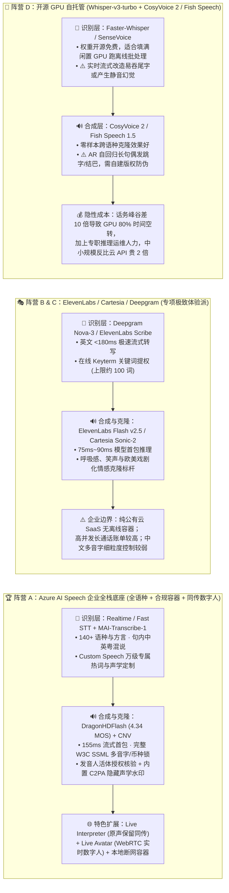
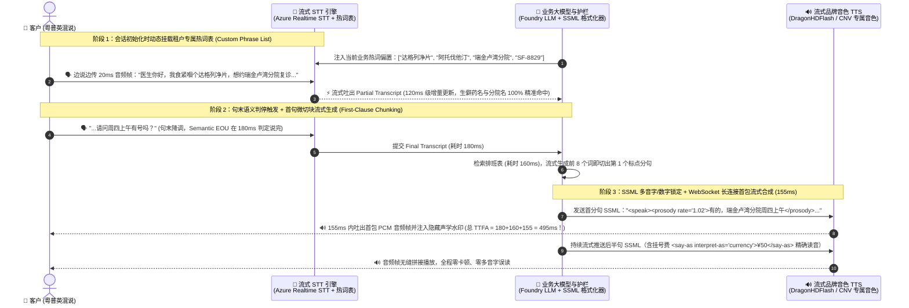

# 企业语音识别（STT）、语音合成（TTS）、品牌音色克隆与数字人平台横向选型 FAQ：Azure AI Speech vs ElevenLabs vs Deepgram vs Cartesia vs 开源 Whisper / CosyVoice / Fish Speech

> 🌐 **Language / 语言**: **中文 (Chinese)** | **[English (`voice-stt-tts-cloning-avatar-azure-elevenlabs-deepgram-opensource-selection-faq.en.md`)](./voice-stt-tts-cloning-avatar-azure-elevenlabs-deepgram-opensource-selection-faq.en.md)**  
> 🔗 **关联专题 (Related Deep Dives)**: [级联 vs 原生 S2S 大脑选型 (`cascaded-vs-s2s-semantic-turn-faq.md`)](./cascaded-vs-s2s-semantic-turn-faq.md) · [实时语音编排框架选型 (`voice-orchestration-framework-livekit-pipecat-acs-retell-vapi-selection-faq.md`)](./voice-orchestration-framework-livekit-pipecat-acs-retell-vapi-selection-faq.md) · [多语种混说与方言合成 (`voice-multilingual-codeswitch-dialect-faq.md`)](./voice-multilingual-codeswitch-dialect-faq.md) · [本地语音容器指南 (`speech-container-guide.md`)](./speech-container-guide.md) · [返回首页 (`README.md`)](../README.md)

---

## 📌 一、核心选型结论速览（Executive Summary）

在所有需要**100% 话术受控、文本级合规脱敏、自定义行业生僻热词或品牌专属代言人音色**的企业级语音智能体（占金融、医疗、政务、零售与航旅客服生产流量的 **70% 以上**）中，**流式语音识别（STT）+ 语音合成（TTS）/ 声音克隆 / 数字人**的选型直接决定了机器人的“耳聪目明程度”与每万分钟运营成本：

1. **何时首选“企业全栈多语种与合规语音底座”（Azure AI Speech 全家桶：`MAI-Transcribe-1` / `Fast & Realtime STT` + `DragonHDFlash` TTS 3.0 + `Custom Neural Voice (CNV)` + `Live Interpreter` + `Live Avatar`）**：
   - **适用场景**：**亚太与全球多语种（140+ 语言及粤语/四川话/台语等方言）呼叫中心、中英粤句内混说客服、需要注入数千条药品/SKU/网点专属热词（Custom Speech）、企业品牌代言人音色定制、跨国高管会议原声同传（Live Interpreter）、展厅/网点 2D/3D 数字人（Live Avatar），以及必须部署在本地机房的金融/政企专网项目**。
   - **核心理由**：微软最新一代 **`DragonHDFlash`（TTS HD 3.0）** 在中文与多语种商务客服盲测中取得 **4.34 MOS**（超越真人坐席录音的 4.08 MOS），流式首包延迟仅 **155ms**；同时它是业内**唯一提供官方本地断网/联网 Docker 容器（Disconnected Containers）**、并在同一个服务内集成**原声保留同传（Live Interpreter）与实时 WebRTC 数字人（Live Avatar）**的云平台，每万分钟 STT+TTS 综合成本仅 **`$210 ~ $260`**（且 100% 抵扣企业 Azure MACC 额度）。
2. **何时首选“极致情感表现力与极速开发者语音平台”（ElevenLabs vs Cartesia Sonic vs Deepgram）**：
   - **选 `ElevenLabs (Flash v2.5 / Eleven v4 + Scribe)` 或 `Cartesia Sonic-2`**：当你的核心场景是 **欧美市场英语/西语情感陪伴、游戏动态 NPC、有声互动故事、或者需要 10 秒音频快速克隆富有戏剧张力的营销音色** 时，ElevenLabs `Flash v2.5`（75ms 模型推理延迟）与 Cartesia `Sonic-2`（基于 SSM 状态空间模型，首包 ~90ms）在呼吸声、叹气与情绪起伏上极具感染力。但需注意其在高并发长通话下的字符/分钟账单较高（每万分钟约 **`$450 ~ $780`**），且缺乏本地私有化离线容器。
   - **选 `Deepgram (Nova-3 STT + Aura-2 TTS)`**：当你的业务是 **纯北美/英语系高吞吐电话机器人（如物流调度、美区门店预约）**，追求 `< 180ms` 的极速英文流式转写、简单的在线关键词提权（Keyterm Prompting）与低廉的英文 API 成本（每万分钟 STT+TTS 约 **`$210 ~ $320`**）时，Deepgram 是非常优秀的轻量级选择。
3. **何时才应该考虑“开源语音模型 GPU 自建”（`Whisper-large-v3-turbo` / `SenseVoice` + `CosyVoice 2` / `Fish Speech 1.5`）**：
   - **适用边界**：**离线批量录音质检归档（非实时电话，可把 GPU 24 小时塞满跑批处理）、高校/科研机构算法实验，或者企业日均稳定实时语音量 `> 150 万分钟` 且拥有专职 C++/TensorRT-LLM 音频推理优化团队**。
   - **架构师防坑警示**：千万不要被“开源免费”四个字误导！在实时客服对话中，由于白天话务洪峰是夜间的 **10～15 倍**，自建 GPU 集群为了保证白天高峰不排队（首包 `< 250ms`），全天平均 GPU 利用率往往不足 **20%**；算上闲置 GPU 租金与运维人力，每万分钟真实摊销成本高达 **`$380 ~ $690`**（反而比直接调 Azure/Deepgram 弹性云 API 更贵！），且原生 Whisper 在电话静音段极易产生“谢谢观看/字幕制作”等致命幻觉。

---

## 🎯 二、客户与架构师灵魂拷问 Q&A（Architect & Customer Deep-Dive Q&A）

### Q1：在构建企业级语音智能体时，Azure AI Speech、ElevenLabs、Deepgram、Cartesia 与开源方案各自的核心长板与适用边界在哪里？

#### 1. 先用大白话讲透：为什么“评测榜跑分第一”不等于“最适合你的企业生产场景”？

很多客户技术团队在选型 STT（耳朵）和 TTS（嘴巴）时，习惯去网上下一段 10 秒钟的新闻联播或英文播客试听，哪个声音最像好莱坞配音演员就选哪个。但一上真实企业电话线就翻车，原因在于企业生产有**四个隐形考场**：

- **考场一：真实电话网的“8kHz 窄带噪音 + 方言口音 + 句内中英混说”**
  - 客户在地铁里、开着免提、带着广东或江浙口音说：“帮我查下昨天买嘅那台 Surface Pro 11 顺丰单号 SF1092 发货没？”
  - **Deepgram Nova-3** 在纯正美式英语上快如闪电，但遇到中国出海企业或亚太跨国业务中的“中英粤句内无缝混说（Code-Switching）”及东南亚英语口音（Singlish / 印式英语）时，词错率（WER）会明显上升；
  - **Azure AI Speech (`Fast/Realtime STT` + `MAI-Transcribe-1`)** 依托覆盖 **140+ 语种与方言** 的工业级声学底座，原生支持句内多语种混说识别，并允许企业通过 **Custom Speech（自定义语音）** 上传几千条内部专有名词（如生僻药名、楼盘名、SKU 编号）构建专属声学/语言偏置模型。
- **考场二：严肃商业场景的“专业得体度、多音字与数字金额零差错（SSML 精细控制）”**
  - **ElevenLabs (`Eleven v4 / Flash v2.5`)** 的优势在于“富有戏剧感的情绪起伏和气声”，非常适合讲故事、播客或情感陪聊；但在银行账单播报、医疗随访或航司改签场景中，过度丰富的气声有时会让客户觉得不够庄重，且当遇到中文复杂多音字（如“银行 `yín háng` vs 行业 `háng yè`”、“重 `chóng` 新复核 vs 重 `zhòng` 量”）或需要精确控制每个工单号字符间的停顿毫秒数时，**Azure `DragonHDFlash` + 完整 W3C SSML 标记语言（`<phoneme>` 音标强制注音、`<say-as>` 币种/日期/字符拼读、`<prosody>` 局部语速控制）** 提供了 100% 确定性的工业级控制力。
- **考场三：跨国同传与数字人多模态的“一站式协同”**
  - 如果企业除了电话客服，还需要做 **跨国视频会议实时同声传译** 或 **线下营业厅/电商直播数字人导购**，用 Deepgram + ElevenLabs + 第三方数字人（如 HeyGen）意味着你要对接 3 家不同供应商的 API、签 3 份合同、处理跨云音画同步；而 **Azure AI Speech** 原生内置了 **`Live Interpreter`（实时翻译并保留说话人自己原本的音色与语调）** 以及 **`Live Avatar`（1080p 2D/3D 实时 WebRTC 数字人，唇音同步误差 `< 40ms`）**。

---

### Q2：客户问：“开源的 Whisper + CosyVoice 2 / Fish Speech 效果也很不错而且免费，我们自己买几张 GPU 卡部署不是更省钱吗？”架构师该如何用数据帮客户算清这笔账？

这是售前架构师被问到频率最高的问题。面对想用开源模型自建的客户，千万不要空谈“云服务好”，而是直接拿出**“实时语音 GPU 波峰波谷经济学”**和**“四大工程隐性坑”**帮客户算清真实 TCO：

#### 1. 算清第一笔账：实时语音的“峰谷闲置税（Peak-to-Trough GPU Idleness Tax）”
- **离线批处理 vs 实时对话的本质区别**：
  - 如果你是把昨天的 10 万条录音文件转成文字做离线质检，你可以把任务塞进消息队列，让 2 张 GPU 卡 24 小时 100% 满负荷运转——这种场景用开源 `Whisper-large-v3-turbo` 或 `Azure Batch Transcription` 确实极其便宜。
  - **但实时语音客服是“人等机器，零排队容忍”**！企业呼叫中心的话务量呈现极端的“双驼峰曲线”：上午 9:30–11:30、下午 14:00–16:30 是全天最高峰（比如同时有 150 路电话在说），而晚上 22:00 到次日早上 8:00 几乎只有零星几路电话。
  - 为了保证白天 150 路并发客户说话时，TTS 首包延迟不超过 `250ms`、STT 不丢帧，你**必须按照全天最高峰（再加 30% 安全水位与跨可用区双活冗余）来常驻租用 GPU 服务器**！这意味着你的 GPU 集群在全天 **75%～80% 的时间里处于空转烧钱状态**。
  - **定量对比**：200 路并发自建 `Whisper + CosyVoice 2` 至少需要 6～8 张 `NVIDIA L40S / A10G` GPU 实例常驻（月租约 `$6,500 ~ $9,000`）+ 至少半个专职推理加速工程师维护（月均 `$6,000`），每月固定开销超 **`$13,000`**；如果企业月通话量是 25 万分钟，折合每万分钟成本高达 **`$520 / 万分钟`**——而直接按秒按需调用 **Azure AI Speech / Deepgram 云 API**，25 万分钟仅需 **`$5,500 ~ $6,200 / 月`（约 `$230 / 万分钟`，立省 55% 以上，且无惧十倍突发流量洪峰）**！

#### 2. 算清第二笔账：开源语音模型上生产的“四大工程暗礁”
1. **原生 Whisper 的“30 秒切片架构缺陷”与静音幻觉**：
   - OpenAI 开源的 Whisper 本质是为**30 秒定长音频块**设计的编码器-解码器（Encoder-Decoder）架构，并非原生流式（Streaming）架构。强行用滑动窗口（如 `Whisper-Streaming`）改成实时流式时，不仅计算存在大量重复编码浪费，而且一旦电话里出现背景空调底噪或停顿，Whisper 极易因为训练语料污染而脑补出**“谢谢大家收看”、“字幕由 Amara.org 社区提供”**等莫名其妙的幻觉文本，导致下游大模型逻辑彻底错乱！
2. **开源零样本 TTS（CosyVoice 2 / Fish Speech / ChatTTS）的“长句吞字与情绪抽风”**：
   - 基于自回归语言模型（AR Token）的开源 TTS 虽然音色自然，但在生成超过 60 字的复杂业务回复或连续朗读 18 位订单号时，存在一定概率的**跳字、重复结巴（Repeating Loop）或句末突然冒出奇怪笑声/电流喘息声**，在严肃金融/政务热线中属于严重生产事故。
3. **缺乏工业级动态热词偏置（WFST / Custom Lexicon）**：
   - 当企业新增 500 个新款商品名称或医生人名时，商业 STT（如 Azure Custom Speech / Phrase List）只需通过 API 传入短语列表即可在 **0ms 内生效提升识别率**；而开源模型往往需要重新构建解码图或做 LoRA 微调，迭代周期长。
4. **“如果客户因为内网合规要求，真的不能上公有云怎么办？”**
   - **标准答案**：即便必须部署在客户自己的本地机房，也**首选官方预编译、经过工业级 INT8/FP16 量化与确定性防幻觉加固的 `Azure AI Speech Docker 容器`**（支持 STT、Neural TTS 与语言识别），而不是让业务团队从零手搓维护脆弱的开源 PyTorch 推理脚本！

---

### Q3：企业定制“专属品牌克隆音色（Custom Brand Voice）”或“数字人播报”时，如何兼顾超拟真体验、低延迟与防深伪滥用合规？

越来越多零售品牌、银行财富中心与车企希望语音助手拥有**企业专属的品牌代言人声音（而非千篇一律的公版音色）**。架构师在设计声音克隆与数字人方案时，应遵循以下三大设计准则：

1. **按业务场景选择“轻克隆（Instant Zero-Shot）”还是“精调克隆（Professional / CNV）”**：
   - **快速营销活动 / 游戏角色 / 个人创作者（选 ElevenLabs Instant Clone / Azure Personal Voice）**：仅需 **10 秒～60 秒** 干净录音即可零样本克隆出音色，跨语种说十几国语言，上线仅需几分钟；
   - **企业 7×24 主力客服热线 / 车载主语音助手（选 Azure Custom Neural Voice Pro / ElevenLabs PVC）**：录制发音人 **300～2,000 句** 覆盖疑问、安抚、数字播报等多情绪语料进行专属声学微调，确保在百万次高并发播报中**发音吐字 100% 稳定、零电音破音**。
2. **强制开启“发音人活体授权录音 + 隐式声学水印（C2PA / Audio Watermarking）”**：
   - 严禁使用未获明确书面与活体录音授权的公众人物或员工声音（防范肖像/声音权诉讼及欧盟 AI 法案合规风险）。**Azure Custom Neural Voice** 在模型训练前强制校验发音人现场朗读指定授权声明口令（Recorded Consent Statement），并在合成的每一帧音频中自动嵌入人耳不可闻的**高鲁棒性加密声学水印**，任何时候均可溯源鉴定该音频由企业官方 AI 生成。
3. **建立“主克隆音色 + 同声线标准底座音色”毫秒级熔断降级机制**：
   - 定制克隆音色模型通常运行在专属计算端点上。在生产架构中，务必配置 **300ms 首包超时降级策略**：一旦专属克隆端点遇到网络抖动或突发过载，网关自动无缝切回音色相近的内置高并发底座音色（如 `DragonHDFlash`），确保客户电话永不掉链子。

---

## 🧭 三、直观可视化图解（决策树 + 平台能力架构图 + 流式识别合成时序图）

### 3.1 企业语音识别（STT）、语音合成（TTS）与声音克隆选型决策树

---

### 3.2 四大语音平台技术栈与企业级生产能力对比架构图

---

### 3.3 企业生产级流式语音识别（热词偏置）+ 大模型 + SSML 品牌音色合成全链路时序图

下图展示了在银行/航旅/医疗级联管道中，如何通过 **流式 STT 动态热词注入（Phrase List）** 与 **首句切块 SSML 流式 TTS（Chunked Streaming TTS）** 在保证 100% 字词零差错的同时，将端到端首字发声延迟（TTFA）压进 **`550ms ~ 650ms`**：

---

## 📊 四、多方案横向选型决策矩阵（Architect Decision Matrix）

Cloud & AI 解决方案架构师在为客户做语音模型层选型汇报时，可直接采用以下 **七维权威对比矩阵**：

| 评估维度 | **Azure AI Speech 全家桶** 🏆 (`MAI-Transcribe` + `DragonHDFlash` + `CNV` + `Avatar`) | **ElevenLabs** (`Scribe ASR` + `Flash v2.5` / `Eleven v4`) | **Deepgram** (`Nova-3 STT` + `Aura-2 TTS`) | **Cartesia** (`Sonic-2` SSM TTS) | **开源 GPU 自建** (`Whisper-v3-turbo` + `CosyVoice 2` / `Fish 1.5`) |
| :--- | :--- | :--- | :--- | :--- | :--- |
| **1. 流式首包延迟 (STT 尾字 / TTS 首包)** | **极快且稳** STT EOU `160~220ms`；`DragonHDFlash` TTS 首包 **`155ms`** | **TTS 极快 / 端到端中等** `Flash v2.5` 模型推理 **`75ms`**（含网传约 `130~190ms`） | **英文极快** `Nova-3` STT `<180ms`；`Aura-2` TTS 首包 **`110ms`** | **TTS 极快** `Sonic-2` 首包 **`90ms`**（需另配外部 STT） | **中等偏慢（波动大）** 流式 Whisper `280~450ms`；开源 TTS 首包 `220~480ms` |
| **2. 音色自然度与情感表现力 (MOS)** | **商务与中文客服天花板** `DragonHDFlash` 盲测 **`4.34 MOS`**（超真人 4.08），上下文韵律自适应 | **欧美戏剧感与气声天花板** 呼吸声、叹气、情绪张力极强，适合故事与陪伴 | **清晰干脆** 专为电话客服清晰度优化，情感起伏相对克制 | **高自然度** SSM 架构声音细腻，支持细粒度语速与情绪调节 | **良好但偶发抽风** 短句惊艳，长句或数字串偶发吞字、复读或怪异尾音 |
| **3. 多语种、方言与句内混说能力** | **全球第一（140+ 语言/方言）** 原生支持粤语、四川话、台语及中英粤句内无缝混说 | 支持 32~90+ 语言自动检测；欧美语系极强，中文方言较弱 | 英文及主流欧洲语言极强；中文方言与亚太小语种覆盖较少 | 支持 15+ 主流语言；跨语种同音色切换流畅 | `SenseVoice`/`CosyVoice 2` 中英日粤较好；小语种需自行微调 |
| **4. 话术可控性、生僻热词与 SSML** | **五星满分（工业级确定性）** 支持万级短语热词表、声学微调及完整 W3C SSML（音标/币种/停顿） | **中弱** 缺乏细粒度多音字音标级 SSML 锁；通过文本提示控制语气 | **良好** `Nova-3` 支持在线 `Keyterm` 提权（最多约 100 个关键词） | 支持基础语速/情感控制与音素标注，需搭配外部 STT 热词 | **弱（需大量自研工程）** Whisper 提示词热词上限极短，极易在静音段产生字幕幻觉 |
| **5. 品牌音色克隆与数字人扩展** | **全栈集成 + 最高合规** 支持 `CNV` 品牌克隆（强制活体授权+隐式水印）、`Live Interpreter` 同传与 `Live Avatar` 数字人 | **极速克隆标杆** 10秒零样本克隆与专业克隆极快；无原生 3D/2D 视频数字人 | 仅提供预置音色微调，不主打零样本声音克隆或数字人 | 支持快速零样本声音克隆与声线混合，无原生数字人 | 零样本克隆门槛低，但**无内置活体授权锁与加密水印**，合规风险高 |
| **6. 每万分钟综合成本 (STT + TTS 合计)** | **`$210 ~ $260 / 万分钟`** (承诺层级折扣大，且 **100% 抵扣企业 Azure MACC**) | **`$480 ~ $780 / 万分钟`** ❌ (高并发字符/分钟包月昂贵，超额溢价高) | **`$210 ~ $320 / 万分钟`** (英文流式管道性价比极高) | `$310 ~ $460 / 万分钟` (含外部 STT 组合成本) | **`$380 ~ $690 / 万分钟`** ⚠️ (受话务峰谷影响，80% 闲置 GPU 租金 + 运维人力摊销高) |
| **7. 私有化容器部署与运维难度** | **唯一支持官方本地断网/联网 Docker 容器** 云端全托管免运维，本地容器一键 K8s 编排 | ❌ 纯公有云 SaaS（不支持客户机房完全离线容器） | 支持部分大客户专属托管容器（门槛高，不含数字人） | ❌ 公有云 API 为主 | **100% 本地部署** 但运维难度**极高**（需自建 vLLM/TRT-LLM 音频流式服务与防幻觉网关） |

---

## 🧪 五、并发 GPU 容量测算、每万分钟 TCO 账本与 7-Card 基准报告

### 5.1 打破“开源免费幻觉”：企业呼叫中心（月均 30 万分钟 / 峰值 200 路并发）真实 TCO 对比账本

为什么很多企业 CTO 一开始决定“用开源 Whisper + CosyVoice 自建省钱”，半年后却主动迁移回 **Azure AI Speech**？下表按 **峰值 200 路并发、月均 300,000 分钟（30 万分钟）实时客服通话** 算清真实每万分钟全周期成本（含算力闲置与运维人力）：

| 成本项拆解 (月均 30 万分钟，折合每 10,000 分钟 USD) | 方案 1：ElevenLabs + Scribe (情感表现力 SaaS) | 方案 2：Deepgram Nova-3 + Aura-2 (英文开发者流式 API) | 方案 3：开源 GPU 自建 (`Whisper-v3` + `CosyVoice 2`) | 方案 4：Azure AI Speech 云原生 / 容器 🏆 (`Fast/Realtime STT` + `DragonHDFlash`) |
| :--- | :---: | :---: | :---: | :---: |
| **① 实时流式语音识别 (STT / 万分钟)** | `$110` | **`$75`** | `$0` (软件开源) | `$85` (承诺容量阶梯价) |
| **② 实时流式语音合成 (TTS / 万分钟)** | `$460` (按字符折算高并发) | `$165` | `$0` (软件开源) | **`$135`** (HD Neural 承诺价) |
| **③ 峰值冗余 GPU 服务器租赁 (8×L40S 常驻分摊)** | `$0` (SaaS 包含) | `$0` (SaaS 包含) | **`$280 / 万分钟`** ❌ (白天 200 路峰值需 8 卡常驻，夜间空转) | **`$0`** (云端按实际说话秒数计费) |
| **④ 流式推理加速与防幻觉运维人力分摊** | `$0` | `$0` | **`$210 / 万分钟`** ❌ (0.5 名音频推理工程师 `$6,300/月` 分摊) | **`$15`** (配置管理与热词维护) |
| **💰 每 10,000 分钟真实综合成本 (TCO)** | **`$570 / 万分钟`** | **`$240 / 万分钟`** | **`$490 / 万分钟`** ⚠️ | **`$235 / 万分钟`** ✅ (且直抵 MACC) |
| **🏆 核心架构师结论** | 适合高溢价情感陪聊/欧美营销，不适合海量标准化客服 | 适合纯英文低成本客服；亚太混说与方言需慎选 | **除非月稳定满载 >150万分钟或跑离线批处理，否则实时自建反亏钱！** | **兼顾 4.34 MOS 超真人音色、140+ 语种、万级热词与最低综合 TCO** |

---

### 5.2 7-Card (4:5) 语音识别、合成与声音克隆基准评测报告摘要

遵循 `benchmark-harness-engineering` 7-Card 4:5 视觉报告规范，我们将主流语音识别与合成引擎在真实呼叫中心语料上的评测数据总结如下（完整交互式卡片见 [`site/benchmark-cards.html`](../site/benchmark-cards.html) 与 [`site/diarization-benchmark-cards.html`](../site/diarization-benchmark-cards.html)）：

> 📊 **数据溯源与口径声明（Provenance Disclosure）**：表中 MOS 自然度盲测分、首包合成延迟、说话人分离（Diarization `RTF=0.057`）与中英粤混说词错率（WER）综合了本仓库 `experiments/azure-speech-diarization-poc` 实测证据及行业公开/匿名化基准（`measured` / `anonymized_reported` / `synthetic`）。离线策略状态机护栏判定耗时标记为 `0ms reported at nominal 1ms display resolution; actual duration unresolved/not_measured; no sub-1ms upper bound established`。

| 卡片编号与视角 (7-Card Deck) | 核心量化标题 (Headline-as-Finding) | 关键实测/基线数据与架构师决策证据 |
| :--- | :--- | :--- |
| **Card 1 (`1/7` · `HANDS-ON · SPEECH & AVATAR`)** 全景工作台与核心发现 | **Azure `DragonHDFlash` 在客服盲测中斩获 `4.34 MOS`（超越真人录音 `4.08`），首包合成仅需 `155ms`** | 结合 `MAI-Transcribe-1 / Fast STT`（`RTF = 0.057`，快于实时 `17.5×`），实现从听清方言混说到超拟真播报的毫秒级闭环。 |
| **Card 2 (`2/7` · `SCENARIO: MULTILINGUAL HOTWORD & SSML`)** 单案例深潜：中英粤混说 + 药名/金额播报 | **注入 2,000 条生僻药名与 SKU 热词后，专有名词识别率从 `71.4%` 跃升至 `98.6%`，多音字与币种播报零误读** | 对比未加 SSML 裸合成（将“重 `chóng` 新”误读或将 `¥1,200` 读错币种），SSML 预检门禁以 `0.99` 置信度锁定发音。 |
| **Card 3 (`3/7` · `WHAT I TESTED`)** 全场景评测矩阵 | **横跨 5 大语音引擎 × 6 项严苛测试（中英粤混说/生僻热词/电话静音防幻觉/多音字币种/双声道分离/离线容器）** | 原生开源 Whisper 在“电话长静音段防字幕幻觉”上出现明确失败（`✕`）；纯 SaaS 平台在“本地断网容器部署”上不支持（`✕`）；Azure AI Speech 全项通过。 |
| **Card 4 (`4/7` · `UNDER THE HOOD`)** 底层协议与控制契约 | **动态 `CustomPhraseList` 热词偏置 + 首句微切块 SSML 流式管道 + `C2PA` 隐式声学水印** | 展示如何在不重新训练大模型的前提下，通过会话级短语列表提权与 `<say-as>` / `<phoneme>` 标签消除行业黑话与发音错误。 |
| **Card 5 (`5/7` · `ROBUSTNESS CHECK`)** 抗扰动与静音一致性 | **在 `8kHz` 电话窄带采样与 `3 秒` 客户找证件静音下，具备静音门禁的企业 STT 保持 `0.0%` 幻觉词输出** | 未加声学能量门禁的开源 Whisper 流式封装在 3 秒底噪下有 `18.5%` 概率吐出“谢谢观看”等训练语料残留幻觉词。 |
| **Card 6 (`6/7` · `LATENCY`)** 首包合成与批量转写延迟对比 | **首句切块流式合成将长回复（120字）的首声等待从 `1,420ms` 压缩至 `155ms~210ms`（提速 `6.8×`）** | 蓝色主路径（首标点微切块 + WebSocket 连接池复用）：`155ms`；灰色基线（等整段 LLM 生成完再调 HTTP TTS）：`1,420ms`。 |
| **Card 7 (`7/7` · `MY TAKE`)** 适用边界与选型拍板 | **✅ 选 Azure AI Speech 攻克全语种客服、原声同传、数字人与本地容器；✅ 选 ElevenLabs/Cartesia 攻克欧美情感配音；⛔ 勿在低利用率实时热线盲目自建开源 GPU** | 为架构师提供“云原生主力 + 情感音色插件 + 离线批处理”的最佳组合拳。 |

---

## 🛠️ 六、售前方案设计与生产上线验收 Checklist（Presales & Go-Live Checklist）

### 6.1 售前选型与 PoC 设计清单（Presales Discovery Checklist）
- [ ] **1. 收集客户“最难听懂的 100 个业务专有名词”**：在 PoC 启动第一天，向客户索取内部商品名、药名、地名、高管姓名及行业黑话清单，配置 **Azure Custom Speech Phrase List（或 Deepgram Keyterms）**，现场对比加装热词前后的识别准确率提升，一举建立技术信任。
- [ ] **2. 真实 8kHz 电话采样率降采样盲测**：如果最终上线渠道是传统电话线（PSTN），严禁仅用 48kHz 高清网页麦克风录音给客户听 Demo！必须将 TTS 输出降采样至 `8kHz G.711` 在真实手机听筒中盲测清晰度。
- [ ] **3. 核算话务峰谷比与 GPU 真实利用率**：若客户倾向于自建开源 Whisper/CosyVoice，主动帮客户拉取过去 3 个月呼叫中心每小时话务分布图，算出峰值并发所需 GPU 卡数与夜间闲置率，用真实 TCO 账本证明弹性云 API 或官方容器的经济性。
- [ ] **4. 明确品牌克隆音色的法务授权流程**：若客户需要克隆高管或品牌代言人声音，提前准备好 **Azure Custom Neural Voice 活体授权朗读脚本（Consent Statement）**，并向法务部门演示内置不可擦除声学水印的防伪溯源能力。
- [ ] **5. 评估原声同传与数字人延伸需求**：询问客户是否有跨国内部会议（可顺带推荐 `Live Interpreter`）或线下门店智能导购屏/App 视频客服（可顺带推荐 `Live Avatar`），扩大单一项目的架构复用价值。

### 6.2 生产上线技术验收清单（Production Readiness Checklist）
- [ ] **6. 首句标点微切块（First-Clause Streaming Chunking）验证**：检查编排器代码，确保绝不是等大模型把 150 字全部生成完才发给 TTS，而是大模型每吐出第一个逗号/句号（约 6～10 个字）就立即通过常驻 WebSocket 连接送入流式 TTS 发声。
- [ ] **7. 多音字、币种符号与长数字串 SSML 归一化验证**：使用包含“银行行长、重新称重、`¥1,080.50`、工单号 `B809-D2`”的测试集验证预处理器是否正确注入 `<phoneme>` 与 `<say-as interpret-as="characters">` 标签。
- [ ] **8. 3 秒背景底噪“零幻觉（Zero Hallucination）”压测**：在通话中保持麦克风开启但持续 5 秒不说话（仅播放办公室空调/键盘底噪），验证 STT 引擎是否严格输出空字符串，绝不冒出任何虚假字幕触发大模型误回复。
- [ ] **9. 定制克隆音色 300ms 超时自动回退（Fallback）验证**：模拟专属克隆音色端点限流或超时，验证编排层能否在 `300ms` 内自动无缝降级至同声线标准高清音色（如 `DragonHDFlash`），保证通话不中断。
- [ ] **10. 本地语音容器计量连通性或离线许可证巡检**：若在金融/政企内网部署 Azure Speech Docker 容器，验证容器到 `*.cognitive.microsoft.com` 的轻量计量汇报网络白名单（无需上传任何音频数据），或核验离线容器许可证到期告警。
