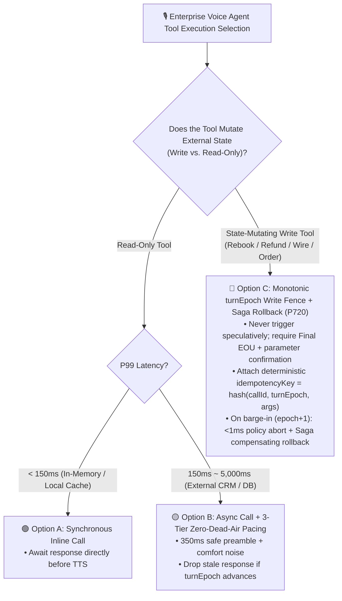
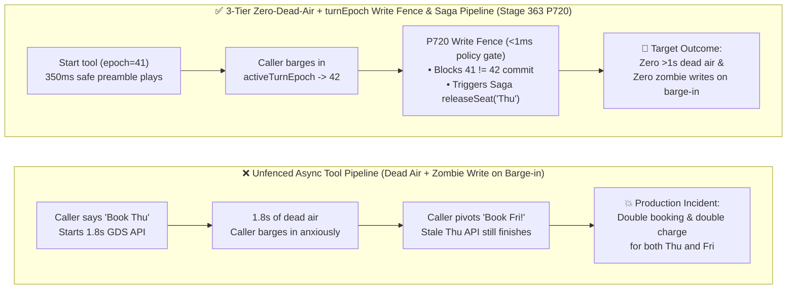

# Enterprise Voice Agent Async Tool Execution & Rollback Selection FAQ: Synchronous Blocking Tools vs. Monotonic `turnEpoch` Write Fence + Saga Compensation, and How Does 3-Tier Zero-Dead-Air Masking Work Under the Hood?

> **Single-Topic Scope (Round 3B)**: Focused strictly on **asynchronous state-mutating voice tool execution, concurrency control, and barge-in rollback architecture**—when to use inline synchronous calls vs. asynchronous tool orchestration with 3-tier Zero-Dead-Air masking, monotonic `turnEpoch` write fences, and Saga compensating rollbacks (`P720`).  
> **Companion Guide (Read-Only Speculative Voice RAG)**: For read-only knowledge retrieval, partial-ASR prefetching, and Voice Micro-Chunking (`P719`), see [`docs/speculative-voice-rag-faq.en.md`](./speculative-voice-rag-faq.en.md).  
> **Data Provenance Note**: Industry backend API latency and cost baselines are tagged `anonymized_reported` (`independently_reproduced=false`). The `<1ms` (`0ms` rounded at `1ms` local clock resolution) latency reported for `P720` refers strictly to **offline in-memory policy state-machine evaluation (`synthetic`)**; **live production cross-service database Saga rollback network round-trip latency (`30ms–250ms` production budget) is `not_measured` in local unit tests**.

---

## ① 📌 Executive Summary

1. **Voice Tool Execution Selection Boundary (Synchronous Inline Call vs. Async Orchestration + `turnEpoch` Write Fence + Saga Compensation)**:
   - Use **Synchronous Inline Tool Calls** only for in-memory or local-cache read-only lookups with `P99 < 150ms`.
   - For any external CRM/ERP/airline GDS/payment gateway call (`350ms–5,000ms`) or any **State-Mutating Write Tool**, architects must use **Asynchronous Tool Orchestration + 3-Tier Zero-Dead-Air Masking + Monotonic `turnEpoch` Write Fence & Saga Compensation (`P720`)**.
2. **Why Caller Barge-in During Slow Tool Execution Causes Catastrophic "Zombie Writes"**:
   - Suppose a caller says *"Rebook my Wednesday flight to Thursday"* (`turnEpoch = 41`), triggering a `1.8s` GDS API call. At `900ms`, the caller interrupts: *"Wait, don't book Thursday—make it Friday!"* (`activeTurnEpoch` increments to `42`). Without a monotonic epoch write fence, the in-flight `epoch=41` request finishes 900ms later and silently commits the unwanted Thursday booking!
3. **Production Gold-Standard Pattern (3-Tier Zero-Dead-Air Pacing + `turnEpoch` Write Fence + Saga Rollback `P720`)**:
   - **Zero Dead Air (`<= 1,000ms` max silence)**: Emit a safe acknowledgment preamble at `350ms` (never promising unverified success or leaking unverified amounts), a progress update at `2,000ms`, and an SMS/human fallback at `5,000ms`.
   - **Zero Zombie Writes**: Every caller barge-in atomically increments `activeTurnEpoch`. Whenever `toolInvocationEpoch < activeTurnEpoch`, the `P720` offline policy state machine aborts the stale write commit and dispatches a Saga compensating rollback directive in `<1ms` (`1ms` clock resolution, `synthetic`; live cross-service network rollback latency is `not_measured` in local unit tests).

---

## ② 🎯 Customer & Architect Soul-Searching Q&A (FAQ-Driven)

### Q1: External CRM, banking, and airline APIs often take 2–4 seconds. How do we prevent callers from thinking the line dropped? How does 3-Tier Zero-Dead-Air Pacing (`P720`) work?

- **Plain-Language First Principles**:
  - On a phone call, more than **`1.0 second` of absolute silence (Dead Air)** triggers "dropped-call anxiety"—the caller says *"Hello? Are you still there?"*, which triggers false barge-in and aborts the pending tool call!
  - **The 3-Tier Zero-Dead-Air Pacing State Machine (`P720`)**:
    - **Tier 1 (`250ms–450ms` — Promptable Preamble + Comfort Noise)**: Plays a natural intent acknowledgment (*"Let me check your reservation status right now, one moment..."*) backed by subtle comfort noise.
    - **Tier 2 (`2,000ms` — Progress Heartbeat)**: Plays a brief status bridge (*"Still syncing with the ticketing ledger, almost there..."*).
    - **Tier 3 (`> 5,000ms` — Async Callback / Warm Transfer Degradation)**: Gracefully switches to an asynchronous SMS receipt or human handoff instead of leaving the caller waiting indefinitely.
  - **Preamble Safety Rule (`P720`)**: Preambles may only state that an action is *in progress*; `P720` blocks any preamble that prematurely claims success (*"I have refunded your card"*) or states unverified dollar amounts before the tool returns.

---

### Q2: How do the Monotonic `turnEpoch` Write Fence and Saga Compensating Rollbacks (`P720`) prevent corrupted database state when a caller interrupts mid-tool?

- **Plain-Language First Principles**:
  - **Defense 1: Monotonic `turnEpoch` Write Fence & Idempotency Key**:
    - Every tool invocation stamps `toolInvocationEpoch = activeTurnEpoch` and `idempotencyKey = hash(callId, turnEpoch, toolName, args)`.
    - If the caller barges in before the tool finishes, `activeTurnEpoch` increments (`41 -> 42`). At the pre-commit gate, `P720` evaluates `toolInvocationEpoch === activeTurnEpoch` in `<1ms` (`synthetic`)—immediately rejecting the stale `epoch=41` commit and flushing any queued speech from turn `41`.
  - **Defense 2: Multi-Step Saga Compensating Rollback**:
    - If Step 1 of a composite workflow already locked an airline seat (`lockSeat('Thu')`) when the caller interrupted during Step 2 payment verification, simply dropping the HTTP response leaves the seat locked. `P720` emits a Saga compensation directive (`releaseSeat('Thu', 'k-41')`) to roll back external state cleanly.

---

## ③ 🧭 Visual Architecture Diagrams (Mermaid Decision Tree + Pipeline Comparison + Sequence Diagram)

### 3.1 Enterprise Voice Tool Execution & Rollback Decision Tree (`flowchart TD`)



### 3.2 Legacy Unfenced Async Tool Call vs. Stage 363 `turnEpoch` Write Fence & Saga Pipeline (`flowchart LR`)



### 3.3 Millisecond 3-Tier Preamble & Barge-in Saga Rollback Sequence (`sequenceDiagram`)

```mermaid
sequenceDiagram
    autonumber
    participant User as Caller Audio Stream
    participant Orch as Voice Orchestrator + turnEpoch State
    participant Gate as P720 Epoch Write Fence & Preamble Gate
    participant ERP as External Airline GDS / CRM API

    User->>Orch: 🗣️ "Rebook my flight to Thursday morning" (Final EOU, activeTurnEpoch = 41)
    Orch->>Gate: Invoke write tool rebookFlight(day='Thu', toolEpoch=41, idempotencyKey='k-41')
    Gate->>ERP: Step 1: lockSeat('Thu') succeeds; enters Step 2 payment check
    Note over Orch,Gate: t = 350ms tool still running -> trigger Tier-1 Zero-Dead-Air preamble
    Gate->>Orch: P720 verifies preamble contains no unverified amount or premature success claim
    Orch->>User: 🔊 "Got it, checking availability to move your flight to Thursday morning, one moment..."
    Note over User,Orch: t = 900ms Caller interrupts mid-flight!
    User->>Orch: 🗣️ "Wait! Make it Friday morning instead!" (Barge-in increments activeTurnEpoch = 42)
    Orch->>Gate: Broadcasts epoch transition activeTurnEpoch = 42
    Gate->>Gate: P720 Offline Policy State Machine (<1ms synthetic) detects toolEpoch(41) < activeTurnEpoch(42):<br/>① Aborts Step 2 payment commit & flushes epoch=41 audio queue<br/>② Emits Saga compensation directive releaseSeat('Thu', 'k-41')
    Gate->>ERP: Executes Saga compensating rollback (30~250ms live network budget)
    Orch->>Gate: Dispatches new turn tool rebookFlight(day='Fri', toolEpoch=42, idempotencyKey='k-42')
```

---

## ④ 📊 Architect Decision Matrix

| Dimension | Option A: Synchronous Blocking Tool Call | Option B: Static "Please Hold" Audio + Unfenced Async Call | Option C: 3-Tier Zero-Dead-Air Pacing + `turnEpoch` Write Fence + Saga Rollback (`P720`) |
| :--- | :--- | :--- | :--- |
| **Best-Fit Scenarios** | `< 150ms` local read-only cache lookups | Non-critical read-only lookups (weather, store hours) | **Flight/hotel rebooking, wire transfers, order cancellations, healthcare scheduling, insurance claims** |
| **Perceived Silence During `2s–5s` Slow Tools** | `2,000ms – 5,000ms` dead air (high hang-up rate) | Repetitive canned hold loop | **`350ms` contextual preamble + `2,000ms` heartbeat + `5,000ms` SMS fallback (`<= 1,000ms` max silence)** |
| **Transaction Safety When Caller Barges In Mid-Tool** | 🔴 Critical risk (stale tool commits in background) | 🔴 Critical risk (stops audio playback but fails to roll back in-flight multi-step mutations) | 🟢 **High integrity (`<1ms` offline policy fence blocks stale epoch commits + deterministic idempotency key + Saga rollback)** |
| **Preamble Compliance Safety** | N/A | Static prompt only | 🟢 **`P720` blocks preambles that claim premature success or leak unverified amounts** |

---

## ⑤ 🧪 Quantitative Evaluation & 7-Card Benchmark Findings

| Probe Scenario | Unprotected Tool Pipeline Baseline | Stage 363 (`P720`) Guarded Pipeline | Data Provenance & Engineering Notes |
| :--- | :--- | :--- | :--- |
| **Caller barges in during state-mutating tool (`toolEpoch=41 < activeEpoch=42`)** | Stale epoch mutation commits and speaks outdated confirmation | **`P720` offline policy state machine (`<1ms` at `1ms` clock resolution, `synthetic`) aborts stale commit and emits Saga rollback directive** | Live cross-service Saga rollback network RTT (`30ms–250ms` budget) is `not_measured` in local unit tests |
| **Slow tool causes `1,800ms` unmasked silence or `600ms` preamble delay** | Caller assumes call dropped and speaks over agent | **`P720` (`<1ms` `synthetic`) enforces 3-tier preamble pacing (`250ms–450ms` trigger window, `<= 1,000ms` max silence)** | Eliminates dead-air hang-ups during slow API calls |
| **Preamble claims *"I refunded $500"* before API returns** | Compliance violation if backend refund fails | **`P720` (`<1ms` `synthetic`) blocks premature outcome claims or unverified amounts in preambles** | Guarantees preamble honesty |

---

## ⑥ 🛠️ Appendix: Production Async Voice Tool Launch Checklist (Architect Checklist)

- [ ] **1. Atomic `turnEpoch` Increment & Pre-Commit Fence (`P720`)**: Does every barge-in event increment `activeTurnEpoch` and block any tool commit where `toolInvocationEpoch !== activeTurnEpoch`?
- [ ] **2. Deterministic Idempotency Keys**: Do all write tools pass `hash(callId, turnEpoch, toolName, normalizedArgs)` to prevent duplicate mutations on network retries?
- [ ] **3. Saga Compensation Registry**: Does every multi-step write workflow register a compensating rollback action (e.g., `releaseSeat`) triggered automatically on barge-in abort?
- [ ] **4. 3-Tier Zero-Dead-Air Pacing & Preamble Safety Gate (`350ms / 2,000ms / 5,000ms`)**: Are slow tools masked within `250ms–450ms` using safe intent-only preambles that never promise unverified outcomes?
