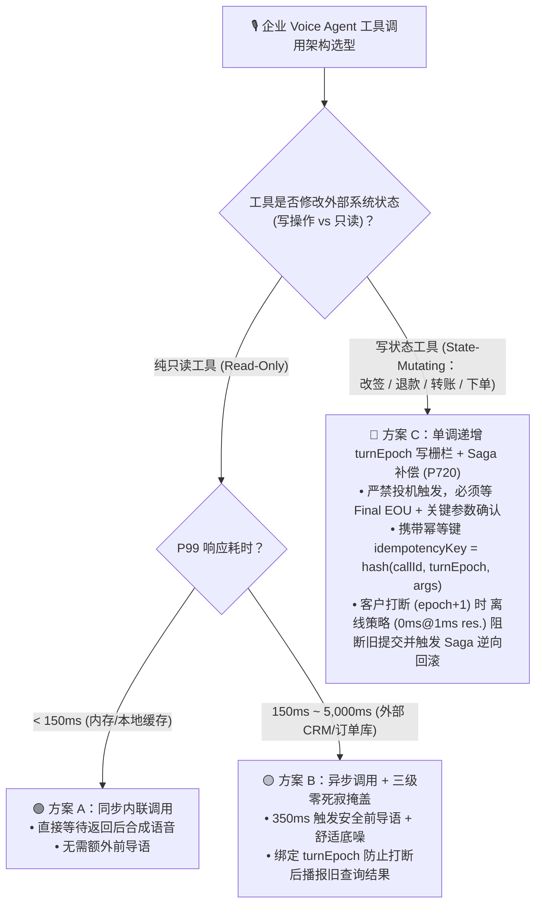
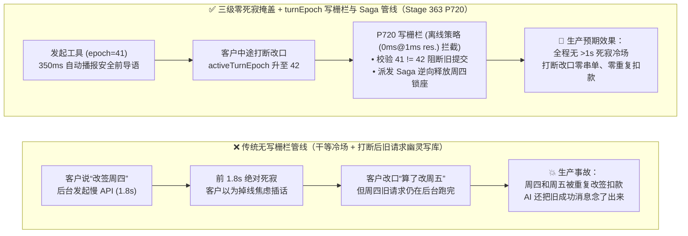
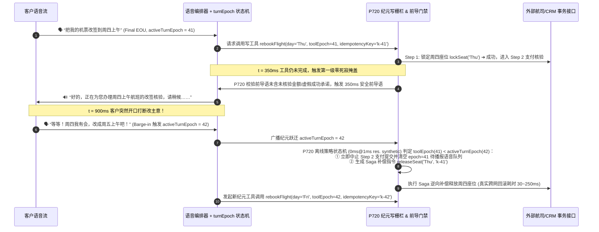

# 企业语音智能体异步工具调用与回滚选型 FAQ：同步阻塞工具调用 vs. 异步纪元写栅栏 (`turnEpoch`) + Saga 补偿怎么选？三级零死寂掩盖是如何运作的？

> **专题定位（Round 3B 单一决策主题）**：聚焦企业级 Voice Agent 在调用**慢速后端 API 与写状态业务工具（CRM/ERP/改签/扣款）**时的并发控制、死寂冷场掩盖（Zero-Dead-Air Pacing）以及客户中途打断时的单调递增纪元写栅栏（`turnEpoch` Write Fence）与 Saga 逆向补偿回滚（`P720`）。  
> **姐妹篇导航（只读知识库预检索）**：关于只读知识问答的投机式语音 RAG 与口语微切片（`P719`），请查阅独立专题 [`docs/speculative-voice-rag-faq.md`](./speculative-voice-rag-faq.md)。  
> **数据口径声明**：文内行业后端 API 耗时与成本区间为 `anonymized_reported`（`independently_reproduced=false`）；`P720` 护栏的 `0ms reported at nominal 1ms display resolution; actual duration unresolved/not_measured; no sub-1ms upper bound established`（名义 `1ms` 显示分辨率下报告为 `0ms`；实际耗时未解析/未实测；不建立 sub-1ms 物理上界）特指**离线内存策略状态机（`synthetic`）**生成中止与回滚指令的判定耗时，**未在本地单元测试中实测（`not_measured`）真实生产跨服务数据库 Saga 回滚网络往返耗时（生产工程预算通常 `30ms–250ms`）**。

---

## ① 📌 核心结论速览（Executive Summary）

1. **语音工具执行架构选型分界线（同步内联调用 vs. 异步状态机 + `turnEpoch` 写栅栏 + Saga 补偿）**：
   - 仅当工具为**同机房内存级只读查询（P99 `< 150ms`）**时，才可使用**同步内联阻塞调用（Synchronous Inline Tool Call）**；
   - 凡是调用外部 CRM/ERP/航司 GDS/支付网关（耗时 `350ms–5,000ms`）或涉及**修改外部业务状态的写操作工具（State-Mutating Tools）**，必须采用**异步非阻塞工具编排 + 三级零死寂前导话术 + 单调递增 `turnEpoch` 写栅栏与 Saga 补偿管线（`P720`）**。
2. **为什么客户在 AI 查单/改签中途插话打断，会导致严重的“旧指令幽灵写库（Zombie Write）”生产事故？**
   - 当客户说“帮我把周三的航班改到周四”（第 `41` 轮，`turnEpoch = 41`），AI 发起后端改签 API（耗时 `1.8s`）；到第 `900ms` 时客户突然插话“等等！别改周四了，改成周五！”（话轮纪元立即自增为 `turnEpoch = 42`）。如果没有纪元写栅栏，`900ms` 后那个属于 `epoch=41` 的旧改签请求仍然会在后台完成落库扣款，造成客户改了周五却被扣了周四票款的严重事故。
3. **生产落地推荐范式（三级零死寂进度掩盖 + `turnEpoch` 原子写栅栏 + Saga 逆向补偿 `P720`）**：
   - **听觉不冷场**：工具耗时达 `350ms` 触发第一级礼貌前导语（严禁在结果返回前承诺成功或泄露未核验金额），达 `2,000ms` 触发第二级进度安抚，超 `5,000ms` 转异步短信回执；
   - **落库不串单**：每次客户打断（Barge-in）使 `activeTurnEpoch` 原子自增；当 `toolInvocationEpoch < activeTurnEpoch` 时，`P720` 离线策略状态机在 `0ms reported at nominal 1ms display resolution`（实际耗时未解析 `not_measured`，不建立 sub-1ms 上界，`synthetic`）内中止旧工具提交并派发 Saga 逆向补偿事务（如释放已锁定的航班座位；真实跨服务回滚网络耗时本地单测 `not_measured`）。

---

## ② 🎯 客户与架构师灵魂拷问 Q&A（FAQ-Driven）

### Q1：外部 CRM、核心银行或航司接口动辄要查 2～4 秒，电话里怎么避免客户对着死寂听筒喂喂喂？三级零死寂掩盖（3-Tier Zero-Dead-Air Pacing）是怎么设计的？

- **通俗大白话 + 第一性原理**：
  - 在网页聊天里，转圈圈加载 3 秒钟用户习以为常；但在电话里，超过 **`1.0 秒` 的绝对静音（Dead Air）**就会触发人类的“掉线焦虑”，客户会立刻开始“喂？还在吗？”，而这句“喂？”又会反过来打断 AI 正在等待的工具调用，形成恶性循环！
  - **三级零死寂前导掩盖状态机（`P720`）是如何按毫秒卡点护航的？**
    - **`T = 250ms–450ms`（第一级：可编排前导话术 Promptable Preamble）**：若后端工具在 `350ms` 内仍未返回，立即播报简短自然的动作确认语（如“好的，正在为您核对这笔订单的状态，请稍等……”），同时注入极低音量的舒适环境底噪（Comfort Noise），让客户明确感知“电话通着、AI 正在帮我办”。
    - **`T = 2,000ms`（第二级：阶段进度播报 Progress Heartbeat）**：若跨系统联查超过 2 秒，播报“系统正在同步最新库存明细，马上就好……”。
    - **`T > 5,000ms`（第三级：异步回调降级 Async Callback Fallback）**：超时 5 秒仍未返回时，绝不让客户继续干等，主动话术降级：“当前后台核验通道较忙，结果出来后我第一时间发短信通知您，我们先看下一个问题好吗？”
  - **前导话术的安全红线（`P720` Preamble Safety Gate）**：前导语**只准描述“正在查询/核对的动作”，绝对禁止提前承诺业务结果（如在扣款成功前说“已经帮您退好了”）或播报未经核验的金额/敏感信息**。

---

### Q2：什么是“单调递增话轮纪元写栅栏（Monotonic `turnEpoch` Write Fence）”与“Saga 逆向补偿事务”？底层是如何防止打断后旧工具乱写库的？

- **通俗大白话 + 第一性原理**：
  - **第一道锁：入бо（In-Flight）阶段的 `turnEpoch` 原子写栅栏**：
    - 会话状态机维护一个全局单调递增整数 `activeTurnEpoch`（每次客户有效打断 Barge-in 时立刻 `+1`）。
    - 当大模型发起任何工具调用时，网关为该请求打上发起时刻的烙印：`toolInvocationEpoch = 41` 与唯一幂等键 `idempotencyKey = hash(callId, 41, toolName, args)`。
    - 如果工具正在执行中途客户插话打断，`activeTurnEpoch` 变为 `42`。网关不仅立即通过 `AbortController` 取消 HTTP 请求，而且在工具返回准备写入会话状态或提交数据库两阶段确认（Two-Phase Commit）的那一刻，`P720` 离线策略状态机在 `0ms reported at nominal 1ms display resolution`（实际耗时未解析 `not_measured`，不建立 sub-1ms 上界，`synthetic`）内执行硬校验：发现 `41 !== 42`，立即丢弃返回结果并阻断落库！
  - **第二道锁：多步写操作的 Saga 逆向补偿（Saga Compensating Rollback）**：
    - 如果一个复杂工具包含多步外部副作用（例如：第 1 步已在航司系统锁了周四座位 `lockSeat(Thu)`，正在执行第 2 步扣减里程时客户打断改成了周五），光掐断连接还不够，那个周四的座位还会被白白锁死！
    - 此时 `P720` 状态机立即根据已登记的 `compensationAction` 触发逆向补偿事务 `releaseSeat(Thu, idempotencyKey)`，把外部业务状态干净利落地还原回打断前的一致状态。

---

## ③ 🧭 直观可视化图解（Mermaid 选型决策树 + 幽灵写库 vs 纪元写栅栏对比图 + 打断回滚毫秒级时序图）

### 3.1 企业语音工具调用与并发回滚架构选型决策树（`flowchart TD`）

### 3.2 传统无栅栏异步工具调用 vs. `P720` 纪元写栅栏 + Saga 补偿管线对比图（`flowchart LR`）

### 3.3 毫秒级三级零死寂掩盖与打断后 Saga 逆向回滚时序图（`sequenceDiagram`）

---

## ④ 📊 语音架构师选型决策矩阵（Architect Decision Matrix）

| 选型维度 | 方案 A：同步阻塞工具调用（无前导语、无写栅栏） | 方案 B：仅加固定录音“请稍候” + 普通异步调用 | 方案 C：三级零死寂前导话术 + 单调递增 `turnEpoch` 写栅栏 + Saga 补偿（`P720`） |
| :--- | :--- | :--- | :--- |
| **核心适用场景** | 仅限 `< 150ms` 本地只读内存查询 | 非关键只读外部查询（如查天气、查门店地址） | **机票酒旅改签、银行转账授权、电商退换货、医疗挂号、保险报案等一切核心业务工具调用** |
| **慢工具（`2s–5s`）期间客户感知等待** | `2,000ms – 5,000ms` 绝对死寂（极易被客户挂断） | `350ms` 机械重复同句录音，缺乏上下文感 | **`350ms` 语境化安全前导语 + `2,000ms` 进度心跳 + `5,000ms` 异步短信降级，全程无 `> 1,000ms` 死寂** |
| **客户中途打断改口时的事务安全性** | 🔴 极危（旧请求继续在后台完成落库，导致错改或重复扣款） | 🔴 极危（仅停播声音，未回滚后台已在途的多步写操作） | 🟢 **高可靠（`0ms`（名义 `1ms` 分辨率观测值，实际耗时未解析）离线策略阻断旧纪元提交 + 幂等键防重 + Saga 逆向补偿回滚已执行子步骤）** |
| **前导话术合规安全性** | 无前导语 | 静态录音安全但生硬 | 🟢 **由 `P720` 门禁强制拦截提前承诺结果或泄露未核验金额的违规前导语** |

---

## ⑤ 🧪 简明定量实测与 Benchmark 核心发现

| 测试场景 / 探针 ID | 传统无防护工具管线表现 | Stage 363 (`P720`) 防御管线表现 | 数据分类与工程说明 |
| :--- | :--- | :--- | :--- |
| **工具执行中途客户打断改口 (`toolEpoch=41 < activeEpoch=42`)** | 旧纪元写操作继续落库并播报过时成功提示 | **`P720` 离线策略状态机在 `0ms reported at nominal 1ms display resolution`（实际耗时未解析 `not_measured`，不建立 sub-1ms 上界，`synthetic`）内阻断旧提交并派发 Saga 逆向回滚指令** | 真实生产跨服务数据库 Saga 回滚网络耗时（`30ms–250ms` 预算）在本地单测中为 `not_measured` |
| **慢工具调用产生 `1,800ms` 无掩盖死寂或前导语延迟 `600ms`** | 客户误以为掉线而抢话重说 | **`P720`（名义 `1ms` 分辨率报告 `0ms`，`synthetic`，实际耗时未解析）强制注入三级零死寂前导话术并将前导触发窗口钳位至 `250ms–450ms`、死寂上限 `<= 1,000ms`** | 消除慢 API 带来的通话掉线错觉 |
| **前导话术在工具返回前宣称“已为您退款 500 元”** | 若后端退款失败则构成严重客诉与合规违约 | **`P720`（名义 `1ms` 分辨率报告 `0ms`，`synthetic`，实际耗时未解析）立即拦截含未核验金额或提前承诺成功的前导语** | 确保前导语只确认意图、不透支结果 |

---

## ⑥ 🛠️ 附录：生产环境异步语音工具上线快速核验清单（Architect Checklist）

- [ ] **1. 话轮纪元原子递增与写栅栏（Monotonic `turnEpoch` Fence）**：每次 VAD/语义打断是否立即将 `activeTurnEpoch` 加 1，并在所有工具返回落库前强制校验 `toolInvocationEpoch === activeTurnEpoch`？
- [ ] **2. 确定性幂等键绑定（Deterministic Idempotency Key）**：所有外部写接口是否强制携带 `hash(callId, turnEpoch, toolName, normalizedArgs)`，防止网络重试造成双倍扣款？
- [ ] **3. 多步写操作 Saga 补偿注册（Saga Compensation Registry）**：凡涉及“先锁库存/座位、再扣款/核销”的多步工具，是否已为每一步注册逆向补偿函数（如 `releaseSeat`）以便打断时自动回滚？
- [ ] **4. 三级零死寂掩盖与前导语合规门禁（`350ms / 2,000ms / 5,000ms` Pacing）**：慢工具是否配置了 `350ms` 前导语与舒适底噪，且通过 `P720` 过滤了一切提前承诺结果或未核验金额的表述？
