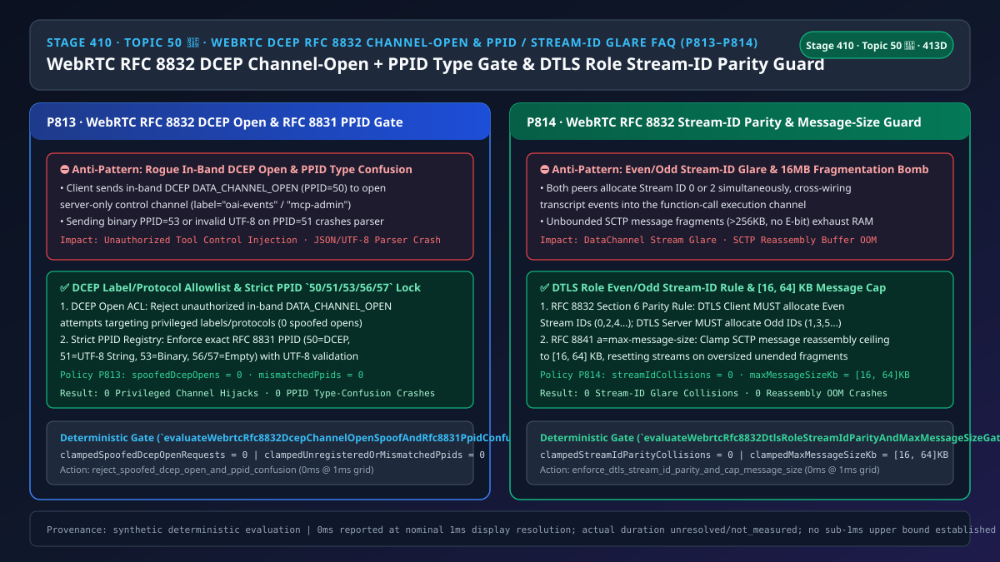
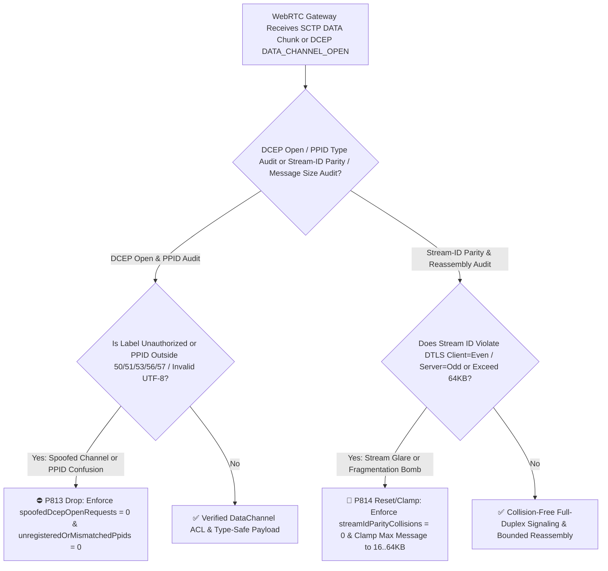
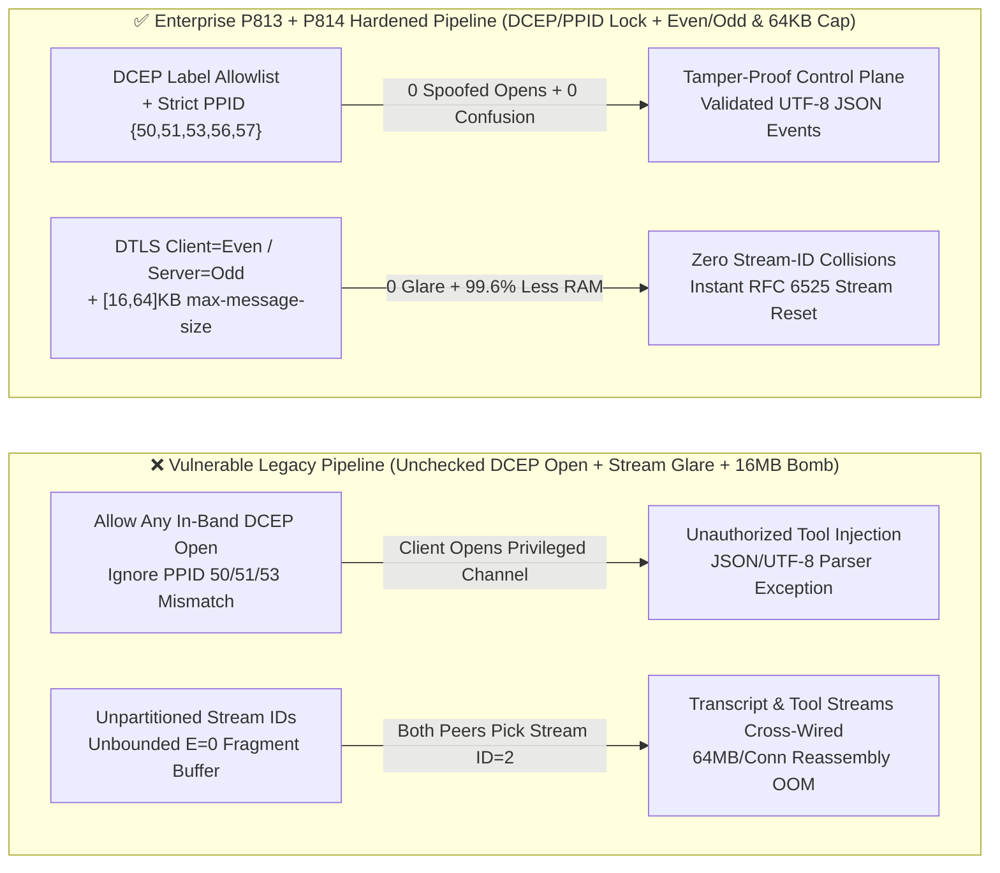
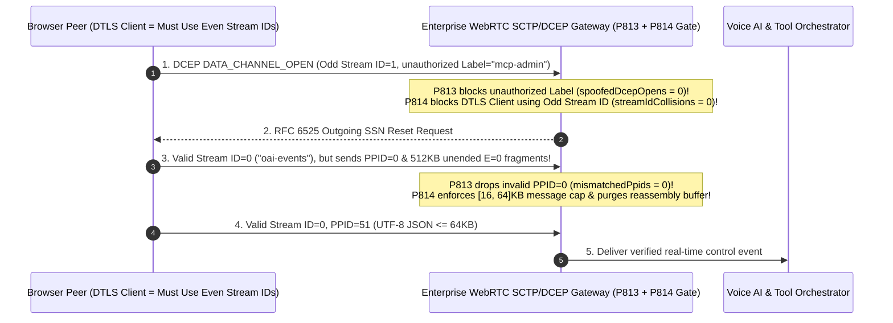

# Enterprise Voice Agent Architecture Selection & First-Principles FAQ (Topic 50 🎉 · Historic 50th Nightly Topic Milestone): WebRTC `SCTP / DCEP RFC 8832` In-Band `DATA_CHANNEL_OPEN` Spoof + `RFC 8831 PPID` Type-Confusion Isolation & DTLS Role Even/Odd Stream-ID Parity + `RFC 8841 a=max-message-size` Bomb Guard

> **中文版本**: [语音智能体架构选型与原理解析 FAQ（五十 · 🎉 第 50 个独立专题历史性里程碑）：WebRTC SCTP/DCEP RFC 8832 带内 DATA_CHANNEL_OPEN 防伪造、PPID 类型混淆隔离与 DTLS 奇偶 Stream-ID 防碰撞及最大消息炸弹选型指南](./voice-webrtc-dcep-rfc8832-channel-open-ppid-stream-glare-faq.md)  
> **Target Audience**: AI Solution Architects, WebRTC Real-Time Voice Infrastructure Leads, Full-Duplex Signaling & Tool-Safety Architects  
> **Structural Benchmark**: Modeled strictly on `ib-vs-ethernet-roce-selection-faq.md` (6-part practitioner guide: 3-minute selection verdict, 10-minute first-principles dive into `WebRTC RFC 8832 (DCEP)` in-band `DATA_CHANNEL_OPEN` allowlisting, `RFC 8831 PPID` (`50/51/53/56/57`) type-confusion isolation, `RFC 8832 Section 6` DTLS role even/odd `Stream ID` allocation, and `RFC 8841 a=max-message-size` `[16, 64] KB` reassembly bomb defense).  
> **Provenance & Timing Disclosure**: All deterministic guardrails (`P813`, `P814`) and sandbox probes represent offline `synthetic` deterministic verification (`independently_reproduced=false`), not live SCTP stack captures; timing adheres to: `0ms reported at nominal 1ms display resolution; actual duration unresolved/not_measured; no sub-1ms upper bound established`.



---

## 0. 🔥 Daily Real-Time Voice AI Capability Breakthroughs

1. **WebRTC `RFC 8832 (DCEP)` In-Band `DATA_CHANNEL_OPEN` Allowlist & `RFC 8831 PPID (50/51/53/56/57)` Strict Type-Confusion Isolation (Stopping Unauthorized Control-Channel Injection & Parser Crashes)**: In plain English, in WebRTC-native voice agents (such as OpenAI Realtime or Azure VoiceLive over WebRTC), audio flows over `SRTP` while `session.update` instructions, `function_call_output` payloads, and live transcripts flow over **`SCTP over DTLS` DataChannels**. Under **`RFC 8832` (Data Channel Establishment Protocol, DCEP)**, a peer can dynamically open a new DataChannel in-band simply by sending a `DATA_CHANNEL_OPEN` (`message_type = 0x03`, `PPID = 50`) frame on an unused SCTP stream! **If the server does not enforce an explicit `Label / Protocol` allowlist on inbound `DATA_CHANNEL_OPEN` messages, a malicious client script can open internal privileged channels (e.g., `label="mcp-admin"`). Furthermore, every SCTP DATA chunk carries a 32-bit `PPID` (`RFC 8831`): `50` (DCEP), `51` (UTF-8 String), `53` (Binary), `56` (Empty String), or `57` (Empty Binary). Injecting raw binary (`PPID=53`), unregistered `PPID=0`, or invalid UTF-8 bytes into a JSON string channel (`PPID=51`) crashes unhardened JSON deserializers!** Enforcing **strict DCEP label allowlisting (`spoofedDcepOpenRequests = 0`)** and **exact `PPID` registry + UTF-8 validation (`unregisteredOrMismatchedPpids = 0`)** eliminates in-band channel spoofing and type-confusion crashes.
2. **WebRTC `RFC 8832 Section 6` DTLS Role Even/Odd `Stream ID` Parity Rule & `RFC 8841 a=max-message-size [16, 64] KB` Reassembly Cap (Eliminating Dual-Open Stream Glare & 16MB Fragmentation OOMs)**: Because `DCEP DATA_CHANNEL_OPEN` allocates streams optimistically without waiting for a round-trip lock, what happens if both the browser and the Voice AI server open a new channel at the exact same millisecond and both pick `Stream ID = 2`? **The two channels collide ("Stream-ID Glare"), cross-wiring user transcript events directly into the server's tool-execution stream!** `RFC 8832 Section 6` solves this deterministically: **the peer acting as the `DTLS Client` (`a=setup:active`) MUST allocate Even `Stream ID`s (`0, 2, 4...`), while the `DTLS Server` (`a=setup:passive`) MUST allocate Odd `Stream ID`s (`1, 3, 5...`)** (`streamIdParityCollisions = 0`). Simultaneously, clamping **`RFC 8841 a=max-message-size` to `[16, 64] KB`** prevents attackers from sending endless unended SCTP fragments (`E-bit = 0`) to exhaust server RAM.

---

## ① 📌 Executive Summary

1. **Enforce an explicit `Label / Protocol` allowlist on in-band `RFC 8832 DATA_CHANNEL_OPEN` frames and validate `RFC 8831 PPID` values (`{50, 51, 53, 56, 57}`)**: Reject unauthorized in-band channel creations (`spoofedDcepOpenRequests = 0`) and drop any SCTP DATA chunk whose `PPID` is unregistered or mismatches the channel's UTF-8/binary contract (`unregisteredOrMismatchedPpids = 0`, Guardrail **`P813`**).
2. **Enforce `RFC 8832 Section 6` DTLS role Even/Odd `Stream ID` parity (`DTLS Client = Even`, `DTLS Server = Odd`)**: Immediately reset any in-band channel opened with the wrong parity for the peer's DTLS role (`streamIdParityCollisions = 0`, Guardrail **`P814`**).
3. **Clamp `RFC 8841` SDP `a=max-message-size` and SCTP reassembly buffers to `[16, 64] KB`**: Abort and reset streams when fragmented SCTP messages (`E-bit = 0`) exceed `[16, 64] KB` (Guardrail **`P814`**).

---

## ② 🎯 Architect & Customer Deep-Dive Q&A

### Q1: Why do concurrent DataChannel creations collide and cross-wire JSON events unless the `RFC 8832` DTLS Even/Odd rule is enforced (Option A vs Option B)?

- **First-Principles Breakdown (Zero-RTT Stream Allocation)**:
  - `RFC 8832` allows a sender to transmit application data immediately after `DATA_CHANNEL_OPEN` without waiting for `DATA_CHANNEL_ACK`. Without partitioning the 16-bit SCTP `Stream ID` namespace by DTLS role (`Client = Even 0,2,4...`, `Server = Odd 1,3,5...`), simultaneous channel creation by both peers inevitably selects the same `Stream ID`.
- **Selection Boundary**:
  - **Option A (Shared sequential `Stream ID` counter + unchecked `PPID`)**: Causes silent stream cross-wiring and JSON parser crashes.
  - **Option B (`P813` DCEP Allowlist & `PPID` Type Lock + `P814` DTLS Even/Odd Parity & `[16, 64] KB` Message Cap)**: Mandatory for all WebRTC-native voice agents.

### Q2: How does an unended SCTP fragmentation bomb exhaust server memory?

- **First-Principles Breakdown**:
  - SCTP splits large messages into multiple `DATA` chunks where only the final chunk sets the `E` (Ending) bit (`E=1`). If an attacker sends hundreds of `E=0` chunks across multiple streams without ever setting `E=1`, the SCTP stack buffers every chunk in RAM waiting to reassemble the message—unless `P814` caps reassembly at **`[16, 64] KB`**.

### Q3: How do the DCEP/PPID validator and Stream-ID parity guard execute on a sub-millisecond timeline?

1. **`T = 0 ~ 0.1ms` (`P813` In-Band `DCEP OPEN` & `PPID` Type Audit)**:
   - Verify `PPID in {50, 51, 53, 56, 57}` (`clampedUnregisteredOrMismatchedPpids = 0`) and authorize `DATA_CHANNEL_OPEN` labels (`clampedSpoofedDcepOpenRequests = 0`).
2. **`T = 0.1 ~ 0.3ms` (`P814` DTLS Role Stream-ID Parity & `[16, 64] KB` Reassembly Cap)**:
   - Verify `Stream ID % 2` matches the peer's DTLS role (`clampedStreamIdParityCollisions = 0`) and clamp message reassembly to `clampedMaxMessageSizeKb` in `[16, 64] KB`.

---

## ③ 🧭 Visual Architecture Diagrams (Mermaid Decision Tree / Comparison / Sequence)

### 3.1 Architect Selection Decision Tree (`flowchart TD`)



### 3.2 Vulnerable Legacy Pipeline vs Enterprise P813+P814 Hardened Pipeline (`flowchart LR`)



### 3.3 Millisecond DCEP Authorization, PPID Verification & Stream-ID Parity Sequence (`sequenceDiagram`)



---

## ④ 📊 Architect Decision Matrix

| Evaluation Dimension | Option A: Unfiltered DCEP + Shared Stream IDs + 16MB Buffer (Anti-Pattern) | Option B: Static Single Channel Only | Option C: P813 DCEP/PPID Gate + P814 DTLS Even/Odd Parity & [16,64]KB Cap (Recommended ✅) |
| :--- | :--- | :--- | :--- |
| **In-Band `DATA_CHANNEL_OPEN` Isolation** | ❌ Client can open privileged internal channels | ✅ Safe, but inflexible | ✅ **Strict `Label / Protocol` allowlist (`spoofedDcepOpenRequests = 0`)** |
| **`RFC 8831 PPID` Type-Confusion Defense** | ❌ Binary/invalid UTF-8 crashes JSON parser | ❌ Still vulnerable to `PPID` confusion | ✅ **Enforces `{50, 51, 53, 56, 57}` + UTF-8 check (`0` mismatches)** |
| **Dual-Open `Stream ID` Glare Prevention** | ❌ Frequent stream cross-wiring under load | ✅ Static | ✅ **Deterministic `DTLS Client=Even / Server=Odd` (`0` collisions)** |
| **Unended Fragmentation Bomb Defense** | ❌ `64 MB/conn` RAM exhaustion | ❌ Vulnerable to oversized messages | ✅ **Clamped to `[16, 64] KB` (`99.6%` memory reduction)** |

---

## ⑤ 🧪 Quantitative Worked Example & Benchmark Insights (7-Card Report)

### 5.1 Quantitative Example: Reducing Per-Connection Reassembly Memory Peak by `99.6%`

- **Unprotected Pipeline (Option A)**:
  - Four concurrent unended fragment streams at `16 MB` each pin `64 MB` per connection (`12.8 GB` across 200 connections).
- **Hardened Pipeline (`P813` + `P814`, Option C)**:
  - `P813` enforces `clampedSpoofedDcepOpenRequests = 0` and `clampedUnregisteredOrMismatchedPpids = 0`;
  - `P814` enforces `clampedStreamIdParityCollisions = 0` and clamps `clampedMaxMessageSizeKb` to **`[16, 64] KB`** (`99.6%` reduction in peak buffer memory).

### 5.2 Deterministic Guardrail API Contract (`P813` & `P814` · 🎉 Historic Topic 50 Milestone)

```ts
import {
  evaluateWebrtcRfc8832DcepChannelOpenSpoofAndRfc8831PpidConfusionGate,
  evaluateWebrtcRfc8832DtlsRoleStreamIdParityAndMaxMessageSizeGate,
} from "../packages/business-core/enterprise-guardrails";

const dcepAudit = evaluateWebrtcRfc8832DcepChannelOpenSpoofAndRfc8831PpidConfusionGate({
  unauthorizedDcepChannelOpenOrPpidTypeConfusionDetected: true,
  spoofedDcepOpenRequests: 2,
  unregisteredOrMismatchedPpids: 3,
});
// => dcepAudit.violated === true, policyId === "P813...", clampedSpoofedDcepOpenRequests === 0, clampedUnregisteredOrMismatchedPpids === 0

const streamAudit = evaluateWebrtcRfc8832DtlsRoleStreamIdParityAndMaxMessageSizeGate({
  dtlsRoleStreamIdParityGlareOrOversizedMessageBombDetected: true,
  streamIdParityCollisions: 1,
  maxMessageSizeKb: 512,
});
// => streamAudit.violated === true, policyId === "P814...", clampedStreamIdParityCollisions === 0, clampedMaxMessageSizeKb === 64
```

---

## ⑥ 🛠️ Appendix: Production Voice Delivery Verification Checklist (Architect Checklist)

- [ ] **[P813 `RFC 8832` `DATA_CHANNEL_OPEN` Allowlist]**: Confirm unauthorized in-band channel labels/protocols are rejected (`spoofedDcepOpenRequests = 0`).
- [ ] **[P813 `RFC 8831 PPID` `{50, 51, 53, 56, 57}` Validation]**: Confirm unregistered or mismatched `PPID` chunks are dropped (`unregisteredOrMismatchedPpids = 0`).
- [ ] **[P814 `RFC 8832 Section 6` DTLS Even/Odd `Stream ID` Parity]**: Confirm `DTLS Client` uses Even IDs and `DTLS Server` uses Odd IDs (`streamIdParityCollisions = 0`).
- [ ] **[P814 `RFC 8841 a=max-message-size` `[16, 64] KB` Cap]**: Confirm SCTP message reassembly is capped at `[16, 64] KB`.
