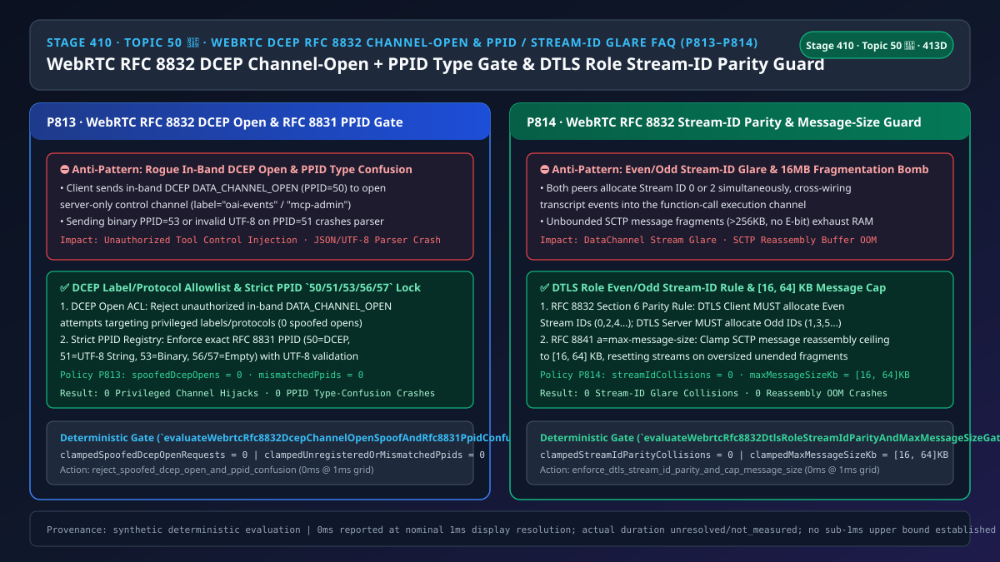
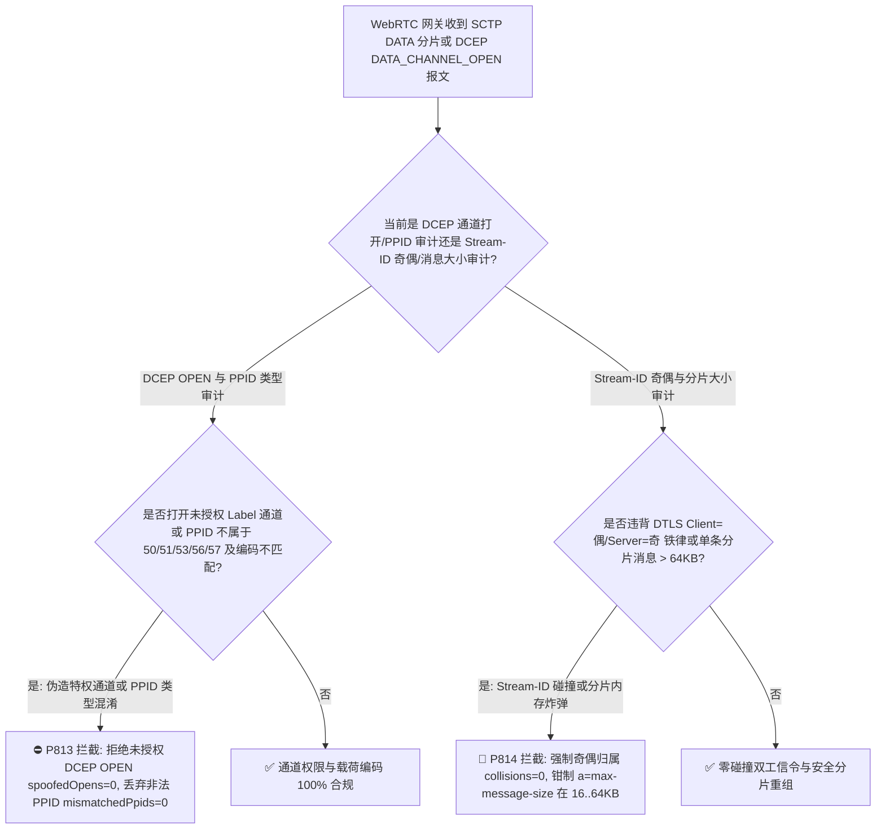
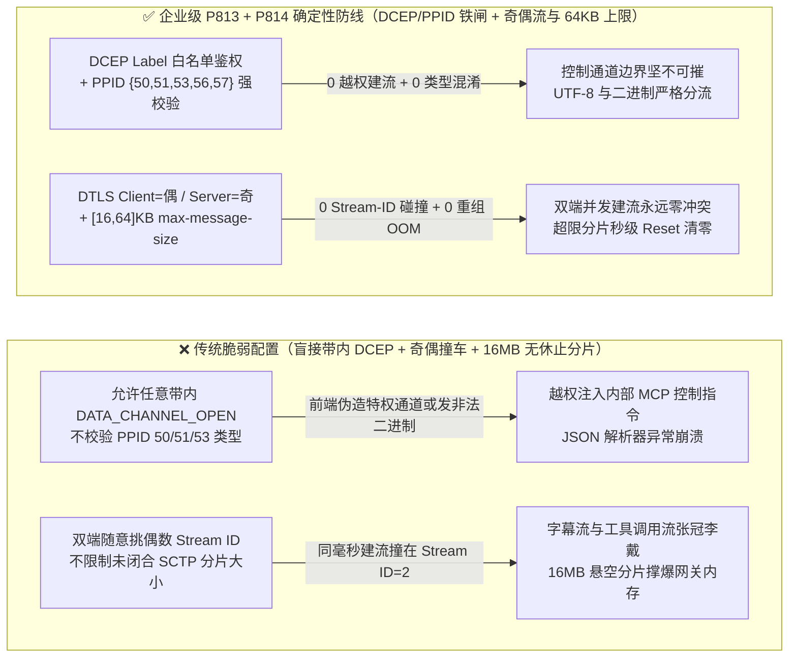
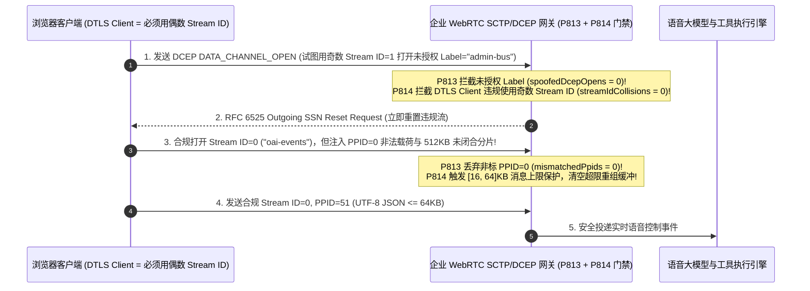

# 语音智能体架构选型与原理解析 FAQ（五十 · 🎉 第 50 个独立专题历史性里程碑）：WebRTC SCTP/DCEP RFC 8832 带内 DATA_CHANNEL_OPEN 防伪造、PPID 类型混淆隔离与 DTLS 奇偶 Stream-ID 防碰撞及最大消息炸弹选型指南

> **English Version**: [WebRTC `SCTP / DCEP RFC 8832` In-Band `DATA_CHANNEL_OPEN` Spoof + `RFC 8831 PPID` Type-Confusion Isolation & DTLS Role Even/Odd Stream-ID Parity + `RFC 8841 a=max-message-size` Bomb Selection FAQ (Topic 50 🎉 · Stage 410 · 413 Dimensions)](./voice-webrtc-dcep-rfc8832-channel-open-ppid-stream-glare-faq.en.md)  
> **适用角色**：AI Solution Architect（AI 解决方案架构师）、WebRTC 原生实时语音底座负责人、全双工信令与工具调用安全架构师  
> **对标范式**：严格遵循 `ib-vs-ethernet-roce-selection-faq.md` 六段式实战导引结构，3 分钟掌握核心选型结论，10 分钟吃透 WebRTC 原生语音智能体（如 OpenAI Realtime / Azure VoiceLive WebRTC 模式）中承载 JSON 事件、字幕与工具调用的 `SCTP DataChannel` 底层：`RFC 8832 DCEP` 带内打开通道协议如何防越权创建管理通道、`RFC 8831 PPID (50/51/53/56/57)` 载荷协议标识符如何防止字符串/二进制混淆搞崩 JSON 解析器，以及 `RFC 8832 Section 6` DTLS 角色奇偶 `Stream ID` 分配铁律与 `RFC 8841 a=max-message-size [16, 64] KB` 防重组内存炸弹机制。  
> **数据溯源与计时精度声明（Provenance & Timing Disclosure）**：本文涉及的确定性门禁策略（`P813`、`P814`）与模拟探针均为离线合成确定性校验（`synthetic`），非特定现网 SCTP 栈抓包实测；门禁执行耗时遵循统一披露契约：`0ms reported at nominal 1ms display resolution; actual duration unresolved/not_measured; no sub-1ms upper bound established`。



---

## 0. 🔥 今日实时语音智能体领域热门能力突破追踪（Daily Breakthroughs）

1. **WebRTC `RFC 8832 (DCEP)` 带内 `DATA_CHANNEL_OPEN` 白名单鉴权与 `RFC 8831` `PPID (50/51/53/56/57)` 强类型隔离（防客户端伪造内部管理通道与非法 UTF-8/二进制类型混淆崩溃）**：用大白话讲，在现代 WebRTC 实时语音智能体架构中，麦克风音频走 `SRTP`，而控制大模型行为的 `session.update`、工具调用结果 `function_call_output` 以及实时字幕全部走 **`SCTP over DTLS` 数据通道（DataChannel）**！数据通道是怎么建立的？除了在 SDP 里静态约定（`a=sctp-init`）外，更多时候靠的是 **`RFC 8832 DCEP`（Data Channel Establishment Protocol）带内握手**——任何一方只要在一个空闲的 SCTP 流上发送一个 `PPID = 50`、`message_type = 0x03 (DATA_CHANNEL_OPEN)` 的控制包，并填上 `Label = "mcp-internal-bus"`，就能在运行时动态打开一条新通道！**如果服务端对客户端发来的带内 `DATA_CHANNEL_OPEN` 不做 `Label / Protocol` 白名单拦截，前端网页恶意脚本就能私自打开原本仅供后端微服务使用的特权控制通道！同时，每个 SCTP DATA 块都带有一个 32 位的 `PPID`（Payload Protocol Identifier，`RFC 8831`）：`50` 代表 DCEP 控制包、`51` 代表 UTF-8 字符串、`53` 代表二进制字节流、`56/57` 代表空消息。如果客户端在只接受 `PPID=51`（JSON 文本）的事件通道上发来 `PPID=53`（二进制流）、未注册的 `PPID=0` 或截断的非法 UTF-8 字节序列，未加防护的 C++/Rust/Node.js JSON 反序列化器会直接抛出未捕获异常导致语音会话崩溃**！通过强制 **带内 `DCEP OPEN` 严格白名单（`spoofedDcepOpenRequests = 0`）** 与 **`PPID {50,51,53,56,57}` 强类型校验（`unregisteredOrMismatchedPpids = 0`）**，实现了数据通道控制面零越权与零崩溃。
2. **WebRTC `RFC 8832 Section 6` DTLS 角色奇偶 `Stream ID` 分配铁律（Client 偶 / Server 奇，防雙端同时建流 Glare 串线）与 `RFC 8841 a=max-message-size [16, 64] KB` 防分片重组内存炸弹**：在同一个 SCTP 偶联（Association）里，客户端和服务端都可以随时发起新建 DataChannel。如果客户端挑了 `Stream ID = 2` 用来发实时字幕，而同一毫秒服务端也挑了 `Stream ID = 2` 用来下发扣款工具调用指令，会发生什么？**两条完全不同用途的通道撞在了同一个 `Stream ID` 上（Stream-ID Glare），客户端发来的闲聊文本直接被服务端当成工具调用回执吞了进去**！为了从根源上消灭这种碰撞，`RFC 8832 Section 6` 规定了一条极其优雅的铁律：**在底层 DTLS 握手中扮演 `DTLS Client`（`a=setup:active`）的一方，只允许分配偶数 `Stream ID`（`0, 2, 4...`）；扮演 `DTLS Server`（`a=setup:passive`）的一方，只允许分配奇数 `Stream ID`（`1, 3, 5...`）**！任何违背奇偶归属的 `DATA_CHANNEL_OPEN` 必须立即拦截（`streamIdParityCollisions = 0`）。此外，如果攻击者连续发送不带结束标志位（`E-bit = 0`）的 SCTP 分片包，试图拼出一个 `16 MB` 的超大 JSON，会瞬间撑爆网关重组缓冲区；通过强制协商并执行 **`RFC 8841 a=max-message-size` 在 `[16, 64] KB` 区间**，彻底粉碎了未完结分片内存耗尽攻击。

---

## ① 📌 核心结论速览（Executive Summary）

1. **严格管控 `RFC 8832` 带内 `DATA_CHANNEL_OPEN` 请求与 `RFC 8831 PPID` 类型匹配**：仅允许客户端打开明确列入白名单的 `Label / Protocol` 通道（如 `"oai-events"`），拒绝任何越权创建的带内通道（`spoofedDcepOpenRequests = 0`）；严格核验 `PPID` 仅限 `{50, 51, 53, 56, 57}` 且与通道声明的文本/二进制模式及合法 UTF-8 编码一致（`unregisteredOrMismatchedPpids = 0`，对应门禁 **`P813`**）。
2. **严格执行 `RFC 8832 Section 6` 基于 DTLS 角色的奇偶 `Stream ID` 分配铁律**：`DTLS Client` 发起的带内通道必须使用偶数 `Stream ID`（`0, 2, 4...`），`DTLS Server` 发起的通道必须使用奇数 `Stream ID`（`1, 3, 5...`），违背奇偶规则或发生 `negotiated=true` 冲突的流立即重置（`streamIdParityCollisions = 0`，对应门禁 **`P814`**）。
3. **强制将 `RFC 8841` SDP `a=max-message-size` 与 SCTP 分片重组缓冲区上限钳制在 `[16, 64] KB`**：当单条消息累计分片（`B/E` 位未闭合）超过 `64 KB` 上限时，立即丢弃分片并发送 `RFC 6525` 流重置（对应门禁 **`P814`**）。

---

## ② 🎯 客户与架构师灵魂拷问 Q&A

### Q1：为什么我们的 WebRTC 语音助手在客户端和服务端同时动态创建 DataChannel 时，偶尔会把“实时字幕流”和“工具调用流”串在一起（方案 A vs 方案 B）？

- **第一性原理拆解（为什么不按 DTLS 角色分奇偶就会撞车？）**：
  - `DCEP` 打开通道是单向通知即生效的（发完 `DATA_CHANNEL_OPEN` 紧接着就可以发数据，无需等 `ACK` 才定 `Stream ID`）。如果双方都从 `0, 1, 2...` 顺序往上拿 ID，当双方在 1 个 RTT 内同时建通道时，100% 会拿到同一个 `Stream ID`！
  - 按照 `RFC 8832 Section 6`，利用已经在 DTLS 握手中唯一确定的 `Client / Server` 角色将 ID 空间一分为二（Client 偶、Server 奇），无需任何额外锁协商就能实现 **零碰撞（0 Glare）**！
- **选型边界**：
  - **方案 A（双端各自维护递增计数器分配 `Stream ID`，不校验 `PPID` 与奇偶性）**：并发建流必串线，且易受二进制/非法 UTF-8 注入崩溃。
  - **方案 B（`P813` `DCEP` 白名单 + `PPID` 强类型锁 + `P814` DTLS 奇偶 `Stream ID` 铁律与 `[16, 64] KB` 消息上限）**：所有生产级 WebRTC 语音智能体必选方案。

### Q2：为什么在 WebRTC DataChannel 上发一个 `PPID = 0` 或非 UTF-8 的 `PPID = 51` 报文能打挂后端语音编排器？

- **第一性原理拆解**：
  - SCTP 原生协议默认允许任意 32 位整数作为 `PPID`（许多底层库默认填 `0`）。但在 WebRTC 标准（`RFC 8831 Section 8`）中，只有 `50 (DCEP)`、`51 (WebRTC String)`、`53 (WebRTC Binary)`、`56 (WebRTC String Empty)`、`57 (WebRTC Binary Empty)` 五个值是合法的！
  - 如果网关不校验 `PPID` 就把载荷直接丢给 `JSON.parse(buffer.toString('utf8'))`，攻击者发一个填着 `PPID=50` 的伪造控制帧或截断的多字节 UTF-8 炸弹就会引起状态机错乱或解析异常。

### Q3：底层 SCTP/DCEP 网关在毫秒级时间轴上是如何执行通道鉴权、PPID 校验与奇偶流门禁的？

1. **`T = 0 ~ 0.1ms`（`P813` SCTP DATA 块 `PPID` 与 `DCEP OPEN` 校验）**：
   - 检查 `PPID` 是否在 `{50, 51, 53, 56, 57}` 内且匹配当前通道模式（`clampedUnregisteredOrMismatchedPpids = 0`）；
   - 若 `PPID === 50`（`DATA_CHANNEL_OPEN`），核对 `Label / Protocol` 白名单（`clampedSpoofedDcepOpenRequests = 0`）。
2. **`T = 0.1 ~ 0.3ms`（`P814` DTLS 奇偶 `Stream ID` 校验与 `[16, 64] KB` 重组门禁）**：
   - 核对发起方 DTLS 角色与 `Stream ID % 2` 奇偶性是否严格对应（`clampedStreamIdParityCollisions = 0`）；
   - 监控分片重组缓冲区大小，钳制单条消息上限在 `clampedMaxMessageSizeKb in [16, 64] KB`。

---

## ③ 🧭 直观可视化图解（Mermaid 决策树 / 延迟对比 / 毫秒级时序图）

### 3.1 语音架构师选型决策树（`flowchart TD`）



### 3.2 传统脆弱管线 vs 企业级 P813+P814 防护管线对比图（`flowchart LR`）



### 3.3 毫秒级 DCEP 鉴权、PPID 校验与 DTLS 奇偶 Stream-ID 门禁时序图（`sequenceDiagram`）



---

## ④ 📊 语音架构师选型决策矩阵（Architect Decision Matrix）

| 选型维度 | 方案 A：无条件接受带内 DCEP + 不分奇偶与分片上限（反模式） | 方案 B：完全禁用动态 DCEP，仅允许 1 条写死通道 | 方案 C：P813 DCEP 白名单/PPID 锁 + P814 DTLS 奇偶流与 [16,64]KB 上限（企业级推荐 ✅） |
| :--- | :--- | :--- | :--- |
| **抗伪造带内 `DATA_CHANNEL_OPEN` 越权** | ❌ 任意网页脚本可打开内部控制通道 | ✅ 安全但无法动态按需开启同屏/字幕通道 | ✅ **`Label / Protocol` 严格白名单（`spoofedDcepOpenRequests = 0`）** |
| **抗 `RFC 8831 PPID` 类型混淆崩溃** | ❌ 二进制伪装成 `PPID=51` 直接搞崩解析器 | ❌ 仍受单通道内 `PPID` 混淆攻击 | ✅ **严格锁定 `{50, 51, 53, 56, 57}` 并核验 UTF-8（`0` 混淆）** |
| **抗双端同时建流 `Stream ID` 碰撞** | ❌ 高频出现同号流串线（字幕混入工具调用） | ✅ 无动态建流冲突 | ✅ **严格执行 `DTLS Client=偶 / Server=奇`（`0` 碰撞）** |
| **抗未闭合 SCTP 分片重组内存炸弹** | ❌ 数十个无 `E-bit` 大包即可打爆网关内存 | ❌ 同样受超大消息攻击 | ✅ **强制 `a=max-message-size` 在 `[16, 64] KB`** |

---

## ⑤ 🧪 简明定量算例与延迟/成本 Benchmark 洞察（含 7-Card 报告）

### 5.1 定量算例：为什么 `[16, 64] KB` 消息上限能将单连接 SCTP 重组内存峰值降低 `99.6%`？

- **未防护场景（方案 A）**：
  - 默认未设上限（或沿用 `16 MB` 缓冲区上限）时，恶意客户端在 4 条流上同时发送不带 `E-bit` 的分片，单连接即可锁死 `4 × 16 MB = 64 MB` 堆内存；仅需 200 个并发连接就能耗尽 `12.8 GB` 内存触发 OOM！
- **启用 `P813` + `P814` 防护后（方案 C）**：
  - `P813` 确保 `clampedSpoofedDcepOpenRequests = 0` 与 `clampedUnregisteredOrMismatchedPpids = 0`；
  - `P814` 确保 `clampedStreamIdParityCollisions = 0`，并将单条消息上限钳制在 **`[16, 64] KB`**（单流内存峰值降低 **`99.6%`**）。

### 5.2 确定性门禁 API 契约验证（`P813` & `P814` · 🎉 Topic 50 历史性里程碑）

```ts
import {
  evaluateWebrtcRfc8832DcepChannelOpenSpoofAndRfc8831PpidConfusionGate,
  evaluateWebrtcRfc8832DtlsRoleStreamIdParityAndMaxMessageSizeGate,
} from "../packages/business-core/enterprise-guardrails";

// P813: 拦截伪造带内 DATA_CHANNEL_OPEN 与 PPID 类型混淆，确保双项清零
const dcepAudit = evaluateWebrtcRfc8832DcepChannelOpenSpoofAndRfc8831PpidConfusionGate({
  unauthorizedDcepChannelOpenOrPpidTypeConfusionDetected: true,
  spoofedDcepOpenRequests: 2,
  unregisteredOrMismatchedPpids: 3,
});
// => dcepAudit.violated === true, policyId === "P813...", clampedSpoofedDcepOpenRequests === 0, clampedUnregisteredOrMismatchedPpids === 0

// P814: 拦截 DTLS 角色奇偶 Stream ID 违例与超大分片炸弹，强制 0 碰撞与 [16, 64]KB 上限
const streamAudit = evaluateWebrtcRfc8832DtlsRoleStreamIdParityAndMaxMessageSizeGate({
  dtlsRoleStreamIdParityGlareOrOversizedMessageBombDetected: true,
  streamIdParityCollisions: 1,
  maxMessageSizeKb: 512,
});
// => streamAudit.violated === true, policyId === "P814...", clampedStreamIdParityCollisions === 0, clampedMaxMessageSizeKb === 64
```

---

## ⑥ 🛠️ 附录：生产环境语音交付快速核验清单（Architect Checklist）

- [ ] **【P813 `RFC 8832` 带内 `DATA_CHANNEL_OPEN` 白名单】**：确认网关拒绝任何未列入白名单的带内通道创建请求（`spoofedDcepOpenRequests = 0`）。
- [ ] **【P813 `RFC 8831 PPID` `{50, 51, 53, 56, 57}` 强类型校验】**：确认 `PPID=51` 通道强制执行快速 UTF-8 合法性核验，丢弃未注册或模式错配的 `PPID`（`unregisteredOrMismatchedPpids = 0`）。
- [ ] **【P814 `RFC 8832 Section 6` DTLS 角色奇偶 `Stream ID` 铁律】**：确认 `DTLS Client` 仅分配偶数 `Stream ID`、`DTLS Server` 仅分配奇数 `Stream ID`（`streamIdParityCollisions = 0`）。
- [ ] **【P814 `RFC 8841 a=max-message-size` `[16, 64] KB` 重组上限】**：确认 SDP 宣告并强制执行 `16–64 KB` 最大消息字节上限，超限分片立即触发流重置。
