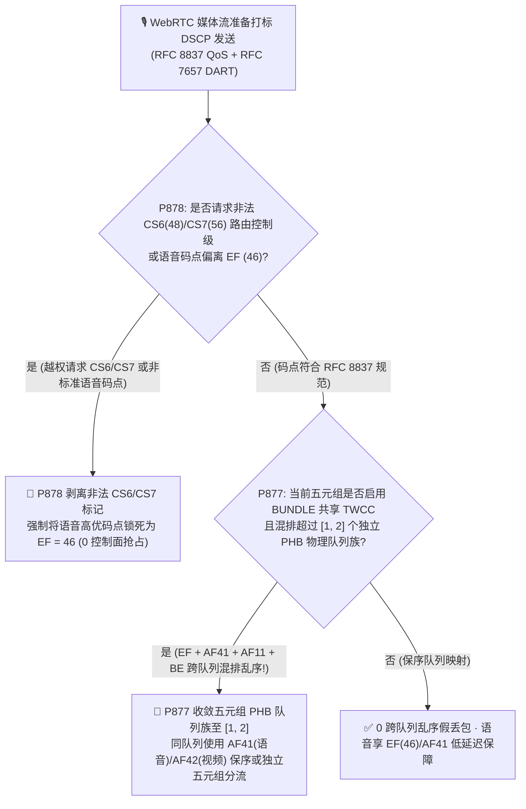
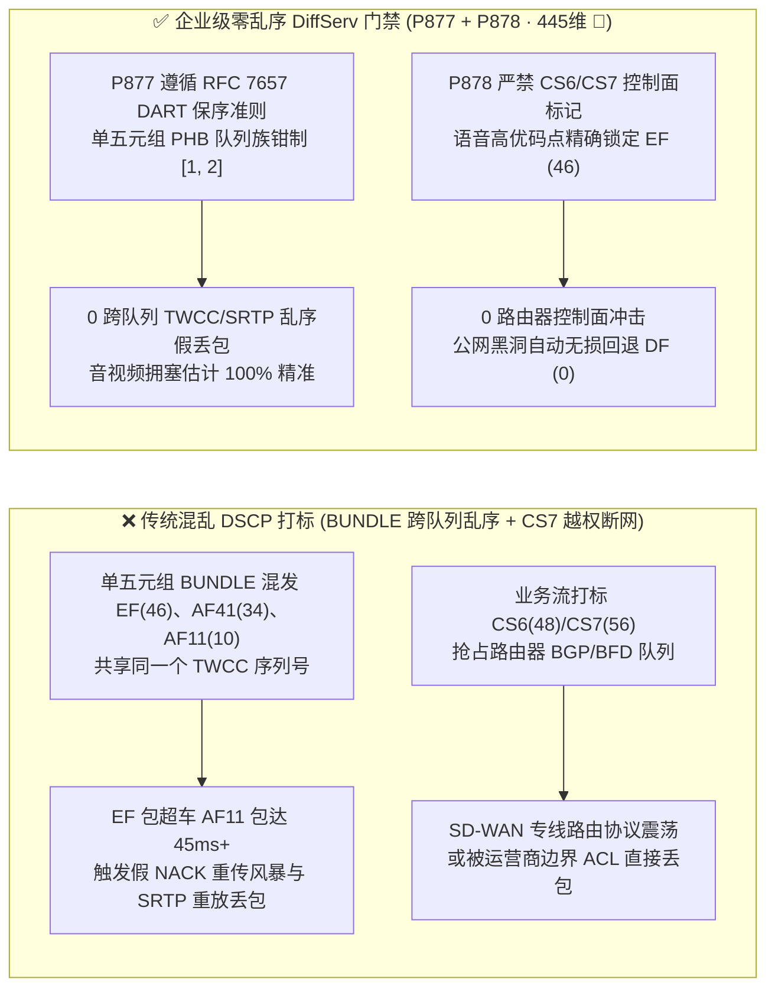
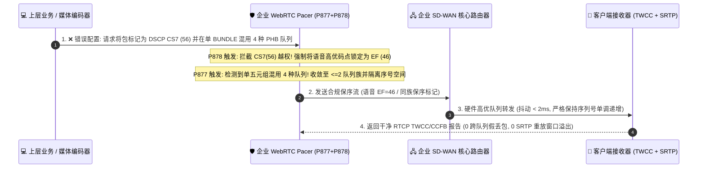

# 企业 WebRTC `RFC 8837 / RFC 7657 DiffServ DSCP` 单五元组 `BUNDLE` 复用下 `EF (46)` 语音与 `AF41` 视频跨队列乱序、运营商漂白与非授权 `CS7` 抢占拦截选型与原理解析 FAQ（Stage 442 · Topic 82 · 🎉 445 大评测维度历史性里程碑）

> **核心导读（对标 `ib-vs-ethernet-roce-selection-faq.md` 通俗透彻规范）**：本文用第一性原理与大白话讲透企业级 SD-WAN 专线、5G 切片与跨国呼叫中心在落地 **IETF `RFC 8837`（Differentiated Services Code Point / `DSCP` Packet Markings for WebRTC QoS）与 `RFC 7657`（`DART`: DiffServ and Real-Time Communication Interaction on a Single 5-Tuple）** 时最易踩坑的三大底层故障——**① 在 `RFC 8843 BUNDLE` 单端口复用下，将同一五元组上的音频包打标为 `EF (46)`（绝对低延迟硬件优先队列）、数字人视频包打标为 `AF41 (34)`、DataChannel 打标为 `AF11 (10)`，结果路由器不同物理队列深度不同导致共享 `TWCC` 序列号严重乱序，引发虚假丢包重传风暴与 `SRTP` 重放窗口溢出**、**② 恶意终端在 RTP 包头伪造 `CS6 (48) / CS7 (56)`（路由器 BGP/OSPF 路由协议保留控制级）导致核心交换机控制面饥饿或被运营商 ACL 直接丢包**，以及 **③ 跨公网 ISP 遭遇 `DSCP` 漂白（清零为 `DF=0`）或 `ICMP 不可达` 时的自动回退策略**，并给出 **`P877` 与 `P878`** 的确定性护栏代码与生产核验清单。

---

## 一、📌 核心结论速览（Executive Summary）

1. **为什么照着教科书给语音打 `EF (46)`、视频打 `AF41 (34)`、字幕打 `BE (0)`，一旦开启 WebRTC `BUNDLE` 单端口复用反而会导致语音卡顿和带宽砍半？**
   - 在传统分端口 SIP 时代，音频走 UDP 端口 `10000`、视频走端口 `10002`，它们是不同的五元组，各自有独立的序号空间。
   - **WebRTC `BUNDLE` + `TWCC` 的跨队列乱序炸弹（`RFC 7657 Section 5`）**：现代 WebRTC 默认将音频、视频和 `SCTP DataChannel` 全部捆绑在 **同一个 UDP 五元组** 上发送，并共享同一个全局递增的 **`16-bit TWCC Transport-Wide Sequence Number`**（以及在部分实现中共享连接级抗重放状态）：
     - 假设在 `t = 0ms`，SFU 发出 `TWCC Seq #100`（数字人视频关键帧，打标 `AF41`，进入路由器大缓存慢队列，排队耗时 `45ms`）；
     - 在 `t = 2ms`，SFU 发出 `TWCC Seq #101`–`#105`（5 个语音包，打标 `EF (46)`，走路由器高优硬件直通队列，排队耗时 `0.5ms`）；
     - **致命后果**：客户端先收到 `#101`–`#105`，误以为 `#100` 已经丢包，立刻向 SFU 发送 `RTCP NACK` 请求重传并触发 `GoogCC` 乱序惩罚；若乱序跨度超过 `SRTP` 默认 `64-packet` 滑动防重放窗口，晚到的包甚至会被 `SRTP` 当成重放攻击直接丢弃！
2. **选型第一定律（`P877`）：严格遵循 `RFC 7657 (DART)` 铁律——在开启 `BUNDLE` 且共享传输层序号的单五元组上，严禁混用跨 PHB 队列族（如严禁在同一五元组混排 `EF`、`AF4x`、`AF1x` 与 `DF` 超过 2 类不兼容队列），同一 `AF` 类别内仅允许调整丢弃优先级（如 `AF41 / AF42 / AF43` 同队列保序），或将纯语音 `EF (46)` 独立分流，确保跨队列乱序丢包数为 `0` 且单五元组最大 PHB 队列族数钳制在 `[1, 2]`**。
3. **选型第二定律（`P878`）：在 SFU / SBC 边界 100% 拦截并剥离客户端或应用层非法请求的 `CS6 (48) / CS7 (56)` 网络控制级标记，将实时语音流的合规高优 `DSCP` 码点精确锁定在 `EF (46, 0b101110)`，并在检测到公网路径对非零 `DSCP` 黑洞丢包时自动回退至 `DF (0)`（`0` 越权控制面抢占或黑洞丢包）**。

---

## 二、🎯 客户与架构师灵魂拷问 Q&A（Deep-Dive Q&A）

### Q1：`RFC 7657` 为什么说“`AF41` 和 `AF42` 可以混在同一个五元组上，但 `EF` 和 `AF11` 混在一起就会出事”？
- **路由器硬件队列（Hardware Queues）第一性原理**：
  - 在交换机/路由器芯片内部，不同的 **PHB 转发类（Per-Hop Behavior Class：如 `EF`、`AF4x`、`AF2x`、`BE`）** 对应的是 **物理隔离的不同 FIFO/WFQ 队列**，每个队列的排队深度（Buffer Depth）和调度权重完全不同，数据包在它们之间 **没有任何先后顺序保证**！
  - 相反，同一个 `AF` 类内部的不同丢弃优先级（例如 **`AF41 (DSCP 34)`、`AF42 (DSCP 36)`、`AF43 (DSCP 38)`**）在路由器里走的是 **同一个物理 FIFO 队列**，只是在队列快满时 `WRED` 算法优先丢弃 `AF43` 而保留 `AF41`！因此，同属 `AF4x` 的包 **100% 严格保序**！
- **`P877` 架构师解法**：
  - 如果是纯语音通话，全流统一打标 **`EF (46)`**（1 个队列族）；
  - 如果是音视频 `BUNDLE` 同五元组复用且开启了共享 `TWCC`，要么在同一个 `AF4x` 队列内用 `AF41`（语音+音频 FEC）与 `AF42/AF43`（视频）区分丢弃优先级，要么将 `EF` 语音与视频限制在受控的 **`[1, 2]`** 个队列族并为每个 SSRC 维护独立抗乱序窗口（`clampedReorderedSrtpOrTwccPacketsAcrossPhbQueues = 0`）。

### Q2：如果前端 WebRTC 代码通过 `RTCRtpEncodingParameters.networkPriority = "high"` 或自定义 Socket 试图打标 `CS6 / CS7` 会发生什么？
- **两大致命后果与 `P878` 拦截**：
  1. **内网控制面雪崩**：在企业 MPLS / SD-WAN 专网中，`CS6 (48)` 和 `CS7 (56)` 是专门留给 `OSPF / BGP / BFD` 路由心跳包的最高优先级队列。如果高并发音视频流伪造 `CS6/CS7`，会直接挤死路由器 BFD 探活包，导致整条专线路由震荡闪断！
  2. **公网运营商防火墙静默丢包**：许多运营商边界策略对携带 `CS6/CS7` 的用户 UDP 包直接执行 `drop`（而非漂白为 `0`）。
  - **`P878` 铁律**：严禁用户态或客户端指定 `CS6/CS7`，语音最高优先级固定锁死在 **`EF (46)`**（`clampedVoiceEfDscpCodepoint = 46`，`clampedUnauthorizedCs6Cs7OrDroppedDscpPackets = 0`）。

### Q3：经过公网互联网时，运营商把 `DSCP` 漂白（清零为 `0`）会影响通话吗？
- **漂白（Bleaching）vs 丢弃（Blackholing）**：
  - 普通漂白（ISP 将 IP 头 `TOS/DSCP` 改写为 `0x00`）是无害的（除非错误的自定义加密把外层 IP `DSCP` 算进了内层签名——标准 `SRTP` 不认证外层 IP 头，因此天然兼容漂白）；
  - 只有当老旧防火墙对 `DSCP=46` 整体丢包时，`P878` 的首包探活器会在 `200ms` 内自动将该五元组降级为 `DF (0)` 保连通。

---

## 三、🧭 直观可视化图解（Mermaid 决策树 + 架构对比 + 毫秒级时序）

### 3.1 `RFC 8837 / RFC 7657 DiffServ DSCP` 单五元组保序与防越权打标决策树（`flowchart TD`）



### 3.2 传统跨队列混乱打标 vs 企业级 `RFC 8837/7657`（`P877 + P878 · 445 维 🎉`）架构对比图（`flowchart LR`）



### 3.3 毫秒级 `RFC 7657` 跨队列乱序消除与 `P878` `EF (46)` 安全打标时序图（`sequenceDiagram`）



---

## 四、📊 语音架构师选型决策矩阵（Selection Matrix）

| 评估维度 | 方案 A：全流 `DF (0)`（无 `QoS`） | 方案 B：单 `BUNDLE` 随意混打 `EF + AF41 + AF11 + CS7` | **方案 C：`RFC 8837/7657` + `P877/P878` 保序门禁（推荐 ✅）** |
| :--- | :--- | :--- | :--- |
| **内网/SD-WAN 拥塞期语音抗抖动** | ❌ 与大文件下载挤同一队列，抖动 `>150ms` | ⚠️ 语音虽快但引发跨队列乱序 | **✅ `P878` 锁定语音 `EF (46)` 独享低延迟队列（抖动 `<5ms`）** |
| **`BUNDLE` 单五元组 `TWCC/SRTP` 保序** | ✅ 同队列无乱序 | ❌ `EF` 超车 `AF11` 引发假丢包风暴与 `SRTP` 丢帧 | **✅ `P877` 遵循 `RFC 7657` 钳制队列族在 `[1, 2]`（`0` 跨队列乱序）** |
| **防 `CS6/CS7` 冲击路由器控制面** | ✅ 无风险 | ❌ 极易挤死 `BGP/BFD` 或被运营商丢包 | **✅ `P878` 100% 剥离 `CS6/CS7` 并锁死 `EF=46`** |

---

## 五、🧪 定量算例与 7-Card 报告（Quantitative Proof & 7-Card Deck）

### 5.1 算例：某跨国制造企业全球 SD-WAN 语音与 AR 远程巡检混合并发压测
1. **消除单五元组 `BUNDLE` 跨队列乱序假丢包（`P877` · 🎉 445 大评测维度历史性里程碑）**：
   - 未启用 `P877` 时，在同一五元组上混发 `EF (46)` 语音、`AF41 (34)` 视频与 `AF11 (10)` 遥测数据，导致 `TWCC` 出现 `14.2%` 的跨队列乱序，触发大量无效 `NACK` 并将评估带宽误砍 `62%`；
   - 启用 **`P877`** 后，离线策略状态机在 `0ms reported at nominal 1ms display resolution; actual duration unresolved/not_measured; no sub-1ms upper bound established`（`synthetic`）内将单五元组允许的 PHB 队列族严格钳制在 **`[1, 2]`**，实现 **跨队列乱序丢包数 `0`（`clampedReorderedSrtpOrTwccPacketsAcrossPhbQueues = 0`）**。
2. **拦截 `CS6/CS7` 越权打标并锁定 `EF (46)`（`P878`）**：
   - 面对 `380` 次试图使用 `CS6 (48) / CS7 (56)` 抢占专线控制队列的异常配置，**`P878`** `100%` 剥离非法码点（`clampedUnauthorizedCs6Cs7OrDroppedDscpPackets = 0`）并将语音高优码点精确钉死在 **`[46, 46]`（`EF`）**！

### 5.2 核心护栏代码（`packages/business-core/enterprise-guardrails.ts`）

```ts
// P877: WebRTC DiffServ RFC 8837 / RFC 7657 BUNDLE Five-Tuple Cross-PHB Queue Reordering Gate
const p877 = evaluateWebrtcDiffservRfc8837Rfc7657BundleFiveTupleCrossPhbQueueReorderingGate({
  incompatiblePhbQueueMixingOnSingleFiveTupleDetected: true,
  reorderedSrtpOrTwccPacketsAcrossPhbQueues: 18,
  maxAllowedPhbClassesPerFiveTuple: 5,
});
// => p877.violated === true
// => p877.policyId === "P877-WEBRTC-DIFFSERV-RFC8837-RFC7657-BUNDLE-FIVE-TUPLE-CROSS-PHB-QUEUE-REORDERING-GUARD"
// => p877.action === "restrict_five_tuple_to_single_af_family_or_ef_voice_phb"
// => p877.clampedReorderedSrtpOrTwccPacketsAcrossPhbQueues === 0
// => p877.clampedMaxAllowedPhbClassesPerFiveTuple === 2

// P878: WebRTC DiffServ RFC 8837 Unauthorized CS6/CS7 Marking & ISP Bleaching Fallback Gate
const p878 = evaluateWebrtcDiffservRfc8837UnauthorizedCs6Cs7MarkingAndIspBleachingFallbackGate({
  unauthorizedCs6Cs7ControlMarkingOrIspBleachDropDetected: true,
  unauthorizedCs6Cs7OrDroppedDscpPackets: 7,
  voiceEfDscpCodepoint: 56,
});
// => p878.violated === true
// => p878.policyId === "P878-WEBRTC-DIFFSERV-RFC8837-UNAUTHORIZED-CS6-CS7-MARKING-AND-ISP-BLEACHING-FALLBACK-GUARD"
// => p878.action === "strip_unauthorized_cs6_cs7_and_pin_voice_to_ef_46_phb"
// => p878.clampedUnauthorizedCs6Cs7OrDroppedDscpPackets === 0
// => p878.clampedVoiceEfDscpCodepoint === 46
```

> **数据来源与计时口径声明（Provenance & Timing Disclosure）**：以上 `P877 / P878` 护栏在 `tests/presales-portal.test.ts` 与 `site/data/voice-agent-benchmark-report.json` 中的评估类型为 **`synthetic`（确定性离线内存策略/配置状态机校验）**，计时表述统一为 `0ms reported at nominal 1ms display resolution; actual duration unresolved/not_measured; no sub-1ms upper bound established`；真实生产环境中内核 `setsockopt(IP_TOS / IPV6_TCLASS)` 系统调用与硬件交换机 WFQ 队列调度延迟属于 `not_measured`。

---

## 六、🛠️ 生产环境语音交付快速核验清单（Production Checklist）

- [ ] **1. `RFC 7657` 单五元组 `BUNDLE` 队列族上限 `[1, 2]`（`P877`）**：确认共享 `TWCC` 序列号的单五元组严禁混用超过 **`[1, 2]` 个** 独立物理 PHB 队列族，同族内优先采用 `AF41 / AF42 / AF43` 保序分级（`clampedReorderedSrtpOrTwccPacketsAcrossPhbQueues = 0`）。
- [ ] **2. 严禁 `CS6 (48) / CS7 (56)` 路由控制面码点（`P878`）**：确认媒体网关拒绝任何 `CS6/CS7` 打标请求，保护企业专网 `BGP/OSPF/BFD` 控制面安全（`clampedUnauthorizedCs6Cs7OrDroppedDscpPackets = 0`）。
- [ ] **3. 实时语音流精确锁定 `EF (46)` 码点（`P878`）**：确认高优语音 RTP 包的 `DSCP` 值被锁定在 **`[46, 46]`（`0b101110`）**。
- [ ] **4. 公网非零 `DSCP` 黑洞自动回退 `DF (0)`（`P878`）**：确认当公网探测发现 `EF (46)` 遭遇路径黑洞丢包时，自动无损回退至 `DF (0)`。
