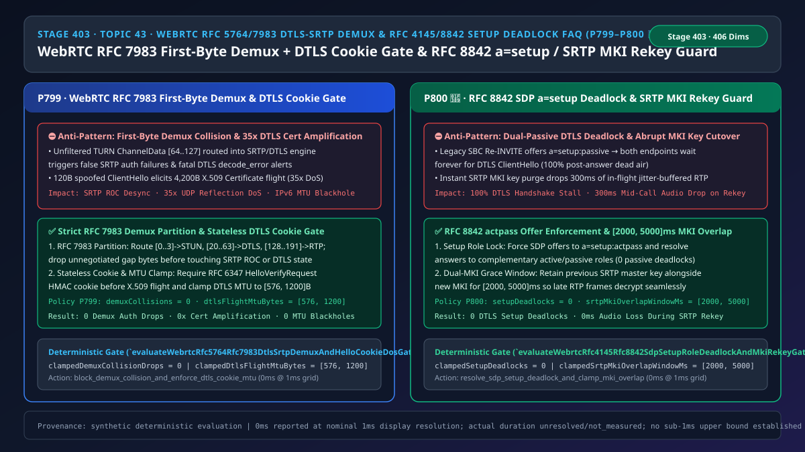
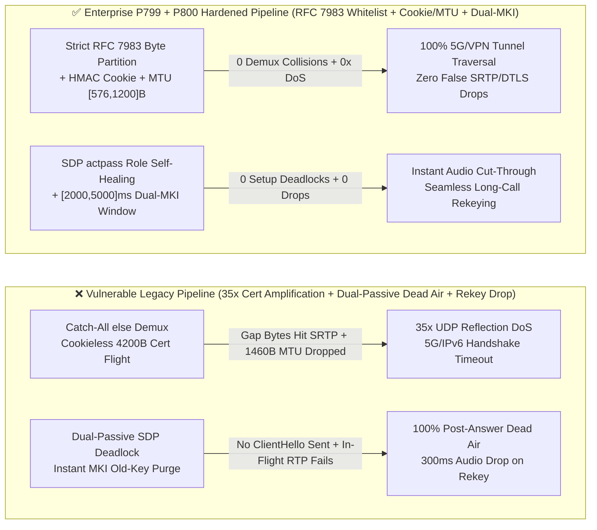
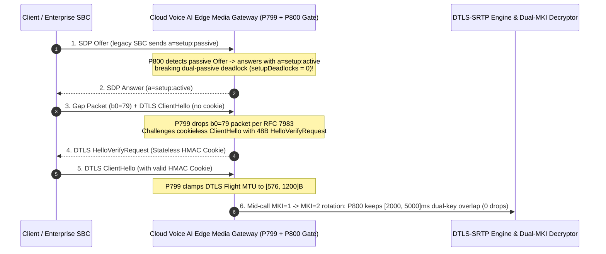

# Enterprise Voice Agent Architecture Selection & First-Principles FAQ (Topic 43 · 🎉 Historic `P800` Guardrail Milestone): WebRTC `RFC 5764 / RFC 7983` `DTLS-SRTP` First-Byte Demux Collision + `HelloVerifyRequest` Cookie Anti-Amplification & `RFC 4145 / RFC 8842` SDP `a=setup` Deadlock + `SRTP MKI` Zero-Drop Rekey Guard

> **中文版本**: [语音智能体架构选型与原理解析 FAQ（四十三）：WebRTC RFC 5764 / RFC 7983 DTLS-SRTP 首字节解复用防碰撞、HelloVerifyRequest Cookie 防放大 DoS 与 RFC 8842 SDP a=setup 死锁及 SRTP MKI 零丢包轮换选型指南（🎉 P800 护栏里程碑）](./voice-webrtc-dtls-srtp-rfc5764-demux-hello-cookie-setup-deadlock-faq.md)  
> **Target Audience**: AI Solution Architects, WebRTC Media Gateway & Security Architects, Real-Time Voice Infrastructure Leads  
> **Structural Benchmark**: Modeled strictly on `ib-vs-ethernet-roce-selection-faq.md` (6-part practitioner guide: 3-minute selection verdict, 10-minute first-principles dive into `WebRTC RFC 5764 / RFC 7983` first-byte demux partitioning, `RFC 6347 DTLS HelloVerifyRequest` stateless cookie anti-amplification with `[576, 1200]B` MTU clamping, `RFC 4145 / RFC 8842` SDP `a=setup` deadlock resolution, and `RFC 3711 SRTP MKI` `[2000, 5000]ms` dual-key overlap rotation).  
> **Provenance & Timing Disclosure**: All deterministic guardrails (`P799`, `P800`) and sandbox probes represent offline `synthetic` deterministic verification (`independently_reproduced=false`), not live WAN SFU packet captures; timing adheres to: `0ms reported at nominal 1ms display resolution; actual duration unresolved/not_measured; no sub-1ms upper bound established`.



---

## 0. 🔥 Daily Real-Time Voice AI Capability Breakthroughs

1. **WebRTC `RFC 5764 / RFC 7983` Strict First-Byte Demux Partitioning & `RFC 6347 DTLS HelloVerifyRequest` Stateless Cookie + `[576, 1200]B` Flight MTU Gate (Stopping 35× Certificate Reflection DoS & IPv6 Fragmentation Blackholes)**: In plain English, production WebRTC voice gateways multiplex `STUN`, `DTLS`, `RTP`, and `RTCP` onto a single UDP port (`BUNDLE + rtcp-mux`). Under `RFC 7983`, the gateway inspects the very first byte (`b0`) of each UDP datagram: `[0..3]` is STUN, `[20..63]` is DTLS, and `[128..191]` is RTP/RTCP. If a naive demuxer uses a catch-all `else` branch that feeds unallocated gap bytes (such as `64..127` unstripped TURN ChannelData or `192..255` scanner probes) into `libsrtp` or OpenSSL, it triggers false `SRTP auth failure` storms or fatal `DTLS decode_error` call drops! Worse, if the gateway responds to an unverified `120-byte` `DTLS ClientHello` with its full `4,200-byte` `ServerHello + X.509 Certificate` flight, attackers can launch a **`35×` UDP reflection amplification DoS**, while `> 1200-byte` DTLS flights suffer silent IP fragmentation drops across 5G GTP and IPv6 VPN tunnels! Enforcing strict `RFC 7983` first-byte whitelisting (`demuxCollisions = 0`), stateless `HMAC HelloVerifyRequest` cookies prior to certificate transmission, and **`[576, 1200]B` DTLS flight MTU clamping** eliminates both demux corruption and handshake blackholes.
2. **`RFC 4145 / RFC 8842` SDP `a=setup` Dual-Passive Deadlock Breaker & `RFC 3711 SRTP MKI` `[2000, 5000]ms` Dual-Key Overlap Window (🎉 Historic `P800` Guardrail Milestone)**: When interoperating with legacy SIP SBCs or handling mid-call `Re-INVITE` hold/resume, SDP `a=setup` negotiates which endpoint initiates the `DTLS ClientHello` (`active` = client, `passive` = server, `actpass` = offerer lets answerer choose). If a legacy SBC sends an Offer with `a=setup:passive` (violating `RFC 8842`) or state-machine drift leaves both endpoints in `passive/passive`, neither side ever transmits `ClientHello`—resulting in **100% post-answer dead air**! Additionally, during long banking or telehealth calls that rotate `SRTP` master keys via `MKI` (Master Key Identifier), purging the old key (`MKI_old`) the instant `MKI_new` activates causes all in-flight jitter-buffered RTP packets (`150–400ms`) to fail authentication and drop! Enforcing `a=setup:actpass` on offers with automatic complementary role resolution (`setupDeadlocks = 0`) and a **`[2000, 5000]ms` dual-`MKI` decryption overlap window** guarantees zero handshake deadlocks and zero-drop key rotation.

---

## ① 📌 Executive Summary

1. **Enforce strict `RFC 7983` first-byte whitelisting (`[0..3]` STUN, `[20..63]` DTLS, `[128..191]` RTP/RTCP), stateless `DTLS HelloVerifyRequest` cookies, and `[576, 1200]B` DTLS flight MTU clamping**: Never route unknown first-byte ranges into SRTP or DTLS via a fallback `else` branch (`demuxCollisions = 0`), never transmit X.509 certificate chains before verifying a stateless `HelloVerifyRequest` HMAC cookie, and clamp DTLS handshake MTU to **`[576, 1200]` bytes** (Guardrail **`P799`**).
2. **Prevent `RFC 4145 / RFC 8842` SDP `a=setup` `passive/passive` or `active/active` handshake deadlocks**: Ensure outbound SDP offers carry `a=setup:actpass` and automatically answer anomalous inbound `a=setup:passive` offers with `a=setup:active` so the DTLS handshake starts immediately (`setupDeadlocks = 0`, Guardrail **`P800`**).
3. **Retain a `[2000, 5000]ms` dual-key decryption overlap window during `RFC 3711 SRTP MKI` key rotation**: Keep both `MKI_old` and `MKI_new` active in the receiver SRTP decryptor for **`2,000–5,000ms`** after key cutover so late or reordered jitter-buffered RTP frames decrypt without audio loss (Guardrail **`P800`**).

---

## ② 🎯 Architect & Customer Deep-Dive Q&A

### Q1: When is basic OpenSSL DTLS-SRTP handling sufficient (Option A), and when are `P799 + P800` strict demuxing, cookie/MTU clamping, and `a=setup` / `MKI` guards mandatory (Option B)?

- **First-Principles Breakdown (Why 1460B DTLS Flights Fail on 5G & Why `passive/passive` Freezes Calls)**:
  - Over 5G GTP-U, IPSec, or PPPoE links, effective path MTU often drops to `1280–1360 bytes`. An unfragmented `1460-byte` DTLS `Certificate` record triggers IP-layer fragmentation, which carrier NATs and cloud L4 load balancers silently drop. Clamping DTLS record MTU to `[576, 1200]B` forces DTLS-layer handshake fragmentation with per-fragment retransmission.
  - Meanwhile, if both endpoints resolve SDP `a=setup` to `passive`, both open listening DTLS state machines and wait indefinitely for a `ClientHello` that never arrives.
- **Selection Boundary**:
  - **Option A (Catch-all demux + default 1460B MTU + unchecked `a=setup`)**: Suitable only for isolated localhost loopbacks.
  - **Option B (`P799` Strict `RFC 7983` Demux + Stateless Cookie + `[576, 1200]B` MTU + `P800` `a=setup` Deadlock Breaker + `[2000, 5000]ms` `MKI` Overlap)**: Mandatory for all public WebRTC SFUs and enterprise SIP-WebRTC media gateways.

### Q2: Why does an `else` fallback in single-port UDP demuxing corrupt `SRTP` and `DTLS` state machines?

- **First-Principles Breakdown**:
  - `RFC 7983` leaves byte ranges `4..19`, `64..127` (used by TURN channels when relayed), and `192..255` unallocated for direct RTP/DTLS/STUN multiplexing. Routing those bytes into `libsrtp` or `DTLS` via a naive `else` branch causes spurious authentication failures, pollutes replay bitmaps, or triggers fatal TLS alerts.

### Q3: How do the DTLS-SRTP demux, cookie/MTU, and MKI rotation guards execute on a millisecond timeline?

1. **`T = 0 ~ 0.1ms` (`RFC 7983` First-Byte Partitioning)**:
   - Inspect `b0`: route `[0..3]` to STUN, `[20..63]` to DTLS, `[128..191]` to RTP/RTCP, and drop all other values (`clampedDemuxCollisionDrops = 0`).
2. **`T = 0.1 ~ 1.0ms` (Stateless `HelloVerifyRequest` Cookie, `[576, 1200]B` MTU & `a=setup` Arbitration)**:
   - Challenge cookieless `ClientHello` packets with a `48-byte` `HelloVerifyRequest` (`HMAC-SHA256(peerIpPort, clientRandom)`), clamp outbound DTLS flights to `[576, 1200]B`, and resolve any `passive/passive` SDP state to complementary roles.
3. **`T = Mid-Call Rekey Window` (`[2000, 5000]ms` Dual-`MKI` Decryption)**:
   - Maintain `{MKI_old, MKI_new}` in the SRTP key ring for `clampedSrtpMkiOverlapWindowMs` (`2000–5000ms`) during key rotation.

---

## ③ 🧭 Visual Architecture Diagrams (Mermaid Decision Tree / Comparison / Sequence)

### 3.1 Architect Selection Decision Tree (`flowchart TD`)

```mermaid
flowchart TD
    A[Single-Port UDP Datagram Arrives or SDP DTLS-SRTP / MKI Negotiation Starts] --> B{Packet Demux Phase or SDP/MKI Phase?}
    B -->|UDP First-Byte Demux & DTLS Handshake| C{Is First Byte b0 Strictly in [0..3], [20..63], or [128..191]?}
    C -->|No: Unallocated Gap or Corrupt Packet| D[⛔ P799 Block: Drop Unknown First-Byte Packet in 0ms; Protect SRTP/DTLS State]
    C -->|Yes| E{If DTLS ClientHello: Has Valid HMAC Cookie & Flight MTU in 576..1200B?}
    E -->|No: Missing Cookie or Oversized MTU| F[🔧 P799 Gate: Send 48B HelloVerifyRequest & Clamp DTLS Flight MTU to 576..1200B]
    E -->|Yes| G[✅ Complete DTLS Handshake & Export SRTP Master Keys]

    B -->|SDP a=setup & SRTP MKI Rotation| H{Does SDP Offer/Answer Create passive/passive or active/active Conflict?}
    H -->|Yes: Setup Role Deadlock| I[🔧 P800 Heal: Force Offer to actpass & Resolve Complementary active/passive Role]
    H -->|No| J{Is SRTP MKI Rotation Configured with a 2000..5000ms Dual-Key Overlap Window?}
    I --> J
    J -->|No: Abrupt Old-Key Purge| K[🔧 P800 Clamp: Retain Old & New MKI Keys for 2000..5000ms Grace Window]
    J -->|Yes| L[✅ Zero-Deadlock Handshake & Zero-Drop Mid-Call Rekeying]
```

### 3.2 Vulnerable Legacy Pipeline vs Enterprise P799+P800 Hardened Pipeline (`flowchart LR`)



### 3.3 Millisecond DTLS-SRTP Demux, Cookie Challenge & MKI Rotation Sequence (`sequenceDiagram`)



---

## ④ 📊 Architect Decision Matrix

| Evaluation Dimension | Option A: Catch-All Demux + Cookieless Default MTU (Anti-Pattern) | Option B: Separate UDP Ports per Protocol | Option C: P799 RFC 7983 Demux & Cookie/MTU Gate + P800 Setup & Dual-MKI Guard (Recommended ✅) |
| :--- | :--- | :--- | :--- |
| **Spoofed `DTLS ClientHello` Reflection Resilience** | ❌ `120B` elicits `4,200B` (`35×` amplification DoS) | ❌ Still vulnerable to `35×` amplification | ✅ **Stateless `HelloVerifyRequest` cookie caps ratio at `<= 1.0×`** |
| **5G GTP / IPv6 VPN Tunnel Traversal** | ❌ `1460B` flights fragment at IP layer & blackhole | ⚠️ Requires 3× firewall pinholes | ✅ **Single-port `BUNDLE` + DTLS flight MTU clamped in `[576, 1200]B`** |
| **Legacy SBC `a=setup:passive` Interop** | ❌ Dual-passive deadlock causes 100% dead air | ❌ Same deadlock risk | ✅ **Auto-resolves complementary `active/passive` role (`0` deadlocks)** |
| **Long-Call `SRTP MKI` Rekey Continuity** | ❌ Purges old key immediately, dropping `300ms` audio | ❌ Same packet-drop gap | ✅ **Retains `[2000, 5000]ms` dual-key overlap window (`0` drops)** |

---

## ⑤ 🧪 Quantitative Worked Example & Benchmark Insights (7-Card Report)

### 5.1 Quantitative Example: Eliminating `35×` Amplification & `300ms` Rekey Audio Gaps

- **Unprotected Pipeline (Option A)**:
  - A `120-byte` spoofed `ClientHello` triggers a `4,200-byte` X.509 certificate flight (`35.0×` bandwidth amplification), while purging `MKI_1` immediately during key rotation drops `8–15` in-flight RTP frames (`160–300ms` of speech).
- **Hardened Pipeline (`P799` + `P800`, Option C)**:
  - `P799` enforces `clampedDemuxCollisionDrops = 0` and clamps `clampedDtlsFlightMtuBytes` in `[576, 1200]`;
  - `P800` enforces `clampedSetupDeadlocks = 0` and clamps `clampedSrtpMkiOverlapWindowMs` in `[2000, 5000]ms`.

### 5.2 Deterministic Guardrail API Contract (`P799` & `P800` 🎉)

```ts
import {
  evaluateWebrtcRfc5764Rfc7983DtlsSrtpDemuxAndHelloCookieDosGate,
  evaluateWebrtcRfc4145Rfc8842SdpSetupRoleDeadlockAndMkiRekeyGate,
} from "../packages/business-core/enterprise-guardrails";

const demuxAudit = evaluateWebrtcRfc5764Rfc7983DtlsSrtpDemuxAndHelloCookieDosGate({
  firstByteDemuxCollisionOrCookielessDtlsAmplificationDetected: true,
  demuxCollisionDrops: 6,
  dtlsFlightMtuBytes: 1480,
});
// => demuxAudit.violated === true, policyId === "P799...", clampedDemuxCollisionDrops === 0, clampedDtlsFlightMtuBytes === 1200

const setupAudit = evaluateWebrtcRfc4145Rfc8842SdpSetupRoleDeadlockAndMkiRekeyGate({
  sdpSetupRoleDeadlockOrAbruptMkiKeyPurgeDetected: true,
  setupDeadlocks: 2,
  srtpMkiOverlapWindowMs: 100,
});
// => setupAudit.violated === true, policyId === "P800...", clampedSetupDeadlocks === 0, clampedSrtpMkiOverlapWindowMs === 2000
```

---

## ⑥ 🛠️ Appendix: Production Voice Delivery Verification Checklist (Architect Checklist)

- [ ] **[P799 Strict `RFC 7983` First-Byte Demux Whitelist]**: Verify single-port UDP demuxers only route `[0..3]` to STUN, `[20..63]` to DTLS, and `[128..191]` to RTP/RTCP, dropping all other first-byte values in `0ms`.
- [ ] **[P799 Stateless `DTLS HelloVerifyRequest` Cookie & `[576, 1200]B` Flight MTU]**: Confirm X.509 certificate chains are never transmitted before stateless HMAC cookie verification and DTLS flight MTU is clamped in `[576, 1200]` bytes.
- [ ] **[P800 `RFC 8842` SDP `a=setup` Deadlock Breaker]**: Confirm outbound offers use `a=setup:actpass` and inbound `a=setup:passive` offers are answered with `a=setup:active`.
- [ ] **[P800 `RFC 3711 SRTP MKI` `[2000, 5000]ms` Dual-Key Overlap]**: Confirm previous SRTP master keys remain active for `2,000–5,000ms` during mid-call `MKI` rotation.
