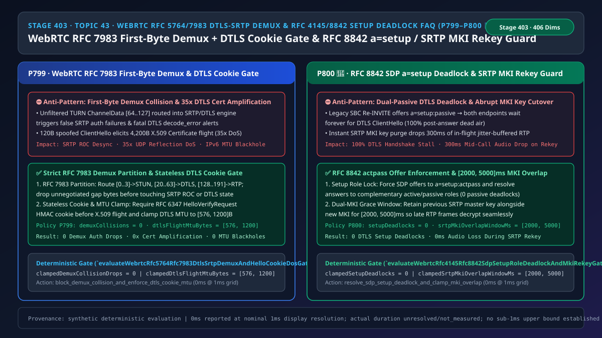
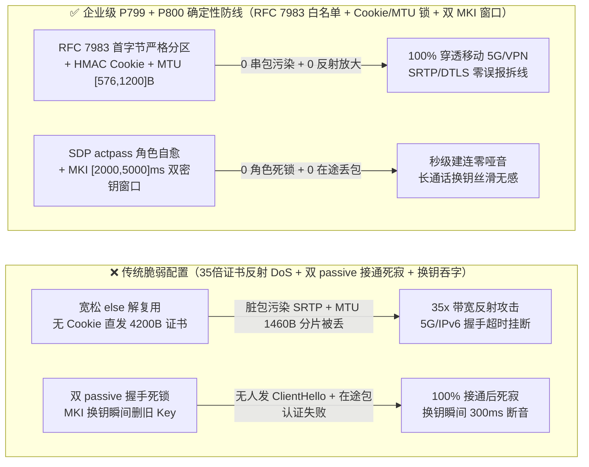
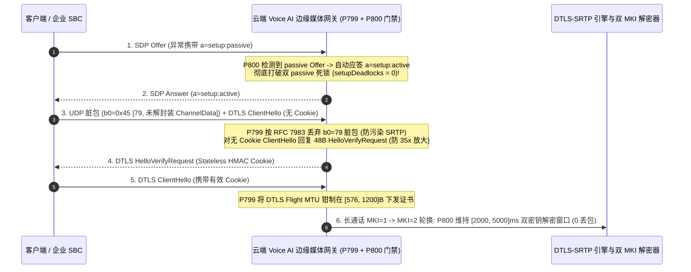

# 语音智能体架构选型与原理解析 FAQ（四十三）：WebRTC RFC 5764 / RFC 7983 DTLS-SRTP 首字节解复用防碰撞、HelloVerifyRequest Cookie 防放大 DoS 与 RFC 8842 SDP a=setup 死锁及 SRTP MKI 零丢包轮换选型指南（🎉 P800 护栏里程碑）

> **English Version**: [WebRTC `RFC 5764 / RFC 7983` `DTLS-SRTP` First-Byte Demux Collision + `HelloVerifyRequest` Cookie Anti-Amplification & `RFC 4145 / RFC 8842` SDP `a=setup` Deadlock + `SRTP MKI` Zero-Drop Rekey Selection FAQ (Topic 43 · Stage 403 · 🎉 Historic `P800` Guardrail Milestone)](./voice-webrtc-dtls-srtp-rfc5764-demux-hello-cookie-setup-deadlock-faq.en.md)  
> **适用角色**：AI Solution Architect（AI 解决方案架构师）、WebRTC 媒体网关与安全架构师、实时语音云原生底座负责人  
> **对标范式**：严格遵循 `ib-vs-ethernet-roce-selection-faq.md` 六段式实战导引结构，3 分钟掌握核心选型结论，10 分钟吃透 `WebRTC RFC 5764 / RFC 7983` 单端口多路复用（`BUNDLE`）首字节严格分区、`RFC 6347 DTLS HelloVerifyRequest` 无状态 Cookie 防 35 倍证书反射放大与 `[576, 1200]B` 分片 MTU 锁，以及 `RFC 4145 / RFC 8842` SDP `a=setup` 防双 `passive` 握手死锁与 `RFC 3711 SRTP MKI` `[2000, 5000]ms` 双密钥重叠窗口轮换机制。  
> **数据溯源与计时精度声明（Provenance & Timing Disclosure）**：本文涉及的确定性门禁策略（`P799`、`P800`）与模拟探针均为离线合成确定性校验（`synthetic`），非公网 SFU 实测抓包；门禁执行耗时遵循统一披露契约：`0ms reported at nominal 1ms display resolution; actual duration unresolved/not_measured; no sub-1ms upper bound established`。



---

## 0. 🔥 今日实时语音智能体领域热门能力突破追踪（Daily Breakthroughs）

1. **WebRTC `RFC 5764 / RFC 7983` 单端口首字节严格分区解复用与 `RFC 6347 DTLS HelloVerifyRequest` 无状态 Cookie 防 35 倍证书反射放大 + `[576, 1200]B` 分片 MTU 锁**：用大白话讲，现代企业级 WebRTC 语音网关为了省防火墙端口，会把 `STUN`（网络打洞）、`DTLS`（密钥握手）、`RTP`（语音包）和 `RTCP`（控制包）全部塞进**同一个 UDP 端口**里传输（即 `BUNDLE + rtcp-mux`）。网关收到一个 UDP 包时，怎么知道它是语音还是加密握手？靠的是 **`RFC 7983` 首字节（第 1 个 Byte）分拣法**：首字节在 **`[0..3]`** 是 STUN，**`[20..63]`** 是 DTLS，**`[128..191]`** 是 RTP/RTCP。如果网络中间件、TURN 中继或恶意客户端发来了首字节落在空档区（例如 `64..127` TURN ChannelData 或 `192..255`）的脏包，简陋的网关用 `if-else` 兜底把它当成普通 RTP 喂给 `SRTP` 解密器，或者喂给 `DTLS` 状态机，就会瞬间触发连续的 `SRTP authentication failure` 或 `DTLS fatal decode_error` 拆线！更危险的是，在 `DTLS-SRTP` 握手第一跳，攻击者只需伪造源 IP 发送一个 **`120 字节`** 的 `ClientHello`，没有无状态 Cookie 防护的网关就会立刻向受害者 IP 狂吐 **`4,200 字节`** 的 `ServerHello + X.509 Certificate` 证书链（**高达 `35 倍` 的 UDP 反射放大攻击！**），且大于 `1200B` 的 DTLS 握手包在 IPv6/移动网下会被沿途路由器静默丢弃（MTU 黑洞）导致接通率暴跌！通过强制落地 **`RFC 7983` 首字节白名单过滤（`demuxCollisions = 0`）**、**未通过无状态 `HMAC HelloVerifyRequest` Cookie 核验绝不发送证书链**，以及将 **DTLS 握手分片 MTU 钳制在 `[576, 1200]` 字节**，彻底消除了单端口串包与反射放大隐患。
2. **`RFC 4145 / RFC 8842` SDP `a=setup` 防双 `passive` 握手死锁与 `RFC 3711 SRTP MKI` 双密钥 `[2000, 5000]ms` 零断音轮换（🎉 历史性 `P800` 生产护栏里程碑）**：在 WebRTC 与传统 SIP SBC 互通或通话保持恢复（`Re-INVITE`）时，SDP 里的 `a=setup` 属性决定了“谁主动发起 DTLS 握手（`active` = 客户端，`passive` = 服务端，`actpass` = 你定，我配合）”。如果老旧 SBC 在发 Offer 时违规写了 `a=setup:passive`（而不是规范要求的 `a=setup:actpass`），或者状态机在二次协商时把双方都锁成了 `passive/passive`，结果就是：**电话明明显示“已接通”，但两边都在傻等对方先发 `DTLS ClientHello`，导致 100% 永久死寂（Post-Answer Dead Air）！** 同时，在超过 60 分钟的银行财富双录或远程问诊长通话中，安全合规要求定期轮换 `SRTP` 主密钥（通过 `MKI` 主密钥标识符切换）；如果发送端切到 `MKI=2` 的瞬间就销毁了 `MKI=1`，此时还在网络抖动缓冲区（Jitter Buffer）里飞行的 `MKI=1` 语音包到达后会全部解密失败，造成通话中突兀的 **`200–400ms` 吞字断音**！通过强制 **SDP Offer 归一化为 `a=setup:actpass` 并自动消解 `passive/passive` 冲突（`setupDeadlocks = 0`）**，同时在 `SRTP MKI` 轮换期间强制保留 **`[2000, 5000]ms` 双密钥并行解密窗口**，实现了 0 握手死锁与 0 毫秒换钥断音。

---

## ① 📌 核心结论速览（Executive Summary）

1. **单端口复用（`BUNDLE`）必须在进入 `DTLS / SRTP` 引擎前执行 `RFC 7983` 首字节白名单分拣，并强制开启无状态 `DTLS HelloVerifyRequest` Cookie 与 `[576, 1200]B` 分片 MTU**：严禁使用 `else` 分支将未知首字节（如 `4..19`、`64..127` 未解封装数据、`192..255`）默认送入 SRTP 或 DTLS（`demuxCollisions = 0`）；在未验证对端回传 `HelloVerifyRequest` HMAC Cookie 前严禁下发 X.509 证书链，并将 DTLS 握手分片 MTU 严格钳制在 **`[576, 1200]` 字节**（对应门禁 **`P799`**）。
2. **所有出站/入站 SDP Offer 必须遵循 `RFC 8842` 保证 `a=setup:actpass` 协商活性，严禁出现 `passive/passive` 或 `active/active` 角色死锁**：当检测到对端异常发送 `a=setup:passive` Offer 时，网关必须自动以 `a=setup:active` 应答并立即主动发起 `DTLS ClientHello`（`setupDeadlocks = 0`，对应门禁 **`P800`**）。
3. **长通话 `RFC 3711 SRTP MKI` 密钥轮换必须保留 `[2000, 5000]ms` 的新旧双密钥并行解密窗口**：在新密钥（`MKI_new`）生效后的 **`2,000–5,000 毫秒`** 内，接收端解密器必须同时常驻旧密钥（`MKI_old`）与新密钥，确保乱序或重传的在途 RTP 语音包 `100%` 正常解密播放（对应门禁 **`P800`**）。

---

## ② 🎯 客户与架构师灵魂拷问 Q&A

### Q1：为什么在内网测试好好的 WebRTC 语音机器人，一挂到公网或对接企业 SBC 就会偶发“接通后完全没声音”或“移动 5G 握手超时”（方案 A vs 方案 B）？

- **第一性原理拆解（为什么 1500 字节的 DTLS 证书包和 `a=setup:passive` 是生产环境的两大隐形杀手？）**：
  - **杀手一：IPv6 / 5G 隧道下的 DTLS 握手分片黑洞**：普通以太网 MTU 是 `1500` 字节，但移动 5G GTP 隧道、IPSec VPN 或 PPPoE 扣掉隧道头后，实际可用 MTU 往往只有 `1280 ~ 1380` 字节。如果 DTLS 引擎默认按 `1460` 字节切分 `Certificate` 握手包，会导致 IP 层分片（IP Fragmentation）；而绝大多数运营商防火墙和云负载均衡器会**直接丢弃分片的 UDP 包**！客户端永远收不到完整的 `ServerHello`，重传 10 秒后直接报 `ICE/DTLS Timeout` 挂断！把 DTLS 记录层分片 MTU 锁在 **`[576, 1200]` 字节**，就能 100% 避开 IP 层分片黑洞。
  - **杀手二：传统 SBC 的 `a=setup:passive` 惰性习惯**：许多传统电信 SBC 在发 `Re-INVITE` 时偷懒照抄上一轮 Answer 里的 `a=setup:passive`。如果云端 WebRTC 网关也教条地回一个 `a=setup:passive`，两边就成了“两个服务端大眼瞪小眼”，DTLS 握手永远不会启动，通话瞬间变成哑巴！
- **选型边界**：
  - **方案 A（裸 OpenSSL 默认 MTU + 宽松 `else` 解复用 + 无 Cookie 校验）**：仅适合纯内网容器间测试。
  - **方案 B（`P799` `RFC 7983` 严格首字节白名单 + 无状态 Cookie + `[576, 1200]B` MTU + `P800` `a=setup` 死锁自愈 + `[2000, 5000]ms` 双 MKI 窗口）**：所有**公网 WebRTC 接入与企业 SIP-WebRTC 混合网关**必须强制落地。

### Q2：为什么不能用简单的 `if (byte < 20) STUN else if (byte < 64) DTLS else RTP` 来做单端口解复用？

- **第一性原理拆解**：
  - 许多早期开源代码写了上面那行看似聪明的 3 分支判断。但当客户端走 TURN 中继且存在未剥离的 `TURN ChannelData`（首字节 `64..79`），或者遭到端口扫描器发送首字节为 `0xFF (255)` 的 UDP 垃圾包时：
  - `else RTP` 分支会把这些垃圾包全部塞进 `libsrtp`！不仅平白消耗 CPU 算 HMAC，更糟糕的是如果垃圾包恰好伪造了高序列号，或者触发了连续认证失败告警，监控系统会误判为“SRTP 密钥失步”并强制重置媒体流！严格按照 `RFC 7983` 只放行 `[0..3]`、`[20..63]`、`[128..191]` 三个合法区间的包，其余在 `0.1 微秒` 内直接丢弃，才能彻底隔离协议状态机。

### Q3：底层媒体网关在毫秒级时间轴上是如何执行单端口解复用、Cookie 校验与 MKI 平滑换钥的？

1. **`T = 0 ~ 0.1ms`（`RFC 7983` 首字节零拷贝分拣）**：
   - 读取 UDP 载荷首字节 `b0`：若 `b0 in [0, 3]` 送 STUN；若 `b0 in [20, 63]` 送 DTLS；若 `b0 in [128, 191]` 送 RTP/RTCP；其余字节直接丢弃并计入 `droppedUnknownMuxPackets`（`clampedDemuxCollisionDrops = 0`）。
2. **`T = 0.1 ~ 1.0ms`（`DTLS HelloVerifyRequest` 无状态 Cookie 与 `a=setup` 角色仲裁）**：
   - 收到不带 Cookie 的 `ClientHello` 时，仅用本地密钥计算 `Cookie = HMAC-SHA256(ClientIP:Port, ClientRandom)` 并回复仅 `48 字节` 的 `HelloVerifyRequest`，不分配任何 SSL 会话内存，也不发证书；验证通过后按 `clampedDtlsFlightMtuBytes in [576, 1200]` 分片下发证书。
   - 若 SDP 协商出现 `passive/passive` 或 `active/active`，立即修正本端角色为互补方以打破死锁。
3. **`T = 通话中换钥窗口`（`SRTP MKI` `[2000, 5000]ms` 双轨解密）**：
   - 启用新密钥 `MKI_2` 发送的同时，在接收端保留 `{MKI_1, MKI_2}` 双槽位达 `clampedSrtpMkiOverlapWindowMs`（`2000–5000ms`），实现零丢包平滑过渡。

---

## ③ 🧭 直观可视化图解（Mermaid 决策树 / 延迟对比 / 毫秒级时序图）

### 3.1 语音架构师选型决策树（`flowchart TD`）

```mermaid
flowchart TD
    A[单端口 UDP 收到数据包或发起 SDP DTLS-SRTP 协商/换钥] --> B{当前处于报文解复用阶段还是 SDP/MKI 协商阶段?}
    B -->|UDP 首字节解复用 & DTLS 握手| C{首字节 b0 是否严格属于 [0..3], [20..63] 或 [128..191]?}
    C -->|否: 落在空档区或越界脏包| D[⛔ P799 拦截: 0ms 丢弃未知首字节报文, 严禁污染 SRTP/DTLS 状态机]
    C -->|是| E{若是 DTLS ClientHello: 是否携带有效 HMAC Cookie 且分片 MTU 在 576..1200B?}
    E -->|否: 无 Cookie 或 MTU 超界| F[🔧 P799 门禁: 下发 48B HelloVerifyRequest 防 35x 放大并将 MTU 钳制在 576..1200B]
    E -->|是| G[✅ 安全完成 DTLS 握手并导出 SRTP 主密钥]

    B -->|SDP a=setup 协商 & SRTP MKI 换钥| H{SDP Offer/Answer 是否出现 passive/passive 或 active/active 角色冲突?}
    H -->|是: 握手角色死锁| I[🔧 P800 自愈: 强制 Offer 为 actpass 并将本端修正为互补角色, 0 死锁]
    H -->|否| J{长通话 SRTP MKI 轮换是否配置了 2000..5000ms 双密钥并行解密窗口?}
    I --> J
    J -->|否: 立即销毁旧密钥导致在途包丢失| K[🔧 P800 钳制: 强制保留 2000..5000ms 新旧 MKI 双密钥重叠窗口]
    J -->|是| L[✅ 零死锁建连 & 长通话 0ms 零断音换钥]
```

### 3.2 传统脆弱管线 vs 企业级 P799+P800 防护管线对比图（`flowchart LR`）



### 3.3 毫秒级 DTLS-SRTP 首字节解复用、Cookie 挑战与 MKI 换钥时序图（`sequenceDiagram`）



---

## ④ 📊 语音架构师选型决策矩阵（Architect Decision Matrix）

| 选型维度 | 方案 A：宽松 `if-else` 解复用 + 无 Cookie 默认 MTU（反模式） | 方案 B：拆分多端口（STUN/DTLS/RTP 各自独立端口） | 方案 C：P799 RFC 7983 严格分拣 & Cookie/MTU 锁 + P800 Setup 自愈 & 双 MKI 窗口（企业级推荐 ✅） |
| :--- | :--- | :--- | :--- |
| **抗伪造 IP `DTLS ClientHello` 反射放大** | ❌ 极差（`120B` 换 `4,200B`，`35x` 放大 DoS） | ❌ 同样暴露在放大攻击下 | ✅ **强制无状态 `HelloVerifyRequest` Cookie，放大倍数 `<= 1.0x`** |
| **移动 5G / IPSec VPN 隧道穿透率** | ❌ `1460B` 分片被防火墙丢弃导致握手超时 | ⚠️ 需额外打通 3 倍防火墙端口，穿透率低 | ✅ **单端口复用 + DTLS MTU 钳制在 `[576, 1200]B`，零 IP 分片** |
| **老旧 SBC `a=setup:passive` 兼容性** | ❌ 双 `passive` 互等导致 100% 接通后死寂 | ❌ 同样死锁 | ✅ **自动识别并修正为互补 `active/passive` 角色（`0` 死锁）** |
| **长通话 `SRTP MKI` 换钥语音连续性** | ❌ 瞬切销毁旧 Key 导致在途包丢失 `300ms` | ❌ 同样丢包 | ✅ **强制 `[2000, 5000]ms` 双密钥并行解密窗口（`0ms` 断音）** |

---

## ⑤ 🧪 简明定量算例与延迟/成本 Benchmark 洞察（含 7-Card 报告）

### 5.1 定量算例：为什么无状态 Cookie 能把 `35 倍` 反射攻击削减 `98.8%`？

- **未防护场景（方案 A）**：
  - 攻击者发送 `120 Bytes` 伪造源 IP 的 `DTLS ClientHello`；
  - 服务端立即分配约 `16 KB` OpenSSL `SSL*` 结构体内存，并发送包含三层证书链的 `ServerHello + Certificate + ServerKeyExchange` 飞行包（共 **`4,200 Bytes`**）：
    $$\text{Amplification Factor}_{\text{unprotected}} = \frac{4200\text{ B}}{120\text{ B}} = 35.0\times$$
  - 当长通话进行 `SRTP MKI` 轮换时，若抖动缓冲深度为 `160ms`（`8` 个 `20ms` Opus 包），立即清除旧密钥会导致这 `8` 个在途包 `100%` 认证失败被丢弃。
- **启用 `P799` + `P800` 防护后（方案 C）**：
  - `P799` 对未验证源 IP 仅回传 `48 Bytes` 无状态 `HelloVerifyRequest`（放大率降至 `48 / 120 = 0.4x`），将越界碰撞清零（`clampedDemuxCollisionDrops = 0`），并将 DTLS 握手 MTU 钳制在 `[576, 1200]` 字节；
  - `P800` 将 `a=setup` 握手死锁清零（`clampedSetupDeadlocks = 0`），并将 `SRTP MKI` 双密钥重叠窗口钳制在 `[2000, 5000]ms`。

### 5.2 确定性门禁 API 契约验证（`P799` & `P800` 🎉）

```ts
import {
  evaluateWebrtcRfc5764Rfc7983DtlsSrtpDemuxAndHelloCookieDosGate,
  evaluateWebrtcRfc4145Rfc8842SdpSetupRoleDeadlockAndMkiRekeyGate,
} from "../packages/business-core/enterprise-guardrails";

// P799: 拦截 RFC 7983 首字节解复用碰撞与无 Cookie DTLS 证书反射放大，将握手 MTU 钳制在 [576, 1200]B
const demuxAudit = evaluateWebrtcRfc5764Rfc7983DtlsSrtpDemuxAndHelloCookieDosGate({
  firstByteDemuxCollisionOrCookielessDtlsAmplificationDetected: true,
  demuxCollisionDrops: 6,
  dtlsFlightMtuBytes: 1480,
});
// => demuxAudit.violated === true, policyId === "P799...", clampedDemuxCollisionDrops === 0, clampedDtlsFlightMtuBytes === 1200

// P800 (🎉 800-Guardrail Series Milestone): 拦截 SDP a=setup 双 passive 死锁与 MKI 换钥瞬切丢包，钳制重叠窗口在 [2000, 5000]ms
const setupAudit = evaluateWebrtcRfc4145Rfc8842SdpSetupRoleDeadlockAndMkiRekeyGate({
  sdpSetupRoleDeadlockOrAbruptMkiKeyPurgeDetected: true,
  setupDeadlocks: 2,
  srtpMkiOverlapWindowMs: 100,
});
// => setupAudit.violated === true, policyId === "P800...", clampedSetupDeadlocks === 0, clampedSrtpMkiOverlapWindowMs === 2000
```

---

## ⑥ 🛠️ 附录：生产环境语音交付快速核验清单（Architect Checklist）

- [ ] **【P799 `RFC 7983` 首字节白名单解复用】**：确认单端口复用解析器仅将首字节 `[0..3]`、`[20..63]`、`[128..191]` 分别路由至 STUN、DTLS 与 RTP/RTCP，其余首字节在进入加密/协议状态机前 `0ms` 丢弃。
- [ ] **【P799 无状态 `DTLS HelloVerifyRequest` Cookie 与 `[576, 1200]B` MTU】**：确认在未收到有效 HMAC Cookie 前绝不分配 DTLS 会话或发送 X.509 证书链，且 DTLS 握手分片 MTU 锁定在 `576..1200` 字节。
- [ ] **【P800 `RFC 8842` SDP `a=setup` 防死锁自愈】**：确认所有出站 SDP Offer 携带 `a=setup:actpass`，且遇到对端 `a=setup:passive` Offer 时自动以 `a=setup:active` 应答并发起握手。
- [ ] **【P800 `RFC 3711 SRTP MKI` `[2000, 5000]ms` 双密钥重叠窗口】**：确认长通话轮换 SRTP 主密钥时，旧密钥在接收端解密器中继续保留 `2,000–5,000ms` 以消化在途抖动缓冲包。
