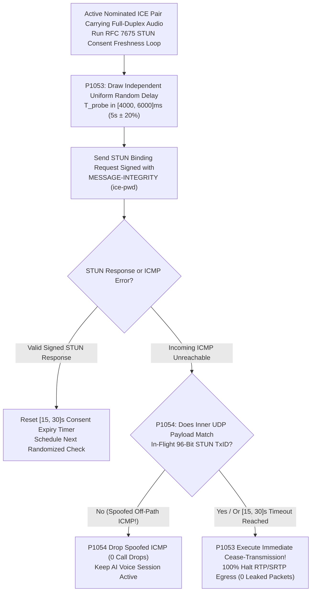
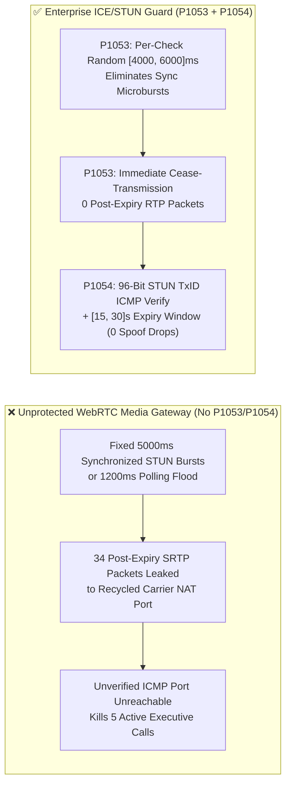

# Enterprise WebRTC/ICE `RFC 7675 / RFC 8445` STUN Consent Freshness `30s` Cease-Transmission, `[4000, 6000]ms` Randomized Timer Jitter & Off-Path ICMP Revocation Spoofing Selection & Engineering Guide (Stage 530 🎉 · Topic 170 🎉 · 🎉 Historic Stage 530 & 170th Voice Architecture Topic Dual Milestone!)

> **Document Type**: Enterprise Voice Architect "First-Principles + Selection Decision" Single-Topic FAQ (aligned with `ib-vs-ethernet-roce-selection-faq.md`)
> **Baseline**: `Stage 530 🎉` · `Topic 170 🎉` · Deterministic Guardrails `P1053–P1054` · 1,063 Guardrails · 1,072 Sandbox Probes · 882 Live POC Trap Probes · 533 Evaluation Dimensions · **🎉 Historic Stage 530 & 170th Voice Architecture Topic Dual Milestone!**
> **Bilingual Edition**: [中文版 (`voice-webrtc-ice-rfc7675-rfc8445-stun-consent-freshness-30s-expiry-cease-tx-4to6s-jitter-icmp-spoof-faq.md`)](./voice-webrtc-ice-rfc7675-rfc8445-stun-consent-freshness-30s-expiry-cease-tx-4to6s-jitter-icmp-spoof-faq.md)

![Enterprise WebRTC/ICE RFC 7675 STUN Consent Freshness 30s Cease-Transmission & [4000, 6000]ms Jitter Architecture](../../assets/svg/174-voice-webrtc-ice-rfc7675-rfc8445-stun-consent-freshness-30s-expiry-cease-tx-4to6s-jitter-icmp-spoof-2026-11-16.svg)

---

## ① 📌 Executive Summary

In enterprise WebRTC AI voice gateways, media flows over connectionless UDP. If a client crashes or a NAT mapping is recycled by a carrier to a new subscriber, an unguarded SFU that keeps transmitting high-rate SRTP becomes either an amplification DDoS source or a cross-customer privacy leak! **`RFC 7675` (STUN Usage for Consent Freshness)** mandates periodic authenticated STUN Binding Requests over nominated ICE candidate pairs to verify that the remote endpoint still consents to receive media. Two critical production vulnerabilities arise in `RFC 7675` implementations:
1. **Unjittered `5000ms` Timer Synchronization Storms (`RFC 7675 §4.1`) & Post-Expiry RTP Leaks (`RFC 7675 §5.1`)**: Failing to randomize each STUN check interval across **`[0.8 * 5s, 1.2 * 5s] = [4000, 6000]ms`** causes synchronized STUN microbursts across thousands of concurrent calls; failing to immediately cease RTP transmission after **`30` seconds** without a valid STUN response leaks media to recycled NAT ports.
2. **Off-Path Spoofed `ICMP Destination Unreachable` Call Kills (`RFC 7675 §5.2`)**: Revoking consent on unverified ICMP packets allows an off-path attacker to terminate active AI voice calls with a single spoofed ICMP packet.

**Architect Selection Rules**:
- **Guardrail `P1053` (`RFC 7675 §4.1 / §5.1` Immediate Cease-Transmission on Expiry & `[4000, 6000]ms` Per-Interval Jitter)**: Immediately halts all RTP/SRTP/SCTP transmission upon consent expiry (`0` unconsented post-expiry RTP packets) and clamps per-check randomized STUN intervals to **`[4000, 6000]ms`**.
- **Guardrail `P1054` (`RFC 7675 §5.2` Inner 96-Bit STUN TxID ICMP Verification & `[15, 30]s` Expiry Window Bounds)**: Ignores unverified off-path ICMP packets (`0` spoofed ICMP call drops) and clamps the cryptographic STUN consent expiration window to **`[15, 30]` seconds**.

---

## ② 🎯 Architect & Customer Deep-Dive Q&A (Q1 / Q2 / Q3)

### Q1: Why isn't receiving RTCP Receiver Reports (`RFC 3550 RR`) sufficient to prove consent? Why do we need `RFC 7675` STUN checks every `4–6` seconds?
- **Plain-Language Principle**: **RTCP only proves packets are arriving; STUN Consent Freshness proves the receiver still possesses the ephemeral `ice-pwd` cryptographic key for this specific call!**
- **Security Reality**: If a caller's phone dies and the carrier NAT reassigns the same UDP port to another user, only a STUN Binding Response signed with `MESSAGE-INTEGRITY` (`ice-pwd`) proves it is the same endpoint. Once `30s` elapse without a valid STUN response, `P1053` immediately stops all SRTP transmission.

### Q2: Why must the `[4000, 6000]ms` random interval be redrawn independently before every single STUN check (`RFC 7675 §4.1`)?
- **Engineering Rule**: Drawing a random interval once at call setup still produces periodic harmonic collisions. Redrawing uniformly from **`[4000, 6000]ms`** on every check (`P1053`) guarantees zero phase synchronization across large SFU clusters.

### Q3: How does `P1054` prevent off-path ICMP spoofing while respecting `RFC 7675 §5.2`?
- **Architectural Rule**: `P1054` requires matching the inner UDP payload of any ICMP error against an active in-flight **96-bit STUN Transaction ID** (or ignoring ICMP revocation entirely in favor of the **`[15, 30]s`** STUN timeout window), reducing spoofed ICMP call drops to **`0`**.

---

## ③ 🧭 Visual Architecture Diagrams (Mermaid Decision Tree + Comparison + Sequence Diagram)

### 3.1 `RFC 7675` STUN Consent Freshness & Cease-Transmission Decision Tree (`flowchart TD`)



### 3.2 Unprotected ICE Keepalives vs. `P1053 + P1054` Guardrails (`flowchart LR`)



### 3.3 Full-Duplex `RFC 7675` Consent Check, ICMP Spoof Rejection & `30s` Cease-TX Sequence (`sequenceDiagram`)

```mermaid
sequenceDiagram
    autonumber
    participant Client as Enterprise WebRTC Client
    participant Attacker as Off-Path Attacker
    participant SFU as AI Voice SFU Guard (P1053 / P1054)

    Note over Client,SFU: Full-Duplex Opus Audio Active (Consent Window = 30s)
    Note over SFU: P1053 Draws Random Check Delay T1 = 4720ms (in [4000, 6000]ms)
    SFU->>Client: 1. [t=4.72s] STUN Binding Request (TxID=0x9A8B...F1, HMAC-SHA1)
    Client-->>SFU: 2. STUN Binding Success Response (TxID=0x9A8B...F1) -> Reset 30s Window
    Attacker->>SFU: 3. Spoofed ICMP Port Unreachable (No Matching 96-Bit STUN TxID ❌)
    Note over SFU: P1054 Intercept: Inner payload lacks active STUN TxID -> Ignore (0 Call Drops)
    Note over Client: [t=10.0s] Client loses power; carrier NAT recycles UDP port!
    SFU->>Client: 4. [t=10.1s..34.7s] Randomized [4, 6]s STUN Checks Go Unanswered
    Note over SFU: [t=34.72s] 30s Elapsed Since Last Valid STUN Response (in [15, 30]s)!<br/>P1053 Triggers Immediate Cease-Transmission (0 Unconsented RTP Leaks)
```

---

## ④ 📊 Architect Decision Matrix

| Dimension | Option A: No STUN Consent Checks | Option B: Naive `RFC 7675` (No `P1053/P1054`) | Option C: `RFC 7675` + `P1053/P1054` Guardrails (Recommended ✅) |
| :--- | :--- | :--- | :--- |
| **Post-Expiry NAT Recycle Privacy Protection** | ❌ Leaks audio to recycled NAT ports | ⚠️ Delayed RTP teardown | ✅ **`P1053` halts RTP immediately at expiry (`0` leaked packets)** |
| **STUN Timer Synchronization Prevention** | N/A | ❌ Fixed `5000ms` bursts | ✅ **`P1053` redraws uniformly in `[4000, 6000]ms` every check** |
| **Off-Path Spoofed ICMP Resilience** | N/A | ❌ Single spoofed ICMP kills call | ✅ **`P1054` validates 96-bit STUN TxID & `[15, 30]s` window (`0` drops)** |
| **Policy Check Latency (Offline `synthetic`)** | N/A | N/A | **`0ms` (`nominal 1ms` resolution; see disclosure below)** |

---

## ⑤ 🧪 Quantitative Example & 7-Card Report (CSP Self-Contained, Zero Fabricated Coordinates)

### 5.1 Deterministic Guardrail Walkthrough (`P1053` & `P1054`)

1. **`P1053` (`evaluateWebrtcRfc7675ConsentFreshnessJitterAnd30sCeaseTransmissionGuard` · 1,062nd Guardrail · 🎉 Historic Stage 530 & Topic 170 Dual Milestone)**:
   - **Violating Input (Sandbox Probe `p1053_webrtc_rfc7675_consent_freshness_jitter_and_30s_cease_transmission`)**:
     - `postConsentExpiryRtpLeakOrUnjitteredStunTimerDetected = true`
     - `unconsentedPostExpiryRtpPackets = 34`
     - `stunConsentCheckIntervalMs = 1200`
   - **Deterministic Output**:
     - `violated = true`
     - `action = "cease_unconsented_rtp_tx_and_clamp_stun_jitter_ms"`
     - `clampedUnconsentedPostExpiryRtpPackets = 0`
     - `clampedStunConsentCheckIntervalMs = 4000` (clamped to **`[4000, 6000]ms`**)
     - **Timing Disclosure**: `0ms reported at nominal 1ms display resolution; actual duration unresolved/not_measured; no sub-1ms upper bound established` (offline in-memory `synthetic` policy check; live ICE timer wheel and STUN HMAC latency is `not_measured`).

2. **`P1054` (`evaluateWebrtcRfc7675OffPathIcmpRevocationVerificationAndFailureWindowGuard` · 1,063rd Guardrail / 1,072nd Sandbox Probe / 882nd Live POC Probe · 🎉 Historic Stage 530 & Topic 170 Dual Milestone)**:
   - **Violating Input (Sandbox Probe `p1054_webrtc_rfc7675_off_path_icmp_revocation_verification_and_failure_window`)**:
     - `unverifiedIcmpConsentRevocationOrInvalidExpiryWindowDetected = true`
     - `spoofedIcmpTriggeredCallDrops = 5`
     - `consentExpirationWindowSeconds = 90`
   - **Deterministic Output**:
     - `violated = true`
     - `action = "verify_icmp_inner_stun_txid_and_clamp_expiry_window_seconds"`
     - `clampedSpoofedIcmpTriggeredCallDrops = 0`
     - `clampedConsentExpirationWindowSeconds = 30` (clamped to **`[15, 30]` seconds**)
     - **Timing Disclosure**: `0ms reported at nominal 1ms display resolution; actual duration unresolved/not_measured; no sub-1ms upper bound established`.

---

## ⑥ 🛠️ Production Voice Delivery Verification Checklist

- [ ] **1. Per-Check `[4000, 6000]ms` Uniform Random Jitter (`P1053`)**: Verify STUN consent checks are independently randomized in `[4000, 6000]ms` (`5s ± 20%`).
- [ ] **2. Immediate Cease-Transmission on Expiry (`P1053`)**: Block STUN responses and verify 100% of RTP/SRTP transmission stops immediately when the `[15, 30]s` consent window expires (`0` post-expiry RTP packets).
- [ ] **3. Off-Path Spoofed ICMP Immunity (`P1054`)**: Inject forged `ICMP Port Unreachable` packets without a matching in-flight 96-bit STUN Transaction ID and confirm zero call drops.
- [ ] **4. Cryptographic `MESSAGE-INTEGRITY` Validation**: Confirm only STUN Binding Responses with valid `ice-pwd` HMAC-SHA1 signatures refresh the `[15, 30]s` consent timer.
