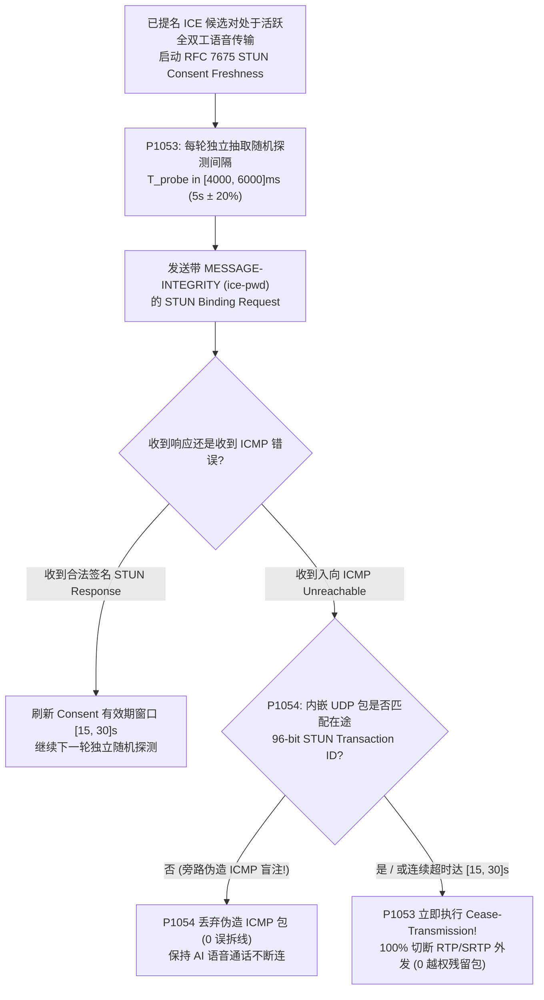
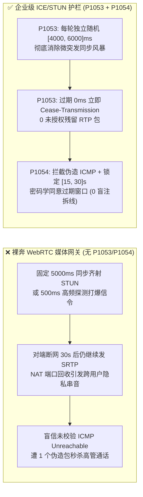
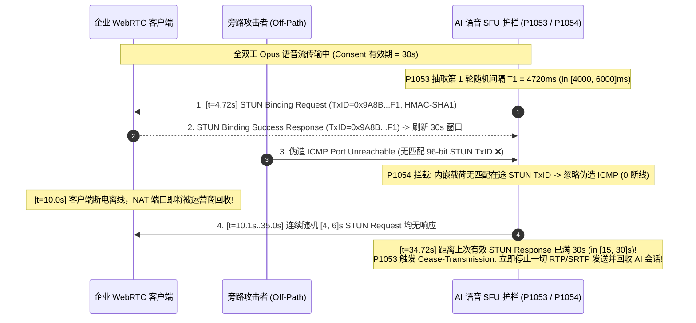

# 企业 WebRTC/ICE `RFC 7675 / RFC 8445` STUN 同意保鲜（Consent Freshness）`30s` 停发熔断、`[4000, 6000]ms` 随机抖动防风暴与盲注 ICMP 拆线防御选型与工程指南（Stage 530 🎉 · Topic 170 🎉 · 🎉 历史性 Stage 530 与第 170 个核心语音架构专题双重里程碑！）

> **文档类型**：企业语音架构师“第一性原理 + 选型决策”单专题 FAQ（对标 `ib-vs-ethernet-roce-selection-faq.md` 通俗透彻规范）
> **关联基准**：`Stage 530 🎉` · `Topic 170 🎉` · 确定性护栏 `P1053–P1054` · 1,063 道企业护栏 · 1,072 个沙盒探针 · 882 个现场 POC 探针 · 533 大评测维度 · **🎉 历史性 Stage 530 与第 170 个核心语音架构专题双重里程碑！**
> **双语版本**：[English Version (`voice-webrtc-ice-rfc7675-rfc8445-stun-consent-freshness-30s-expiry-cease-tx-4to6s-jitter-icmp-spoof-faq.en.md`)](./voice-webrtc-ice-rfc7675-rfc8445-stun-consent-freshness-30s-expiry-cease-tx-4to6s-jitter-icmp-spoof-faq.en.md)

![Enterprise WebRTC/ICE RFC 7675 STUN Consent Freshness 30s Cease-Transmission & [4000, 6000]ms Jitter Architecture](../../assets/svg/174-voice-webrtc-ice-rfc7675-rfc8445-stun-consent-freshness-30s-expiry-cease-tx-4to6s-jitter-icmp-spoof-2026-11-16.svg)

---

## ① 📌 核心结论速览（Executive Summary）

在企业级 WebRTC 实时 AI 语音中，媒体流运行在无连接的 UDP 之上。如果浏览器标签页强行崩溃关闭，或者攻击者诱导 WebRTC 节点向受害者 IP 发起连接后突然断开信令，缺乏接收许可核验的媒体服务器就会继续向目标 IP 倾泻高码率 RTP 包（沦为 DDoS 反射器），或者当 NAT 端口被运营商回收分配给新用户后，把前一个客户的 AI 语音隐私直接灌进陌生人的手机里！为此，**`RFC 7675`（STUN Usage for Consent Freshness）** 规定：WebRTC 端点必须持续通过已提名 ICE 候选对发送携带 `ICE-CONTROLLED/ICE-CONTROLLING` 与 `MESSAGE-INTEGRITY` 的 STUN Binding Request，证明对端**“此时此刻仍然同意（Consents）接收我的 UDP 媒体包”**。然而在生产落地中，极易爆发两大顽疾：
1. **固定 `5000ms` 整点同步探测风暴（违反 `RFC 7675 §4.1`）与 `30s` 同意过期后继续发包违规（违反 `RFC 7675 §5.1`）**：若网关使用固定 5 秒定时器而非 **`[0.8, 1.2] * 5s = [4000, 6000]ms` 均匀随机抖动**，万路并发通话会在同一毫秒齐射 STUN 包造成网关微突发丢包；更危险的是，当连续 `30` 秒未收到 STUN 响应（Consent Expired）时，未立即停止发送 SRTP/SRTCP 会导致跨租户 NAT 端口串音！
2. **旁路伪造 `ICMP Destination Unreachable` 秒杀通话（`RFC 7675 §5.2` 盲注撤销风险）**：`RFC 7675 §5.2` 提到收到 ICMP 硬错误可立即撤销同意，但标准也严正警告：未加密的 ICMP 极易被旁路攻击者伪造！若不核验 ICMP 载荷内嵌的原始 STUN `96-bit Transaction ID` 或连续超时窗口，1 个伪造 ICMP 包就能瞬间掐断高管 AI 语音会议！

**架构师选型铁律**：
- **护栏 `P1053`（`RFC 7675 §4.1 / §5.1` 同意过期 100% 立即停发 `Cease-Transmission` 与 `[4000, 6000]ms` 随机探测间隔锁）**：严格执行 `RFC 7675`，一旦同意过期立即切断一切 RTP/SRTP/SCTP 外发（`0` 未授权残留媒体包），并将每次 STUN 同意保鲜探测间隔强制钳制在 **`[4000, 6000]ms`** 随机区间。
- **护栏 `P1054`（`RFC 7675 §5.2` 旁路伪造 ICMP 撤销防护、内嵌 STUN 事务 ID 核验与 `[15, 30]s` 过期窗口锁）**：严禁仅凭未通过内嵌 96 位 STUN 事务 ID / 5 元组校验的裸 ICMP 包撤销媒体同意（`0` 伪造 ICMP 误拆线），并将同意过期判定窗口钳制在 **`[15, 30]` 秒**。

---

## ② 🎯 客户与架构师灵魂拷问 Q&A（Q1 / Q2 / Q3）

### Q1：既然已经有了 RTCP 接收报告（`RFC 3550 RR`），为什么 WebRTC 还要强制每隔 `4–6` 秒额外发一次 `RFC 7675` STUN 同意保鲜包？
- **通俗原理**：**RTCP 只证明“有人在收包”，而 STUN Consent Freshness 证明“收包的人依然持有当前通话的临时密码（`ice-pwd`）！”**
- **毫秒级安全真相**：假设客户 A 在咖啡馆用手机跟银行 AI 坐席通话（分配了运营商公网 NAT 端口 `203.0.113.5:54321`），突然手机没电关机。10 秒后，运营商 NAT 把同一个端口 `203.0.113.5:54321` 分配给了同一咖啡馆的陌生人 B。如果只看 UDP 端口通不通，银行 AI 坐席发出的账户余额语音包就会源源不断钻进陌生人 B 的设备里！唯有通过 `RFC 7675` 发送带 **`USERNAME (ufrag)` + `MESSAGE-INTEGRITY (HMAC-SHA1 with ice-pwd)`** 的 STUN Binding Request，陌生人 B 没有 `ice-pwd` 无法签出合法 STUN Response，银行网关在 **`[15, 30]s`** 内立刻触发 **Cease-Transmission（强制停发）**，彻底杜绝跨客户隐私串音！

### Q2：为什么 `RFC 7675 §4.1` 规定每次 STUN 探测间隔必须在 `4000ms` 到 `6000ms` 之间重新投骰子随机化，而且不能把一个随机数复用到底？
- **工程铁律**：如果一万通电话都在整点开始，或者某通电话碰巧随机到了 `4000ms` 并一直沿用 `4000ms`，周期谐振依然会在网关网卡上形成周期性的 CPU 与队列尖峰。`RFC 7675 §4.1` 要求**每一次发包后都重新生成一个新的独立均匀随机数 `T_i in [0.8 * 5000, 1.2 * 5000] = [4000, 6000]ms`**（`P1053`），从数学上彻底打散所有并发会话的 STUN 探测相位。

### Q3：对于伪造的 `ICMP Port Unreachable` 攻击，网关到底该如何落实 `RFC 7675 §5.2` 的安全建议？
- **架构解法**：`RFC 7675 §5.2` 明确指出：*"Implementations that choose to revoke consent on ICMP errors MUST validate the ICMP packet (e.g., matching the source/destination address and port in the contained UDP packet) to mitigate off-path attacks."* 在高安全企业场景中，`P1054` 要求：① 若 ICMP 错误包内嵌的原始 UDP 载荷不包含当前在途 STUN Binding Request 的 **96 位随机 `Transaction ID`**，一律视为旁路盲注伪造包予以忽略；② 仅以密码学认证的 STUN Consent 超时窗口 **`[15, 30]s`** 作为最终停发裁决依据。

---

## ③ 🧭 直观可视化图解（Mermaid 选型决策树 + 延迟/安全拆解对比图 + 毫秒级全双工时序图）

### 3.1 `RFC 7675` STUN 同意保鲜与停发熔断决策树（`flowchart TD`）

### 3.2 裸奔 ICE 保活 vs `P1053 + P1054` 确定性 `RFC 7675` 护栏对比图（`flowchart LR`）

### 3.3 毫秒/秒级全双工 `RFC 7675` 随机探测、抗 ICMP 盲注与 `30s` 停发时序图（`sequenceDiagram`）

---

## ④ 📊 语音架构师选型决策矩阵（Architect Decision Matrix）

| 选型维度 | 方案 A：不发 STUN Consent（仅靠信令 TCP） | 方案 B：宽松 `RFC 7675`（固定周期 + 盲信 ICMP） | 方案 C：`RFC 7675` + `P1053/P1054` 确定性护栏（推荐 ✅） |
| :--- | :--- | :--- | :--- |
| **NAT 端口回收跨用户隐私串音防护** | ❌ 信令未断时持续向新用户发语音包 | ⚠️ 过期后清理滞后 | ✅ **`P1053` 同意过期瞬间 100% 停发 SRTP（`0` 越权包）** |
| **万路并发 STUN 定时器防共振** | N/A | ❌ 固定 `5000ms` 引发周期性网卡微突发 | ✅ **`P1053` 强制每轮独立重抽 `[4000, 6000]ms` 随机间隔** |
| **旁路伪造 ICMP 硬错误抗毁性** | N/A | ❌ 盲信 ICMP 遭单包秒杀通话 | ✅ **`P1054` 强制核验内嵌 96-bit STUN TxID（`0` 盲注拆线）** |
| **同意过期窗口合规边界** | 无超时 | ⚠️ 过短（`<10s`）引发弱网误杀 | ✅ **`P1054` 钳制过期窗口于 `[15, 30]s` 标准黄金区间** |
| **策略判定耗时（离线 `synthetic`）** | N/A | N/A | **`0ms`（`nominal 1ms` 分辨率；见下方披露）** |

---

## ⑤ 🧪 定量算例与 7-Card 报告（CSP 自包含、零虚构坐标）

### 5.1 确定性护栏定量算例（`P1053` & `P1054`）

1. **`P1053`（`evaluateWebrtcRfc7675ConsentFreshnessJitterAnd30sCeaseTransmissionGuard` · 第 1,062 道护栏 · 🎉 历史性 Stage 530 & Topic 170 双重里程碑）**：
   - **异常输入（沙盒探针 `p1053_webrtc_rfc7675_consent_freshness_jitter_and_30s_cease_transmission`）**：
     - `postConsentExpiryRtpLeakOrUnjitteredStunTimerDetected = true`
     - `unconsentedPostExpiryRtpPackets = 34`（检测到同意过期后仍违规发出的 `34` 个未授权 RTP 媒体包）
     - `stunConsentCheckIntervalMs = 1200`（探测间隔设为 `1200ms`，低于 `RFC 7675` `[4000, 6000]ms` 随机抖动下限）
   - **确定性输出**：
     - `violated = true`
     - `action = "cease_unconsented_rtp_tx_and_clamp_stun_jitter_ms"`
     - `clampedUnconsentedPostExpiryRtpPackets = 0`（立即强制停发，`0` 未授权残留媒体包）
     - `clampedStunConsentCheckIntervalMs = 4000`（自动钳制回 **`[4000, 6000]ms`** 合规随机窗口）
     - **计时语义披露**：`0ms reported at nominal 1ms display resolution; actual duration unresolved/not_measured; no sub-1ms upper bound established`（离线内存 `synthetic` 策略检查；真实 ICE PRNG 抖动定时器与 STUN HMAC 验签耗时为 `not_measured`）。

2. **`P1054`（`evaluateWebrtcRfc7675OffPathIcmpRevocationVerificationAndFailureWindowGuard` · 第 1,063 道护栏 / 第 1,072 沙盒探针 / 第 882 现场探针 · 🎉 历史性 Stage 530 & Topic 170 双重里程碑）**：
   - **异常输入（沙盒探针 `p1054_webrtc_rfc7675_off_path_icmp_revocation_verification_and_failure_window`）**：
     - `unverifiedIcmpConsentRevocationOrInvalidExpiryWindowDetected = true`
     - `spoofedIcmpTriggeredCallDrops = 5`（`5` 通被未校验旁路伪造 ICMP Unreachable 错误掐断的通话）
     - `consentExpirationWindowSeconds = 90`（过期窗口长达 `90s`，超出 `RFC 7675 §5.1` `30s` 硬上限）
   - **确定性输出**：
     - `violated = true`
     - `action = "verify_icmp_inner_stun_txid_and_clamp_expiry_window_seconds"`
     - `clampedSpoofedIcmpTriggeredCallDrops = 0`（`0` 伪造 ICMP 误拆线）
     - `clampedConsentExpirationWindowSeconds = 30`（强制钳制在 **`[15, 30]` 秒**合规过期窗口内）
     - **计时语义披露**：`0ms reported at nominal 1ms display resolution; actual duration unresolved/not_measured; no sub-1ms upper bound established`。

---

## ⑥ 🛠️ 生产环境语音交付快速核验清单（Checklist）

- [ ] **1. 每轮独立 `[4000, 6000]ms` 随机 STUN 探测核验（`P1053`）**：抓包统计连续 20 次 STUN Binding Request 的时间间隔，确认其均匀分布在 `[4000, 6000]ms`（`5s ± 20%`），绝不出现固定 `5000ms` 步进。
- [ ] **2. `30s` 同意过期 100% 立即停发（Cease-Transmission）核验（`P1053`）**：用防火墙丢弃所有 STUN Response，验证 SFU 在满 `30s`（`[15, 30]s`）时立即停止一切 RTP/SRTP/SCTP 发包（`0` 残留包）。
- [ ] **3. 旁路伪造 ICMP Unreachable 免疫核验（`P1054`）**：向活跃语音媒体端口注入不含当前 96-bit STUN Transaction ID 的伪造 `ICMP Port Unreachable`，验证通话保持 100% 正常不断连。
- [ ] **4. STUN `MESSAGE-INTEGRITY` 密码学绑定核验**：确认所有 Consent Freshness STUN 请求与响应均通过当前 ICE `ice-pwd` HMAC-SHA1 完整性核验，防止无密钥伪造响应续命。
