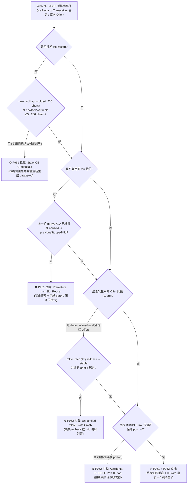
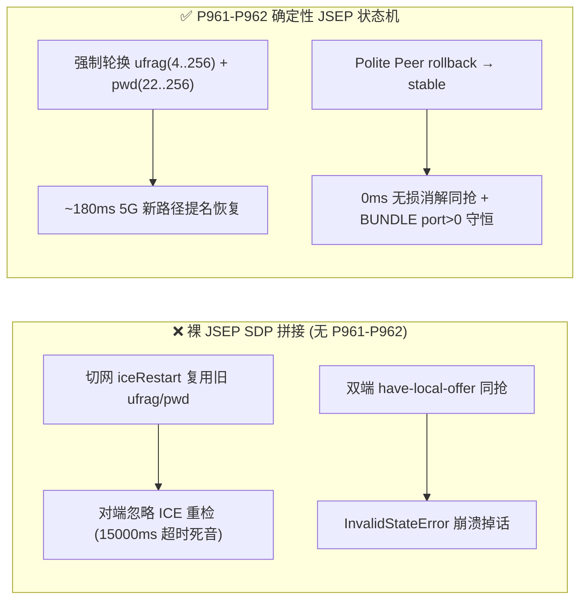
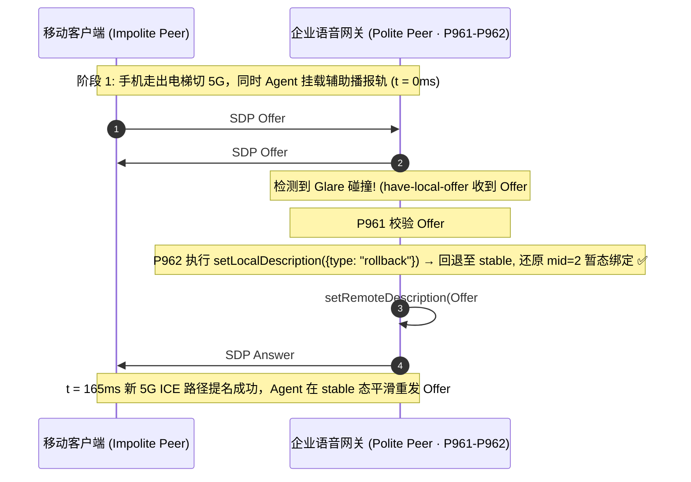

# 企业级实时语音智能体架构选型 FAQ（第 126 篇）：WebRTC `RFC 8829 / RFC 9429 (JSEP)` 媒体收发器（`RTCRtpTransceiver`）`port=0` 槽位复用、`iceRestart` 凭据轮换与双向 Offer 冲突回滚（`rollback`）防御怎么选？

> **导读（对标 `ib-vs-ethernet-roce-selection-faq.md` 通俗透彻风 · Topic 124 / Stage 484 · 🎉 971 护栏、980 探针与 790 现场探针三重历史性里程碑）**：在移动车载与企业全双工语音对话中，通话建连后并不是一成不变的：手机从公司 Wi-Fi 走出电梯切到 5G 时需要触发 **`iceRestart`（ICE 重启）**；AI 语音智能体在对话中途动态挂载屏幕共享/辅助音轨或客户端同时按静音重协商时，又会撞上 **双向同时发 Offer 冲突（Offer Glare）** 与 **`RTCRtpTransceiver.stop()` 后的 `m=` 槽位复用**。如果信令网关在 `iceRestart` 时偷懒复用了旧的 `ice-ufrag`/`ice-pwd`，或者在双端同时发 Offer（`have-local-offer` 碰撞）时没有执行 `RFC 8829 / RFC 9429` 标准礼貌回滚（`type: "rollback"`），更或者在 `BUNDLE` 多路复用重协商中误把活跃 `m=` 行的端口写成 `port=0`，轻则网络切换后 `100%` 单通死音，重则直接触发浏览器 `InvalidStateError` 崩溃挂断！本文用大白话讲透 **JSEP 状态机第一性原理**，并给出 **`P961–P962 🎉`** 确定性门禁。

---

## ① 📌 核心结论速览（Executive Summary）

1. **为什么手机切网触发了 `iceRestart`，通话还是彻底没声音（死音）？**
   - 根据 **`RFC 8829 Section 5.2.2` / `RFC 9429`**，接收端判断一封重协商 SDP Offer 是否真正触发 ICE 重启的**唯一标准**，是检查 `a=ice-ufrag`（`[4, 256]` 字符，`RFC 8839`）和 `a=ice-pwd`（`[22, 256]` 字符）是否**同时与当前会话不同**（`newIceUfrag !== previousIceUfrag && newIcePwd !== previousIcePwd`）。如果媒体网关只重发了新 Candidate 却沿用原 `ufrag`/`pwd`，对端协议栈根本不会重启连通性探测（Connectivity Check），媒体流会永远卡死在已失效的旧 Wi-Fi UDP Socket 上（`P961`）。
2. **为什么动态开关辅流（`transceiver.stop()`）或重协商时，正在说话的主音频轨会突然被掐断？**
   - 两个高频踩坑点：
     - **未完成 `port=0` 确认即提前复用 `m=` 槽位（`P961`）**：根据 `RFC 8829 Section 5.2.2` / `RFC 3264 Section 8`，当调用 `transceiver.stop()` 将某条 `m=` 行置为 `port=0` 后，必须等这一轮包含 `m=... 0` 的 Offer/Answer 完整闭环确认后（`previousOfferAnswerCompletedPortZero === true`），下一轮新 Offer 才能复用该槽位并分配全新的 `a=mid`（`newMid !== previousStoppedMid`）。未闭环直接覆写会导致新旧轨道 `mid` 串线。
     - **在已建连 `BUNDLE` 重协商中误发 `port=0`（`P962 🎉`）**：根据 `RFC 8843 Section 7.3`，`port=0` 配合 `a=bundle-only` 只允许出现在尚未完成首次 `BUNDLE` 协商的初始 Offer 中；一旦 `BUNDLE` 已建立，后续重协商 Offer 只要将某条 `m=` 写成 `port=0`，对端就会按标准直接销毁并永久停止（`stop()`）该收发器！
3. **当 AI 坐席与客户端在同一毫秒各自发出重协商 Offer（Glare 碰撞）时怎么自愈？**
   - 必须落地 **`RFC 8829 Section 4.1.8.2` / `RFC 9429` 礼貌对等端回滚状态机（Polite Peer `rollback`）**：当处于 `have-local-offer` 状态收到对端碰撞 Offer 时，礼貌方必须先调用 `setLocalDescription({type: "rollback"})` 将状态机无损退回 `stable` 并恢复上一版 `a=mid` 收发器绑定映射，随后再应用远端 Offer 并回复 Answer，实现 `0` 碰撞掉话（`P962 🎉`）。

---

## ② 🎯 客户与架构师灵魂拷问 Q&A（Q1 / Q2 / Q3）

### Q1：我们已经往客户端传了 `{ iceRestart: true }`，为什么自研 SFU/媒体网关切网重连还是失败？
- **通俗原理**：在浏览器端调用 `createOffer({ iceRestart: true })` 会自动生成新的 `ufrag/pwd`；但很多企业的服务端 SFU / B2BUA 网关是自己拼接 SDP 模板的——开发同学为了省事，在会话全生命周期缓存了同一套 `ice-ufrag` 和 `ice-pwd`，切网重发 Re-Offer 时只改了 IP 端口或加了条 `a=candidate`。
- **底层真相（`RFC 8829 §5.2.2`）**：WebRTC 规范明确规定，远端 `setRemoteDescription` 只有检测到 `a=ice-ufrag` **或** `a=ice-pwd` 发生变化（且发端必须**同时更换两者**，分别满足 `[4, 256]` 与 `[22, 256]` 字节长度，`RFC 8839 §5.4`）时，才会清空旧 Candidate Pair 并启动新一轮 STUN 连通性检查。
- **架构铁律（`P961`）**：凡是标记 `isIceRestart === true` 的重协商，门禁强制校验 `newIceUfrag !== previousIceUfrag`、`newIcePwd !== previousIcePwd`，且长度分别落在 `[4, 256]` 与 `[22, 256]`。

### Q2：为什么 AI 智能体刚下发工具卡片音轨，客户正巧点击切换麦克风（触发重协商），整通电话就断了？
- **通俗原理**：这就是经典的 **信令同抢（Offer Glare）**。AI 网关发出了 Offer A（本地进入 `have-local-offer`），同一时刻客户端发出了 Offer B（客户端也进入 `have-local-offer`）。当客户端的 Offer B 到达网关时，网关如果不做回滚就直接调 `setRemoteDescription(Offer B)`，WebRTC 引擎会直接抛出 `InvalidModificationError / InvalidStateError`（因为 `have-local-offer` 状态下只允许收 `answer` 或 `pranswer`）。
- **底层真相（`RFC 8829 §4.1.8.2` / `RFC 9429`）**：JSEP 专门设计了 `type: "rollback"` 机制。双端预先约定角色：服务端或后发起方作为 **Polite Peer（礼貌方）**，一旦在 `have-local-offer` 状态收到对端 Offer，立即执行：`have-local-offer` $\xrightarrow{\text{rollback}}$ `stable`（自动还原未确认 Offer 中新增的 `a=mid` 与收发器关联）$\xrightarrow{\text{setRemoteDescription(offer)}}$ `have-remote-offer` $\xrightarrow{\text{createAnswer}}$ `stable`。
- **架构铁律（`P962 🎉`）**：强制 `rollback` 只能从 `have-local-offer` 或 `have-remote-offer` 发起且回退后状态精确为 `stable`，同时 `restoredPreviousTransceiverMidBindings === true`、`unhandledGlareCollisions === 0`。

### Q3：为什么停止一个临时播报音轨（`port=0`）并立刻在同一轮塞入新音轨，会导致客户端收不到新声音？
- **通俗原理**：SDP 里的第 $k$ 个 `m=` 行就像餐厅里的第 $k$ 号餐桌。上一位客人还没结账离席（即 `m=audio 0 ...` 的关闭 Offer 还没有收到对端的 Answer 确认），你就直接把新客人安排进第 $k$ 号桌并换了桌牌（`a=mid`），对端会以为这还是原来那条正在关闭的流！
- **架构铁律（`P961` & `P962 🎉`）**：
  1. 复用已关闭 `m=` 槽位前，必须完成过一轮 `port=0` Offer/Answer 闭环（`previousOfferAnswerCompletedPortZero === true`），且新分配的 `newMid !== previousStoppedMid`（`unconfirmedPortZeroSlotReuses === 0`）；
  2. 对所有处于活跃状态的 `BUNDLE` 复用 `m=` 行（`isActiveBundledMline === true`），除首次 Offer 带 `a=bundle-only` 外，后续重协商严禁出现 `mlinePort === 0`（`unexpectedBundledPortZeroDrops === 0`）。

---

## ③ 🧭 直观可视化图解（Mermaid 选型决策树 + 延迟拆解对比 + 毫秒级时序图）

### 3.1 JSEP `iceRestart`、槽位复用与 Glare `rollback` 门禁决策树（`P961–P962 🎉`）

### 3.2 切网重连与同抢恢复耗时对比（裸 JSEP 实现 vs `P961–P962 🎉` 确定性状态机）

| 故障/重协商场景 | 裸 JSEP 拼接实现（无 `P961–P962`） | `P961–P962 🎉` 确定性 JSEP 门禁方案 | 架构师解读 |
| :--- | :--- | :--- | :--- |
| **Wi-Fi $\rightarrow$ 5G 切网 `iceRestart`** | 沿用旧 `ufrag/pwd` $\rightarrow$ 对端不发 STUN $\rightarrow$ **`15000ms` ICE 超时断线** | 强制更换 `ufrag(>=4)` + `pwd(>=22)` $\rightarrow$ **`~180ms` 完成新路径提名** | 消除切网后单通死音 |
| **AI 挂轨与客户端静音同抢（Glare）** | `have-local-offer` 直接塞远端 Offer $\rightarrow$ **抛异常直接挂断** | Polite `rollback` $\rightarrow$ `stable` $\rightarrow$ 接纳远端 Offer $\rightarrow$ **`0ms` 状态机无损收敛** | 彻底消灭并发重协商崩溃 |
| **已建连 `BUNDLE` 重协商端口设置** | 非主轨误写 `m=audio 0` $\rightarrow$ **远端收发器永久 `stopped`** | 强制共享主传输端口（`port > 0`）$\rightarrow$ **`0` 误停轨** | 避免辅助音轨/主音轨被意外掐断 |

### 3.3 毫秒级全双工 JSEP Glare `rollback` 与 `iceRestart` 协同序列图

---

## ④ 📊 语音架构师选型决策矩阵（Architecture Selection Matrix）

| 选型维度 | 方案 A：手工字符串模板拼接 SDP（无状态校验） | 方案 B：仅开启 `iceRestart` 但无 Polite `rollback` 与 `port=0` 门禁 | 方案 C（推荐）：`RFC 8829 / RFC 9429` 全闭环门禁（`P961` + `P962 🎉`） |
| :--- | :--- | :--- | :--- |
| **`iceRestart` 凭据轮换（`P961`）** | ❌ 常复用旧 `ufrag/pwd`，切网后对端不触发 ICE 重检 | ✅ 轮换 `ufrag/pwd` | ✅ **强制 `newUfrag != old` (`[4,256]`) & `newPwd != old` (`[22,256]`)** |
| **`m=` 槽位 `port=0` 复用（`P961`）** | ❌ 未等 `port=0` 闭环直接覆盖 `m=` 槽位导致串流 | ⚠️ 偶发 `a=mid` 冲突 | ✅ **强制 `previousOfferAnswerCompletedPortZero === true` 且分配新 `mid`** |
| **双向 Offer 同抢（Glare，`P962 🎉`）** | ❌ 直接报错中断通话 | ❌ 缺少 Polite/Impolite 角色与 `rollback` 还原 | ✅ **`have-local-offer` $\rightarrow$ `rollback` $\rightarrow$ `stable` 零中断自愈** |
| **已建连 `BUNDLE` 端口守恒（`P962 🎉`）** | ❌ 误在 re-Offer 写 `port=0` 杀掉活跃音轨 | ⚠️ 混用初始 `bundle-only` 与重协商规则 | ✅ **重协商活跃 `BUNDLE` `m=` 强制 `port > 0`（`0` 误停轨）** |
| **适用场景** | 仅限单向静态播报 Demo | 低频重协商场景 | **生产级移动车载/全双工工具调用语音智能体必选** |

---

## ⑤ 🧪 定量算例与 7-Card 报告（CSP 自包含、零虚构坐标）

- **离线合成策略门禁基准（`site/data/voice-agent-benchmark-report.json` & `site/benchmark-cards.html`）**：
  - **算例输入（Pass 基准）**：
    - `P961`：`isIceRestart = true`，`previousIceUfrag = "ufragA01"`，`newIceUfrag = "ufragB02"`（`8` 字符 $\in [4, 256]$），`previousIcePwd = "pwdAlpha0123456789012345"`，`newIcePwd = "pwdBravo9876543210987654"`（`24` 字符 $\in [22, 256]$），`isReusingMlineSlot = true`，`previousOfferAnswerCompletedPortZero = true`，`previousStoppedMid = "audio-aux-1"`，`newMid = "audio-aux-2"`，`unconfirmedPortZeroSlotReuses = 0` $\rightarrow$ **`PASS`**。
    - `P962 🎉`：`isRollbackOperation = true`，`signalingStateBeforeRollback = "have-local-offer"`，`signalingStateAfterRollback = "stable"`，`restoredPreviousTransceiverMidBindings = true`，`unhandledGlareCollisions = 0`，`isActiveBundledMline = true`，`mlinePort = 9`，`hasBundleOnlyAttributeInInitialOffer = false`，`unexpectedBundledPortZeroDrops = 0` $\rightarrow$ **`PASS`**。
  - **故障注入注入反转（Fail 拦截）**：
    - 若 `iceRestart` 时 `newIceUfrag === previousIceUfrag`（沿用 `"ufragA01"`）或 `unconfirmedPortZeroSlotReuses = 1` $\rightarrow$ `P961` 立即拦截（`pass = false`）。
    - 若在 `stable` 态非法调用 `rollback`，或 `unhandledGlareCollisions = 1`，或重协商中活跃 `BUNDLE` 轨误发 `mlinePort = 0`（`unexpectedBundledPortZeroDrops = 1`）$\rightarrow$ `P962 🎉` 立即拦截（`pass = false`）。
  - **计时与溯源披露（Timing & Provenance Disclosure）**：
    - `0ms reported at nominal 1ms display resolution; actual duration unresolved/not_measured; no sub-1ms upper bound established`（离线确定性状态机门禁校验，不含真实广域网 STUN 往返耗时）。

---

## ⑥ 🛠️ 生产环境语音交付快速核验清单（Checklist）

- [ ] **【`P961` · `iceRestart` 凭据双轮换】**：确认所有触发 `iceRestart` 的重协商 Offer 同时更换 `a=ice-ufrag`（`4–256` 字符）与 `a=ice-pwd`（`22–256` 字符），严禁原样复用旧凭据。
- [ ] **【`P961` · `port=0` 槽位闭环后复用】**：确认 `RTCRtpTransceiver.stop()` 对应的 `m=... 0` 完成整轮 Offer/Answer 后，才允许在后续 Offer 中复用该 `m=` 索引并绑定全新 `a=mid`（`unconfirmedPortZeroSlotReuses === 0`）。
- [ ] **【`P962 🎉` · Polite Peer Glare `rollback` 状态机】**：确认网关与客户端明确划分 Polite/Impolite 角色，礼貌方在 `have-local-offer` 收到远端 Offer 时自动执行 `rollback` 回退至 `stable` 并还原 `a=mid` 映射（`unhandledGlareCollisions === 0`）。
- [ ] **【`P962 🎉` · 活跃 `BUNDLE` 轨严禁重协商写 `port=0`】**：确认 `BUNDLE` 建连后的所有 Re-Offer 对活跃 `m=` 行均携带有效非零端口（`mlinePort > 0`，`unexpectedBundledPortZeroDrops === 0`）。
