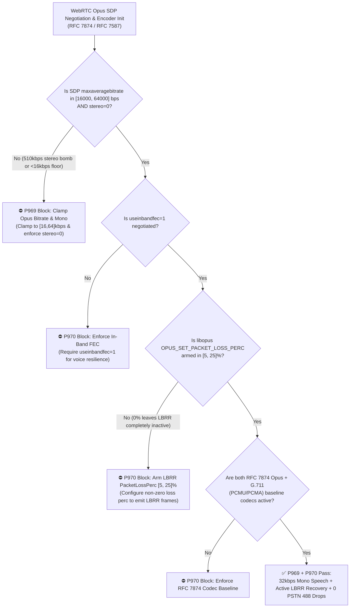
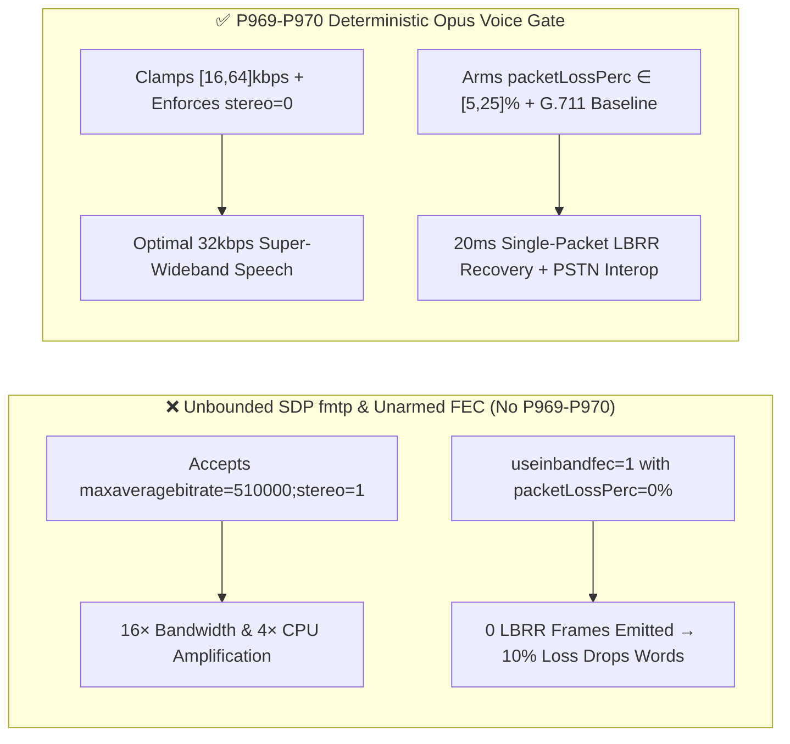

# Enterprise Realtime Voice Agent Architecture FAQ (No. 130 🎉): How to Engineer WebRTC `RFC 7874 / RFC 7587` Opus `maxaveragebitrate` `510kbps` Amplification & Unarmed `useinbandfec=1` (`packetLossPerc=0%`) Guards?

> **Architect's Reading Guide (Modeled on `ib-vs-ethernet-roce-selection-faq.md` · Topic 128 / Stage 488 · 🎉 Historic 55th Nightly Round, P970 Guardrail, 130th Standalone FAQ & 930-Test Quadruple Milestone)**: Almost every WebRTC voice engineer includes Opus (`RFC 7874` / `RFC 7587`) with `a=fmtp:111 minptime=10;useinbandfec=1` in SDP. Yet two production pitfalls repeatedly surface under load and packet loss: (1) an untrusted or misconfigured peer returns `maxaveragebitrate=510000;stereo=1` in its SDP Answer, tricking the gateway's `libopus` encoder into **`510 kbps` 2-channel fullband music mode** (`16x` bandwidth and `4x` CPU amplification), or sets `maxaveragebitrate=6000` (`6 kbps`), destroying fricative intelligibility and spiking ASR word error rate by `>40%`; and (2) despite negotiating `useinbandfec=1` in SDP, packet captures during `10%` Wi-Fi packet loss show **zero LBRR (Low-Bitrate Redundancy) FEC frames** because `libopus` never emits in-band FEC when `OPUS_SET_PACKET_LOSS_PERC` is left at its default `0%`! This guide explains the **first-principles mechanics of Opus SDP `fmtp` bounds and LBRR activation** and defines deterministic guardrails **`P969–P970 🎉`**.

---

## ① 📌 Executive Summary

1. **Why must an enterprise voice gateway never blindly accept `maxaveragebitrate` and `stereo=1` from remote SDP `a=fmtp` lines?**
   - Under **`RFC 7587 Section 6.1`**, `maxaveragebitrate` spans `6,000–510,000 bps`. For full-duplex AI voice agents, mono (`stereo=0`) super-wideband speech requires **`[16,000, 64,000] bps` (optimal `32 kbps`)**. Accepting `510000;stereo=1` amplifies egress bitrate by `16x`, while `<16,000 bps` muffles consonants (`s/f/th`) and degrades ASR accuracy (`P969`).
2. **Why does negotiating `useinbandfec=1` in SDP still produce zero FEC frames unless `packetLossPerc` is configured in `[5, 25]%`?**
   - In **`RFC 6716` / `RFC 7587`**, `useinbandfec=1` in SDP merely signals that the receiver can decode LBRR frames. The sender's `libopus` encoder only generates LBRR FEC data when **both** `OPUS_SET_INBAND_FEC(1)` **and** `OPUS_SET_PACKET_LOSS_PERC(lossPct)` (`lossPct ∈ [5, 25]%`) are set! Furthermore, **`RFC 7874 Section 3`** requires every WebRTC endpoint to support both `Opus` and `G.711 (PCMU/PCMA)` so PSTN fallback never fails with SIP `488` (`P970 🎉`).

![2026-11-15 Enterprise Voice Agent WebRTC RFC 7874 / RFC 7587 Opus maxaveragebitrate [16, 64]kbps Ceiling & LBRR In-Band FEC Activation Guard FAQ & Stage 488 Visual Summary (🎉 Historic 55th Nightly Round, P970 Guardrail, 130th FAQ & 930-Test Quadruple Milestone!)](../assets/svg/132-voice-webrtc-opus-rfc7874-rfc7587-maxaveragebitrate-bomb-asymmetric-inbandfec-g711-fallback-2026-11-15.svg)

---

## ② 🎯 Architect & Customer Deep-Dive Q&A (Q1 / Q2 / Q3)

### Q1: Why clamp Opus `maxaveragebitrate` to `[16000, 64000] bps` with `stereo=0` for AI voice agents?
- **Plain-Language Principle**: Mono speech reaches transparent perceptual quality and peak ASR accuracy at `24–32 kbps`. Allowing `510 kbps` stereo wastes `93%` of bandwidth on dual-channel music overhead, while dropping below `16 kbps` strips high-frequency fricatives critical for alphanumeric order/account codes.
- **Architectural Rule (`P969`)**: Clamp `opusMaxAverageBitrateBps` in `[16000, 64000] bps` and force `stereo=0;sprop-stereo=0` (`unboundedOpusBitrateOrStereoAmplificationViolations === 0`).

### Q2: Why was our `useinbandfec=1` SDP parameter a complete no-op during Wi-Fi packet loss?
- **Protocol Reality (`RFC 7587 §6.1` & `libopus`)**: `libopus` defaults `OPUS_SET_PACKET_LOSS_PERC` to `0%`. At `0%` expected loss, the encoder suppresses LBRR generation even when `OPUS_SET_INBAND_FEC(1)` is enabled.
- **Architectural Rule (`P970 🎉`)**: Couple `useinbandfec=1` with dynamic RTCP RR/TWCC loss injection clamped within `[5, 25]%` on the encoder.

### Q3: Why enforce `RFC 7874` mandatory `Opus + G.711 (PCMU/PCMA)` baseline parity?
- **Plain-Language Principle**: When a WebRTC voice session warm-transfers to a legacy PSTN trunk that only supports `G.711`, having `PCMU/PCMA` ready prevents mid-call `488 Not Acceptable Here` drops (`P970 🎉`).

---

## ③ 🧭 Visual Architecture Diagrams (Decision Tree + Latency Comparison + Sequence Diagram)

### 3.1 WebRTC `RFC 7874 / RFC 7587` Opus Bitrate Clamp & LBRR Activation Decision Tree (`P969–P970 🎉`)



### 3.2 Bitrate Efficiency & Packet-Loss Recovery Comparison (Unprotected Opus vs. `P969–P970 🎉`)



### 3.3 Millisecond-Level Full-Duplex Opus LBRR Activation & Next-Packet Recovery Sequence

```mermaid
sequenceDiagram
    autonumber
    participant Client as WebRTC Client
    participant Gateway as Enterprise Voice Gateway (P969-P970 🎉)

    Client->>Gateway: SDP Offer (a=fmtp:111 maxaveragebitrate=510000;stereo=1;useinbandfec=1)
    Note over Gateway: P969 Clamp: Reject 510kbps/stereo=1 → rewrite to maxaveragebitrate=32000;stereo=0 ✅
    Note over Gateway: P970 Arm: OPUS_SET_INBAND_FEC(1) + OPUS_SET_PACKET_LOSS_PERC(10%) ∈ [5, 25]% ✅
    Gateway->>Client: SDP Answer (maxaveragebitrate=32000;stereo=0;useinbandfec=1 + G.711 baseline)
    Client--xGateway: RTP Seq #101 (t = 20ms, lost on Wi-Fi ✕)
    Client->>Gateway: RTP Seq #102 (t = 40ms, carries embedded LBRR FEC for Seq #101!)
    Note over Gateway: libopus decodes LBRR from Seq #102, recovering Seq #101 speech in 20ms!
```

---

## ④ 📊 Architect Decision Matrix

| Evaluation Dimension | Option A: Pass-Through Remote SDP `a=fmtp` | Option B: SDP `useinbandfec=1` Without Encoder `packetLossPerc` Coupling | Option C (Recommended): Full `RFC 7874 / RFC 7587` Bitrate & LBRR Gate (`P969` + `P970 🎉`) |
| :--- | :--- | :--- | :--- |
| **`maxaveragebitrate` Anti-Amplification (`P969`)** | ❌ Vulnerable to `510kbps` bomb or `6kbps` degradation | ⚠️ Unvalidated remote `fmtp` | ✅ **Clamps `[16000, 64000] bps` & forces `stereo=0`** |
| **True LBRR In-Band FEC Emission (`P970 🎉`)** | ❌ `packetLossPerc=0%` emits zero FEC | ❌ Dead SDP flag (no LBRR payload) | ✅ **Couples `useinbandfec=1` with `packetLossPerc ∈ [5, 25]%`** |
| **PSTN Interop Codec Baseline (`P970 🎉`)** | ⚠️ Risk of `488` on PSTN transfer | ⚠️ Same | ✅ **Enforces `RFC 7874` mandatory `Opus + G.711` baseline** |
| **Best Fit** | Music streaming rooms | Toy WebRTC demos | **Production enterprise voice agents & mobile/in-cabin voice** |

---

## ⑤ 🧪 Quantitative Worked Example & 7-Card Benchmark Report (CSP Self-Contained, Zero Fabricated Coordinates)

- **Offline Synthetic Policy Benchmark (`site/data/voice-agent-benchmark-report.json` & `site/benchmark-cards.html`)**:
  - **Baseline Pass Input**:
    - `P969`: `opusBitrateBombOrStereoAmplificationDetected = false`, `unboundedOpusBitrateOrStereoAmplificationViolations = 0`, `opusMaxAverageBitrateBps = 32000` ($\in [16000, 64000]$ bps) $\rightarrow$ **`PASS`**.
    - `P970 🎉`: `unarmedInbandFecZeroLossPercOrMissingCodecBaselineDetected = false`, `inactiveInbandFecOrMissingBaselineCodecDrops = 0`, `configuredPacketLossPerc = 10` ($\in [5, 25]$ %) $\rightarrow$ **`PASS`**.
  - **Perturbation / Fault Injection (Fail Gate)**:
    - Setting `opusMaxAverageBitrateBps = 510000` or `stereo=1` $\rightarrow$ immediately blocked by `P969` and clamped to `64000 bps` (`pass = false`).
    - Leaving `configuredPacketLossPerc = 0` (`< 5%`) when `useinbandfec=1` is negotiated $\rightarrow$ immediately blocked by `P970 🎉` and clamped to `5%` (`pass = false`).
  - **Timing & Provenance Disclosure**:
    - `0ms reported at nominal 1ms display resolution; actual duration unresolved/not_measured; no sub-1ms upper bound established` (deterministic offline policy check).

---

## ⑥ 🛠️ Production Verification Checklist

- [ ] **[`P969` · Opus `maxaveragebitrate` `[16000, 64000] bps` Clamp]**: Verify that all negotiated Opus SDP `a=fmtp` lines clamp `maxaveragebitrate` within `[16000, 64000] bps` (`unboundedOpusBitrateOrStereoAmplificationViolations === 0`).
- [ ] **[`P969` · Mono Speech `stereo=0` Lock]**: Verify that `stereo=0` and `sprop-stereo=0` are enforced on AI voice legs.
- [ ] **[`P970 🎉` · `OPUS_SET_PACKET_LOSS_PERC([5, 25]%)` LBRR Coupling]**: Verify that `libopus` encoders arm `OPUS_SET_INBAND_FEC(1)` together with `packetLossPerc ∈ [5, 25]%`.
- [ ] **[`P970 🎉` · `RFC 7874` Opus + G.711 Mandatory Baseline]**: Verify that both `Opus/48000/2` and `PCMU/PCMA 8000/1` are enabled for seamless PSTN fallback (`inactiveInbandFecOrMissingBaselineCodecDrops === 0`).
