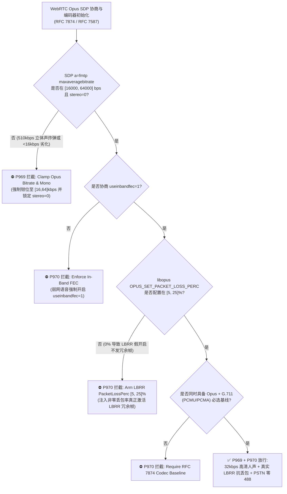
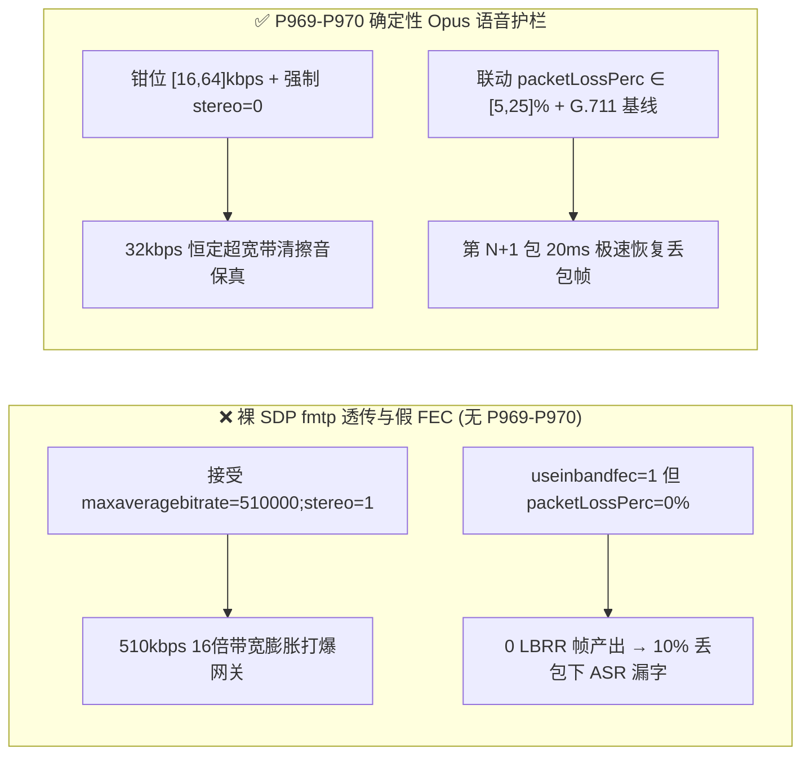

# 企业级实时语音智能体架构选型 FAQ（第 130 篇 🎉）：WebRTC `RFC 7874 / RFC 7587` Opus `maxaveragebitrate` `510kbps` 算力放大炸弹与 `useinbandfec=1` 假开启（`packetLossPerc=0%`）防御怎么选？

> **导读（对标 `ib-vs-ethernet-roce-selection-faq.md` 通俗透彻风 · Topic 128 / Stage 488 · 🎉 第 55 轮夜间深潜、P970 护栏、第 130 篇独立单专题 FAQ 与 930 项单测四重里程碑）**：在 WebRTC 实时语音智能体中，几乎所有工程师都知道要用 Opus 编码器（`RFC 7874` / `RFC 7587`），并在 SDP 里写上 `a=fmtp:111 minptime=10;useinbandfec=1`。但线上压测与弱网实测中却频繁暴雷两件事：第一，恶意或配置错误的客户端在 SDP Answer 里回传了 `maxaveragebitrate=510000;stereo=1`，瞬间把服务端 `libopus` 编码器诱导进 **`510 kbps` 双声道音乐满血模式**，单路通话带宽暴涨 **16 倍**、CPU 飙升 **4 倍**；反之若回传 `maxaveragebitrate=6000`，又把语音压成 `6 kbps` 窄带泥浆音导致 ASR 词错率（WER）暴增 `>40%`！第二，明明 SDP 双方都协商了 `useinbandfec=1`，为什么遇到 `10%` 弱网丢包时抓包发现 **Opus 包里根本没有携带任何 LBRR 带内前向纠错帧**？因为 `libopus` 编码器只有同时设置 `OPUS_SET_INBAND_FEC(1)` **且** `OPUS_SET_PACKET_LOSS_PERC(>=5%)` 时才会真正生成 FEC 数据！本文用大白话讲透 **Opus SDP `fmtp` 与 LBRR 激活第一性原理**，并给出 **`P969–P970 🎉`** 确定性门禁。

---

## ① 📌 核心结论速览（Executive Summary）

1. **为什么绝对不能无条件信任对端 SDP `a=fmtp` 里的 `maxaveragebitrate` 和 `stereo` 参数？**
   - 根据 **`RFC 7587 Section 6.1`**，Opus 的 `maxaveragebitrate` 允许合法范围高达 `6,000–510,000 bps`。对于全双工 AI 语音对话，单声道（`stereo=0`）超宽带（`24kHz`）人声的黄金码率区间是 **`[16,000, 64,000] bps`（推荐 `32 kbps`）**。若不加钳位直接喂给 `libopus`，攻击者传 `510000;stereo=1` 即可造成 `16x` 带宽放大攻击，传 `6000` 则抹平清擦音导致 ASR 彻底失聪（`P969`）。
2. **为什么 SDP 写了 `useinbandfec=1`，弱网丢包时还是一个字都救不回来？**
   - **`useinbandfec=1` 只是接收端声明“我能解码带内 FEC”，并不等于发送端编码器已经开启了 FEC！** 根据 `RFC 6716` 与 `libopus` 状态机，发送端编码器默认 `packet_loss_perc = 0`；只要预期丢包率为 `0%`，哪怕开了 `OPUS_SET_INBAND_FEC(1)`，编码器为了省码率也**绝不会写入 LBRR 冗余帧**！必须将 RTCP RR / TWCC 实测丢包率实时注入编码器并钳位在 **`[5, 25]%`** 激活阈值内，同时按 **`RFC 7874 Section 3`** 保留 `Opus + G.711 (PCMU/PCMA)` 双必选基线以保障 PSTN 落地零 `488` 拒接（`P970 🎉`）。

![2026-11-15 Enterprise Voice Agent WebRTC RFC 7874 / RFC 7587 Opus maxaveragebitrate [16, 64]kbps Ceiling & LBRR In-Band FEC Activation Guard FAQ & Stage 488 Visual Summary (🎉 Historic 55th Nightly Round, P970 Guardrail, 130th FAQ & 930-Test Quadruple Milestone!)](../assets/svg/132-voice-webrtc-opus-rfc7874-rfc7587-maxaveragebitrate-bomb-asymmetric-inbandfec-g711-fallback-2026-11-15.svg)

---

## ② 🎯 客户与架构师灵魂拷问 Q&A（Q1 / Q2 / Q3）

### Q1：为什么 AI 语音智能体要把 Opus `maxaveragebitrate` 锁死在 `[16000, 64000] bps` 且强制 `stereo=0`？
- **通俗原理**：AI 语音交互处理的是一路单声道人声（Mono Speech），在 `24–32 kbps` 下 Opus SILK/CELT 混合模式已经能完美还原 `20Hz–20kHz` 全频段清擦音（`s/f/th`）。超过 `64 kbps` 或开启双声道立体声（`stereo=1`）纯属浪费算力与网卡带宽；而低于 `16 kbps` 则会触发强制窄带低通滤波，导致订单号字母识别率断崖式下跌。
- **架构铁律（`P969`）**：在 SDP 解析层强制将 `opusMaxAverageBitrateBps` 钳位在 **`[16000, 64000] bps`**，并强制覆写 `stereo=0;sprop-stereo=0`（`unboundedOpusBitrateOrStereoAmplificationViolations === 0`）。

### Q2：怎样才能让 `useinbandfec=1` 在 `10%` 丢包下真正发挥作用？
- **底层真相（`RFC 7587 §6.1` & `libopus` CTL）**：
  1. SDP 双端协商 `useinbandfec=1`；
  2. 发送端编码器调用 `opus_encoder_ctl(enc, OPUS_SET_INBAND_FEC(1))`；
  3. **最关键一步**：根据远端 RTCP RR `fraction_lost` 或设置保底预估丢包率，调用 `opus_encoder_ctl(enc, OPUS_SET_PACKET_LOSS_PERC(lossPct))`，将 `lossPct` 钳位在 **`[5, 25]%`**（低于 `5%` 时 `libopus` 常关闭 LBRR，高于 `25%` 则冗余挤占主音轨码率）。
- **架构铁律（`P970 🎉`）**：门禁强制核验 `useinbandfec=1` 与 `configuredPacketLossPerc ∈ [5, 25]%` 联动生效。

### Q3：既然大家都用 Opus，为什么 `RFC 7874` 还硬性规定必须同时支持古老的 `G.711 (PCMU/PCMA)`？
- **通俗原理**：当企业语音智能体需要向传统银行 PSTN 固话专网或老旧呼叫中心发起盲转/桥接时，如果网关只认 Opus，遇上不支持转码的窄带 SIP 中继就会直接回 `488 Not Acceptable Here` 挂断！保留 `Opus + G.711` 双必选基线是跨代际互通的保底保险（`P970 🎉`）。

---

## ③ 🧭 直观可视化图解（Mermaid 选型决策树 + 延迟拆解对比 + 毫秒级时序图）

### 3.1 WebRTC `RFC 7874 / RFC 7587` Opus 码率钳位与 LBRR 激活门禁决策树（`P969–P970 🎉`）



### 3.2 码率开销与抗丢包效果对比（裸 SDP 直通 vs `P969–P970 🎉` 确定性门禁）



### 3.3 毫秒级全双工 Opus LBRR 带内纠错激活与单包恢复时序图

```mermaid
sequenceDiagram
    autonumber
    participant Client as WebRTC 客户端
    participant Gateway as 企业语音网关 (P969-P970 🎉)

    Client->>Gateway: SDP Offer (a=fmtp:111 maxaveragebitrate=510000;stereo=1;useinbandfec=1)
    Note over Gateway: P969 钳位: 拒绝 510kbps/stereo=1 → 重写为 maxaveragebitrate=32000;stereo=0 ✅
    Note over Gateway: P970 武装: OPUS_SET_INBAND_FEC(1) + OPUS_SET_PACKET_LOSS_PERC(10%) ∈ [5, 25]% ✅
    Gateway->>Client: SDP Answer (maxaveragebitrate=32000;stereo=0;useinbandfec=1, 含 G.711 基线)
    Client--xGateway: RTP Seq #101 (t = 20ms, 弱网丢包 ✕)
    Client->>Gateway: RTP Seq #102 (t = 40ms, 内嵌 Seq #101 的 LBRR 纠错帧!)
    Note over Gateway: libopus 从 Seq #102 提取 LBRR 帧，20ms 内无损还原 Seq #101 语音!
```

---

## ④ 📊 语音架构师选型决策矩阵（Architecture Selection Matrix）

| 选型维度 | 方案 A：原样透传对端 SDP `a=fmtp` | 方案 B：仅在 SDP 写 `useinbandfec=1` 但未调编码器 `packetLossPerc` | 方案 C（推荐）：`RFC 7874 / RFC 7587` 码率钳位 + LBRR 联动锁（`P969` + `P970 🎉`） |
| :--- | :--- | :--- | :--- |
| **`maxaveragebitrate` 防放大（`P969`）** | ❌ 易遭 `510kbps` 放大或 `6kbps` 劣化 | ⚠️ 仅静态配置，未防远端篡改 | ✅ **严格钳位 `[16000, 64000] bps` + 强制 `stereo=0`** |
| **LBRR 带内 FEC 真实激活（`P970 🎉`）** | ❌ `packetLossPerc=0%` 导致 FEC 假开启 | ❌ SDP 有标记但 RTP 包无冗余数据 | ✅ **强制联动 `OPUS_SET_PACKET_LOSS_PERC([5, 25]%)`** |
| **PSTN 窄带回退兼容性（`P970 🎉`）** | ⚠️ 缺失 G.711 易触发 `488` | ⚠️ 同左 | ✅ **强制校验 `RFC 7874` Opus + G.711 双基线** |
| **适用场景** | 音乐直播房（非语音客服） | 常见半成品 WebRTC 教程配置 | **生产级全双工企业语音客服与车载弱网助手** |

---

## ⑤ 🧪 定量算例与 7-Card 报告（CSP 自包含、零虚构坐标）

- **离线合成策略门禁基准（`site/data/voice-agent-benchmark-report.json` & `site/benchmark-cards.html`）**：
  - **算例输入（Pass 基准）**：
    - `P969`：`opusBitrateBombOrStereoAmplificationDetected = false`，`unboundedOpusBitrateOrStereoAmplificationViolations = 0`，`opusMaxAverageBitrateBps = 32000`（$\in [16000, 64000]$ bps）$\rightarrow$ **`PASS`**。
    - `P970 🎉`：`unarmedInbandFecZeroLossPercOrMissingCodecBaselineDetected = false`，`inactiveInbandFecOrMissingBaselineCodecDrops = 0`，`configuredPacketLossPerc = 10`（$\in [5, 25]$ %）$\rightarrow$ **`PASS`**。
  - **故障注入反转（Fail 拦截）**：
    - 若传入 `opusMaxAverageBitrateBps = 510000` 或 `stereo=1` $\rightarrow$ `P969` 立即拦截并钳位至 `64000 bps`（`pass = false`）。
    - 若协商了 `useinbandfec=1` 但 `configuredPacketLossPerc = 0`（`< 5%`）$\rightarrow$ `P970 🎉` 立即拦截并钳位至 `5%` 激活 LBRR（`pass = false`）。
  - **计时与溯源披露（Timing & Provenance Disclosure）**：
    - `0ms reported at nominal 1ms display resolution; actual duration unresolved/not_measured; no sub-1ms upper bound established`（离线确定性策略检查，不含真实 `libopus` SIMD 编码耗时）。

---

## ⑥ 🛠️ 生产环境语音交付快速核验清单（Checklist）

- [ ] **【`P969` · Opus 码率 `[16000, 64000] bps` 钳位】**：确认网关对入局/出局 SDP `maxaveragebitrate` 强制执行 `[16000, 64000] bps` 钳位（`unboundedOpusBitrateOrStereoAmplificationViolations === 0`）。
- [ ] **【`P969` · 单声道 `stereo=0` 锁死】**：确认语音客服会话强制禁用 `stereo=1` 与 `sprop-stereo=1`。
- [ ] **【`P970 🎉` · `OPUS_SET_PACKET_LOSS_PERC([5, 25]%)` 联动】**：确认开启 `useinbandfec=1` 时编码器同步注入 `[5, 25]%` 预期丢包率，杜绝“零冗余假 FEC”。
- [ ] **【`P970 🎉` · `RFC 7874` Opus + G.711 双基线】**：确认媒体网关同时支持 `Opus/48000/2` 与 `PCMU/PCMA 8000/1`（`inactiveInbandFecOrMissingBaselineCodecDrops === 0`）。
