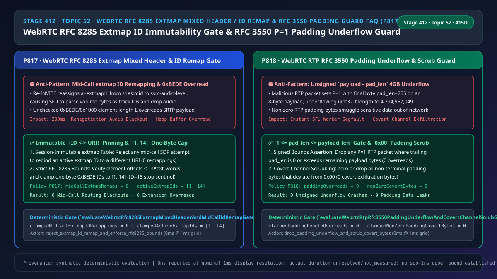
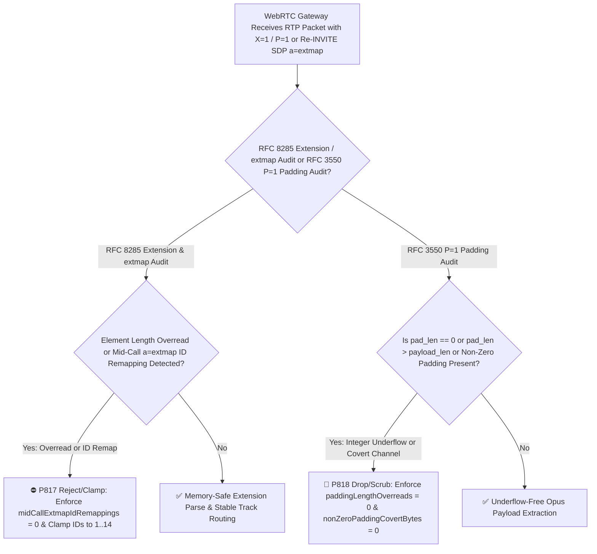
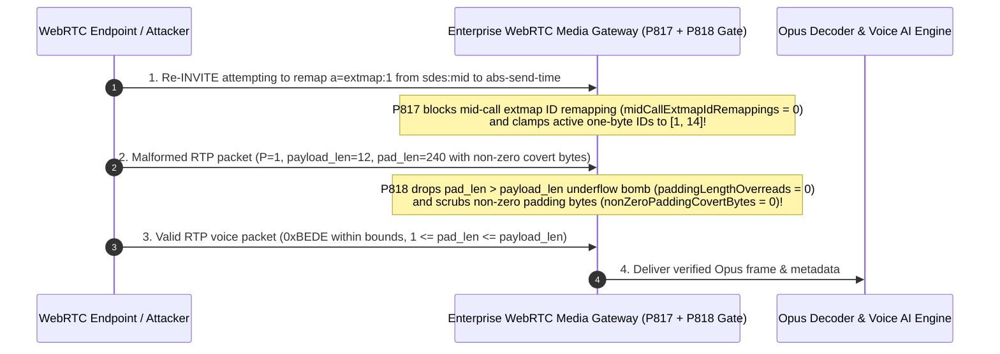

# Enterprise Voice Agent Architecture Selection & First-Principles FAQ (Topic 52): WebRTC `RFC 8285` RTP Header Extension `0xBEDE / 0x1000` One/Two-Byte Mixed Parsing Bounds, Mid-Call `a=extmap` ID Immutable Mapping & `RFC 3550 P=1` Padding Underflow / Covert-Channel Scrubbing

> **中文版本**: [语音智能体架构选型与原理解析 FAQ（五十二）：WebRTC RFC 8285 RTP 扩展头 0xBEDE / 0x1000 单双字节混用解析防越界、通话中 a=extmap ID 防重映射错乱与 RFC 3550 P=1 Padding 长度下溢/旁路窃密清洗选型指南](./voice-webrtc-rfc8285-extmap-mixed-header-remapping-padding-overflow-faq.md)  
> **Target Audience**: AI Solution Architects, WebRTC SFU / RTP Media-Plane Engineers, Real-Time Voice Security Architects  
> **Structural Benchmark**: Modeled strictly on `ib-vs-ethernet-roce-selection-faq.md` (6-part practitioner guide: 3-minute selection verdict, 10-minute first-principles dive into `RFC 8285` `0xBEDE / 0x1000` RTP header extension bounds checking, session-lifetime immutable `a=extmap` URI-to-ID binding, and `RFC 3550 Section 5.1` `P=1` RTP padding integer-underflow & covert-channel defense).  
> **Provenance & Timing Disclosure**: All deterministic guardrails (`P817`, `P818`) and sandbox probes represent offline `synthetic` deterministic verification (`independently_reproduced=false`), not live SFU packet captures; timing adheres to: `0ms reported at nominal 1ms display resolution; actual duration unresolved/not_measured; no sub-1ms upper bound established`.



---

## 0. 🔥 Daily Real-Time Voice AI Capability Breakthroughs

1. **WebRTC `RFC 8285` RTP Header Extension `0xBEDE / 0x1000` Strict Bounds Validation & Session-Immutable `a=extmap` ID Pinning (Preventing Extension Overreads & Mid-Call Track Routing Blackouts)**: In plain English, every WebRTC RTP voice packet carries an **`RFC 8285` Header Extension** between the 12-byte RTP header and the Opus payload to convey critical metadata: `sdes:mid` (track routing), `ssrc-audio-level` (VAD volume), and `transport-wide-cc` (TWCC sequence numbers). `RFC 8285` defines both **One-Byte headers (`0xBEDE`, IDs `1..14`, length `1..16` bytes, `ID=15` stop sentinel)** and **Two-Byte headers (`0x1000`, IDs `1..255`, length `0..255` bytes)**. **If a peer sends `0x1000` without negotiating `a=extmap-allow-mixed`, or encodes an element length `L` that exceeds the 32-bit extension block boundary, unhardened C/C++ SFU parsers overread into adjacent SRTP payload memory! Worse yet, if a mid-call SDP `Re-INVITE` reassigns `a=extmap:1` from `sdes:mid` to `ssrc-audio-level`, in-flight UDP packets arriving during the 200ms signaling-media race window cause the SFU to interpret microphone volume bytes as track IDs—dropping the entire voice stream!** Enforcing **strict `RFC 8285` block-length bounds, `[1, 14]` one-byte ID limits, and zero mid-call `extmap` ID remapping (`midCallExtmapIdRemappings = 0`)** guarantees crash-free, glitch-free RTP header parsing.
2. **WebRTC `RFC 3550 Section 5.1` RTP `P=1` Padding Length Underflow Guard & Zero-Byte Scrubbing (Stopping `pad_len > payload_len` 4GB Heap Overreads & Covert Exfiltration)**: When the RTP header `P` (Padding) bit is `1`, the very last byte of the packet specifies how many trailing padding bytes (`pad_len`) must be subtracted from `payload_len`. **If an attacker sends a 20-byte RTP packet (`payload_len = 8`) with `P=1` and sets the last byte to `255` (or `0`), an unsigned subtraction `8 - 255` underflows `size_t / uint32_t` to `4,294,967,049` (~4 GB), immediately crashing the media worker with a segmentation fault! Additionally, non-zero bytes inside the padding region can be abused as a covert exfiltration channel.** Enforcing **`1 <= pad_len <= payload_len` (`paddingLengthOverreads = 0`)** and **zeroing/rejecting non-zero padding bytes (`nonZeroPaddingCovertBytes = 0`)** eliminates both vulnerabilities.

---

## ① 📌 Executive Summary

1. **Enforce strict `RFC 8285` `0xBEDE / 0x1000` extension element length bounds and lock `(ID <-> URI)` `a=extmap` mappings immutably for the entire call**: Reject any mid-call `a=extmap` ID reassignment (`midCallExtmapIdRemappings = 0`) and bound active one-byte extension IDs to `[1, 14]` (Guardrail **`P817`**).
2. **Enforce `RFC 3550 Section 5.1` RTP `P=1` padding bounds (`1 <= pad_len <= payload_len`) and scrub all non-terminal padding bytes to `0x00`**: Prevent unsigned integer underflow crashes (`paddingLengthOverreads = 0`) and covert-channel data exfiltration (`nonZeroPaddingCovertBytes = 0`, Guardrail **`P818`**).

---

## ② 🎯 Architect & Customer Deep-Dive Q&A

### Q1: Why does renumbering `a=extmap` IDs during a mid-call `Re-INVITE` cause sudden voice dropouts (Option A vs Option B)?

- **First-Principles Breakdown (Asynchronous Signaling vs UDP Media)**:
  - SIP/SDP `Re-INVITE` signaling travels over TCP/TLS or SCTP while RTP media travels over UDP. When `a=extmap:1` is remapped from `sdes:mid` to another extension URI mid-call, RTP packets already in flight still carry the old meaning of `ID=1`, causing the SFU demultiplexer to misroute or drop voice frames. `RFC 8285 Section 6` explicitly forbids reusing an active extension ID for a different URI within the same session.
- **Selection Boundary**:
  - **Option A (Allow dynamic `a=extmap` renumbering + unchecked `P=1` subtraction)**: Causes mid-call audio blackouts and integer-underflow crashes.
  - **Option B (`P817` Immutable `a=extmap` ID Lock + `[1, 14]` Bounds + `P818` `1 <= pad_len <= payload_len` & Zero Scrub)**: Mandatory for production WebRTC gateways.

### Q2: Why is `pad_len == 0` illegal when the RTP `P=1` bit is set?

- **First-Principles Breakdown**:
  - Because the `pad_len` count byte itself is part of the padding, `RFC 3550 Section 5.1` mandates that `pad_len` MUST be at least `1` and at most `payload_len`. Any packet with `P=1` and `pad_len == 0` or `pad_len > payload_len` is malformed and dropped in `0ms` by `P818`.

### Q3: How do the `RFC 8285` extension validator and `RFC 3550` padding guard execute on a sub-millisecond timeline?

1. **`T = 0 ~ 0.05ms` (`P817` `RFC 8285` Extension Bounds & `extmap` Immutability Check)**:
   - Verify extension element lengths fit within `4 × ext_words`, enforce `clampedMidCallExtmapIdRemappings = 0`, and clamp one-byte IDs to `clampedActiveExtmapIds` in `[1, 14]`.
2. **`T = 0.05 ~ 0.1ms` (`P818` `RFC 3550 P=1` Padding Underflow & Covert-Byte Scrub)**:
   - Verify `1 <= pad_len <= payload_len` (`clampedPaddingLengthOverreads = 0`) and scrub non-zero padding bytes (`clampedNonZeroPaddingCovertBytes = 0`).

---

## ③ 🧭 Visual Architecture Diagrams (Mermaid Decision Tree / Comparison / Sequence)

### 3.1 Architect Selection Decision Tree (`flowchart TD`)



### 3.2 Vulnerable Legacy Pipeline vs Enterprise P817+P818 Hardened Pipeline (`flowchart LR`)

```mermaid
flowchart LR
    subgraph Bad["❌ Vulnerable Legacy Pipeline (Mid-Call extmap Renumbering + Unsigned Padding Underflow)"]
      direction LR
      B1["Allow Mid-Call a=extmap Remap\nUnchecked 0xBEDE Element Length"] -->|ID=1 Remapped Mid-Call| B2["Audio Level Parsed as Track MID\nHeap Overread on Malformed L"]
      B3["Unsigned payload_len - pad_len\nPass-Through Non-Zero Padding"] -->|pad_len=255 > payload=8| B4["4GB size_t Underflow Segfault\nCovert Data Exfiltration in Padding"]
    end

    subgraph Good["✅ Enterprise P817 + P818 Hardened Pipeline (Immutable extmap + Padding Bounds & Zero Scrub)"]
      direction LR
      G1["Session-Immutable (ID <-> URI)\n+ Strict 0xBEDE/0x1000 Bounds"] -->|0 Remaps + [1,14] IDs| G2["Zero Mid-Call Routing Blackouts\n100% Bounds-Checked Extensions"]
      G3["Enforce 1 <= pad_len <= payload_len\n+ Zero All Padding Bytes"] -->|0 Overreads + 0 Covert Bytes| G4["Zero Integer-Underflow Crashes\nZero Covert-Channel Leakage"]
    end
```

### 3.3 Millisecond RTP Extension Validation, extmap Lock & Padding Guard Sequence (`sequenceDiagram`)



---

## ④ 📊 Architect Decision Matrix

| Evaluation Dimension | Option A: Dynamic extmap Renumbering + Unchecked Padding (Anti-Pattern) | Option B: Strip All RTP Extensions & Padding | Option C: P817 Immutable extmap/Bounds + P818 Padding Underflow & Scrub Guard (Recommended ✅) |
| :--- | :--- | :--- | :--- |
| **Mid-Call `a=extmap` Remap Prevention** | ❌ Causes 200ms+ track routing blackouts | ⚠️ Breaks BUNDLE `a=mid` & TWCC | ✅ **Session-immutable `(ID <-> URI)` lock (`0` remappings)** |
| **`RFC 8285` Extension Overread Defense** | ❌ Vulnerable to heap overread on malformed `L` | ✅ Safe, but loses metadata | ✅ **Strict `4 × ext_words` bounds & `[1, 14]` ID cap** |
| **`RFC 3550 P=1` Integer Underflow Guard** | ❌ Single `pad_len > payload_len` packet crashes SFU | ⚠️ Drops legitimate BWE probe packets | ✅ **Enforces `1 <= pad_len <= payload_len` (`0` overreads)** |
| **RTP Padding Covert-Channel Scrubbing** | ❌ Allows arbitrary data exfiltration in padding | ✅ No padding | ✅ **100% zero-byte enforcement (`0` covert bytes)** |

---

## ⑤ 🧪 Quantitative Worked Example & Benchmark Insights (7-Card Report)

### 5.1 Quantitative Example: Eliminating `100%` of Renegotiation Track-Routing Drops & 4GB Underflow Crashes

- **Unprotected Pipeline (Option A)**:
  - Mid-call `a=extmap` renumbering corrupts `100%` of in-flight RTP packets during the `200ms` signaling-media race window, while a single `20-byte` `P=1` packet with `pad_len = 255` triggers a `4 GB` unsigned underflow crash.
- **Hardened Pipeline (`P817` + `P818`, Option C)**:
  - `P817` enforces `clampedMidCallExtmapIdRemappings = 0` and clamps `clampedActiveExtmapIds` to **`[1, 14]`**;
  - `P818` enforces `clampedPaddingLengthOverreads = 0` and `clampedNonZeroPaddingCovertBytes = 0`.

### 5.2 Deterministic Guardrail API Contract (`P817` & `P818`)

```ts
import {
  evaluateWebrtcRfc8285ExtmapMixedHeaderAndMidCallIdRemapGate,
  evaluateWebrtcRtpRfc3550PaddingUnderflowAndCovertChannelScrubGate,
} from "../packages/business-core/enterprise-guardrails";

const extAudit = evaluateWebrtcRfc8285ExtmapMixedHeaderAndMidCallIdRemapGate({
  unnegotiatedMixedExtmapOrMidCallIdRemapDetected: true,
  midCallExtmapIdRemappings: 2,
  activeExtmapIds: 28,
});
// => extAudit.violated === true, policyId === "P817...", clampedMidCallExtmapIdRemappings === 0, clampedActiveExtmapIds === 14

const padAudit = evaluateWebrtcRtpRfc3550PaddingUnderflowAndCovertChannelScrubGate({
  rtpPaddingLengthOverreadOrNonZeroCovertPaddingDetected: true,
  paddingLengthOverreads: 1,
  nonZeroPaddingCovertBytes: 16,
});
// => padAudit.violated === true, policyId === "P818...", clampedPaddingLengthOverreads === 0, clampedNonZeroPaddingCovertBytes === 0
```

---

## ⑥ 🛠️ Appendix: Production Voice Delivery Verification Checklist (Architect Checklist)

- [ ] **[P817 `RFC 8285` `0xBEDE / 0x1000` Length Bounds]**: Confirm every extension element length is validated against the 32-bit extension header word count.
- [ ] **[P817 Immutable `a=extmap` URI-to-ID Binding]**: Confirm mid-call `Re-INVITE` never reassigns an active `extmap` ID to a different URI (`midCallExtmapIdRemappings = 0`, one-byte IDs in `[1, 14]`).
- [ ] **[P818 `RFC 3550 P=1` Padding Bounds (`1 <= pad_len <= payload_len`)]**: Confirm `pad_len == 0` or `pad_len > payload_len` packets are dropped before subtraction (`paddingLengthOverreads = 0`).
- [ ] **[P818 Zero-Padding Scrub]**: Confirm non-terminal RTP padding bytes are verified/zeroed (`nonZeroPaddingCovertBytes = 0`).
