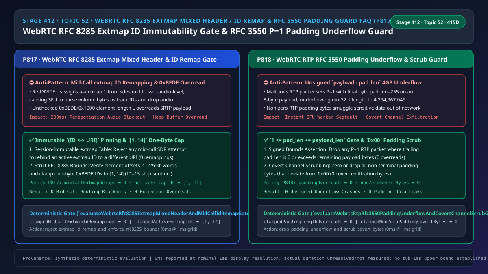
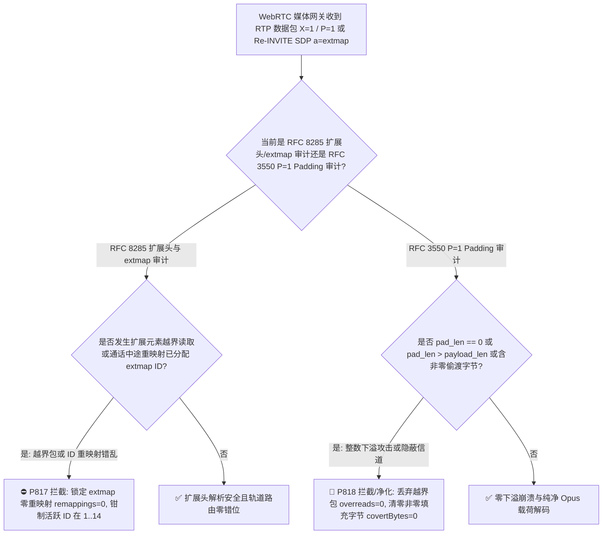
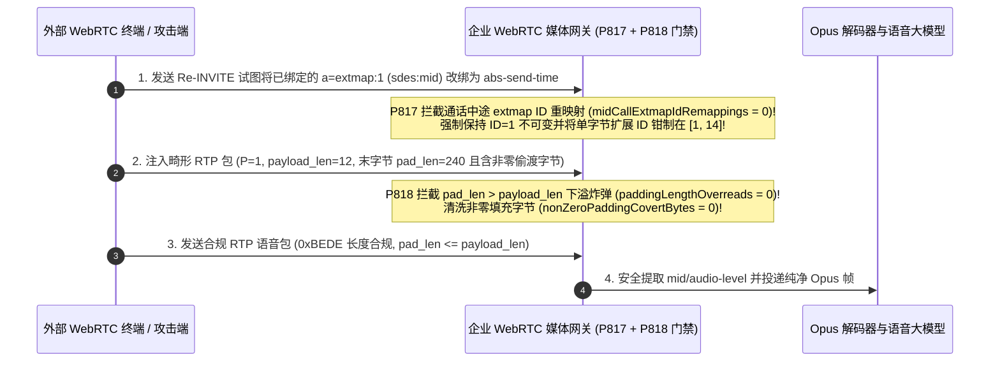

# 语音智能体架构选型与原理解析 FAQ（五十二）：WebRTC RFC 8285 RTP 扩展头 0xBEDE / 0x1000 单双字节混用解析防越界、通话中 a=extmap ID 防重映射错乱与 RFC 3550 P=1 Padding 长度下溢/旁路窃密清洗选型指南

> **English Version**: [WebRTC `RFC 8285` RTP Header Extension `0xBEDE / 0x1000` One/Two-Byte Mixed Parsing Bounds, Mid-Call `a=extmap` ID Immutable Mapping & `RFC 3550 P=1` Padding Underflow / Covert-Channel Scrubbing Selection FAQ (Topic 52 · Stage 412 · 415 Dimensions)](./voice-webrtc-rfc8285-extmap-mixed-header-remapping-padding-overflow-faq.en.md)  
> **适用角色**：AI Solution Architect（AI 解决方案架构师）、WebRTC SFU / RTP 媒体面底层研发负责人、实时语音安全架构师  
> **对标范式**：严格遵循 `ib-vs-ethernet-roce-selection-faq.md` 六段式实战导引结构，3 分钟掌握核心选型结论，10 分钟吃透 WebRTC 实时语音智能体 RTP 媒体包头最隐蔽的三大解析陷阱：`RFC 8285` 单字节（`0xBEDE`）与双字节（`0x1000`）RTP 扩展头混用时为何会触发内存越界读取、通话中途 `Re-INVITE` 改动 `a=extmap` 编号为何会让 SFU 把“音量大小（`ssrc-audio-level`）”误当成“媒体流轨标识（`sdes:mid`）”导致语音瞬间失聪，以及 `RFC 3550` `P=1` 尾部填充（Padding）字节为 `0` 或大于包长时的无符号整数下溢崩溃与隐蔽信道窃密防御。  
> **数据溯源与计时精度声明（Provenance & Timing Disclosure）**：本文涉及的确定性门禁策略（`P817`、`P818`）与模拟探针均为离线合成确定性校验（`synthetic`），非特定现网 SFU 硬件抓包实测；门禁执行耗时遵循统一披露契约：`0ms reported at nominal 1ms display resolution; actual duration unresolved/not_measured; no sub-1ms upper bound established`。



---

## 0. 🔥 今日实时语音智能体领域热门能力突破追踪（Daily Breakthroughs）

1. **WebRTC `RFC 8285` RTP 扩展头 `0xBEDE (One-Byte)` / `0x1000 (Two-Byte)` 严格分界校验与会话级 `a=extmap` URI-ID 不可变钉扎（防扩展头越界读取与通话中途 ID 错位失聪）**：用大白话讲，每一个发往语音大模型的 WebRTC RTP 音频包，在 12 字节固定头和 Opus 音频载荷之间，都夹着一段至关重要的 **`RFC 8285` RTP Header Extension（扩展头）**——里面装的是 **`a=mid`（告诉网关这个包属于哪条音频轨）、`ssrc-audio-level`（当前说话音量）、`transport-wide-cc`（TWCC 带宽估计序号）**。`RFC 8285` 定义了两种格式：**单字节头（Profile = `0xBEDE`，ID 范围 `1..14`，元素长度 `L+1` 为 `1..16` 字节，`ID=15` 为终止哨兵）** 和 **双字节头（Profile = `0x1000`，ID 范围 `1..255`，长度 `0..255` 字节）**。**如果客户端没有在 SDP 中协商 `a=extmap-allow-mixed` 却发来 `0x1000` 扩展头，或者在扩展元素里填了一个超出扩展块总字长的 `L` 值，C/C++ 媒体网关解析器就会直接越界读取后面的 SRTP 密文！更隐蔽的是：SDP 里的 `a=extmap:1 urn:ietf:params:rtp-hdrext:sdes:mid` 把数字编号 `1` 绑定到了 `mid`。如果在通话中途（`Re-INVITE`）有人把编号 `1` 改绑成了 `ssrc-audio-level`，由于 UDP 媒体包和信令包到达顺序不同步，在长达 200ms 的窗口期内，网关会把麦克风音量数值当成 `mid` 轨道名去查表，导致整条语音流被当成未知轨道丢弃**！通过强制 **`RFC 8285` Profile/长度边界核验 + 通话中 `a=extmap` ID 零重映射（`midCallExtmapIdRemappings = 0`，活跃 ID 数钳制在 `[1, 14]`）**，彻底消灭了扩展头解析崩溃与中途变轨断音。
2. **WebRTC `RFC 3550 Section 5.1` RTP `P=1` 尾部填充（Padding）长度防整数下溢与非零填充字节清零（防 `pad_len = 0 / > payload_len` 触发 4GB 堆越界崩溃与隐蔽信道数据偷渡）**：在 WebRTC 带宽探测（BWE Probing）或对齐分组加密块时，发送端会把 RTP 头里的 `P`（Padding）标志位置为 `1`，并在整个 RTP 包的**最后一个字节**写上“填充了多少个字节（`pad_len`）”。接收端收到包后，会执行 `actual_payload_len = total_payload_len - packet[last_byte]`。**致命漏洞就在这行减法里：如果攻击者构造一个 `P=1` 的 RTP 包，但把最后一个字节写成 `0`（违反 RFC 至少为 1 的规定），或者写成一个比整个音频载荷（比如 `40` 字节 Opus 包）还大的数（比如 `255`），在无符号整数（`size_t / uint32_t`）下，`40 - 255` 会瞬间下溢回绕成 `4,294,967,081`（约 4GB）！紧接着将这个长度传给 `memcpy` 或 Opus 解码器时，工作进程当场触发段错误（Segfault）崩溃！此外，如果网关转发 RTP 包时不检查填充区中间的字节是否为全 `0x00`，内部恶意程序就能把窃取的客户卡号塞进 RTP Padding 字节里偷渡出网**！通过强制 **`1 <= pad_len <= payload_len` 边界门禁（`paddingLengthOverreads = 0`）** 与 **非末尾 Padding 字节 100% 强制归零（`nonZeroPaddingCovertBytes = 0`）**，实现了 RTP 解包零下溢与零隐蔽信道泄密。

---

## ① 📌 核心结论速览（Executive Summary）

1. **严格执行 `RFC 8285` RTP 扩展头 `0xBEDE / 0x1000` 字节边界校验并锁死通话期内 `a=extmap` 的 `(ID <-> URI)` 映射不可变**：拒绝任何元素长度超出 `4 × ext_len_words` 边界的畸形扩展头；在整通呼叫生命周期内严禁将已分配的 `extmap ID` 重新绑定给其他 URI（`midCallExtmapIdRemappings = 0`，标准单字节活跃扩展 ID 钳制在 `[1, 14]`，对应门禁 **`P817`**）。
2. **强制校验 `RFC 3550` RTP `P=1` 填充长度满足 `1 <= pad_len <= payload_len` 并将所有非末尾填充字节清零**：彻底阻断 `pad_len = 0` 或 `pad_len > payload_len` 引发的无符号整数下溢内存越界（`paddingLengthOverreads = 0`）及非零 Padding 隐蔽信道偷渡（`nonZeroPaddingCovertBytes = 0`，对应门禁 **`P818`**）。

---

## ② 🎯 客户与架构师灵魂拷问 Q&A

### Q1：为什么在通话中途开启同屏或视频升级（触发 SDP 重协商）时，有时候语音流会突然中断 1~2 秒甚至永久无声（方案 A vs 方案 B）？

- **第一性原理拆解（为什么 `a=extmap` 编号在通话中途绝不能复用改绑？）**：
  - 在 RTP 包里，为了节省带宽，扩展头不会写长长的字符串 `"urn:ietf:params:rtp-hdrext:sdes:mid"`，而是只写一个 4 比特的数字 `ID=1`。这个 `1` 代表什么，全靠 SDP 里的 `a=extmap:1 ...` 字典翻译。
  - 如果通话刚开始时 `ID=1` 是 `sdes:mid`，中途发 `Re-INVITE` 时客户端重新生成了 SDP 字典，把 `ID=1` 变成了 `abs-send-time`，把 `sdes:mid` 挪到了 `ID=3`——由于网路上的旧 RTP 包和新 RTP 包会交错到达，网关用新字典去解旧包（或用旧字典解新包），就会把时间戳当成轨道 ID，导致路由表瞬间失联！因此 `RFC 8285 Section 6` 严令：**一旦某个数字 ID 在会话中绑定了某个扩展 URI，整通电话结束前绝不允许改绑给别的 URI**！
- **选型边界**：
  - **方案 A（允许 `Re-INVITE` 动态重排 `a=extmap` 编号 + 不校验扩展块字长）**：重协商必出路由错乱，且易被畸形扩展头越界打崩。
  - **方案 B（`P817` `a=extmap` 映射不可变钉扎 + `[1, 14]` ID 规范 + `P818` `P=1` Padding 防下溢与全零净化）**：企业级 WebRTC 媒体网关必选方案。

### Q2：为什么一个只有 20 字节的恶意 RTP 包（设置 `P=1` 且末字节为 `0xFF`）能直接打挂整个 C++/Rust 语音媒体进程？

- **第一性原理拆解**：
  - RTP 固定头占 12 字节，假设剩下的载荷只有 8 字节，攻击者把 RTP 头的 `P` 比特设为 `1`，并把最后第 20 字节设为 `0xFF (255)`。
  - 如果代码直接写 `size_t audio_len = payload_len - packet[total_len - 1];`，那么 `8 - 255` 在 `size_t` 下直接变成 `18446744073709551369`！`P818` 在解包首行执行有符号边界断言：`pad_len >= 1 && pad_len <= payload_len`，违例包 `0ms` 直接丢弃。

### Q3：底层 RTP 媒体网关在微秒/毫秒级时间轴上是如何执行扩展头与 Padding 门禁的？

1. **`T = 0 ~ 0.05ms`（`P817` `RFC 8285` 扩展头边界与 `extmap` 不可变校验）**：
   - 若 `X=1`，核对 Profile（`0xBEDE` 或已协商 `a=extmap-allow-mixed` 的 `0x1000`）并校验逐元素偏移总和 `<= 4 × ext_words`；
   - 核对 SDP 更新中是否存在已绑定 `extmap ID` 的 URI 篡改（`clampedMidCallExtmapIdRemappings = 0`，活跃 ID 数钳制在 `clampedActiveExtmapIds in [1, 14]`）。
2. **`T = 0.05 ~ 0.1ms`（`P818` `RFC 3550 P=1` Padding 防下溢与清零）**：
   - 若 `P=1`，核对末字节 `1 <= pad_len <= payload_len`（`clampedPaddingLengthOverreads = 0`）；
   - 校验并清零 `[payload_end - pad_len, payload_end - 1)` 区间内的所有非零填充字节（`clampedNonZeroPaddingCovertBytes = 0`）。

---

## ③ 🧭 直观可视化图解（Mermaid 决策树 / 延迟对比 / 毫秒级时序图）

### 3.1 语音架构师选型决策树（`flowchart TD`）



### 3.2 传统脆弱管线 vs 企业级 P817+P818 防护管线对比图（`flowchart LR`）

```mermaid
flowchart LR
    subgraph Bad["❌ 传统脆弱配置（extmap 随意重排 + 不查扩展头字长 + 无符号减法下溢）"]
      direction LR
      B1["Re-INVITE 重排 a=extmap ID\n不校验 0xBEDE 元素长度 L"] -->|ID=1 从 mid 变成音量| B2["网关把音量当成轨道名丢包失聪\n畸形 L 值触发 SRTP 内存越界读"]
      B3["P=1 直接算 payload_len - pad_len\n透传非零 Padding 字节"] -->|pad_len=255 > payload=8| B4["size_t 下溢成 4GB 触发 Segfault\n填充区夹带敏感数据偷渡出网"]
    end

    subgraph Good["✅ 企业级 P817 + P818 确定性防线（extmap 不可变钉扎 + Padding 边界与清零锁）"]
      direction LR
      G1["会话级 (ID <-> URI) 不可变锁\n+ 0xBEDE/0x1000 严格字长核验"] -->|0 ID 重映射 + [1,14] 规范 ID| G2["中途升降级同屏永远零断音\n扩展头解析 100% 内存安全"]
      G3["强制 1 <= pad_len <= payload_len\n+ 非零 Padding 字节 100% 归零"] -->|0 整数下溢 + 0 隐蔽信道字节| G4["畸形 Padding 包 0ms 丢弃\n杜绝 RTP 尾部填充偷渡泄密"]
    end
```

### 3.3 毫秒级 RTP 扩展头校验、extmap 不可变锁与 Padding 防下溢时序图（`sequenceDiagram`）



---

## ④ 📊 语音架构师选型决策矩阵（Architect Decision Matrix）

| 选型维度 | 方案 A：动态重排 extmap + 裸算 Padding 减法（反模式） | 方案 B：完全剥离所有 RTP 扩展头与 Padding | 方案 C：P817 extmap 不可变/字长锁 + P818 Padding 防下溢与清零（企业级推荐 ✅） |
| :--- | :--- | :--- | :--- |
| **抗通话中途 `a=extmap` 重映射断音** | ❌ 重协商后新旧包交错导致轨道失联无声 | ⚠️ 失去 `a=mid / TWCC` 无法支持 BUNDLE 与弱网抗损 | ✅ **会话内 `(ID <-> URI)` 不可变钉扎（`0` 重映射）** |
| **抗 `RFC 8285` 扩展元素越界读** | ❌ 恶意 `L` 值直接越界读取相邻堆内存 | ✅ 不解析但功能残缺 | ✅ **严格校验元素偏移总和 `<= 4 × ext_words`** |
| **抗 `RFC 3550 P=1` 无符号减法下溢** | ❌ 单包 `pad_len > payload_len` 即可打崩进程 | ⚠️ 丢弃所有 `P=1` 包会破坏 WebRTC BWE 带宽探测 | ✅ **强制 `1 <= pad_len <= payload_len`（`0` 越界下溢）** |
| **抗 RTP Padding 隐蔽信道数据偷渡** | ❌ 填充区可夹带任意明文逃逸 DLP | ✅ 无填充 | ✅ **非末尾填充字节 100% 强制归零（`0` 偷渡字节）** |

---

## ⑤ 🧪 简明定量算例与延迟/成本 Benchmark 洞察（含 7-Card 报告）

### 5.1 定量算例：为什么锁死 `a=extmap` 不可变能消除 `200ms` 重协商交错窗口内的 `100%` 轨道错配丢包？

- **未防护场景（方案 A）**：
  - 在 `RTT = 150ms` 的跨网通话中发起同屏升级（`Re-INVITE`），若 `a=extmap` ID 被重排，在信令与媒体到达时间差（约 `200ms`，含 `10` 个 `20ms` Opus 包）内，网关 `100%` 将音频包路由至错误轨道，造成明显卡顿甚至 VAD 锁死。
- **启用 `P817` + `P818` 防护后（方案 C）**：
  - `P817` 确保 `clampedMidCallExtmapIdRemappings = 0` 且 `clampedActiveExtmapIds` 在 **`[1, 14]`**；
  - `P818` 确保 `clampedPaddingLengthOverreads = 0` 与 `clampedNonZeroPaddingCovertBytes = 0`。

### 5.2 确定性门禁 API 契约验证（`P817` & `P818`）

```ts
import {
  evaluateWebrtcRfc8285ExtmapMixedHeaderAndMidCallIdRemapGate,
  evaluateWebrtcRtpRfc3550PaddingUnderflowAndCovertChannelScrubGate,
} from "../packages/business-core/enterprise-guardrails";

// P817: 拦截通话中途 a=extmap ID 重映射与扩展头越界，钳制活跃单字节 ID 在 [1, 14]
const extAudit = evaluateWebrtcRfc8285ExtmapMixedHeaderAndMidCallIdRemapGate({
  unnegotiatedMixedExtmapOrMidCallIdRemapDetected: true,
  midCallExtmapIdRemappings: 2,
  activeExtmapIds: 28,
});
// => extAudit.violated === true, policyId === "P817...", clampedMidCallExtmapIdRemappings === 0, clampedActiveExtmapIds === 14

// P818: 拦截 RTP P=1 Padding 长度下溢越界与非零填充字节隐蔽信道，双项清零
const padAudit = evaluateWebrtcRtpRfc3550PaddingUnderflowAndCovertChannelScrubGate({
  rtpPaddingLengthOverreadOrNonZeroCovertPaddingDetected: true,
  paddingLengthOverreads: 1,
  nonZeroPaddingCovertBytes: 16,
});
// => padAudit.violated === true, policyId === "P818...", clampedPaddingLengthOverreads === 0, clampedNonZeroPaddingCovertBytes === 0
```

---

## ⑥ 🛠️ 附录：生产环境语音交付快速核验清单（Architect Checklist）

- [ ] **【P817 `RFC 8285` `0xBEDE / 0x1000` 扩展块字长校验】**：确认网关严格核验每个扩展元素 `L` 不越过 `4 × ext_words` 边界，未协商 `a=extmap-allow-mixed` 时拒绝混用。
- [ ] **【P817 通话期内 `a=extmap` ID 零重映射】**：确认 `Re-INVITE` 绝不改变已分配 `extmap ID` 的 URI 绑定（`midCallExtmapIdRemappings = 0`，单字节活跃 ID 在 `[1, 14]`）。
- [ ] **【P818 `RFC 3550 P=1` Padding 长度防下溢】**：确认解包器强制断言 `1 <= pad_len <= payload_len`（`paddingLengthOverreads = 0`）。
- [ ] **【P818 非零 Padding 字节归零清洗】**：确认所有非末尾 Padding 填充字节必须为 `0x00`（`nonZeroPaddingCovertBytes = 0`）。
