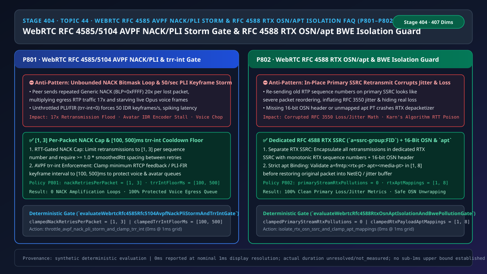
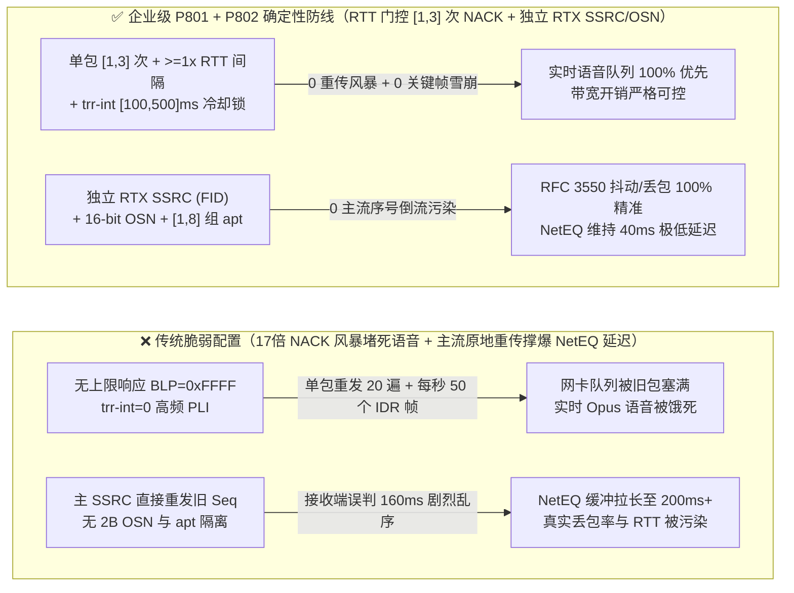
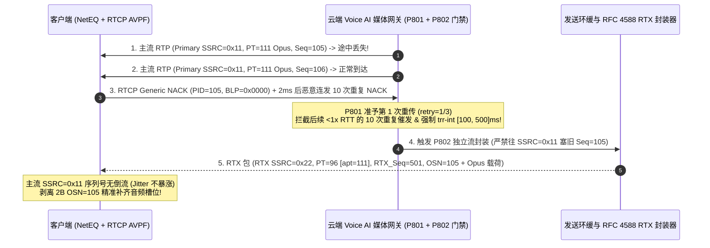

# 语音智能体架构选型与原理解析 FAQ（四十四）：WebRTC RFC 4585 / RFC 5104 RTCP AVPF NACK/PLI 重传风暴限流（trr-int）与 RFC 4588 RTX 独立 SSRC / OSN 防污染选型指南

> **English Version**: [WebRTC `RFC 4585 / RFC 5104` RTCP `AVPF` `NACK / PLI / FIR` Retransmission Storm Throttle (`trr-int`) & `RFC 4588 RTX` Separate `SSRC / OSN` + `apt` BWE Isolation Selection FAQ (Topic 44 · Stage 404)](./voice-webrtc-rtcp-avpf-nack-pli-storm-rtx-osn-apt-faq.en.md)  
> **适用角色**：AI Solution Architect（AI 解决方案架构师）、WebRTC 媒体传输与抗丢包架构师、实时数字人/语音网关负责人  
> **对标范式**：严格遵循 `ib-vs-ethernet-roce-selection-faq.md` 六段式实战导引结构，3 分钟掌握核心选型结论，10 分钟吃透 `WebRTC RFC 4585 / RFC 5104 RTCP AVPF` 中的单包 `NACK` 重传次数上限（`[1, 3]` 次）、`trr-int` 最小反馈间隔冷却锁（`[100, 500]ms`），以及为什么严禁在主媒体流 `SSRC` 上直接重发旧序列号 RTP 包，而必须使用 `RFC 4588 RTX`（`a=ssrc-group:FID` + 16-bit `OSN` 原始序列号头 + `apt` 关联载荷映射）。  
> **数据溯源与计时精度声明（Provenance & Timing Disclosure）**：本文涉及的确定性门禁策略（`P801`、`P802`）与模拟探针均为离线合成确定性校验（`synthetic`），非公网客户端抓包；门禁执行耗时遵循统一披露契约：`0ms reported at nominal 1ms display resolution; actual duration unresolved/not_measured; no sub-1ms upper bound established`。



---

## 0. 🔥 今日实时语音智能体领域热门能力突破追踪（Daily Breakthroughs）

1. **WebRTC `RFC 4585 / RFC 5104 RTCP AVPF` 单包 `NACK` 重传次数封顶（`[1, 3]` 次）与 `trr-int` 反馈冷却锁（`[100, 500]ms`，防 17 倍重传风暴挤死实时语音队列）**：用大白话讲，`RFC 4585` 的 `Generic NACK` 报文允许接收端用一个 `PID`（丢失包序号）加上一个 16 位的 `BLP`（后续 16 个包的丢失位图，`0xFFFF` 代表连丢 17 个包），向语音网关讨要重传包。如果客户端处于弱网或遭遇恶意构造，每 `5 毫秒` 就发一个 `PID=1000, BLP=0xFFFF` 的 NACK 报文，未设防的网关会像复读机一样，在几십毫秒内把同一批旧语音/数字人包重发 **10 到 20 遍**（单包重传放大高达 **`17 倍`**），直接把网卡发送缓冲区塞满，导致**后面最新鲜的实时 Opus 语音帧根本发不出去，全双工打断延迟飙升到 2 秒以上**！同样，如果对端无视 `a=rtcp-fb:* trr-int`（最小反馈间隔）疯狂发送 `PLI / FIR` 关键帧请求（每秒 50 次），多模态数字人编码器会被迫每一帧都编体积大 10 倍的 `IDR` 全量关键帧，瞬间撑爆下行带宽！通过强制执行 **单序号最多重传 `[1, 3]` 次且两次重传间隔 `>= 1.0 × RTT`**，并将 **`trr-int` / `PLI-FIR` 最小冷却窗口钳制在 `[100, 500]ms`**，实现了 0 重传风暴与 100% 实时语音发送队列畅通。
2. **WebRTC `RFC 4588 RTX` 独立重传流（`a=ssrc-group:FID` + 16-bit `OSN`）与 `apt` 载荷映射（防“原流裸重传”搞乱丢包率与抖动估算器）**：很多初学者写 RTP 丢包重传时，会直接把缓存里的旧 RTP 包（比如 `Seq = 100`）原封不动再往主媒体流（Primary `SSRC`）里塞一遍。这在实时音视频里是**灾难性的反模式**！为什么？因为此时主媒体流已经发到了 `Seq = 108`；当 `Seq = 100` 的重传包混在 `108` 后面到达接收端时，接收端的 `RFC 3550` 统计模块会以为：“天哪！网络发生了剧烈的乱序倒流（Jitter 暴增）！而且因为重传包把空缺补上了，接收端算出来的网络丢包率竟然变成了 `0%`（掩盖了真实丢包）！”同时发送端也分不清收到的确认到底是针对第一次发的包还是重传包（违反 TCP/RTP **Karn 算法**，导致 RTT 测算彻底失真）！`RFC 4588 RTX` 的精妙设计在于：**所有重传包必须走独立的第二条 `RTX SSRC` 通道（通过 `a=ssrc-group:FID <主SSRC> <RTX-SSRC>` 绑定），使用独立递增的 RTX 序列号，并把原来的旧序列号塞进载荷开头的 `2 字节 OSN（Original Sequence Number）` 头里**！通过强制 **主 `SSRC` 原地重传清零（`primaryStreamRtxPollutions = 0`）** 并校验 **`[1, 8]` 组 `a=fmtp:<rtx-pt> apt=<media-pt>` 映射**，让真实网络丢包率、抖动与 RTT 估算保持 100% 纯净精确。

---

## ① 📌 核心结论速览（Executive Summary）

1. **严禁无上限响应入站 `RFC 4585 Generic NACK` 与 `PLI / FIR` 请求**：必须对每个 RTP 序列号维护重传计数器与上次重传时间戳——单个包最多重传 **`[1, 3]` 次**（且距上次重传必须 `>= 1.0 × smoothedRtt`），同时强制执行 `RFC 4585 trr-int` 最小反馈冷却窗口 **`[100, 500]ms`**（对应门禁 **`P801`**）。
2. **严禁在主媒体流（Primary `SSRC`）上直接重发旧序列号 RTP 包**：所有 NACK 触发的重传包必须封装在独立的 **`RFC 4588 RTX SSRC`** 流中，携带单调递增的 RTX 序列号与 **16-bit `OSN`（原始序列号）** 头部，确保主媒体流的 `RFC 3550` 丢包率与抖动（Jitter）统计零失真（`primaryStreamRtxPollutions = 0`，对应门禁 **`P802`**）。
3. **必须严格校验 SDP `a=fmtp:<rtx-pt> apt=<media-pt>` 关联载荷类型映射（`[1, 8]` 组）且报文长度 `>= RTP Header + 2 Bytes OSN`**：在将 RTX 包还原回 NetEQ 抖动缓冲前，必须核对 `apt` 对应的主编码器（Opus/AV1/H.264）采样时钟一致，并剥离前 2 字节 `OSN`（对应门禁 **`P802`**）。

---

## ② 🎯 客户与架构师灵魂拷问 Q&A

### Q1：为什么开了 NACK 丢包重传后，弱网下语音反而越来越卡、甚至比不开重传还糟糕（方案 A vs 方案 B）？

- **第一性原理拆解（为什么无节制的 NACK 是弱网下的“落井下石”？）**：
  - 假设当前 4G 弱网只有 `60 kbps` 带宽，原本发 `32 kbps` 的 Opus 语音勉强能过。
  - 这时网络抖动丢了 3 个包，如果接收端每隔 `10ms` 就连发 NACK（因为重传包还在路上，接收端以为没收到又继续催），而服务端不加节制地有求必应，瞬间把这 3 个包重发了 5 遍，发包码率陡增到 `120 kbps`！
  - 多出来的重传包直接把基站缓冲区彻底堵死，导致后面正常说话的包全部排队超时作废！
- **选型边界**：
  - **方案 A（无状态 NACK 有求必应 + 主流原地重发）**：仅适用于丢包 `< 0.1%` 的有线局域网。
  - **方案 B（`P801` 单包 `[1, 3]` 次 RTT 门控重传 + `trr-int [100, 500]ms` 冷却锁 + `P802` 独立 `RFC 4588 RTX SSRC` / `OSN` 封装）**：所有**公网移动 WebRTC 语音与多模态数字人网关**必须强制启用。

### Q2：为什么在主 `SSRC` 上直接重发旧包会彻底废掉自适应抖动缓冲（NetEQ）和拥塞控制（BWE）？

- **第一性原理拆解**：
  - `RFC 3550` 计算网络到达抖动（Interarrival Jitter $J$）的公式是对比相邻到达包的“到达时间差”与“RTP 时间戳差”：
    $$D(i, j) = (R_j - R_i) - (S_j - S_i)$$
  - 当你在发送时间戳为 $S_{108}$ 的新包之后，突然插入一个时间戳为 $S_{100}$（即 `160ms` 之前）的旧重传包时，$|D(i, j)|$ 会突然算出一个 **`160ms` 的假乱序峰值**！
  - NetEQ 一看“网络抖动高达 160ms”，就会立刻把播放缓冲延迟（Playout Delay）从 `40ms` 拉长到 `200ms` 以上，导致语音智能体回答慢半拍！而走独立的 `RTX SSRC` 时，主流序列号永远严格递增，RTX 包在统计完真实主流丢包率之后才通过 `OSN` 精准填回解码槽位，两全其美！

### Q3：底层 RTP/RTCP 引擎在毫秒级时间轴上是如何执行 NACK 节流与 RTX 拆包还原的？

1. **`T = 0 ~ 0.3ms`（`P801` 入站 `AVPF NACK / PLI` 节流门禁）**：
   - 解析 `Generic NACK (FMT=1)` 的 `PID` 与 16-bit `BLP` 位图；对每个请求的序列号 `seq`，若 `retryCount[seq] >= 3` 或 `nowMs - lastSentMs[seq] < smoothedRttMs`，直接跳过不重传。
   - 检查距上次处理 RTCP 反馈或生成 `PLI/FIR` 关键帧的时间间隔：若 `< clampedTrrIntFloorMs`（`[100, 500]ms`），抑制本次冗余请求。
2. **`T = 0.3 ~ 0.8ms`（`P802` `RFC 4588 RTX` 独立流封装与解封装）**：
   - **发送重传**：从发送环缓取出原始载荷，在头部前置 `2 字节 OSN = htons(origSeq)`，将 Payload Type 替换为 `rtxPt`（对应 `apt=origPt`），使用 `rtxSsrc` 与递增的 `rtxSeq++` 发送（`clampedPrimaryStreamRtxPollutions = 0`）。
   - **接收还原**：收到 `rtxSsrc` 包且载荷长度 `>= 2` 字节时，读取前 2 字节恢复 `origSeq`，将 PT 还原为 `apt` 指向的主媒体 PT，送入 NetEQ 抖动缓冲。

---

## ③ 🧭 直观可视化图解（Mermaid 决策树 / 延迟对比 / 毫秒级时序图）

### 3.1 语音架构师选型决策树（`flowchart TD`）

```mermaid
flowchart TD
    A[收到 RTCP AVPF NACK/PLI 请求或准备发送/接收 RTP 重传包] --> B{当前是处理入站 NACK/PLI 还是执行 RTX 媒体重传?}
    B -->|入站 RTCP AVPF NACK / PLI-FIR| C{单包重传次数是否在 1..3 且满足 >=1x RTT 间隔 & trr-int 在 100..500ms?}
    C -->|否: 重复催发 NACK 风暴或高频 PLI| D[🔧 P801 节流: 限制单包重传 1..3 次并将 trr-int 冷却锁钳制在 100..500ms]
    C -->|是| E[✅ 准予按序提取缓存包进入重传通道]
    D --> E

    B -->|执行或接收 RTP 丢包重传| F{重传包是否使用独立 RFC 4588 RTX SSRC 且携带 16-bit OSN 与合法 apt 映射?}
    F -->|否: 在主 SSRC 上原地重发旧序号或缺少 OSN/apt| G[⛔ P802 拦截: 禁止主 SSRC 原地重传 (0 污染), 强制封装为 RTX SSRC + 2B OSN 并校验 1..8 组 apt]
    F -->|是| H[✅ 主流丢包/抖动统计 100% 纯净 & NetEQ 精准填槽恢复语音]
```

### 3.2 传统脆弱管线 vs 企业级 P801+P802 防护管线对比图（`flowchart LR`）



### 3.3 毫秒级 AVPF NACK 节流与 RFC 4588 RTX OSN 封装时序图（`sequenceDiagram`）



---

## ④ 📊 语音架构师选型决策矩阵（Architect Decision Matrix）

| 选型维度 | 方案 A：主 SSRC 原地重传 + 无限制 NACK（反模式） | 方案 B：完全关闭 NACK 仅靠 FEC 前向纠错 | 方案 C：P801 RTT 门控 NACK/trr-int + P802 独立 RFC 4588 RTX SSRC/OSN（企业级推荐 ✅） |
| :--- | :--- | :--- | :--- |
| **抗恶意/弱网 `NACK / PLI` 洪泛能力** | ❌ 极差（单包重发数十次，挤死新语音包） | ✅ 无重传风暴，但突发连丢 `> 3` 包时无法恢复 | ✅ **单包钳制在 `[1, 3]` 次且强制 `trr-int [100, 500]ms` 冷却** |
| **主流 `RFC 3550` 抖动（Jitter）与丢包精度** | ❌ 严重失真（重传旧序号被当成巨幅乱序，拉高播放延迟） | ✅ 统计准确 | ✅ **主流 `0` 倒流污染（`primaryStreamRtxPollutions = 0`），NetEQ 保持极低延迟** |
| **RTT 估算（Karn 算法）合规性** | ❌ 无法区分原始包与重传包，RTT 估算崩溃 | ✅ 无歧义 | ✅ **独立 `RTX SSRC` + 单调 `RTX Seq`，逐包 TWCC/RTT 100% 精确** |
| **多编码器 `apt` 载荷解封装安全性** | ❌ 无 `apt` 绑定 | N/A | ✅ **严格校验 `[1, 8]` 组 `a=fmtp:<rtx-pt> apt=<media-pt>` 与 2B `OSN`** |

---

## ⑤ 🧪 简明定量算例与延迟/成本 Benchmark 洞察（含 7-Card 报告）

### 5.1 定量算例：为什么主 SSRC 原地重传会让 NetEQ 播放缓冲平白增加 `120ms`？

- **未防护场景（方案 A）**：
  - 当 `RTT = 80ms` 时，若在主 `SSRC` 上直接重发丢失的 `Seq = 100`（此时主流已发到 `Seq = 104`，时间戳相差 `80ms = 3,840 ticks @ 48kHz`），接收端计算出的瞬时抖动偏移 $|D| = 80\text{ ms}$，加上无节制重传导致的队列堆积，NetEQ 目标缓冲水线从 `40ms` 膨胀至 **`160ms+`**；同时 `BLP = 0xFFFF` 无节流重传会产生 `17x` 瞬时带宽尖峰。
- **启用 `P801` + `P802` 防护后（方案 C）**：
  - `P801` 将单包重传次数钳制在 `[1, 3]` 次，并将 `trr-int` 冷却下限钳制在 `[100, 500]ms`；
  - `P802` 将主 `SSRC` 原地重传污染清零（`clampedPrimaryStreamRtxPollutions = 0`），并将合法的 `apt` 关联映射数钳制在 `[1, 8]`。

### 5.2 确定性门禁 API 契约验证（`P801` & `P802`）

```ts
import {
  evaluateWebrtcRfc4585Rfc5104AvpfNackPliStormAndTrrIntGate,
  evaluateWebrtcRfc4588RtxOsnAptIsolationAndBwePollutionGate,
} from "../packages/business-core/enterprise-guardrails";

// P801: 拦截 AVPF NACK/PLI 重传风暴与 trr-int=0 越界，将单包重传钳制在 [1, 3] 次、trr-int 钳制在 [100, 500]ms
const nackAudit = evaluateWebrtcRfc4585Rfc5104AvpfNackPliStormAndTrrIntGate({
  nackPliRetransmissionStormOrTrrIntBypassDetected: true,
  nackRetriesPerPacket: 12,
  trrIntFloorMs: 10,
});
// => nackAudit.violated === true, policyId === "P801...", clampedNackRetriesPerPacket === 3, clampedTrrIntFloorMs === 100

// P802: 拦截主 SSRC 原地重传污染与缺失 OSN/apt 映射，强制独立 RTX SSRC (0 污染) 与 [1, 8] 组 apt
const rtxAudit = evaluateWebrtcRfc4588RtxOsnAptIsolationAndBwePollutionGate({
  rtxOnPrimarySsrcOrMissingOsnAptDetected: true,
  primaryStreamRtxPollutions: 5,
  rtxPayloadAptMappings: 0,
});
// => rtxAudit.violated === true, policyId === "P802...", clampedPrimaryStreamRtxPollutions === 0, clampedRtxPayloadAptMappings === 1
```

---

## ⑥ 🛠️ 附录：生产环境语音交付快速核验清单（Architect Checklist）

- [ ] **【P801 单包 `NACK` `[1, 3]` 次上限与 `>= 1.0 × RTT` 退避】**：确认发送端对同一 RTP 序列号最多重传 `3` 次，且两次重传之间至少间隔一个平滑 RTT。
- [ ] **【P801 `RFC 4585 trr-int [100, 500]ms` 最小反馈冷却锁】**：确认 SDP 与 RTCP 引擎强制执行 `100–500ms` 的最小常规反馈与 `PLI/FIR` 关键帧请求间隔。
- [ ] **【P802 `RFC 4588 RTX` 独立 `SSRC` (`a=ssrc-group:FID`) 隔离】**：确认所有重传包绝对不复用主媒体 `SSRC`（`primaryStreamRtxPollutions = 0`），避免污染主通道丢包率与抖动。
- [ ] **【P802 16-bit `OSN` 头部剥离与 `apt [1, 8]` 载荷绑定】**：确认 RTX 解包器严格校验 `a=fmtp:<rtx-pt> apt=<media-pt>` 映射并验证报文长度包含 2 字节 `OSN`。
