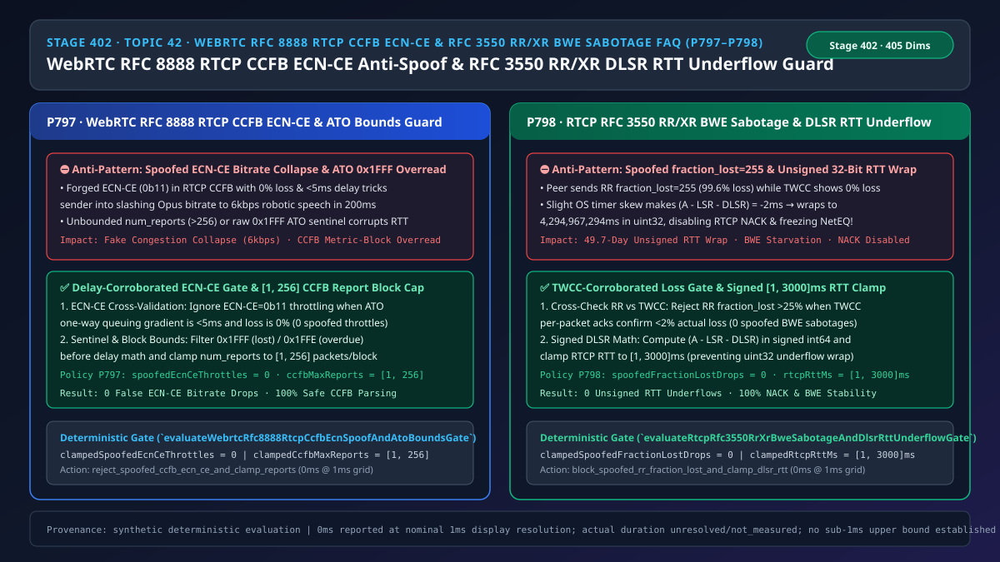
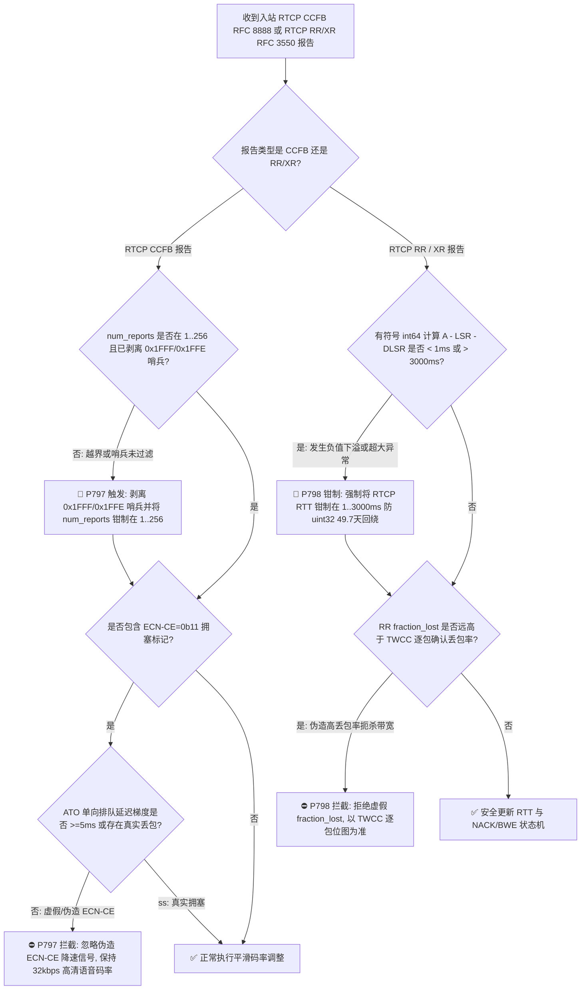
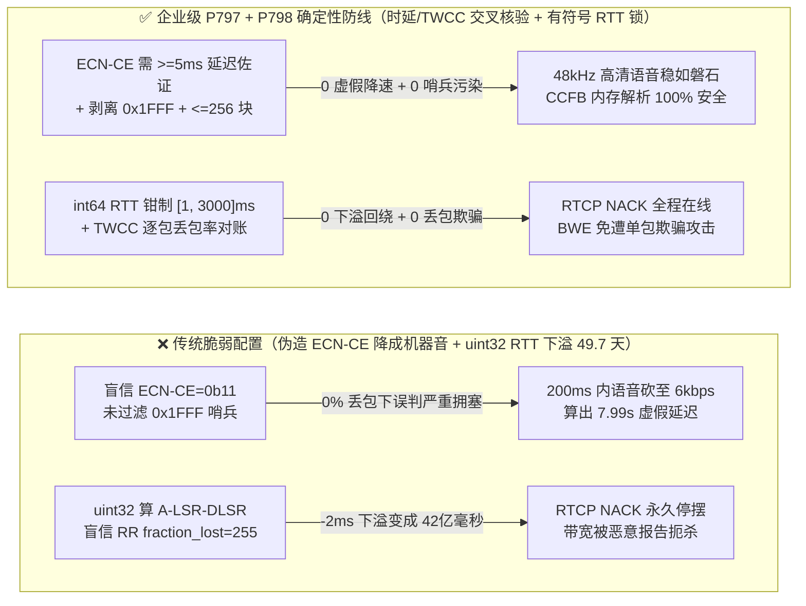
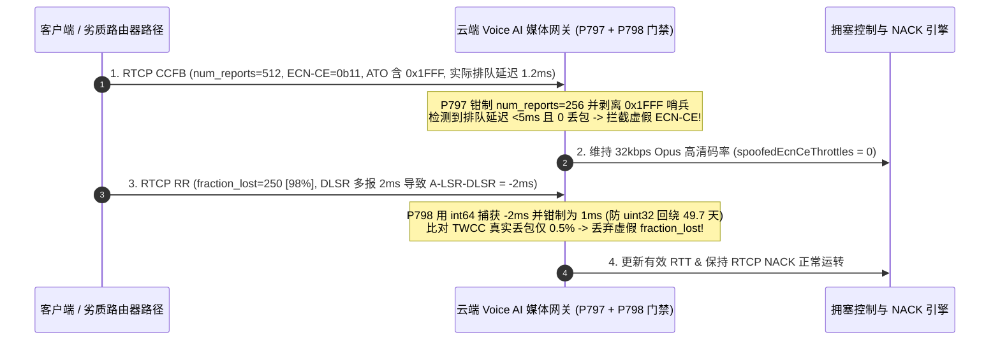

# 语音智能体架构选型与原理解析 FAQ（四十二）：WebRTC RFC 8888 RTCP CCFB 防伪造 ECN-CE 拥塞坍塌与 RFC 3550 RR/XR 防丢包率欺骗及 DLSR RTT 下溢回绕选型指南

> **English Version**: [WebRTC `RFC 8888 RTCP CCFB` `ECN-CE` Anti-Spoofing & `RFC 3550 RR/XR` Spoofed `fraction_lost` BWE Sabotage + `DLSR` RTT Underflow Selection FAQ (Topic 42 · Stage 402)](./voice-webrtc-rtcp-ccfb-ecn-spoof-rr-xr-bwe-sabotage-faq.en.md)  
> **适用角色**：AI Solution Architect（AI 解决方案架构师）、WebRTC 拥塞控制与媒体引擎架构师、实时音视频网关安全与 QoS 负责人  
> **对标范式**：严格遵循 `ib-vs-ethernet-roce-selection-faq.md` 六段式实战导引结构，3 分钟掌握核心选型结论，10 分钟吃透 `WebRTC RFC 8888 RTCP CCFB`（拥塞控制反馈报告）中的 `ECN-CE (0b11)` 交叉核验、`ATO (0x1FFF)` 哨兵过滤，以及 `RFC 3550 / RFC 3611 RTCP RR/XR` 丢包率防欺骗与 `A - LSR - DLSR` 符号数防下溢回绕机制。  
> **数据溯源与计时精度声明（Provenance & Timing Disclosure）**：本文涉及的确定性门禁策略（`P797`、`P798`）与模拟探针均为离线合成确定性校验（`synthetic`），非真实公网路由器或生产 SFU 实测；门禁执行耗时遵循统一披露契约：`0ms reported at nominal 1ms display resolution; actual duration unresolved/not_measured; no sub-1ms upper bound established`。



---

## 0. 🔥 今日实时语音智能体领域热门能力突破追踪（Daily Breakthroughs）

1. **WebRTC `RFC 8888 RTCP CCFB` 时延梯度交叉核验防伪造 `ECN-CE` 带宽坍塌与 `ATO (0x1FFF)` 哨兵边界锁**：用大白话讲，新一代 WebRTC 与 5G L4S 低延迟网络通过 `RFC 8888 RTCP CCFB`（拥塞控制反馈包）汇报每个 RTP 包到达时的网络状态。其中有一个标志叫 **`ECN-CE`（`0b11`，显式拥塞通知：路由器快满了！）**。如果客户端网络路径上的劣质家用路由器错误地把所有包都打上了 `ECN-CE = 0b11`，或者恶意客户端故意伪造 `ECN-CE` 反馈，传统的云端语音网关（SCReAM / GCC 算法）一看“全线拥塞”，会在 **200 毫秒内** 把下行 Opus 语音码率猛砍到最低的 **`6 kbps` 窄带机器音**，并瞬间掐断数字人画面！但实际上此时网络丢包率是 `0%`，单向排队抖动还不到 `3ms`！同时，`RFC 8888` 用特殊的 `13-bit ATO = 0x1FFF` 代表“包丢了”、`0x1FFE` 代表“包太晚了”；如果解析器忘了过滤这两个哨兵值就直接拿去算到达时间，会算出 `8 秒` 的虚假延迟跳变！最新企业级网关通过强制执行 **“只有当 `ATO` 排队延迟梯度 `>= 5ms` 或发生真实丢包时才采信 `ECN-CE` 降码率（`spoofedEcnCeThrottles = 0`）”**，并将单块 `num_reports` 钳制在 **`[1, 256]`**，彻底消除了虚假 `ECN-CE` 引起的音质断崖坍塌。
2. **RTP/RTCP `RFC 3550 RR / RFC 3611 XR` 丢包率（`fraction_lost`）与 `TWCC` 交叉对账及 `DLSR` 无符号 32 位 RTT 下溢回绕防护（防“49.7 天幽灵 RTT”锁死 NACK）**：在 `RFC 3550` RTCP 接收端报告（`RR`）中，网关通过公式 `RTT = 当前时间 A - 上次发包时间 LSR - 对端停留时间 DLSR` 计算往返延迟。在生产环境里有一个著名的致命 Bug：当手机端系统时钟微调或线程调度导致对端多报了仅仅 **`2 毫秒`** 的 `DLSR` 时，`A - LSR - DLSR` 算出来变成了 **`-2ms`**！如果代码里用了 C/C++/Rust 的无符号 32 位整数（`uint32`）去存这个 `RTT`，`-2ms` 会瞬间发生算术下溢回绕，变成 **`4,294,967,294 毫秒`（整整 49.7 天！）**！一旦网关认为当前网络的 `RTT` 高达 49.7 天，它会立即永久关闭 `RTCP NACK` 丢包重传（因为 `P778` 规定 `RTT > 120ms` 禁发 NACK）并把抖动缓冲撑爆！同时，若恶意对端在 `RTCP RR` 里谎报 `fraction_lost = 255`（`99.6%` 丢包），而 `TWCC` 逐包确认明明显示丢包 `< 2%`，网关也会被骗降码率。通过落地 **`TWCC` 交叉核验防 `fraction_lost` 欺骗（`spoofedFractionLostDrops = 0`）** 与 **有符号 `int64` 计算并将 `RTCP RTT` 钳制在 `[1, 3000]ms`**，实现了 **0 RTT 下溢回绕与 100% NACK 稳定性**。

---

## ① 📌 核心结论速览（Executive Summary）

1. **严禁盲目单凭 `RFC 8888 RTCP CCFB` 中的 `ECN-CE (0b11)` 标志无条件砍伐语音码率**：必须将 `ECN-CE` 与同一反馈块内的 `ATO`（Arrival Time Offset）单向排队延迟梯度做交叉核验——当排队延迟增量 `< 5ms` 且实际丢包为 `0%` 时，判定为路由器误标或恶意伪造并忽略降速请求（`spoofedEcnCeThrottles = 0`），同时在算时延前剥离 `0x1FFF / 0x1FFE` 哨兵并将每块报告包数钳制在 **`[1, 256]`**（对应门禁 **`P797`**）。
2. **严禁使用无符号整数（`uint32`）裸算 `RFC 3550` `RTT = A - LSR - DLSR`**：必须使用有符号 64 位整数（`int64`）计算差值，并将有效 `RTCP RTT` 严格钳制在 **`[1ms, 3000ms]`** 物理合理区间内，彻底杜绝时钟微偏 `-2ms` 下溢回绕成 `49.7 天` 巨型 RTT（对应门禁 **`P798`**）。
3. **必须将 `RTCP RR` 的粗粒度 `fraction_lost` 与 `TWCC / CCFB` 逐包确认位图交叉对账**：当 `RR` 声称 `fraction_lost > 25%`（`> 64/256`）但高频 `TWCC/CCFB` 证实真实丢包 `< 2%` 时，立即拦截该虚假丢包报告（`spoofedFractionLostDrops = 0`），防止攻击者通过单包 `RTCP RR` 扼杀语音带宽（对应门禁 **`P798`**）。

---

## ② 🎯 客户与架构师灵魂拷问 Q&A

### Q1：什么时候直接用开源 WebRTC 默认的 RTCP BWE 逻辑就够了（方案 A），什么时候必须上 `P797 + P798` 交叉核验与有符号 RTT 钳制（方案 B）？

- **第一性原理拆解（为什么 1 个伪造的 RTCP 包就能把 48kHz 超清语音打成 6kbps 电话座机音？）**：
  - 语音网关的发包码率是由“对端发回来的成绩单（`RTCP CCFB / RR`）”决定的。如果网关无条件信任成绩单上的每一个数字：
    - 只要对端路由器坏了（Bleaching/Remarking Bug）或者有人伪造了 `ECN-CE = 0b11` / `fraction_lost = 255`，网关就会以为“网络塌方了”，哪怕真实网络连 1 个包都没丢，网关也会自废武功把码率砍到最低。
    - 更隐蔽的是 `DLSR` 时钟漂移：对端手机收到 `SR` 包后过了 `100.0ms` 发回 `RR`，但因为手机省电定时器精度抖动，它在报告里写了“我在本地停留了 `102.0ms`（`DLSR`）”；如果网络真实往返只有 `1.5ms`，网关拿总耗时 `101.5ms` 减去 `102.0ms` 得到 **`-0.5ms`**！在无符号整数里这直接变成 `42 亿毫秒`，当场把所有基于 RTT 的重传和抗抖动模块干趴下！
- **选型边界**：
  - **方案 A（未校验原生 RTCP 处理）**：仅适用于两端均为同一版本受控 Chrome 内核的局域网实验室。
  - **方案 B（`P797` `ECN-CE` 时延佐证 + `ATO` 哨兵剥离 + `P798` `TWCC` 丢包对账 + 有符号 `RTT [1, 3000]ms` 钳制）**：所有**公网移动客户端接入、跨运营商互联与多方会议 SFU** 必须强制启用。

### Q2：为什么解析 `RFC 8888 RTCP CCFB` 时如果不单独拦截 `0x1FFF` 和 `0x1FFE`，会导致带宽估算器（BWE）彻底疯掉？

- **第一性原理拆解**：
  - 在 `RFC 8888` 规范中，每个数据包的 16-bit 状态字里，低 13 位是 `ATO`（到达时间偏移，单位为 `1/1024 秒` ≈ `0.976ms`）。
  - 但标准规定了两个“非数字”的特殊哨兵码：当包还没收到（丢失）时，`L=0` 且 `ATO` 填全 1（**`0x1FFF = 8191`**）；当包到达得太晚超出了报告窗口时，`ATO` 填 **`0x1FFE = 8190`**。
  - 如果工程师直接把 `metric & 0x1FFF` 当成真实到达时间送进卡尔曼滤波器，一遇到丢包就会算出一笔 `8191 / 1024 = 7.999 秒` 的恐怖排队延迟，导致发送端瞬间停发所有媒体！

### Q3：底层 RTCP 拥塞控制引擎在毫秒级时间轴上是如何执行防欺骗与防下溢校验的？

1. **`T = 0 ~ 0.5ms`（`RFC 8888 CCFB` 边界与 `ATO` 哨兵清洗）**：
   - 校验 `num_reports in [1, 256]` 且不超出 RTCP 报文尾端；遇到 `ATO == 0x1FFF` 或 `0x1FFE` 时归入丢包/迟到统计桶，严禁计入时延梯度计算。
   - 若报告标记 `ECN-CE == 0b11`，检查当前窗口 `ATO` 单向排队延迟增量 `deltaQueueMs`：若 `deltaQueueMs < 5ms` 且丢包率为 `0%`，忽略该 `ECN-CE` 降码率信号。
2. **`T = 0.5 ~ 1.0ms`（`RFC 3550 RR` 有符号 RTT 钳制与 `TWCC` 对账）**：
   - 采用 `int64` 计算 `rawRttMs = arrivalMs - lsrMs - dlsrMs`，强制钳制 `clampedRtcpRttMs = clamp(rawRttMs, 1, 3000)`。
   - 比对 `RR.fraction_lost` 与 `TWCC` 窗口真实丢包率：若偏差 `> 20%`，采信 `TWCC` 逐包记录并丢弃异常 `RR` 丢包字段。

---

## ③ 🧭 直观可视化图解（Mermaid 决策树 / 延迟对比 / 毫秒级时序图）

### 3.1 语音架构师选型决策树（`flowchart TD`）



### 3.2 传统脆弱管线 vs 企业级 P797+P798 防护管线对比图（`flowchart LR`）



### 3.3 毫秒级 RTCP CCFB & RR 防欺骗与防下溢时序图（`sequenceDiagram`）



---

## ④ 📊 语音架构师选型决策矩阵（Architect Decision Matrix）

| 选型维度 | 方案 A：原生无校验 RTCP CCFB/RR 解析（反模式） | 方案 B：直接禁用 ECN 与 RTCP RR | 方案 C：P797 时延佐证 CCFB + P798 有符号 RTT & TWCC 对账（企业级推荐 ✅） |
| :--- | :--- | :--- | :--- |
| **劣质路由器/恶意伪造 `ECN-CE` 抵抗力** | ❌ 极差（200ms 内语音跌至 `6 kbps` 机器音） | ✅ 不受影响，但丧失 L4S 真实拥塞极速感知 | ✅ **100% 免疫虚假 `ECN-CE`，且保留真实拥塞快速响应** |
| **`RFC 8888 ATO (0x1FFF/0x1FFE)` 哨兵安全** | ❌ 误当成 `7.99 秒` 延迟送入滤波器 | N/A | ✅ **算延迟前 100% 剥离哨兵，且限制 `num_reports <= 256`** |
| **`A - LSR - DLSR < 0` 下溢回绕防护** | ❌ `uint32` 回绕成 `49.7 天`，彻底锁死 NACK | ❌ 无 RTT 无法开启自适应 NACK | ✅ **有符号 `int64` 运算并钳制在 `[1ms, 3000ms]`** |
| **伪造 `RR fraction_lost = 255` 防护** | ❌ 盲信单包报告砍掉正常码率 | ⚠️ 盲目发包 | ✅ **强制与 `TWCC` 逐包确认位图交叉对账（`0` 欺骗降速）** |

---

## ⑤ 🧪 简明定量算例与延迟/成本 Benchmark 洞察（含 7-Card 报告）

### 5.1 定量算例：为什么 `-2ms` 的时钟抖动能让无符号 32 位 RTT 放大 21 亿倍？

- **未防护场景（方案 A）**：
  - 在 32 位无符号算术中：
    $$\text{uint32}(-2\text{ ms}) = 2^{32} - 2 = 4,294,967,294\text{ ms} \approx 49.71\text{ 天}$$
  - 哪怕用指数平滑滤波 `smoothedRtt = 0.875 * oldRtt + 0.125 * sampleRtt`，只要混入 **1 次** 下溢样本，`smoothedRtt` 也会瞬间飙升至 **`536,870,911 ms`（6.2 天）**，在整个通话剩余时间内永久瘫痪 `RTCP NACK`！
- **启用 `P797` + `P798` 防护后（方案 C）**：
  - `P797` 将虚假 `ECN-CE` 降速清零（`clampedSpoofedEcnCeThrottles = 0`）并将单块报告包数钳制在 `[1, 256]`；
  - `P798` 将虚假 `fraction_lost` 降速清零（`clampedSpoofedFractionLostDrops = 0`）并将 `RTCP RTT` 严格钳制在 `[1, 3000]ms`。

### 5.2 确定性门禁 API 契约验证（`P797` & `P798`）

```ts
import {
  evaluateWebrtcRfc8888RtcpCcfbEcnSpoofAndAtoBoundsGate,
  evaluateRtcpRfc3550RrXrBweSabotageAndDlsrRttUnderflowGate,
} from "../packages/business-core/enterprise-guardrails";

// P797: 拦截无时延梯度佐证的伪造 ECN-CE 降速与 ATO 0x1FFF 哨兵越界，钳制报告数在 [1, 256]
const ccfbAudit = evaluateWebrtcRfc8888RtcpCcfbEcnSpoofAndAtoBoundsGate({
  uncorroboratedEcnCeOrAtoSentinelOverreadDetected: true,
  spoofedEcnCeThrottles: 4,
  ccfbMaxReports: 1024,
});
// => ccfbAudit.violated === true, policyId === "P797...", clampedSpoofedEcnCeThrottles === 0, clampedCcfbMaxReports === 256

// P798: 拦截伪造 RR fraction_lost 与 DLSR 负值 RTT 下溢回绕，将 RTT 钳制在 [1, 3000]ms
const rrAudit = evaluateRtcpRfc3550RrXrBweSabotageAndDlsrRttUnderflowGate({
  spoofedFractionLostOrDlsrRttUnderflowDetected: true,
  spoofedFractionLostDrops: 2,
  rtcpRttMs: -5,
});
// => rrAudit.violated === true, policyId === "P798...", clampedSpoofedFractionLostDrops === 0, clampedRtcpRttMs === 1
```

---

## ⑥ 🛠️ 附录：生产环境语音交付快速核验清单（Architect Checklist）

- [ ] **【P797 `RFC 8888 ECN-CE` 时延梯度交叉核验】**：核验拥塞控制器在收到 `ECN-CE = 0b11` 时，必须确认 `ATO` 排队延迟梯度 `>= 5ms` 或存在丢包才允许下调语音码率。
- [ ] **【P797 `ATO (0x1FFF / 0x1FFE)` 哨兵剥离与 `num_reports [1, 256]` 锁】**：确认 `0x1FFF`（丢失）与 `0x1FFE`（超时）绝不进入延迟算术运算，且单块报告数 `<= 256`。
- [ ] **【P798 有符号 `int64` 计算 `A - LSR - DLSR` 与 `[1, 3000]ms` 钳制】**：确认代码严禁使用 `uint32` 直接相减计算 RTCP RTT，并将结果钳制在 `1..3000ms`。
- [ ] **【P798 `RTCP RR fraction_lost` 与 `TWCC` 逐包位图交叉对账】**：确认当 `RR` 报告丢包率与 `TWCC/CCFB` 逐包统计偏差 `> 20%` 时，优先采信 `TWCC` 逐包证据。
