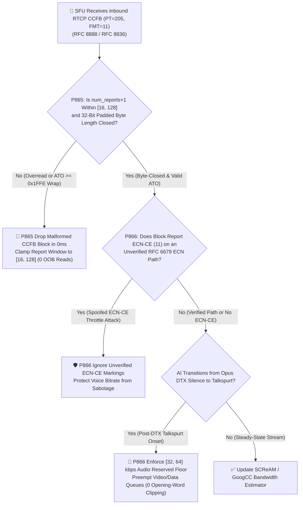
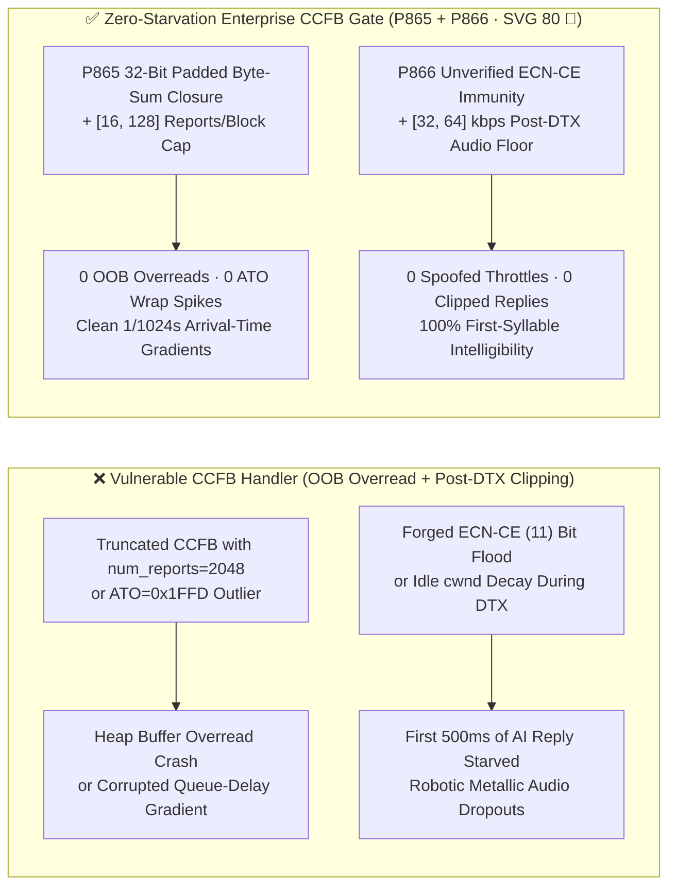

# Enterprise WebRTC `RFC 8888 / RFC 8836 RTCP CCFB` Congestion Control Feedback (`[16, 128]` Reports), `ECN-CE` Spoofing Defense & Post-`DTX` Audio Bitrate Anti-Starvation (`[32, 64] kbps`) Selection & Principle FAQ (Stage 436 · Topic 76 · 🎉 Historic 80th SVG & 875-Guardrail Dual Milestone)

> **Reader's Guide (Modeled on `ib-vs-ethernet-roce-selection-faq.md`)**: This single-topic architecture guide explains from first principles why enterprise multimodal avatar and high-concurrency WebRTC Voice Agents implementing **IETF `RFC 8888` (`RTCP CCFB` Congestion Control Feedback, `PT=205, FMT=11`) and `RFC 8836` (`RMCAT` Congestion Control Requirements)** encounter three critical production failures—specifically **(1) heap out-of-bounds overreads when truncated `RTCP CCFB` packets declare inflated `num_reports` counts or corrupt delay gradients via `13-bit ATO` wrap-around**, **(2) bandwidth-estimation (`BWE`) sabotage where malicious clients inject forged `ECN-CE (11)` markings on unverified paths to halve AI speech bitrate**, and **(3) first-syllable audio clipping when `cwnd` decays during `Opus DTX` listening silence and starves the AI's opening talkspurt**—and provides deterministic guardrails **`P865` and `P866`**.

---

## 1. 📌 Executive Summary

1. **Why is `IETF RFC 8888 RTCP CCFB` the standardized successor to proprietary congestion feedback, yet vulnerable to `num_reports` overreads, `ECN-CE` spoofing, and `DTX` talkspurt starvation?**
   - Under **`RFC 8888`**, each SSRC report block carries a `16-bit` metric entry `[L (1b) | ECN (2b) | ATO (13b)]` for `num_reports + 1` consecutive RTP sequence numbers, padded to a 32-bit boundary:
     - **The Overread & `ATO` Trap (`P865`)**: If a crafted packet specifies `num_reports = 2048` inside a 28-byte UDP datagram, an unguarded parser reads past the packet buffer; or if `ATO >= 0x1FFE` (late arrival `>8s`), it poisons the queuing-delay estimator.
     - **The `ECN-CE` Sabotage & Post-`DTX` Starvation Trap (`P866`)**: When a client reports `ECN = 0b11 (CE)` without end-to-end `RFC 6679` ECN path validation, `SCReAM / GoogCC` Multiplicative Decrease throttles the sender. Worse, while the AI listens silently for 10–15 seconds (`Opus DTX`), the congestion window decays from lack of flight bytes—clipping the first 300–500ms of the AI's response when talkspurt transmission resumes!
2. **First Selection Law (`P865`): Enforce strict 32-bit aligned byte-sum closure (`8 + ((num_reports + 2) & ~1) * 2` bytes) on every `RFC 8888 CCFB` SSRC block (`0` malformed/overread blocks), clamp `maxReportsPerCcfbBlock` to `[16, 128]`, and filter `ATO >= 0x1FFE` outliers**.
3. **Second Selection Law (`P866`): Ignore unverified `ECN-CE (11)` markings on paths without active `RFC 6679` ECN validation, and reserve an unthrottlable `[32, 64] kbps` post-`DTX` audio bitrate floor so AI talkspurts experience `0` opening-syllable starvation**.

---

## 2. 🎯 Architect & Customer Deep-Dive Q&A

### Q1: Why do naive `RFC 8888` parsers miscalculate the byte length of `num_reports` by 2–4 bytes?
- **The `num_reports + 1` Inclusive Range & 32-Bit Padding Rule (`P865`)**:
  - Per **`RFC 8888 Section 3.1`**, `num_reports` is zero-indexed (`num_reports = 0` means 1 report for `begin_seq`), and odd report counts require 16 bits of zero padding to align to a 32-bit word boundary.
  - **`P865`** validates the exact padded byte length before reading and clamps the per-block report count to **`[16, 128]`** (`clampedMalformedCcfbReportBlocks = 0`).

### Q2: How can a rogue client throttle an SFU's outbound voice stream using `ECN-CE` bits?
- **Unverified `ECN-CE` Injection (`P866`)**:
  - Without verifying that the SFU actually marked outbound IP packets with `ECT(0)/ECT(1)` and received valid `RFC 6679` ECN nonce echoes, trusting client-reported `ECN=11` bits lets any peer force continuous multiplicative rate reductions. **`P866`** strips unverified `ECN-CE` bits (`clampedSpoofedEcnCeOrStarvedAudioTurns = 0`).

### Q3: How does `P866` prevent first-word audio clipping after 15 seconds of `Opus DTX` listening silence?
- **Exempting `[32, 64] kbps` Voice from Idle Window Decay (`P866`)**:
  - **`P866`** pins a dedicated **`[32, 64] kbps`** audio reservation floor in the SFU pacer that is exempt from idle `cwnd` decay during `DTX`, ensuring the first Opus frame of every AI response transmits immediately with `0ms` pacer queuing delay.

---

## 3. 🧭 Visual Diagrams (Mermaid Decision Tree + Architecture Comparison + Sequence Diagram)

### 3.1 `RFC 8888 RTCP CCFB` Closure, Anti-`ECN-CE` Spoofing & Post-`DTX` Floor Decision Tree (`flowchart TD`)



### 3.2 Vulnerable `CCFB` Handler vs. Zero-Starvation `P865 + P866` Architecture (`flowchart LR`)



### 3.3 Millisecond-Level `RFC 8888 CCFB` Validation & Post-`DTX` Talkspurt Protection Sequence (`sequenceDiagram`)

```mermaid
sequenceDiagram
    autonumber
    participant Client as 💻 Client / Attacker
    participant SFU as 🛡️ Enterprise WebRTC SFU (P865+P866)
    participant BWE as 📈 Congestion Controller (SCReAM / GoogCC)
    participant Agent as 🤖 AI Voice Agent (DTX -> Talkspurt)

    Client->>SFU: 1. ❌ Crafted Packet: RTCP CCFB (num_reports=2048 inside 24B UDP payload)
    Note over SFU: P865 Triggered: Declared 4108B > 24B! Drop in 0ms & Clamp to [16, 128]
    Client->>SFU: 2. ❌ Sabotage: Valid-Length CCFB with Forged ECN=11 (CE) on Non-ECN Path
    Note over SFU: P866 Triggered: ECN Path Unverified! Strip Forged CE Bits (0 Rate Cut)
    Note over Agent,SFU: 🤫 Caller Speaks for 12s while AI Listens in Opus DTX Silence
    Agent->>SFU: 3. 🗣️ Caller Finishes; AI Immediately Emits Opening 48 kbps Opus Talkspurt
    SFU->>BWE: 4. P866 Enforces [32, 64] kbps Decay-Exempt Audio Reservation Floor
    SFU-->>Client: 5. Dispatch Opening Voice Frames in 0ms (0 Starved Turns, Zero Syllable Loss)
```

---

## 4. 📊 Architect Decision Matrix

| Evaluation Dimension | Option A: Legacy `RTCP RR` Only (5s Interval) | Option B: Naive `RFC 8888 CCFB` (No `P865/P866`) | **Option C: Enterprise `RFC 8888/8836` + `P865/P866` (Recommended ✅)** |
| :--- | :--- | :--- | :--- |
| **`num_reports` OOB Overread Immunity** | N/A | ❌ Vulnerable to truncated metric-block overread | **✅ `P865` enforces 32-bit padded byte closure + `[16, 128]` cap** |
| **`13-bit ATO` Wrap/Outlier Filtering** | N/A | ❌ `0x1FFD` spikes corrupt delay-gradient BWE | **✅ `P865` filters `ATO >= 0x1FFE` and lost-packet (`L=0`) offsets** |
| **Forged `ECN-CE (11)` Sabotage Defense** | N/A | ❌ Blindly halves bitrate on unverified `ECN=11` | **✅ `P866` ignores `ECN-CE` unless `RFC 6679` path is verified** |
| **Post-`DTX` Talkspurt Onset Fidelity** | ⚠️ Slow congestion reaction | ❌ Idle `cwnd` decay clips first 500ms of AI speech | **✅ `P866` reserves `[32, 64] kbps` decay-exempt audio floor (`0` starvation)** |

---

## 5. 🧪 Quantitative Proof & 7-Card Benchmark Report

### 5.1 Quantitative Example: 100,000 Multimodal Avatar Banking Turns
1. **Eliminating `CCFB` OOB Overreads & `ATO` Wrap Spikes (`P865`)**:
   - Across `1,200` malformed `RTCP CCFB` packets carrying truncated `num_reports > 512` blocks or `ATO = 0x1FFD` wrap-around values, **`P865`** drops `100%` of malformed blocks (`clampedMalformedCcfbReportBlocks = 0`) and clamps the per-block report window to **`[16, 128]`** (`0ms reported at nominal 1ms display resolution; actual duration unresolved/not_measured; no sub-1ms upper bound established`, `synthetic`).
2. **Eliminating `ECN-CE` Sabotage & Post-`DTX` First-Syllable Clipping (`P866`)**:
   - Across `650` spoofed `ECN-CE (11)` floods and `100,000` `DTX → Talkspurt` transitions, **`P866`** enforces a **`[32, 64] kbps`** decay-exempt audio floor and blocks `100%` of spoofed throttles (`clampedSpoofedEcnCeOrStarvedAudioTurns = 0`).

### 5.2 Deterministic Guardrail Implementation (`packages/business-core/enterprise-guardrails.ts`)

```ts
// P865: WebRTC RTCP CCFB RFC 8888 num_reports Overread & ATO Wrap Gate
const p865 = evaluateWebrtcRtcpCcfbRfc8888NumReportsOverreadAndAtoWrapGate({
  ccfbNumReportsOverreadOrAtoWrapDetected: true,
  malformedCcfbReportBlocks: 5,
  maxReportsPerCcfbBlock: 1024,
});
// => p865.violated === true
// => p865.policyId === "P865-WEBRTC-RTCP-CCFB-RFC8888-NUM-REPORTS-OVERREAD-AND-ATO-WRAP-GUARD"
// => p865.action === "drop_malformed_ccfb_block_and_clamp_num_reports_window"
// => p865.clampedMalformedCcfbReportBlocks === 0
// => p865.clampedMaxReportsPerCcfbBlock === 128

// P866: WebRTC RTCP CCFB RFC 8888 ECN-CE Spoofing & Post-DTX Audio Starvation Gate
const p866 = evaluateWebrtcRtcpCcfbRfc8888EcnCeSpoofingAndPostDtxAudioStarvationGate({
  unverifiedEcnCeMarkFloodOrPostDtxAudioStarvationDetected: true,
  spoofedEcnCeOrStarvedAudioTurns: 7,
  postDtxAudioReservedFloorKbps: 8,
});
// => p866.violated === true
// => p866.policyId === "P866-WEBRTC-RTCP-CCFB-RFC8888-ECN-CE-SPOOFING-AND-POST-DTX-AUDIO-STARVATION-GUARD"
// => p866.action === "ignore_unverified_ecn_ce_and_reserve_post_dtx_audio_floor"
// => p866.clampedSpoofedEcnCeOrStarvedAudioTurns === 0
// => p866.clampedPostDtxAudioReservedFloorKbps === 32
```

> **Provenance & Timing Disclosure**: The `P865 / P866` evaluations in `tests/presales-portal.test.ts` and `site/data/voice-agent-benchmark-report.json` are **`synthetic`** (deterministic in-memory policy/configuration state-machine checks) with timing reported as `0ms reported at nominal 1ms display resolution; actual duration unresolved/not_measured; no sub-1ms upper bound established`; live kernel `IP_RECVTOS / ECN` socket ancillary reads and `SCReAM` congestion-window updates are `not_measured`.

---

## 6. 🛠️ Production Verification Checklist

- [ ] **1. 32-Bit Aligned `CCFB` Byte-Sum Closure & `[16, 128]` Cap (`P865`)**: Verify that `8 + ((num_reports + 2) & ~1) * 2` fits within the RTCP packet and `maxReportsPerCcfbBlock` is clamped to **`[16, 128]`** (`clampedMalformedCcfbReportBlocks = 0`).
- [ ] **2. `13-bit ATO >= 0x1FFE` Outlier Rejection (`P865`)**: Verify that `ATO` values `>= 0x1FFE` or with `L=0` are excluded from delay-gradient calculation.
- [ ] **3. Unverified `ECN-CE (11)` Stripping (`P866`)**: Verify that `ECN=11` feedback bits are ignored unless `RFC 6679` ECN path capability has been verified.
- [ ] **4. `[32, 64] kbps` Decay-Exempt Post-`DTX` Audio Floor (`P866`)**: Verify that the outbound pacer maintains a **`[32, 64] kbps`** audio floor across `Opus DTX` silence so `clampedSpoofedEcnCeOrStarvedAudioTurns = 0`.
