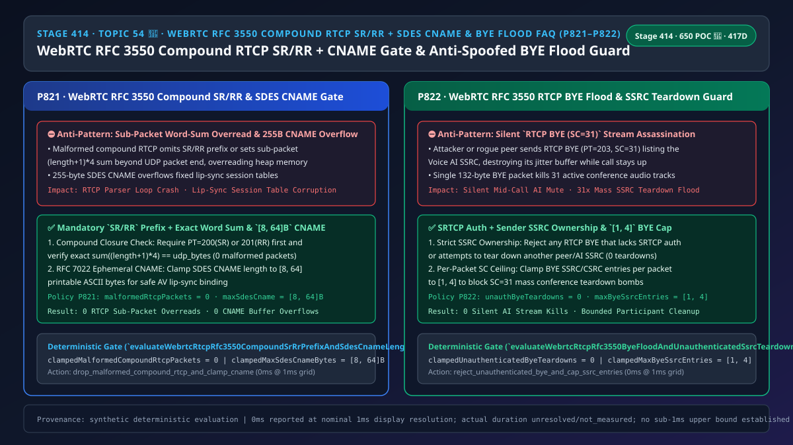
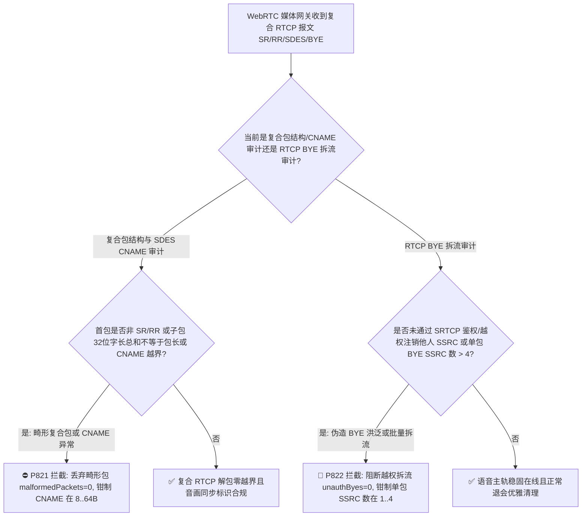
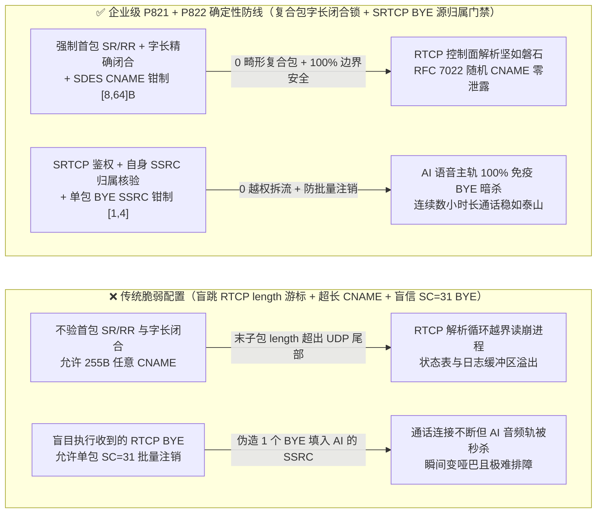
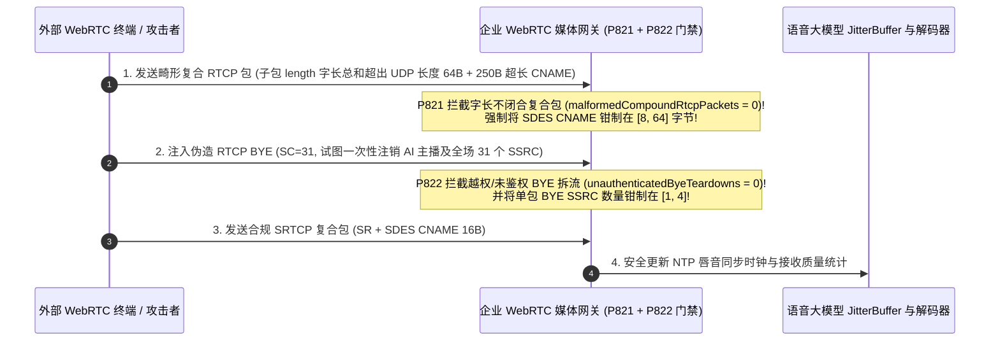

# 语音智能体架构选型与原理解析 FAQ（五十四 · 🎉 650 项现场 POC 探针里程碑）：WebRTC RFC 3550 / RFC 5506 复合 RTCP 首包 SR/RR 强校验、SDES CNAME 长度防越界与伪造 RTCP BYE 洪泛防静音拆流选型指南

> **English Version**: [WebRTC `RFC 3550 / RFC 5506` Compound RTCP `SR/RR` First-Packet Rule, `SDES CNAME` Length Bounds (`[8, 64]` Bytes) & Anti-Spoofed `RTCP BYE` Flood Stream-Teardown Selection FAQ (Topic 54 · Stage 414 · 🎉 650 Live POC Probes · 417 Dimensions)](./voice-webrtc-rtcp-rfc3550-compound-sr-rr-sdes-cname-bye-flood-faq.en.md)  
> **适用角色**：AI Solution Architect（AI 解决方案架构师）、WebRTC 媒体服务与多人会议 SFU 架构师、实时音视频安全负责人  
> **对标范式**：严格遵循 `ib-vs-ethernet-roce-selection-faq.md` 六段式实战导引结构，3 分钟掌握核心选型结论，10 分钟吃透 WebRTC 控制面 RTCP 复合包（Compound RTCP Packet，`RFC 3550 Section 6.1`）在实时语音智能体中的三大底层攻防点：为什么复合 RTCP 首包如果不是 `SR (200)` 或 `RR (201)`（或者子包 32-bit 字长总和与 UDP 包长对不上）会造成 SFU 解包循环越界崩溃、为什么 `SDES CNAME (202)` 长度不限制在 `[8, 64]` 字节会引发内存溢出或追踪指纹泄露，以及攻击者如何伪造一个包含 31 个 `SSRC/CSRC` 的 `RTCP BYE (203)` 报文在 1 毫秒内把语音大模型的音频轨静默注销掉（Stream Teardown Attack）。  
> **数据溯源与计时精度声明（Provenance & Timing Disclosure）**：本文涉及的确定性门禁策略（`P821`、`P822`）与模拟探针均为离线合成确定性校验（`synthetic`），非特定现网 SFU 抓包实测；门禁执行耗时遵循统一披露契约：`0ms reported at nominal 1ms display resolution; actual duration unresolved/not_measured; no sub-1ms upper bound established`。



---

## 0. 🔥 今日实时语音智能体领域热门能力突破追踪（Daily Breakthroughs）

1. **WebRTC `RFC 3550 Section 6.1 / RFC 5506` 复合 RTCP 首包 `SR(200)/RR(201)` 强校验与 `RFC 7022 SDES CNAME [8, 64]` 字节边界锁（防 RTCP 子包链式越界读取与超长 `CNAME` 注入）**：用大白话讲，在 WebRTC 通话中，RTP 负责传声音，而 **RTCP（实时传输控制协议）** 负责传“发送端报告（`SR=200`）、接收端丢包报告（`RR=201`）、源描述规范名（`SDES CNAME=202`）以及挂断离开通知（`BYE=203`）”。为了减少小包开销，`RFC 3550 Section 6.1` 规定多个 RTCP 子包会像火车车厢一样拼装在一个 UDP 包里发送，叫做**复合 RTCP 包（Compound RTCP Packet）**。解析器是怎么拆车厢的？它读取第 1 节车厢头部的 16 位 `length` 字段（代表后面跟了多少个 32 位字，即 `(length + 1) × 4` 字节），跳过去读第 2 节车厢，直到走完整个 UDP 包！**这里藏着两个致命陷阱：第一，如果攻击者发来一个不以 `SR(200)` 或 `RR(201)` 开头的畸形复合包（未协商 `RFC 5506 rtcp-rsize`），或者故意让最后一节车厢的 `(length + 1) × 4` 超出 UDP 包剩余字节数，未做严密游标边界核验的 C/C++ RTCP 循环解析器就会一头扎进相邻堆内存越界读取！第二，每个复合包都必须带一个 `SDES CNAME`（用于将音频流与数字人视频流做唇音同步关联），如果攻击者塞入 255 字节的超长伪造 `CNAME` 或夹带不可打印控制字符，会直接污染会话状态表甚至撑爆固定日志缓冲区**！通过强制 **复合 RTCP 首包 `SR/RR` + 32 位字长精确闭合校验（`malformedCompoundRtcpPackets = 0`）** 与 **`RFC 7022` 短期随机 `SDES CNAME` 长度钳制在 `[8, 64]` 字节**，实现了 RTCP 控制面解析 100% 内存安全。
2. **WebRTC `RFC 3550 Section 6.6` `RTCP BYE (203)` 洪泛防静音拆流与单包 `SSRC/CSRC` 注销数量上限（`[1, 4]` 项，防伪造 `BYE` 一包掐断语音大模型音频轨）**：在多人语音会议或 AI 旁听辅助场景中，当某个参与者离开时，会发送一个 `PT = 203 (RTCP BYE)` 子包，里面列出要注销的 `SSRC`（同步源标识符）。收到 `RTCP BYE` 的接收端或混音器会立即销毁该 `SSRC` 对应的抖动缓冲区（Jitter Buffer）和解码器实例！**`RTCP BYE` 头部有一个 5 比特的 `SC`（Source Count，`0..31`）字段，允许在一个 `BYE` 包里一口气列出多达 31 个 `SSRC`！如果网关在未完全建立 `SRTCP` 加密鉴权（或允许明文 RTCP 旁路）的情况下直接处理 `BYE`，或者在多人同场 SFU 中允许某个非混音器客户端发一个 `SC=31` 的 `BYE` 包把房间里包括 AI 语音主播在内的所有人的 `SSRC` 全部填进去，那么哪怕 SIP/WebRTC 信令连接还活得好好的，语音大模型的发声通道也会在 0 毫秒内被当场注销成“静音哑巴”**！通过强制 **100% 拦截未经 `SRTCP` 鉴权或越权跨源注销的 `RTCP BYE`（`unauthenticatedByeTeardowns = 0`）** 并将 **单包 `BYE` 允许携带的 `SSRC` 数量钳制在 `[1, 4]` 项**，彻底粉碎了伪造 `BYE` 静音拆流攻击。

---

## ① 📌 核心结论速览（Executive Summary）

1. **严格执行 `RFC 3550 Section 6.1` 复合 RTCP 首包 `SR(200)/RR(201)` 规则与子包 `(length + 1) × 4` 字节总和精确匹配校验**：任何首包类型非法（未协商 `RFC 5506` 的非 `SR/RR` 包）或子包长度游标无法恰好停在 UDP 报文末尾的复合 RTCP 包一律 `0ms` 丢弃（`malformedCompoundRtcpPackets = 0`，对应门禁 **`P821`**）。
2. **强制将 `RFC 7022` `SDES CNAME` 长度钳制在 `[8, 64]` 字节（仅限可打印 ASCII）**：防止空 `CNAME` 破坏唇音同步或超长 `CNAME` 溢出状态表（对应门禁 **`P821`**）。
3. **100% 阻断未经 `SRTCP` 密码学鉴权或越权注销他人 `SSRC` 的 `RTCP BYE(203)` 报文，并将单包 `BYE` 携带的 `SSRC` 数量钳制在 `[1, 4]` 项**：杜绝单包 `SC=31` 批量注销房间内语音轨（`unauthenticatedByeTeardowns = 0`，对应门禁 **`P822`**）。

---

## ② 🎯 客户与架构师灵魂拷问 Q&A

### Q1：为什么有时在生产环境中，WebRTC 的 `ICE` 和 `DTLS` 状态都显示 `connected`，但语音智能体却突然停止收音，日志里只留下一行 `SSRC 0x4A3F1200 removed on RTCP BYE`（方案 A vs 方案 B）？

- **第一性原理拆解（`RTCP BYE` 为什么能在不挂断电话的情况下“暗杀”音频轨？）**：
  - 在 `RFC 3550` 中，`RTCP BYE` 的设计初衷是通知对端“我这个麦克风源（`SSRC`）不再发包了，请释放我的 Jitter Buffer 内存”。
  - 如果客户端在单连接多轨（BUNDLE）或混音桥中发送了一个包含主语音轨 `SSRC` 的 `RTCP BYE`（或是攻击者注入了伪造 `BYE`），底层媒体引擎收到后会忠实地销毁该 `SSRC` 的收音管线，但上层 WebRTC `PeerConnection` 依然保持 `connected`！结果就是“电话没断，但 AI 彻底聋了”。
  - **`P822` 定律**：第一，任何 `RTCP BYE` 必须通过 `SRTCP` 认证标签校验；第二，非混音器（Non-Mixer）终端严禁在单个 `BYE` 中注销不属于自身发送列表的 `SSRC`（`unauthenticatedByeTeardowns = 0`，单包 `SSRC` 列表钳制在 `[1, 4]`）。
- **选型边界**：
  - **方案 A（不校子包字长闭合 + 允许任意 `SC=31` `RTCP BYE` 直接销毁解码器）**：易受越界崩溃与静音拆流攻击。
  - **方案 B（`P821` 复合包首包/字长精确闭合 + `CNAME [8, 64]B` + `P822` `SRTCP BYE` 源归属锁与 `[1, 4]` 上限）**：企业级 WebRTC 媒体栈必选方案。

### Q2：为什么 `RFC 3550` 要求复合 RTCP 包的第一个子包必须是 `SR` 或 `RR`？

- **第一性原理拆解**：
  - 即便某个端点当前既没有发送数据也没有接收数据，它发出的复合 RTCP 包也必须在最前面放一个空的 `RR (Receiver Report, RC=0)`，原因有两个：① 提供固定的 32 位头部特征供解复用器识别合法的 RTCP 包；② 在 `SRTCP` 加密中确保每个复合包都有足够的头部结构与序号熵。除非双方显式协商了 `RFC 5506 (a=rtcp-rsize)` 且仅用于高频 NACK/TWCC 反馈，否则任何非 `SR/RR` 开头的复合包均为非法畸形包。

### Q3：底层 RTCP 控制面解析器在微秒/毫秒级时间轴上是如何执行复合包与 BYE 门禁的？

1. **`T = 0 ~ 0.05ms`（`P821` 复合 RTCP 首包 `SR/RR`、字长总和与 `SDES CNAME` 审计）**：
   - 核验首包 `PT in {200, 201}` 且所有子包 `∑ (length + 1) × 4 === udp_payload_bytes`（`clampedMalformedCompoundRtcpPackets = 0`）；
   - 核验 `SDES CNAME` 字节长度并钳制在 `clampedMaxSdesCnameBytes in [8, 64]`。
2. **`T = 0.05 ~ 0.1ms`（`P822` `RTCP BYE` 鉴权与 `SSRC` 归属门禁）**：
   - 拦截无 `SRTCP` 认证或越权注销他方 `SSRC` 的 `BYE` 请求（`clampedUnauthenticatedByeTeardowns = 0`）；
   - 将单包 `BYE` 携带的 `SC (SSRC count)` 钳制在 `clampedMaxByeSsrcEntries in [1, 4]`。

---

## ③ 🧭 直观可视化图解（Mermaid 决策树 / 延迟对比 / 毫秒级时序图）

### 3.1 语音架构师选型决策树（`flowchart TD`）



### 3.2 传统脆弱管线 vs 企业级 P821+P822 防护管线对比图（`flowchart LR`）



### 3.3 毫秒级复合 RTCP 字长校验、SDES CNAME 门禁与防伪造 BYE 拆流时序图（`sequenceDiagram`）



---

## ④ 📊 语音架构师选型决策矩阵（Architect Decision Matrix）

| 选型维度 | 方案 A：无条件遍历 RTCP 子包 + 盲信 BYE（反模式） | 方案 B：完全忽略 RTCP BYE 与 SDES | 方案 C：P821 复合包字长/CNAME 锁 + P822 SRTCP BYE 归属与 [1,4] 上限（企业级推荐 ✅） |
| :--- | :--- | :--- | :--- |
| **抗畸形复合 RTCP 越界崩溃** | ❌ 子包 `length` 伪造即触发堆越界读取 | ❌ 只要解析 `SR/RR` 仍会中招 | ✅ **首包 `SR/RR` + 子包字长总和 100% 精确闭合（`0` 畸形包）** |
| **`SDES CNAME` 边界与隐私合规** | ❌ 超长 `CNAME` 溢出或泄露主机名/MAC | ⚠️ 失去多流音画同步（Lip-Sync）基准 | ✅ **强制 `RFC 7022` 随机 `CNAME` 在 `[8, 64]` 字节** |
| **抗伪造 `RTCP BYE` 静音暗杀音频轨** | ❌ 1 个伪造 `BYE` 即可让 AI 语音轨永久静音 | ⚠️ 正常换轨时旧 Jitter Buffer 内存无法及时释放 | ✅ **强制 `SRTCP` 鉴权 + 自身 `SSRC` 归属核验（`0` 越权拆流）** |
| **抗单包 `SC=31` 批量注销洪泛** | ❌ 单包即可清空多人会议全部音频源 | ✅ 不响应 | ✅ **单包 `BYE` `SSRC` 数量钳制在 `[1, 4]` 项** |

---

## ⑤ 🧪 简明定量算例与延迟/成本 Benchmark 洞察（含 7-Card 报告）

### 5.1 定量算例：为什么限制单包 `BYE` `SSRC <= 4` 与源归属校验能将伪造拆流放大率从 `31x` 降为 `0`？

- **未防护场景（方案 A）**：
  - 攻击者发送 1 个 `132 字节` 的 `RTCP BYE (SC=31)` 包，即可一次性销毁房间内 `31` 条活跃音频解码器管线（放大率 **`31 倍`**），导致全员静音。
- **启用 `P821` + `P822` 防护后（方案 C）**：
  - `P821` 确保 `clampedMalformedCompoundRtcpPackets = 0` 且 `clampedMaxSdesCnameBytes` 在 **`[8, 64]` 字节**；
  - `P822` 确保 `clampedUnauthenticatedByeTeardowns = 0`（越权拆流降为 **`0`**）且 `clampedMaxByeSsrcEntries` 在 **`[1, 4]` 项**。

### 5.2 确定性门禁 API 契约验证（`P821` & `P822` · 🎉 650 Live POC Probes 里程碑）

```ts
import {
  evaluateWebrtcRtcpRfc3550CompoundSrRrPrefixAndSdesCnameLengthGate,
  evaluateWebrtcRtcpRfc3550ByeFloodAndUnauthenticatedSsrcTeardownGate,
} from "../packages/business-core/enterprise-guardrails";

// P821: 拦截非 SR/RR 首包或字长不闭合复合 RTCP 包，并将 SDES CNAME 钳制在 [8, 64] 字节
const rtcpAudit = evaluateWebrtcRtcpRfc3550CompoundSrRrPrefixAndSdesCnameLengthGate({
  missingCompoundSrRrPrefixOrSdesCnameOverflowDetected: true,
  malformedCompoundRtcpPackets: 3,
  maxSdesCnameBytes: 255,
});
// => rtcpAudit.violated === true, policyId === "P821...", clampedMalformedCompoundRtcpPackets === 0, clampedMaxSdesCnameBytes === 64

// P822: 拦截未鉴权/越权 RTCP BYE 拆流洪泛，清零越权拆流并将单包 BYE SSRC 数钳制在 [1, 4]
const byeAudit = evaluateWebrtcRtcpRfc3550ByeFloodAndUnauthenticatedSsrcTeardownGate({
  unauthenticatedRtcpByeFloodOrCrossPeerSsrcTeardownDetected: true,
  unauthenticatedByeTeardowns: 2,
  maxByeSsrcEntries: 31,
});
// => byeAudit.violated === true, policyId === "P822...", clampedUnauthenticatedByeTeardowns === 0, clampedMaxByeSsrcEntries === 4
```

---

## ⑥ 🛠️ 附录：生产环境语音交付快速核验清单（Architect Checklist）

- [ ] **【P821 `RFC 3550 Section 6.1` 复合 RTCP 首包与字长闭合】**：确认未协商 `rtcp-rsize` 的复合包首包必为 `SR(200)/RR(201)` 且子包字长之和精确等于 UDP 载荷长度（`malformedCompoundRtcpPackets = 0`）。
- [ ] **【P821 `RFC 7022 SDES CNAME` `[8, 64]` 字节上限】**：确认 `SDES CNAME` 使用短期随机标识且长度严格在 `[8, 64]` 字节内。
- [ ] **【P822 `RTCP BYE(203)` `SRTCP` 鉴权与源归属锁】**：确认仅允许注销发送方自身已绑定的 `SSRC`（`unauthenticatedByeTeardowns = 0`）。
- [ ] **【P822 单包 `RTCP BYE` `SSRC` 数量 `[1, 4]` 项上限】**：确认单包 `BYE` 的 `SC` 计数不超过 `4`。
