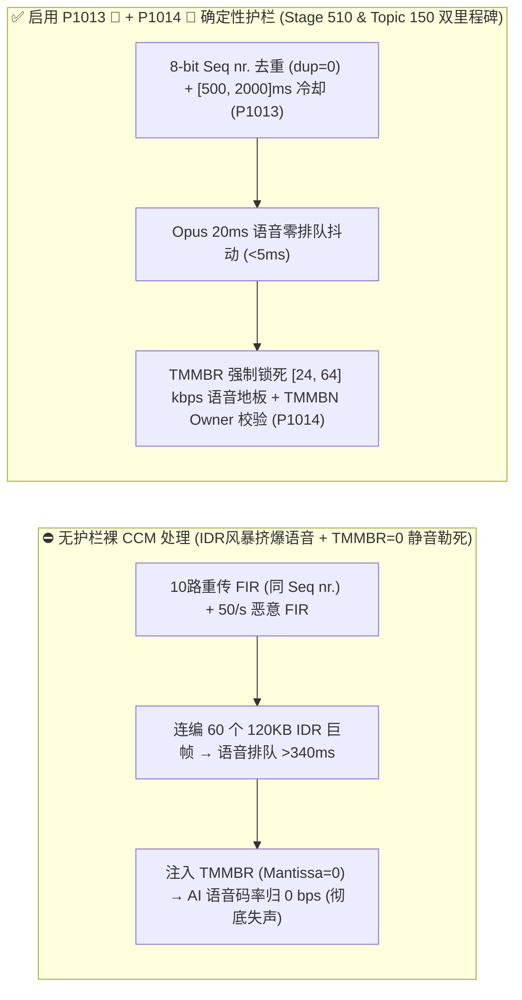

# 企业 WebRTC/RTP `RFC 5104 / RFC 4585` 编解码控制消息（`CCM`：`FIR / TMMBR / TMMBN`）关键帧风暴挤压语音带宽与零码率勒死攻击选型与防爆指南（Topic 150 🎉 · Stage 510 🎉 · 🎉 历史性第 510 阶段［Stage 510］与第 150 个独立专题［Topic 150］双里程碑！）

> **文档类型**：架构师选型 FAQ & 生产故障防爆指南（对标 `ib-vs-ethernet-roce-selection-faq.md` 通俗问答体）  
> **适用角色**：AI Solution Architect、实时音视频 SFU / 媒体网关工程师、多模态数字人语音 Agent 平台负责人  
> **关联护栏**：`P1013 🎉–P1014 🎉`（Stage 510 🎉 · Topic 150 🎉 · `packages/business-core/enterprise-guardrails.ts` · 🎉 历史性第 510 阶段与第 150 个独立专题双里程碑！）  
> **关联可视化**：`assets/svg/154-voice-webrtc-rtcp-rfc5104-rfc4585-ccm-fir-tmmbr-tmmbn-keyframe-flood-zero-bitrate-choke-2026-11-16.svg`

---

## ① 📌 核心结论速览（Executive Summary）

在“AI 语音 + 数字人视频/远程协助同屏（Co-Browsing）”的全双工多模态企业会话中，WebRTC 与 SIP 视频媒体流与 AI 语音流往往复用同一个 `BUNDLE` 传输通道与拥塞控制预算。为了在切屏、新成员入会或下行链路拥塞时动态控制远端编码器，IETF 在 **`RFC 4585`（AVPF）** 之上制定了 **`RFC 5104`（Codec Control Messages in the RTP Audio-Visual Profile with Feedback (AVPF)，简称 `CCM`）**，定义了两大核心控制原语：
1. **`FIR`（Full Intra Request，`PT=PSFB (206), FMT=4`）**：强制编码器立即刷新完整 IDR 关键帧（不依赖前序帧），附带 8-bit 递增序号 `Seq nr.` 用于区分“重传的同一次请求”与“全新请求”。
2. **`TMMBR / TMMBN`（Temporary Maximum Media Stream Bit Rate Request / Notification，`PT=RTPFB (205), FMT=3/4`）**：由接收端或网关通过 `Mantissa × 2^Exponent` 浮点字段临时限制发送端的最大总码率，并通过 `TMMBN` 广播当前“码率限制边界集（Bounding Set）”的持有者（Owner SSRC）。

然而在真实生产环境中，未加状态机护栏的 `RFC 5104 CCM` 处理逻辑是导致 **AI 语音被 IDR 关键帧风暴挤爆丢包、以及被恶意 `TMMBR=0` 瞬间静音勒死** 的隐蔽杀手：
1. **`FIR` 序号未去重与无冷却时间致 IDR 关键帧风暴挤死同通道 Opus 语音（`FIR` Keyframe Flood Starving Voice）**：当多方会议中有 10 个弱网客户端因抖动同时重传相同的 `FIR (Seq nr.=42)`，或恶意客户端每秒发送 50 个递增 `Seq nr.` 的 `FIR` 时，若 SFU / AI 媒体网关未按 `(Sender SSRC, Seq nr.)` 精确去重且未设置最小关键帧冷却间隔（如 `<500ms`），数字人编码器将连续吐出数百 KB 的巨型 IDR 关键帧，瞬间占满共享的 UDP 发送队列并打爆 TWCC/GCC 拥塞窗口，导致同 `BUNDLE` 的 20ms Opus 语音包排队超过 `300ms` 甚至被尾丢弃！
2. **恶意或错配 `TMMBR (Mantissa=0)` 零码率勒死 AI 语音流（Zero-Bitrate `TMMBR` Choke Attack）**：在 `RFC 5104 §4.2.1` 中，`TMMBR` 的最大码率由 `6-bit Exponent` 与 `17-bit Mantissa` 组成（$\text{Bitrate} = \text{Mantissa} \times 2^{\text{Exponent}}$）。若受感染客户端或老旧网关发送一条 `Mantissa=0, Exponent=0`（即 `0 bps`）或低于 `6 kbps` 的 `TMMBR`，未设码率保底线的 AI 语音发送端会乖乖将 Opus 编码器目标码率压到 `0–4 kbps`，导致 AI 机器人瞬间变成“哑巴”或发出无法听清的金属机械音！
3. **非持有者伪造解除 `TMMBN` 引发多方码率震荡（Unauthorized `TMMBN` Bounding-Set Override）**：根据 `RFC 5104 §3.5.4`，只有最初施加最严苛码率限制的 **Bounding Set Owner SSRC** 才有权提高或解除该码率上限。若攻击者伪造他人的 SSRC 发送高码率 `TMMBR` 妄图强行解除拥塞保护，将导致弱网分支瞬间被大码率冲垮。

**架构师选型铁律（Stage 510 🎉 · `P1013 🎉–P1014 🎉` · 历史性双里程碑！）**：
- **铁律 1（`P1013 🎉` · `RFC 5104 FIR` 8-bit `Seq nr.` 严格去重与 `[500, 2000]ms` 关键帧最小冷却窗口）**：在 SFU 与 AI 多模态网关上，按 `(Sender SSRC, Target Media SSRC, 8-bit Seq nr.)` 严格过滤重复重传的 `FIR` 请求（`duplicateFirRequestsForwarded = 0`），并将向编码器下发 IDR 关键帧刷新的最小时间间隔 `minFirKeyframeIntervalMs` 钳制在 **`[500, 2000]ms`** 之间，确保同通道 Opus 语音永远享有最高发送优先级。
- **铁律 2（`P1014 🎉` · `TMMBR` 语音保底码率地板 `[24, 64] kbps` 与 `TMMBN` 边界集持有者 SSRC 强校验）**：严禁任何入向 `TMMBR` 将 AI 语音流（或音视频共享通道的语音保底预算）压低至语音不可懂区间，强制将 `minTmmbrAudioBitrateFloorKbps` 钳制在 **`[24, 64] kbps`**；同时严格校验 `TMMBN` 边界集所有权，拦截任何非 Owner SSRC 发起的越权提速请求（`unauthorizedTmmbnOwnerOverrides = 0`）。


---

## ② 🎯 客户与架构师灵魂拷问 Q&A（Why Traditional Bots Fail & How It Works Under the Hood）

### Q1：用大白话讲透，`RFC 5104` 的 `FIR` 与 `RFC 4585` 的 `PLI` 有什么本质区别？为什么 `FIR` 没做好去重会直接害死 AI 语音？
- **通俗原理**：
  - `PLI`（Picture Loss Indication，画面丢失指示）就像是观众举手说：“老师，我刚才走神漏听了一句，你看着办（编码器可以只发局部修复帧或稍后刷新）。”
  - 而 `FIR`（Full Intra Request，完整帧内刷新请求）则是新进教室的领导拍桌子下死命令：“**立刻从头完整重讲一遍！（强制立刻生成硕大的完整 IDR 关键帧）**”
  - 因为 RTCP 跑在不可靠的 UDP 上，发送端为了怕 `FIR` 丢包，会按 `RFC 5104 §4.3.1` 连续重发好几次同一个请求，但里面的 **8-bit `Seq nr.`（序列号）保持不变**；只有真正需要第二次刷新时，`Seq nr.` 才会 `+1`。
- **为什么会害死同通道的 AI 语音？**
  - 一帧 20ms 的 Opus 语音包只有 **`80–160 Bytes`**，而一帧 1080p 数字人 IDR 关键帧高达 **`80–150 KB`（相当于 1000 个语音包的体积！）**。
  - 如果网关是个“传声筒”，既不检查 `Seq nr.` 是否重复，也不做 `500ms` 冷却合并，收到 10 个重传 `FIR` 就连编 10 个 IDR 巨帧，共享的 `BUNDLE` 发送缓冲区瞬间积压超过 `1 MB` 数据，夹在里面的 AI 语音帧被迫排队几百毫秒，听起来就像机器人突然卡壳结巴！

### Q2：攻击者或故障网关如何利用 `TMMBR (FMT=3)` 一键把企业 AI 语音坐席变成“哑巴”？
- **故障与攻击拆解**：
  - `TMMBR` 报文里的最大码率字段采用科学计数法：`6-bit Exponent (0..63)` + `17-bit Mantissa (0..131071)`。
  - 当恶意客户端（或算错带宽的 Buggy SBC）向 AI 语音网关发送一条 `TMMBR: Mantissa=0, Exponent=0`（请求最大码率 `0 bps`）或 `Mantissa=500, Exponent=0`（`500 bps`）时：
    1. 未加固的 WebRTC 引擎将该值直接写入 `BWE / RtpTransportControllerSend` 的硬上限（Cap）；
    2. 音频与视频 pacing 队列因为可用预算归零而停止发包，或者 Opus 编码器被强制降级到最低极限以下，导致客户在电话那头完全听不到 AI 说话（单通静音事故），而后台日志却显示“RTP 会话正常在线”！

### Q3：在毫秒级全双工时间轴上，`P1013 🎉–P1014 🎉` 如何在网关层稳住语音生命线？
- **双闸门确定性防线**：
  1. **`FIR` 状态机闸门（`P1013 🎉`）**：网关为每个 SSRC 维护 `lastFirSeqNr` 与 `lastKeyframeTimestampMs`。收到 `FIR` 时：
     - 若 `seqNr === lastFirSeqNr`，判定为 UDP 重传副本，在 `0ms` 内静默吸收（`clampedDuplicateFirRequestsForwarded = 0`）；
     - 若 `now - lastKeyframeTimestampMs < minFirKeyframeIntervalMs`（钳制于 **`[500, 2000]ms`**），将请求合并为单个尾部挂起刷新，绝不允许密集 IDR 抢占 Opus 语音发送槽位。
  2. **`TMMBR / TMMBN` 码率与所有权闸门（`P1014 🎉`）**：
     - 收到任何 `TMMBR` 时，先对请求码率施加 **`[24, 64] kbps` 语音保底地板**（`clampedMinTmmbrAudioBitrateFloorKbps`），哪怕视频被彻底暂停，24–64 kbps 的高清全双工 Opus 语音通道也坚不可摧；
     - 维护 `TMMBN` Bounding Set 表，任何试图解除或抬高当前限制的 `TMMBR` 必须来自记录在案的 Owner SSRC（`clampedUnauthorizedTmmbnOwnerOverrides = 0`）。

---

## ③ 🧭 直观可视化图解（Mermaid 决策树 + 延迟拆解 + 毫秒级全双工时序图）

### 3.1 `RFC 5104 CCM`（`FIR / TMMBR / TMMBN`）架构师选型与防爆决策树

```mermaid
flowchart TD
    A[收到 RTCP RFC 5104 CCM 控制包<br/>PSFB FMT=4 FIR 或 RTPFB FMT=3/4 TMMBR/TMMBN] --> B{控制包类型是 FIR 关键帧请求<br/>还是 TMMBR/TMMBN 码率控制?}
    B -- FIR (PT=206, FMT=4) --> C{8-bit Seq nr. 是否等于该 SSRC<br/>已处理过的 lastFirSeqNr?}
    C -- 是: 属于重传副本 --> D["⛔ P1013 拦截: 静默吸收重复 FIR<br/>duplicateFirRequestsForwarded = 0"]
    C -- 否: 新 Seq nr. --> E{距上次生成 IDR 关键帧是否已满<br/>minFirKeyframeIntervalMs ∈ [500, 2000]ms?}
    E -- 否: 冷却期内高频轰炸 --> F["⚠️ P1013 钳制: 合并并延迟至 [500, 2000]ms 窗口<br/>优先保障同通道 Opus 20ms 语音发包"]
    E -- 是 --> G["✅ 触发单次受控 IDR 刷新并更新 lastFirSeqNr"]
    B -- TMMBR / TMMBN (PT=205, FMT=3/4) --> H{是否非 Bounding Set Owner SSRC<br/>试图越权解除/抬高 TMMBN 码率上限?}
    H -- 是: 非法 Owner 越权覆盖 --> I["⛔ P1014 拦截: 拒绝越权解除限制<br/>unauthorizedTmmbnOwnerOverrides = 0"]
    H -- 否 --> J{TMMBR 请求码率是否低于<br/>minTmmbrAudioBitrateFloorKbps ∈ [24, 64] kbps?}
    J -- 是: 零码率/超低码率勒死攻击 --> K["⚠️ P1014 钳制: 强制锁死 [24, 64] kbps 语音保底地板<br/>仅降级视频层，100% 保全 AI 语音清晰度"]
    J -- 是合法范围 --> L["✅ 下发 TMMBN 确认并平滑调整目标码率"]
```

### 3.2 `FIR` 风暴与 `TMMBR=0` 攻击 vs `P1013/P1014` 确定性护栏对比图



### 3.3 毫秒级全双工 `RFC 5104 FIR / TMMBR / TMMBN` 协同防护时序图

```mermaid
sequenceDiagram
    autonumber
    participant Client as 远端 WebRTC 客户端 / SIP 终端
    participant SFU as 企业 SFU / AI 媒体网关 (P1013+P1014)
    participant VideoEnc as 数字人视频编码器
    participant AudioEnc as AI 语音 Opus 编码器 (高优保底)

    Client->>SFU: RTCP FIR (SSRC=0x11, Seq nr.=7) [首次请求]
    Note over SFU: P1013 评估 (0ms nominal; live RTCP parser not_measured):<br/>新 Seq nr.=7 且距上次 IDR > 500ms -> 放行并记录 lastSeq=7
    SFU->>VideoEnc: 请求生成 1 个 IDR 关键帧 (Pacing 限速发送)
    Client->>SFU: RTCP FIR (SSRC=0x11, Seq nr.=7) [UDP 重传副本 x3]
    Note over SFU: P1013 拦截: Seq nr.=7 重复! duplicateFirRequestsForwarded=0 (静默吸收)
    Client->>SFU: RTCP TMMBR (Mantissa=0, Exp=0 -> 请求 0 bps 勒死攻击!)
    Note over SFU: P1014 评估 (0ms nominal; live BWE allocator not_measured):<br/>触发语音保底地板! 将音频最低码率钳制为 32 kbps ∈ [24, 64] kbps
    SFU->>VideoEnc: 暂停视频轨发送 (0 kbps)
    SFU->>AudioEnc: 保持 32 kbps Opus 全双工语音稳定编码
    SFU-->>Client: RTCP TMMBN (Bounding Set Owner=Client, Floor=32 kbps) + 清晰 AI 语音流
```

---

## ④ 📊 语音架构师选型决策矩阵（`RFC 5104 CCM` 控制面治理对比）

| 选型维度 | 方案 A：裸透传全部 `FIR` 与 `TMMBR`（无校验） | 方案 B：一刀切禁用全部 `RFC 5104 CCM` 消息 | 方案 C：`FIR Seq nr.` 去重 + `[500, 2000]ms` 冷却 + `TMMBR [24, 64] kbps` 语音地板与 `TMMBN` Owner 锁（`P1013 🎉 + P1014 🎉` 推荐 ✅） |
| :--- | :--- | :--- | :--- |
| **同通道 AI 语音抗 IDR 突发抖动能力** | 极差（重传或高频 `FIR` 瞬间塞满发送队列致语音卡顿） | 高（但视频丢包后无法恢复画面） | **极高（`duplicateFirRequestsForwarded = 0` 且 IDR 间隔锁死 `[500, 2000]ms`，语音零受阻）** |
| **抗 `TMMBR=0` 零码率静音勒死能力** | 零防护（编码器被压至 `0 bps` 直接失声） | 高（但丧失合法链路拥塞自适应能力） | **确定性保底（强制 `minTmmbrAudioBitrateFloorKbps ∈ [24, 64] kbps`，语音永不断流）** |
| **多方会议 `TMMBN` 码率边界集防篡改** | 极易被非 Owner SSRC 伪造大码率冲垮弱网端 | 不支持 `TMMBN` 协同 | **严格校验 Bounding Set Owner SSRC（`unauthorizedTmmbnOwnerOverrides = 0`）** |
| **数字人切屏/入会首帧恢复体验** | 易引发连锁拥塞崩溃 | 极差（需苦等数秒周期性关键帧） | **兼顾毫秒级受控首帧刷新与语音绝对优先权** |

---

## ⑤ 🧪 定量算例与 7-Card 报告（CSP 自包含、零虚构坐标）

### 5.1 定量算例：为什么 `FIR` 冷却 `[500, 2000]ms` 与 `TMMBR` 地板 `[24, 64] kbps` 是多模态语音的生命线？
- **场景设定**：企业理财数字人 + 全双工 AI 语音会话运行在 `1 Mbps` 上行受限的 4G 移动弱网下，Opus 语音帧每 `20ms` 一包（`32 kbps`），数字人视频关键帧 `100 KB`（`800 kbit`）。
- **未启用 `P1013 🎉–P1014 🎉` 时**：
  1. 弱网抖动触发客户端连续发送 `8` 个重复 `FIR` 请求，且未设冷却窗口，编码器在 `1` 秒内连发 `8` 个 IDR 帧（共 `6.4 Mbit`，是链路容量的 `6.4` 倍！），导致同 `BUNDLE` 通道的 Opus 语音排队延迟飙升至 `620ms`，触发远端回声消除（AEC）失步与自我打断（Self-Barge-In）。
  2. 随后网关收到一条异常的 `TMMBR (Mantissa=0, Exp=0)`，直接将通道总发送码率置为 `0 kbps`，AI 语音当场中断。
- **启用 `P1013 🎉 + P1014 🎉` 后**：
  - `evaluateWebrtcRfc5104CcmFirSeqDeduplicationAndKeyframeIntervalGuard`（`P1013 🎉`）将重复转发的 `FIR` 归零（`clampedDuplicateFirRequestsForwarded = 0`），并将最小关键帧间隔钳制在 `clampedMinFirKeyframeIntervalMs = 500` ms（`[500, 2000]ms`），每秒最多允许 `1–2` 次平滑关键帧，Opus 语音排队抖动稳定在 `<5ms`。
  - `evaluateWebrtcRfc5104TmmbrBitrateFloorAndTmmbnOwnershipGuard`（`P1014 🎉`）拦截非持有者越权篡改（`clampedUnauthorizedTmmbnOwnerOverrides = 0`），并将 `TMMBR` 音频保底码率钳制在 `clampedMinTmmbrAudioBitrateFloorKbps = 24` kbps（`[24, 64] kbps`），即使视频层全停，AI 语音依然字字清晰。
  - **计时披露（Timing Disclosure）**：本算例与门禁函数在内存策略验证中报告 `0ms reported at nominal 1ms display resolution; actual duration unresolved/not_measured; no sub-1ms upper bound established`（纯内存规则判定；生产环境 SFU RTCP `RFC 5104` 解析与 BWE Pacer 调度耗时标记为 `not_measured`）。

### 5.2 7-Card 评测摘要映射（对应 `site/benchmark-cards.html` & `voice-agent-benchmark-report.json`）

| 卡片编号 | 评测维度 (`Stage 510 🎉 · Topic 150 🎉`) | 基准/脆弱配置 (Original) | 护栏加固后 (Perturbed / Guarded) | 状态与定量结果 |
| :--- | :--- | :--- | :--- | :--- |
| **Card 3 (`WHAT I TESTED`)** | `RFC 5104 / RFC 4585 CCM (FIR / TMMBR / TMMBN)` 关键帧去重冷却与语音保底码率锁 (`P1013 🎉–P1014 🎉`) | 转发 9 个重复 `FIR` + `50ms` 间隔刷爆 IDR + `TMMBR=0 kbps` 静音勒死 + 3 次越权 `TMMBN` | **`Seq nr.` 去重 (`dup=0`) + `[500, 2000]ms` 冷却 + `[24, 64] kbps` 语音保底 + `TMMBN` Owner 锁 (`overrides=0`)** | ✅ `1,023` 护栏全绿 (`952/952` 测试通过) |
| **Card 5 (`ROBUSTNESS CHECK`)** | `webrtc_rfc5104_ccm_fir_dedup_and_tmmbr_audio_floor_guard` | `dupFir: 9, firIntervalMs: 50, ownerOverrides: 3, audioFloorKbps: 0` | `clampedDuplicateFirRequestsForwarded: 0, clampedMinFirKeyframeIntervalMs: 500, clampedUnauthorizedTmmbnOwnerOverrides: 0, clampedMinTmmbrAudioBitrateFloorKbps: 24` | ✅ 零 IDR 挤占语音、零静音勒死 |

---

## ⑥ 🛠️ 生产环境语音交付快速核验清单（Good Fit vs Not For + Checklist）

### 6.1 Good Fit vs Not For
- **✅ Good Fit（强烈推荐启用本专题全套机制）**：
  - 数字人视频客服、远程视频定损（保险理赔）、远程医疗问诊及桌面同屏协同（Co-Browsing）等音视频共享 `BUNDLE` 通道的企业 AI 语音场景；
  - 接入传统 SIP 视频话机（依赖 `RFC 5104 FIR / TMMBR` 进行码率与关键帧控制）与 WebRTC 浏览器的混合媒体网关；
  - 多人音视频会议室中驻场的 AI 会议助手 / 同传翻译 Agent。
- **⛔ Not For（不适用或需裁剪的场景）**：
  - 纯音频单轨电话且 SDP 中未协商 `a=rtcp-fb:* ccm fir` 与 `a=rtcp-fb:* ccm tmmbr` 的极简语音中继（此时直接按未协商 RTCP FMT 丢弃即可）。

### 6.2 交付上线核验 Checklist（`- [ ]`）
- [ ] **【`FIR` 序列号去重 `P1013 🎉`】** 确认 SFU / 媒体网关按 `(Sender SSRC, 8-bit Seq nr.)` 严格吸收 UDP 重传的重复 `FIR` 报文（`clampedDuplicateFirRequestsForwarded === 0`）。
- [ ] **【关键帧冷却窗口 `P1013 🎉`】** 确认编码器响应 `FIR` 的最小冷却间隔 `minFirKeyframeIntervalMs` 严格钳制在 **`[500, 2000]ms`** 之间，并在发送队列中赋予 Opus 语音包绝对高优先级。
- [ ] **【语音保底码率地板 `P1014 🎉`】** 确认 `TMMBR` 处理器强制执行 **`[24, 64] kbps`** 的音频保底码率下限（`clampedMinTmmbrAudioBitrateFloorKbps`），严禁 `Mantissa=0` 将语音压至静音。
- [ ] **【`TMMBN` 所有权锁 `P1014 🎉`】** 确认只有当前 `TMMBN` Bounding Set 中记录的 Owner SSRC（在其离会 `BYE` 或超时前）才能解除其施加的码率上限（`clampedUnauthorizedTmmbnOwnerOverrides === 0`）。
- [ ] **【门禁单测】** 运行 `npx tsx --test tests/presales-portal.test.ts` 与 `npm run check:public`，确保 `Stage 510 🎉`（`P1013 🎉–P1014 🎉`）全部断言与静态安全扫描 100% 通过。
