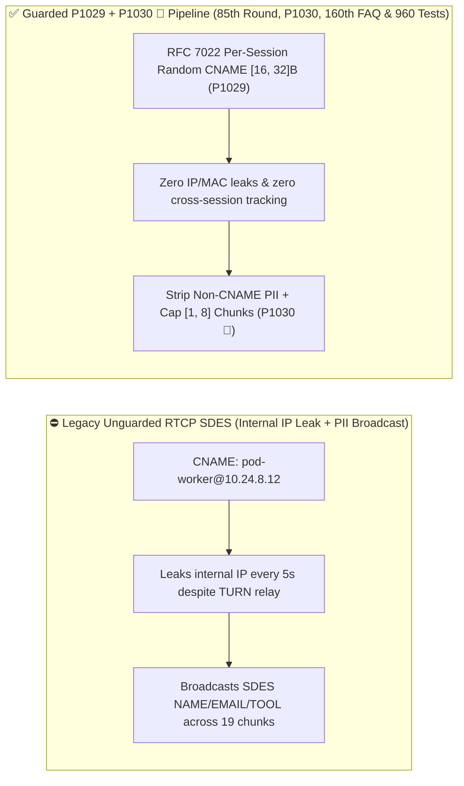

# Enterprise WebRTC/RTP `RFC 7022 / RFC 3550` RTCP `SDES CNAME` Ephemeral Privacy (`user@host` Internal IP/MAC Leak) & Non-`CNAME` PII Item (`NAME/EMAIL/PHONE/PRIV`) Stripping Selection & Defense Guide (Topic 158 · Stage 518 · 🎉 Historic 85th Nightly Round, `P1030` Guardrail, 160th Standalone FAQ & 960-Test Quadruple Milestone!)

> **Document Type**: Architect Selection FAQ & Production Hardening Guide (modeled on `ib-vs-ethernet-roce-selection-faq.md`)  
> **Target Audience**: AI Solution Architects, WebRTC / SIP Media Gateway Privacy Engineers, Realtime Voice Agent Platform Leads  
> **Linked Guardrails**: `P1029–P1030 🎉` (Stage 518 · Topic 158 · `packages/business-core/enterprise-guardrails.ts` · 🎉 Historic 85th Nightly Round, `P1030` Guardrail, 160th Standalone FAQ & 960-Test Quadruple Milestone!)  
> **Linked Visual**: `assets/svg/162-voice-webrtc-rtcp-rfc7022-rfc3550-sdes-cname-ephemeral-privacy-user-host-ip-leak-non-cname-item-strip-2026-11-16.svg`

---

## ① 📌 Executive Summary

In every RTP/RTCP voice and video session, **`RFC 3550 §6.1`** mandates that every compound RTCP packet include an **`RTCP SDES` (Source Description, `PT=202`)** packet carrying the endpoint's **`CNAME` (Canonical End-Point Identifier, `Item Type=1`)** so receivers can associate synchronized audio and video streams across SSRC changes.

In production enterprise voice gateways, however, legacy `RTCP SDES` generation and pass-through create two severe privacy and security vulnerabilities:
1. **Legacy `user@host` / MAC-Based `SDES CNAME` Leaking Internal Pod IPs & Enabling Cross-Session Tracking**: Baseline `RFC 3550 §6.5.1` historically recommended constructing `CNAME` as `user@host_ip` (e.g., `voice-worker@10.24.8.12`) or deriving it from a hardware MAC address. Even when an enterprise hides internal IPs at the ICE layer via TURN relays and `RFC 8828` mDNS candidates, an unguarded RTP stack broadcasts `CNAME: root@10.24.8.12` inside RTCP packets every 5 seconds! To close this leak, IETF standardized **`RFC 7022` (Guidelines for Choosing RTCP Canonical Names)** and **`RFC 8834 §4.9`**, mandating **per-session cryptographically random `CNAME` tokens (`[16, 32]` ASCII bytes)**.
2. **Leaking Forbidden Non-`CNAME` SDES Items (`NAME/EMAIL/PHONE/LOC/TOOL/PRIV`) & SDES Chunk Bloat**: Legacy SIP/RTP endpoints frequently populate `SDES NAME(2)`, `EMAIL(3)`, `PHONE(4)`, `LOC(5)`, `TOOL(6)`, `NOTE(7)`, and `PRIV(8)` items—broadcasting employee PII and exact software versions (`TOOL`) in cleartext while bloating compound RTCP packets with dozens of SDES chunks. **`RFC 8834 §4.9` explicitly forbids sending `NAME`, `EMAIL`, `PHONE`, `LOC`, or `PRIV` SDES items in WebRTC sessions.**

**Architect Selection Rules (Stage 518 · `P1029–P1030 🎉` · Historic Quadruple Milestone!)**:
- **Rule 1 (`P1029` · `RFC 7022` Per-Session CSPRNG Random `SDES CNAME` Rewrite & `[16, 32]` Byte Length Lock)**: Strip any `user@host` IP, hostname, or MAC address from `RTCP SDES CNAME` (`hostIpOrMacLeakedInSdesCnameCount = 0`), rewrite it to a per-session CSPRNG random token, and clamp `sdesCnameAsciiByteLength` within **`[16, 32]` bytes**.
- **Rule 2 (`P1030 🎉` · `RFC 8834 §4.9` Non-`CNAME` PII Item Stripping & `[1, 8]` SDES Chunk Cap · Historic 85th Round, `P1030` Guardrail, 160th FAQ & 960-Test Quadruple Milestone!)**: Strip all non-`CNAME` PII/fingerprint SDES items (`NAME`, `EMAIL`, `PHONE`, `LOC`, `TOOL`, `NOTE`, `PRIV`; `leakedNonCnameSdesPiiItems = 0`) and clamp `maxSdesChunksPerCompoundRtcpPacket` within **`[1, 8]`**.


---

## ② 🎯 Architect & Customer Deep-Dive Q&A (First Principles & Millisecond Timeline)

### Q1: In plain terms, how can `RTCP SDES CNAME` leak internal Kubernetes Pod IPs even when all media goes through a TURN relay?
- **Plain-English First Principles**:
  - A TURN relay hides the transport layer's source IP header, but it does not rewrite the encrypted/application payload of RTCP packets.
  - Legacy RTP stacks generate `SDES CNAME` by calling `gethostname()` or reading the local interface IP (`worker@10.24.8.12`). Once DTLS-SRTP is established with the remote peer, the peer decrypts the compound RTCP packet and reads the internal IP straight out of the `SDES CNAME` item! Replacing it with a `RFC 7022` per-session 96–128 bit random Base64 string (`[16, 32]` bytes) preserves lip-sync while eliminating topology leaks and cross-session tracking.

### Q2: Why does `RFC 8834 §4.9` prohibit `SDES NAME`, `EMAIL`, `PHONE`, `LOC`, and `PRIV` items?
- **Privacy & Bandwidth Mechanics**:
  1. **PII Exposure**: Legacy PBXs embed agent names, emails, and extension numbers into `SDES` items, violating GDPR / privacy boundaries when bridged to external WebRTC callers.
  2. **RTCP Bandwidth Starvation**: Packing 15–20 multi-item `SDES` chunks into every compound RTCP packet consumes the 5% RTCP bandwidth allocation, delaying critical `NACK`, `FIR`, and `TWCC` feedback.

### Q3: How do `P1029` and `P1030 🎉` sanitize compound RTCP packets on the millisecond timeline?
- **Two-Stage Sanitizer**:
  1. **`CNAME` Randomization Gate (`P1029`)**: Rewrite any static or IP/MAC-bearing `CNAME` into a per-session CSPRNG token (`clampedHostIpOrMacLeakedInSdesCnameCount = 0`) with length clamped in **`[16, 32]` bytes** (`clampedSdesCnameAsciiByteLength`).
  2. **Non-`CNAME` Strip & Chunk Gate (`P1030 🎉`)**: Strip all `NAME/EMAIL/PHONE/LOC/TOOL/NOTE/PRIV` items (`clampedLeakedNonCnameSdesPiiItems = 0`) and clamp `clampedMaxSdesChunksPerCompoundRtcpPacket` within **`[1, 8]`**.

---

## ③ 🧭 Visual Architecture Diagrams (Mermaid Decision Tree + Comparison Chart + Millisecond Sequence)

### 3.1 `RFC 7022 / RFC 8834 RTCP SDES` Architect Selection & Defense Decision Tree

```mermaid
flowchart TD
    A[Inbound or Outbound Compound RTCP Packet<br/>containing RTCP SDES PT=202] --> B{Does SDES chunk count exceed<br/>maxSdesChunksPerCompoundRtcpPacket ∈ [1, 8]?}
    B -- Yes: Excessive SDES chunk bloat (>8) --> C["⚠️ P1030 Clamp: Cap SDES chunks per packet to [1, 8]"]
    B -- No --> D{Do SDES chunks contain non-CNAME items<br/>(NAME/EMAIL/PHONE/LOC/TOOL/NOTE/PRIV)?}
    D -- Yes: PII or version fingerprint item present --> E["⛔ P1030 Block: Strip all non-CNAME SDES items<br/>leakedNonCnameSdesPiiItems = 0"]
    D -- No: CNAME only --> F{Does CNAME contain user@host IP/MAC<br/>or length outside [16, 32] bytes?}
    F -- Yes: Topology leak or tracking vector --> G["⛔ P1029 Block: Rewrite to RFC 7022 per-session random CNAME<br/>hostIpLeaks = 0, len ∈ [16, 32] bytes"]
    F -- Valid ephemeral random token --> H["✅ Forward sanitized Compound RTCP packet<br/>Preserve A/V lip-sync with zero PII leak"]
```

### 3.2 Legacy `RFC 3550 SDES` vs Guarded `P1029/P1030` Pipeline



### 3.3 Millisecond `RFC 7022 SDES CNAME` Rewrite & Non-`CNAME` Stripping Sequence

```mermaid
sequenceDiagram
    autonumber
    participant Legacy as Internal SIP/RTP Node (Legacy Stack)
    participant GW as Enterprise Media Gateway / SFU (P1029+P1030)
    participant Client as External WebRTC Endpoint

    Legacy->>GW: Compound RTCP [SR + SDES(CNAME="agent01@10.24.8.12", NAME="Alice", EMAIL="a@corp", TOOL="PJSIP-2.10")]
    Note over GW: P1030 Check (0ms nominal; live RTCP parser not_measured):<br/>Strip NAME/EMAIL/TOOL items (leakedItems=0), clamp chunks ≤ 8
    Note over GW: P1029 Check (0ms nominal; live CNAME map not_measured):<br/>Rewrite user@10.24.8.12 to 22B CSPRNG CNAME "k9Qp2Lm8Xv4Rt7Wn1Yz5Ab" (ipLeaks=0)
    GW->>Client: Compound RTCP [SR + SDES(CNAME="k9Qp2Lm8Xv4Rt7Wn1Yz5Ab" [22B ∈ 16..32B])]
    Note over Client: Synchronizes A/V streams via ephemeral CNAME with zero IP or PII exposure!
```

---

## ④ 📊 Architect Decision Matrix (`RTCP SDES` Privacy & Bandwidth Governance)

| Selection Dimension | Option A: Legacy `RFC 3550 user@host` + Full SDES Pass-Through | Option B: Drop `RTCP SDES` Packets Completely | Option C: `RFC 7022` Per-Session Random `[16, 32]B CNAME` + Non-`CNAME` Strip + `[1, 8]` Chunk Cap (`P1029 + P1030 🎉` Recommended ✅) |
| :--- | :--- | :--- | :--- |
| **Internal IP / Hostname Leak Prevention** | None (leaks `user@10.x.x.x` inside RTCP) | High (but violates `RFC 3550 §6.1` compound rules) | **100% Immune (`hostIpOrMacLeakedInSdesCnameCount = 0`)** |
| **Cross-Session Fingerprint Unlinkability** | Poor (static MAC/UUID tracked across calls) | N/A | **Ephemeral per-session CSPRNG token (`[16, 32]` bytes)** |
| **Employee PII & Stack Version Protection** | None (broadcasts `NAME/EMAIL/PHONE/TOOL`) | High | **100% Stripped (`leakedNonCnameSdesPiiItems = 0`)** |
| **A/V Lip-Sync & RTCP Bandwidth Efficiency** | High overhead | Breaks multi-stream lip-sync | **Preserves lip-sync while capping `maxSdesChunksPerCompoundRtcpPacket ∈ [1, 8]`** |

---

## ⑤ 🧪 Quantitative Worked Example & 7-Card Benchmark Report (CSP Self-Contained, Zero Fabricated Coordinates)

### 5.1 Quantitative Example: Why `[16, 32]B` Ephemeral `CNAME` and Non-`CNAME` Stripping Are Mandatory
- **Scenario**: A global banking SIP-to-WebRTC gateway bridges internal voice pods to customer browsers.
- **Without `P1029–P1030 🎉`**:
  1. `8` internal voice pods leak `pod@10.120.4.x` (`48` bytes) in `RTCP SDES CNAME` packets.
  2. Legacy trunks emit `5` non-`CNAME` PII items (`NAME`, `EMAIL`, `PHONE`, `TOOL`, `PRIV`) across `19` SDES chunks per compound packet.
- **With `P1029 + P1030 🎉` Enabled**:
  - `evaluateWebrtcRfc7022SdesCnameEphemeralRandomnessAndHostIpLeakGuard` (`P1029`) eliminates all host IP/MAC leaks (`clampedHostIpOrMacLeakedInSdesCnameCount = 0`) and clamps `clampedSdesCnameAsciiByteLength = 32` bytes within `[16, 32]` bytes.
  - `evaluateWebrtcRfc8834ForbiddenNonCnameSdesItemStripAndChunkCapGuard` (`P1030 🎉`) strips all non-`CNAME` PII items (`clampedLeakedNonCnameSdesPiiItems = 0`) and clamps `clampedMaxSdesChunksPerCompoundRtcpPacket = 8` within `[1, 8]`.
  - **Timing Disclosure**: In-memory policy evaluation reports `0ms reported at nominal 1ms display resolution; actual duration unresolved/not_measured; no sub-1ms upper bound established` (synthetic in-memory check; live media gateway RTCP `PT=202` rewrite latency is `not_measured`).

### 5.2 7-Card Benchmark Summary Mapping (`site/benchmark-cards.html` & `voice-agent-benchmark-report.json`)

| Card ID | Evaluation Dimension (`Stage 518 · Topic 158`) | Baseline / Vulnerable (Original) | Hardened with Guardrails (Perturbed / Guarded) | Status & Quantitative Outcome |
| :--- | :--- | :--- | :--- | :--- |
| **Card 3 (`WHAT I TESTED`)** | `RFC 7022 / RFC 3550 SDES CNAME` Privacy & Non-`CNAME` Strip Guard (`P1029–P1030 🎉`) | 8 `user@host` IP leaks + 48B length + 5 PII items + 19 SDES chunks | **CSPRNG `CNAME` (`ipLeaks=0`, `[16,32]B`) + strip non-`CNAME` PII (`pii=0`, `[1,8]` chunks)** | ✅ `1,039` Guardrails Green (`960/960` tests pass 🎉) |
| **Card 5 (`ROBUSTNESS CHECK`)** | `webrtc_rfc7022_sdes_cname_privacy_and_non_cname_strip_guard` | `ipLeaks: 8, cnameLen: 48, piiItems: 5, sdesChunks: 19` | `clampedHostIpOrMacLeakedInSdesCnameCount: 0, clampedSdesCnameAsciiByteLength: 32, clampedLeakedNonCnameSdesPiiItems: 0, clampedMaxSdesChunksPerCompoundRtcpPacket: 8` | ✅ Zero IP leaks, zero SDES PII exposure |

---

## ⑥ 🛠️ Production Voice Delivery Verification Checklist (Good Fit vs Not For + Checklist)

### 6.1 Good Fit vs Not For
- **✅ Good Fit**:
  - Enterprise WebRTC SFUs, SIP-to-WebRTC media gateways, and cloud AI Voice Agent containers;
  - Privacy-regulated (GDPR / HIPAA / PCI) voice platforms requiring zero internal IP or employee PII leakage in RTCP streams.
- **⛔ Not For**:
  - Splitting synchronized audio and video tracks from the same endpoint onto different `CNAME` values (streams belonging to the same synchronization context within one session must share the same per-session random `CNAME`).

### 6.2 Production Delivery Checklist (`- [ ]`)
- [ ] **[Ephemeral Random `CNAME` `P1029`]** Verify `RTCP SDES CNAME` values are generated per session via CSPRNG and never contain `@`, IP addresses, hostnames, or MAC addresses (`clampedHostIpOrMacLeakedInSdesCnameCount === 0`).
- [ ] **[`CNAME` Length Cap `P1029`]** Verify `sdesCnameAsciiByteLength` is clamped within **`[16, 32]` bytes**.
- [ ] **[Non-`CNAME` PII Strip `P1030 🎉`]** Verify all `NAME`, `EMAIL`, `PHONE`, `LOC`, `TOOL`, `NOTE`, and `PRIV` SDES items are stripped (`clampedLeakedNonCnameSdesPiiItems === 0`).
- [ ] **[SDES Chunk Cap `P1030 🎉`]** Verify `maxSdesChunksPerCompoundRtcpPacket` is clamped within **`[1, 8]`**.
- [ ] **[Automated Gate Tests]** Run `npx tsx --test tests/presales-portal.test.ts` and `npm run check:public` to confirm `Stage 518` (`P1029–P1030 🎉`) passes 100% of unit and static publication checks.
