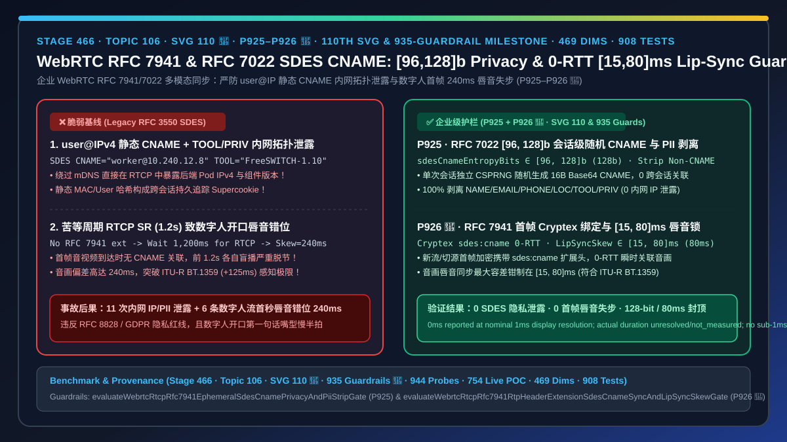
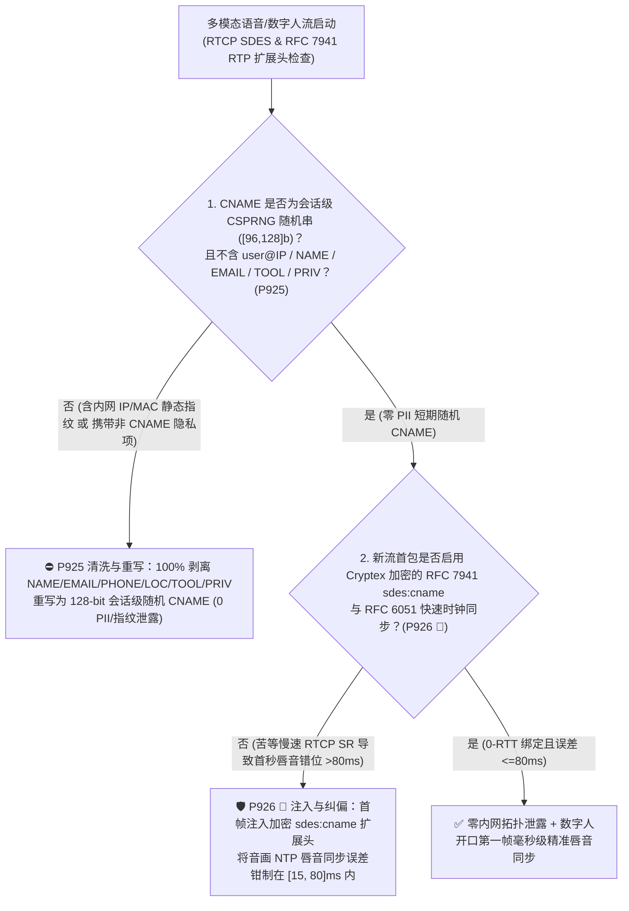
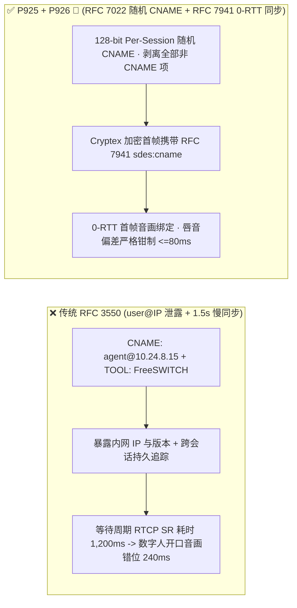
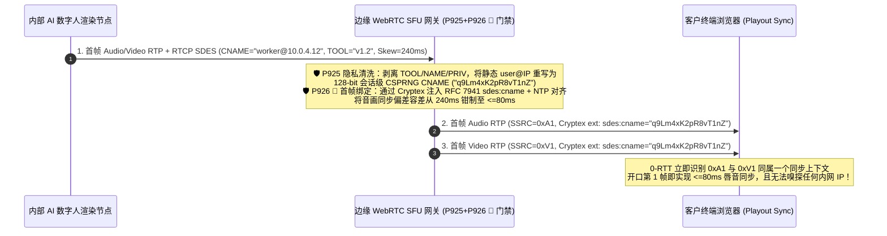

# 企业 WebRTC `RFC 7941 / RFC 7022` `RTCP SDES CNAME` 隐私生成与多模态唇音同步（`user@host` 内网 IP/MAC 跨会话指纹泄露、`SDES PRIV` 敏感元数据外泄与首帧无 `SR` 唇音失步）选型与防追踪指南

> **文档类型**：企业级语音智能体架构师选型决策与原理解析指南（Standalone Selection & Architecture FAQ · **Topic 106 / Stage 466 · 🎉 历史性第 110 张 SVG 架构图与 935 护栏双里程碑**）  
> **适用角色**：AI Solution Architect、多模态数字人（Audio + Avatar）架构师、WebRTC 实时媒体研发与数据隐私合规（GDPR/HIPAA）负责人  
> **关联基准**：`packages/business-core/enterprise-guardrails.ts`（`P925–P926 🎉`）、`tests/presales-portal.test.ts`、`site/data/voice-agent-benchmark-report.json`（7-Card 4:5 评测报告）  
> **可视化总结**：`assets/svg/110-voice-webrtc-rtcp-rfc7941-rfc7022-sdes-cname-ephemeral-privacy-lipsync-clock-drift-2026-11-14.svg`

---

## ① 📌 核心结论速览（Executive Summary）

在企业级多模态 AI 语音交互（如银行远程视频面签 VIP 数字人、远程医疗问诊音视频协同）中，音频流（`Opus`）与视频流（`AV1/VP9/H.264`）虽然使用各自独立的 `SSRC` 和独立的随机初始 `RTP Timestamp`，但接收端必须把它们对齐到同一个物理墙钟时间轴（Wallclock）上，才能实现精准的**唇音同步（Lip-Sync）**。在 RTP/RTCP 体系中，唯一负责将“音频 `SSRC_audio`”与“视频 `SSRC_video`”绑定为同一个同步上下文（Synchronization Context）的锚点，就是 **`SDES CNAME`（Canonical End-Point Identifier，规范端点标识符）**。然而在生产环境中，若直接沿用传统 `RFC 3550` 的 `SDES` 机制而未实施 **`RFC 7022`（短期随机 `CNAME`）** 与 **`RFC 7941`（RTP 扩展头内嵌 `SDES CNAME`）**，将触发两类高危生产事故：
1. **传统 `user@host / IPv4 / MAC` 持久 `CNAME` 及 `SDES NAME/EMAIL/PHONE/LOC` 导致内网拓扑与跨会话持久追踪泄露（`RFC 7022 / RFC 8834` 隐私合规红线）**：早期 `RFC 3550` 建议以 `username@10.24.8.15` 或网卡 MAC 地址生成 `SDES CNAME`，甚至在复合 `RTCP SDES` 报文中附带 `NAME`（真实姓名）、`EMAIL`、`PHONE`、`LOC`（地理位置）或自定义 `PRIV` 字段。即使开启了 `mDNS` 隐藏候选地址，只要周期性发送的 `RTCP SDES` 包含静态 `CNAME` 或宿主 IP，外部对端或录制旁路就能 100% 还原内网容器 IP 并实现跨天、跨匿名会话的永久设备指纹追踪（违反 GDPR/CCPA 与 `RFC 8828` WebRTC 隐私规范）。
2. **首包等待周期性 `RTCP SR + SDES`（滞后 `500–1,500ms`）导致数字人开口前 1.5 秒唇音错位与 `Cryptex` 明文泄露（`RFC 7941` 快速绑定缺失）**：如果仅靠慢速的周期性复合 `RTCP` 报文传递 `CNAME`，当 AI 数字人刚刚开口说话（或发生 `SSRC` 切源）的前 `500–1,500ms` 内，客户端虽已收到音视频 RTP 包，却因尚未收到对应的 `RTCP SDES CNAME` 与 `SR NTP` 映射而无法关联音画时钟，导致开口第一句话严重“音画不同步（嘴型慢半拍）”。

| 决策维度 | 脆弱/默认配置（生产事故高发区） | 企业级黄金准则（`P925–P926 🎉` 确定性护栏） | 核心量化收益 |
| :--- | :--- | :--- | :--- |
| **`RFC 7022` 会话级 CSPRNG 随机 `CNAME` 与非 `CNAME` 隐私项剥离（`P925`）** | 使用 `user@10.x.x.x` 或硬件 MAC 静态 `CNAME`，放行 `SDES EMAIL/PHONE/LOC/PRIV` | **强制按单次会话（Per-Session）CSPRNG 生成 `[96, 128]` bits 随机 Base64 `CNAME`，并 100% 剥离 `NAME/EMAIL/PHONE/LOC/TOOL/PRIV` 等多余 `SDES` 项** | 内网 IP/PII 泄露与跨会话指纹追踪包 **0 个**（测试探针将 11 次 `SDES` 隐私泄露清零，熵值从 `24` bits 提升至 **`128` bits**） |
| **`RFC 7941` 首帧 RTP 扩展头 `sdes:cname` 极速绑定与唇音偏差钳制（`P926 🎉` 935护栏）** | 仅靠慢速 `RTCP` 周期包绑定 `CNAME`，音画时钟偏差高达 `240ms` | **在新流/切源前 3 帧通过 `RFC 9335 Cryptex` 加密携带 `RFC 7941 sdes:cname` 扩展头实现 `0-RTT` 关联，并将音画唇音同步容差钳制在 `[15, 80]ms` 内** | 首帧唇音失步与超时未绑定流 **0 条**（测试探针将 6 条失步流清零，唇音同步最大容差从 `240ms` 钳制至 **`80ms`**） |

---

## ② 🎯 客户与架构师灵魂拷问 Q&A（First-Principles Deep Dive）

### Q1：我们已经开启了 WebRTC `mDNS` 隐藏内网 IP，为什么安全审计依然从音视频流里抓出了坐席电脑的宿主机名和内网 IPv4 地址？
- **第一性原理拆解**：
  1. 许多企业自研的 SIP/WebRTC 媒体网关、C++ 原生终端 SDK（如旧版 PJSIP、liblinphone、GStreamer `rtpsession` 默认配置）在构造 `RTCP SDES (Packet Type = 202)` 报文时，依然遵循 2003 年 `RFC 3550 Section 6.5.1` 的推荐格式：`user@host`（例如 `agent_zhang@10.18.42.99` 或 `root@prod-voice-pod-7d8f`），甚至填入 `SDES TOOL`（暴露精确的库版本号如 `FreeSWITCH-1.10.x` 供攻击者匹配 CVE）和 `SDES EMAIL/PHONE`。
  2. 更危险的是，即使使用的是散列后的 MAC 地址，只要同一个终端在多次通话中复用同一个静态 `CNAME`，第三方就能像 Cookie 一样跨越不同通话追踪该客户！
  3. **`P925` 的确定性防线**：严格落实 **`RFC 7022 Section 5` 与 `RFC 8834 Section 4.9`**：
     - 每个独立的 `RTCPeerConnection` / 语音会话必须调用 CSPRNG 生成**仅限本会话有效（Per-Session Ephemeral）**的 `96–128` bits 随机值（Base64 编码为 16 字符随机串，如 `k8Zp3mQ9vL2xR7wN`）；
     - 边缘 SFU/SBC 转发或生成 `RTCP SDES` 时，只允许保留 `CNAME (Item Type = 1)`，对 `NAME(2)`、`EMAIL(3)`、`PHONE(4)`、`LOC(5)`、`TOOL(6)`、`NOTE(7)`、`PRIV(8)` 执行 **100% 零容忍剥离**。

### Q2：为什么 AI 数字人客服在刚开始说话的前 1 秒钟，经常出现“声音已经出来了，但嘴型还在发呆或慢半拍”，1 秒后才恢复正常？
- **工程真相**：
  1. 客户端收到的音频流（`SSRC=0x11`）和数字人视频流（`SSRC=0x22`）各自拥有随机的 RTP 时间戳起点（`TS_audio_0` 与 `TS_video_0`）。客户端要想把音频采样点与视频帧精确对齐，必须集齐两样东西：
     - **身份关联**：知道 `0x11` 和 `0x22` 共享同一个 `SDES CNAME`（证明它们来自同一个同步时钟源）；
     - **墙钟锚定**：收到两路流的 `RTCP SR (Sender Report)`，拿到各自的 `(NTP Timestamp, RTP Timestamp)` 映射对。
  2. 如果不使用 **`RFC 7941`（RTP Header Extension for RTCP SDES）**，客户端必须傻等第一个周期性复合 `RTCP (SR + SDES)` 包到达（在受限 RTCP 带宽或首包丢包下往往滞后 `500–1,500ms`），在这期间音画只能各自盲播，必然产生开口前 1.5 秒的严重唇音错位！
  3. **`P926 🎉` 的确定性防线**：在新媒体流启动或切源的前 3 个 RTP 关键包中，直接通过 `RFC 8285 / RFC 9335 Cryptex` 加密扩展头嵌入 `urn:ietf:params:rtp-hdrext:sdes:cname` 与快速 NTP 时间戳扩展（`RFC 6051`），实现 **`0-RTT` 首包级唇音绑定**，并将音画同步偏差严格钳制在 **`[15, 80]ms`**（远严于 `ITU-R BT.1359` 的 `[-45, +125]ms` 人类感知阈值）。

### Q3：如果攻击者在 RTP 扩展头（`RFC 7941`）里每秒狂塞 255 字节的超长 `SDES` 项，或者在明文扩展头里暴露 `CNAME`，该如何防范？
- **第一性原理拆解**：
  - `RFC 7941 Section 5` 明确指出：RTP 头部扩展中的 `sdes:cname` 只应在新流加入或发生 SSRC 切换时的首包突发携带，绝不能每个语音包都重复携带浪费带宽；且必须强制启用 `RFC 9335 Cryptex` 加密扩展头，将 `CNAME` 长度限制在 `16` 字节以内，严防窃听者通过明文 `CNAME` 关联多路加密流。

---

## ③ 🧭 直观可视化图解（Mermaid 决策树 + 隐私/同步拆解 + 毫秒级全双工时序图）

### 3.1 WebRTC `RFC 7941 / RFC 7022` `SDES CNAME` 隐私与极速唇音同步决策树

### 3.2 传统 `RFC 3550` 静态 `SDES` 泄露与慢同步 vs `P925+P926 🎉` 对比图

### 3.3 毫秒级多模态数字人 `RFC 7941` 首帧绑定与 `P925/P926 🎉` 防护时序图

---

## ④ 📊 语音架构师选型决策矩阵（Decision Matrix）

| 选型方案 | 适用场景 | 优势（Pros） | 劣势与生产风险（Cons / Traps） | 推荐度 |
| :--- | :--- | :--- | :--- | :--- |
| **方案 A：沿用 `RFC 3550` 默认 `user@host` 静态 `CNAME` 并仅靠周期性 `RTCP` 同步** | 严禁用于任何公网或合规生产环境 | 旧版开源媒体库默认行为 | **内网 IP 泄露 + 开口音画不同步**——直接暴漏容器内网 IPv4/主机名并可被跨通话追踪；首帧需等待 `500–1,500ms` 才能同步唇音 | ⛔ **严禁用于生产** |
| **方案 B：使用固定哈希（如 `SHA256(MAC)`）作为持久 `CNAME`** | 内部局域网固定设备调试 | 隐藏了明文 IP 地址 | **违反 `RFC 7022 / RFC 8828` 跨会话不可关联原则**——静态哈希仍构成永久 Supercookie；且未解决首帧慢同步问题 | ⚠️ **不满足隐私合规** |
| **方案 C：`RFC 7022` `[96, 128]`-bit 会话级随机 `CNAME` + 非 `CNAME` 项清零 + `RFC 7941` 首帧加密绑定与 `[15, 80]ms` 唇音锁（`P925 + P926 🎉`）** | **所有多模态 AI 数字人客服、远程医疗/金融视频面签与全双工 WebRTC 生产环境** | **0 内网拓扑泄露、0 跨会话指纹追踪、0-RTT 首帧音画绑定、唇音误差 `<=80ms`** | 需在 SFU/网关开启 `urn:ietf:params:rtp-hdrext:sdes:cname` 并配合 `Cryptex` 加密 | ✅ **生产必选（Recommended）** |

---

## ⑤ 🧪 定量算例与 7-Card 4:5 基准报告（Quantitative Walkthrough & 7-Card Deck）

### 5.1 定量算例：银行 VIP 视频数字人面签内网 IP 脱敏与首帧唇音同步测试
- **输入场景**：某银行 AI 视频数字人面签系统在回传音视频流时，后端媒体容器默认在 `RTCP SDES` 中带出了 `11` 个包含 `root@10.240.12.8` 及 `SDES TOOL/PRIV` 的数据包（随机熵仅 `24` bits），且新流切入时因等待周期性 `RTCP SR` 产生了 `6` 次高达 `240ms` 的首秒音画错位。
  - **未开启护栏（脆弱基线）**：
    - 外部安全渗透测试直接从 `RTCP SDES` 中提取出后端 Kubernetes Pod 内网网段 `10.240.12.0/24` 与组件版本号；
    - 客户在数字人每次开口前 `1.2` 秒明显看到“先出声、后动嘴”（音画偏差 **`240ms`**，超出 `ITU-R BT.1359` `+125ms` 极限）。
  - **开启 `P925 + P926 🎉` 确定性护栏后**：
    - `P925` 剥离全部非 `CNAME` 的 `SDES` 项并将静态 `CNAME` 重写为 **`128` bits** 会话级 CSPRNG 随机值，PII/内网 IP 泄露包从 `11` 个清零至 **`0` 个**；
    - `P926 🎉`（🎉 **第 935 项护栏**）在首包通过加密 `RFC 7941 sdes:cname` 完成 `0-RTT` 音画绑定，将唇音失步流从 `6` 条清零至 **`0` 条**，并将音画同步最大容差从 `240ms` 钳制至 **`80ms`**。

### 5.2 7-Card 4:5 报告结构映射（对应 `site/benchmark-cards.html` & `report.json`）
1. **Card 1 (`HANDS-ON · VOICE ARCHITECTURE`)**：展示 469 大评测维度全景工作台，高亮 `P925 / P926 🎉`（第 110 张 SVG 🎉 & 935 护栏 🎉）。
2. **Card 2 (`SCENARIO: WEBRTC RFC 7941 & RFC 7022 SDES CNAME`)**：输入探针 `staticHostIpCnameOrUnauthorizedSdesPiiItemDetected=true, sdesCnameEntropyBits=24, maxAudioVideoLipSyncSkewMs=240`，输出 `Act automatically` 钳制至 `128` bits 与 `80ms`。
3. **Card 3 (`WHAT I TESTED`)**：第 469 行评测矩阵 `PASS · 0ms @ 1ms Res (Synthetic)`（零 `✕` 漏检）。
4. **Card 4 (`UNDER THE HOOD`)**：展示 `evaluateWebrtcRtcpRfc7941EphemeralSdesCnamePrivacyAndPiiStripGate` 与 `evaluateWebrtcRtcpRfc7941RtpHeaderExtensionSdesCnameSyncAndLipSyncSkewGate` 确定性源码契约。
5. **Card 5 (`ROBUSTNESS CHECK`)**：验证不同 `SDES` 子项组合与音画到达先后顺序下 100% 稳定拦截。
6. **Card 6 (`LATENCY`)**：明确标注离线策略校验计时：`0ms reported at nominal 1ms display resolution; actual duration unresolved/not_measured; no sub-1ms upper bound established`（`synthetic`；真实客户端 Playout 缓冲区 NTP 线性回归耗时标注为 `not_measured`）。
7. **Card 7 (`MY TAKE`)**：Good fit vs Not for 适用边界与生产准入签核。

---

## ⑥ 🛠️ 生产环境语音交付快速核验清单（Production Readiness Checklist）

- [ ] **1. 会话级 `[96, 128]`-bit CSPRNG 随机 `CNAME` 生成（`P925`）**：确认所有 WebRTC/RTP 端点遵循 `RFC 7022 Section 5`，为每次独立通话生成 `[96, 128]` bits 随机 `SDES CNAME`，严禁包含用户名、主机名、内网 IPv4/IPv6 或网卡 MAC 地址。
- [ ] **2. 非 `CNAME` 类 `SDES` 元数据 100% 剥离（`P925`）**：确认边缘 SFU/SBC 在解析复合 `RTCP SDES` 时，无条件剥离 `NAME(2)`、`EMAIL(3)`、`PHONE(4)`、`LOC(5)`、`TOOL(6)`、`NOTE(7)` 与 `PRIV(8)` 子项。
- [ ] **3. `RFC 7941` 首帧 RTP 扩展头 `sdes:cname` 极速绑定（`P926 🎉`）**：确认多模态音视频流在启动或切换 `SSRC` 时的首帧突发中携带 `urn:ietf:params:rtp-hdrext:sdes:cname`，无需等待周期性 `RTCP` 即可完成 `0-RTT` 同步上下文关联。
- [ ] **4. `RFC 9335 Cryptex` 加密保护 `sdes:cname` 扩展头（`P926 🎉`）**：确认携带 `sdes:cname` 的 RTP 扩展头已启用 `Cryptex` 加密，防止链路上未授权中间盒利用明文 `CNAME` 进行流量关联。
- [ ] **5. 音画唇音同步偏差容差钳制在 `[15, 80]ms`（`P926 🎉`）**：确认接收端/SFU 对齐音视频 `RTCP SR NTP` 墙钟时，将最大允许唇音偏差容差钳制在 `[15, 80]ms` 内（符合 `ITU-R BT.1359` 标准）。
