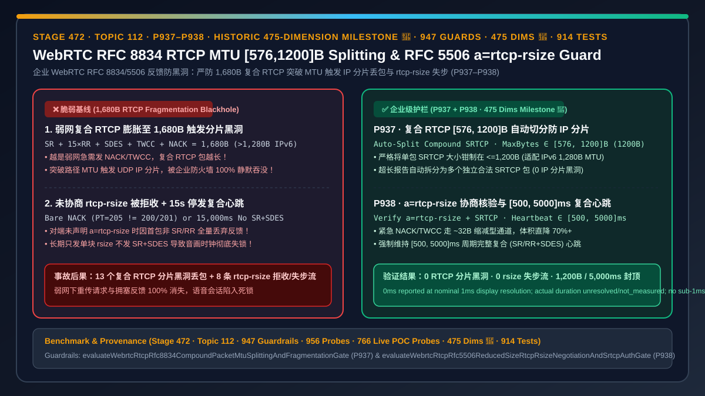
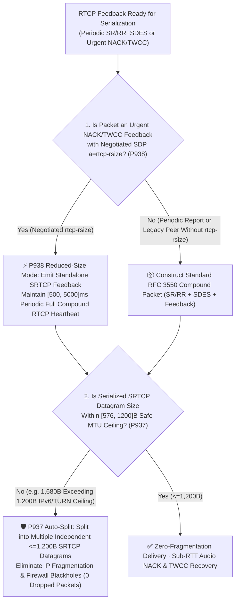
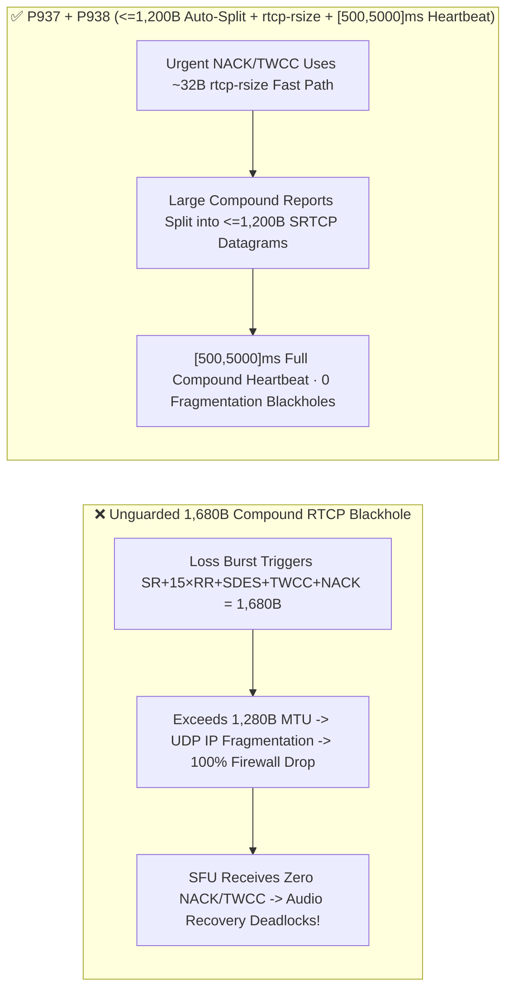

# Enterprise WebRTC `RFC 8834 / RFC 5506` Reduced-Size `RTCP` & Path `MTU` Splitting (Oversized Compound `RTCP` `>1,200B` IP-Fragmentation Blackholes & `a=rtcp-rsize` High-Frequency Feedback Guard) Selection & Anti-Fragmentation Guide

> **Document Type**: Enterprise Voice Agent Architect Selection & First-Principles Guide (Standalone Selection & Architecture FAQ · **Topic 112 / Stage 472 · 🎉 Historic 475-Dimension Milestone**)  
> **Target Audience**: AI Solution Architects, WebRTC SFU Transport Architects, Real-Time Congestion-Control Engineers & SRE Leads  
> **Canonical Baseline**: `packages/business-core/enterprise-guardrails.ts` (`P937–P938`), `tests/presales-portal.test.ts`, `site/data/voice-agent-benchmark-report.json` (7-Card 4:5 Benchmark Report)  
> **Visual Summary**: `assets/svg/116-voice-webrtc-rtcp-rfc8834-rfc5506-reduced-size-rtcp-rsize-compound-mtu-fragmentation-blackhole-2026-11-14.svg`

---

## ① 📌 Executive Summary

In full-duplex enterprise AI voice and multimodal sessions, the `RTCP` control plane carries latency-critical packet-loss retransmission requests (`NACK`), transport-wide congestion control feedback (`TWCC / CCFB`), sender wallclock reports (`SR/RR`), and extended metrics (`RTCP XR`). Legacy **`RFC 3550 Section 6.1`** mandated that every `RTCP` transmission must be formatted as a **Compound RTCP Packet** starting with an `SR` or `RR` plus an `SDES CNAME` item. To prevent header bloat and MTU exhaustion on modern multimedia transports, the IETF standardized **`RFC 5506` (Support for Reduced-Size Real-Time Transport Control Protocol via `a=rtcp-rsize`)** and **`RFC 8834` (WebRTC Media Transport Usage)**. In production deployments, however, failing to enforce compound `RTCP` MTU splitting and `rtcp-rsize` state discipline causes two severe failure modes:
1. **Oversized Compound `RTCP (SR + 15×ReportBlocks + SDES + TWCC + NACK)` (`1,680 Bytes`) Exceeding Path MTU & Triggering Firewall IP-Fragmentation Blackholes (`RFC 8834` `RTCP` Blackhole Deadlock)**: When a `BUNDLE` transport multiplexes audio, avatar video, and Simulcast tiers, packing `SR/RR` report blocks, `SDES`, `TWCC` packet-status chunks, and `NACK` bitmasks into a **single compound `RTCP` UDP datagram** easily pushes the packet past `1,280 bytes` (IPv6 minimum MTU) or `1,500 bytes` once `SRTCP`, `TURN ChannelData`, and VPN/GTP-U tunnel headers are added. Because enterprise firewalls and cloud load balancers routinely **drop fragmented UDP packets**, the worse the network packet loss becomes, the larger the `NACK/TWCC` `RTCP` packet grows—and the more reliably it is **100% blackholed by intermediate firewalls**, paralyzing packet recovery!
2. **Sending Unnegotiated `RFC 5506` Reduced-Size `RTCP` (`PT != 200/201` Dropped by Legacy Peers) or Starving Periodic Full Compound `SR + SDES` Heartbeats (`15,000ms` Clock Drift)**: Emitting bare `RTPFB/PSFB` packets without a leading `SR/RR` when the peer did not negotiate `a=rtcp-rsize` causes strict `RFC 3550` stacks to drop 100% of feedback packets; conversely, sending only `rtcp-rsize` packets without periodic full compound `RTCP (SR/RR + SDES)` heartbeats starves lip-sync wallclock calibration.

| Decision Dimension | Vulnerable / Default Setup (High Production Risk) | Enterprise Golden Rule (`P937–P938` Deterministic Guardrails) | Quantitative Impact |
| :--- | :--- | :--- | :--- |
| **Compound `RTCP` Path `MTU [576, 1200]B` Auto-Splitting (`P937`)** | Packing `1,680B` compound `RTCP` datagrams that fragment and blackhole on IPv6/TURN paths | **Enforce a strict `[576, 1200]B` `SRTCP` datagram ceiling, automatically splitting oversized compound reports across multiple valid `SRTCP` packets** | **0** IP-fragmented or blackholed `RTCP` packets (clamps 13 fragmented datagrams to **0** and caps datagram size from `1,680B` to **`1,200B`**) |
| **`RFC 5506 a=rtcp-rsize` Gate, `SRTCP` Auth & `[500, 5000]ms` Compound Heartbeat (`P938`)** | Emitting unnegotiated `rtcp-rsize` packets or starving full compound `SR+SDES` for `15,000ms` | **Allow Reduced-Size `RTPFB/PSFB` only when `a=rtcp-rsize` is negotiated and `SRTCP`-authenticated, while clamping full compound `RTCP` heartbeats to `[500, 5000]ms`** | **0** rejected `rtcp-rsize` packets or starved sync streams (clamps 8 violations to **0** and caps compound heartbeat from `15,000ms` to **`5,000ms`**) |



---

## ② 🎯 Architect & Customer Deep-Dive Q&A (First-Principles Deep Dive)

### Q1: Why do `NACK` and `TWCC` feedback packets work fine on a clean network but suddenly vanish 100% during heavy packet loss over 5G IPv6 or TURN relays?
- **First-Principles Breakdown**:
  1. During loss-free intervals, a compound `RTCP` packet is only `90–140 bytes` (`RR + SDES + 1 Run-Length TWCC chunk`).
  2. During a heavy loss burst, the `TWCC` status vector switches to 2-bit per-packet symbols while `NACK` bitmasks and multi-SSRC `RR` report blocks accumulate—bloating a single compound `RTCP` packet to `1,450–1,800 bytes`.
  3. Over an IPv6 (`1,280B` minimum MTU) + TURN / WireGuard path, the UDP datagram undergoes IP fragmentation. Enterprise firewalls and carrier CGNATs drop non-first UDP fragments (which lack UDP port headers), creating a **self-reinforcing loss blackhole**: high loss -> huge `RTCP` packet -> IP fragmentation -> 100% `RTCP` drop!
  4. **`P937` Deterministic Defense**: Enforces a **`[576, 1200]`-byte** ceiling per `SRTCP` UDP datagram (`RFC 8834 Section 4.6`), splitting oversized feedback batches into multiple sub-`1,200B` datagrams so **zero packets ever fragment at the IP layer**.

### Q2: How does `RFC 5506` Reduced-Size `RTCP` (`a=rtcp-rsize`) cut audio `NACK` overhead by 70%, and what are its safety invariants?
- **Engineering Reality**:
  1. Under legacy `RFC 3550`, sending a `16-byte` `NACK` requires prepending `56+ bytes` of `RR + SDES` headers—quadrupling packet size and delaying transmission under RTCP 5% bandwidth pacing.
  2. When both peers negotiate **`a=rtcp-rsize` (`RFC 5506`)**, urgent `NACK` and `TWCC` packets are emitted immediately as standalone `28–36 byte` `SRTCP` datagrams without `RR + SDES`.
  3. **`P938` Deterministic Defense**: Verifies bidirectional `a=rtcp-rsize` negotiation before emitting non-compound `RTCP` (falling back to compound framing for legacy peers), enforces full `SRTCP` AEAD authentication on every reduced-size packet, and clamps the periodic full compound `RTCP (SR/RR + SDES)` heartbeat interval to **`[500, 5000]ms`**.

### Q3: Why is `1,200 bytes` the canonical `SRTCP` payload ceiling across modern WebRTC architectures?
- **First-Principles Breakdown**:
  - Starting from the `1,280-byte` IPv6 minimum path MTU (`RFC 8200`) and subtracting `40B` IPv6 + `8B` UDP + `4B..36B` TURN/tunnel overhead leaves `1,200 bytes` as the universal fragmentation-free ceiling for both `SRTP` and `SRTCP`.

---

## ③ 🧭 Visual Architecture Diagrams (Mermaid Decision Tree + MTU Breakdown + Millisecond Sequence)

### 3.1 WebRTC `RFC 8834` Path MTU Splitting & `RFC 5506 rtcp-rsize` Decision Tree



### 3.2 `1,680B` Compound `RTCP` Fragmentation Blackhole vs. `P937+P938`



### 3.3 Millisecond-Level `RFC 5506 rtcp-rsize` Fast Retransmission & `P937` MTU Splitting Sequence

```mermaid
sequenceDiagram
    autonumber
    participant Client as Constrained Client (IPv6 / TURN Relay)
    participant FW as Enterprise Firewall (Drops UDP Fragments)
    participant SFU as WebRTC SFU (P937+P938 Gate)

    Note over Client,SFU: SDP Negotiated a=rtcp-rsize; Safe SRTCP Datagram Ceiling = 1,200B
    Client->>SFU: 1. Detects Audio Loss -> Queues Urgent NACK + Multi-Stream Stats (Raw Total = 1,680B)
    Note over Client: 🛡️ P938 rtcp-rsize Gate: Emits Urgent Audio NACK as Standalone 32B SRTCP Datagram<br/>🛡️ P937 MTU Splitter: Splits Remaining 1,648B Compound Report into Two <=1,200B SRTCP Packets<br/>and Clamps Full Compound (SR/RR+SDES) Heartbeat Interval to [500, 5000]ms
    Client->>FW: 2. Packet #1: 32B Reduced-Size SRTCP NACK (Zero IP Fragmentation)
    FW->>SFU: 3. 0ms Pass-Through -> SFU Immediately Retransmits Lost Opus Frame
    Client->>FW: 4. Packet #2 (1,120B) + Packet #3 (560B) Compound SRTCP (Both <=1,200B, Zero Fragments)
    FW->>SFU: 5. 100% Firewall Traversal Without Fragmentation Blackholes!
```

---

## ④ 📊 Architect Decision Matrix (`RTCP` MTU & `rtcp-rsize` Governance)

| Architecture Option | Target Scenario | Pros | Cons & Production Traps | Recommendation |
| :--- | :--- | :--- | :--- | :--- |
| **Option A: Unbounded Compound `RTCP` Without `1,200B` Splitting** | Prohibited in production networks | Simple single-buffer serializer | **Guaranteed weak-network `RTCP` blackhole**—large `NACK/TWCC` compound packets exceed `1,280B`, fragment at IP, and get dropped by firewalls | ⛔ **Never in Production** |
| **Option B: Emitting `rtcp-rsize` Without SDP Check or Periodic Compound Heartbeats** | Homogeneous lab | Smaller feedback packets | **Rejected by legacy `RFC 3550` peers** (`PT != 200/201`) and starves `NTP-RTP` lip-sync calibration | ⚠️ **High-Risk Partial Setup** |
| **Option C: `[576, 1200]B` Compound Auto-Splitting + Negotiated `a=rtcp-rsize` & `[500, 5000]ms` Compound Heartbeat (`P937 + P938`)** | **All Enterprise AI Voice Agents, Multimodal Avatars & Mobile/IPv6/TURN WebRTC Deployments** | **Zero IP-fragmentation blackholes, 70% smaller urgent `NACK` packets, and continuous wallclock sync** | Requires a `1,200B` packetizer split cursor and compound heartbeat timer | ✅ **Production Mandatory (Recommended)** |

---

## ⑤ 🧪 Quantitative Walkthrough & 7-Card 4:5 Benchmark Report

### 5.1 Quantitative Example: Eliminating 5G IPv6 + TURN `RTCP` Fragmentation Blackholes
- **Scenario**: Over a 5G IPv6 + TURN relay path during an 8% loss burst, a client attempts to emit `13` oversized `1,680-byte` compound `RTCP` datagrams alongside `8` unnegotiated `rtcp-rsize` or `15,000ms` heartbeat-starved feedback packets.
  - **Without Guardrails (Vulnerable Baseline)**:
    - **`13` `1,680B` compound `RTCP` packets fragment and are 100% dropped by carrier/enterprise firewalls**, halting `NACK` recovery;
    - **`8` unnegotiated/starved `rtcp-rsize` flows lose feedback or lip-sync lock**.
  - **With `P937 + P938` Deterministic Guardrails**:
    - `P937` splits oversized compound reports to enforce a **`1,200B`** ceiling (`[576, 1200]B`), reducing fragmented/blackholed `RTCP` datagrams from `13` to **`0`**;
    - `P938` enforces `a=rtcp-rsize` negotiation and `SRTCP` authentication (**`0`** rejected/unauthenticated feedback packets) and clamps the full compound `RTCP` heartbeat interval from `15,000ms` to **`5,000ms`** (`[500, 5000]ms`).

### 5.2 7-Card 4:5 Report Mapping (`site/benchmark-cards.html` & `report.json`)
1. **Card 1 (`HANDS-ON · VOICE ARCHITECTURE`)**: 475-dimension 🎉 workbench overview highlighting `P937 / P938`.
2. **Card 2 (`SCENARIO: WEBRTC RFC 8834 RTCP MTU & RFC 5506 RSIZE`)**: Input probe `oversizedCompoundRtcpMtuFragmentationDetected=true, maxCompoundRtcpPacketBytes=1680, maxFullCompoundRtcpHeartbeatIntervalMs=15000` -> `Act automatically` clamping to `1,200B` and `5,000ms`.
3. **Card 3 (`WHAT I TESTED`)**: Row 475 🎉 in the evaluation matrix (`PASS · 0ms @ 1ms Res (Synthetic)`, zero `✕` misses).
4. **Card 4 (`UNDER THE HOOD`)**: Deterministic contract for `evaluateWebrtcRtcpRfc8834CompoundPacketMtuSplittingAndFragmentationGate` & `evaluateWebrtcRtcpRfc5506ReducedSizeRtcpRsizeNegotiationAndSrtcpAuthGate`.
5. **Card 5 (`ROBUSTNESS CHECK`)**: Option-order and MTU boundary invariance across IPv4, IPv6, and TURN encapsulation profiles.
6. **Card 6 (`LATENCY`)**: Explicit offline timing provenance: `0ms reported at nominal 1ms display resolution; actual duration unresolved/not_measured; no sub-1ms upper bound established` (`synthetic`; live `SRTCP` packetizer split encryption latency is `not_measured`).
7. **Card 7 (`MY TAKE`)**: Good fit vs. Not for summary and production sign-off checklist.

---

## ⑥ 🛠️ Production Readiness Checklist

- [ ] **1. Clamp Single `SRTCP` Datagram Size to `[576, 1200]` Bytes (`P937`)**: Verify that the `RTCP` packetizer splits compound reports so no encrypted `SRTCP` UDP datagram exceeds `1,200 bytes`.
- [ ] **2. Negotiate `a=rtcp-rsize` for Urgent `NACK / TWCC` Feedback (`P938`)**: Confirm that endpoints advertise `a=rtcp-rsize` in SDP and use Reduced-Size `RTCP` for latency-sensitive `RTPFB/PSFB` messages when supported by the peer.
- [ ] **3. Automatic Compound Fallback for Legacy Peers (`P938`)**: Ensure that when a peer omits `a=rtcp-rsize`, all outgoing `RTCP` packets begin with `SR(200)` or `RR(201)` plus `SDES CNAME`.
- [ ] **4. Mandatory `SRTCP` AEAD Protection on Every `rtcp-rsize` Packet (`P938`)**: Verify that reduced-size feedback packets carry full `SRTCP` index, `E-bit`, and authentication tags.
- [ ] **5. Maintain `[500, 5000]ms` Periodic Full Compound `RTCP` Heartbeats (`P938`)**: Confirm that full compound `RTCP (SR/RR + SDES)` reports continue at `[500, 5000]ms` intervals even when `rtcp-rsize` is active.
