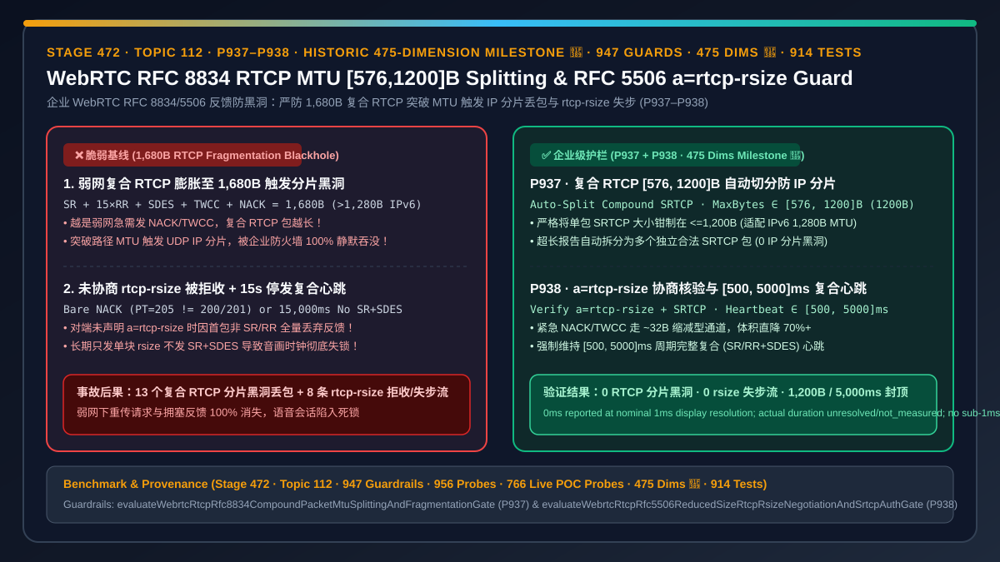
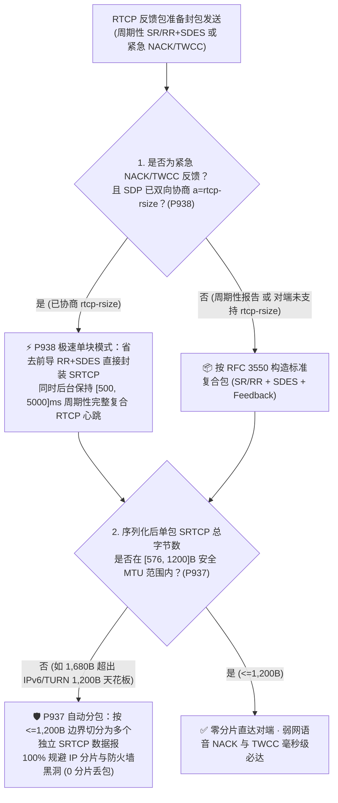
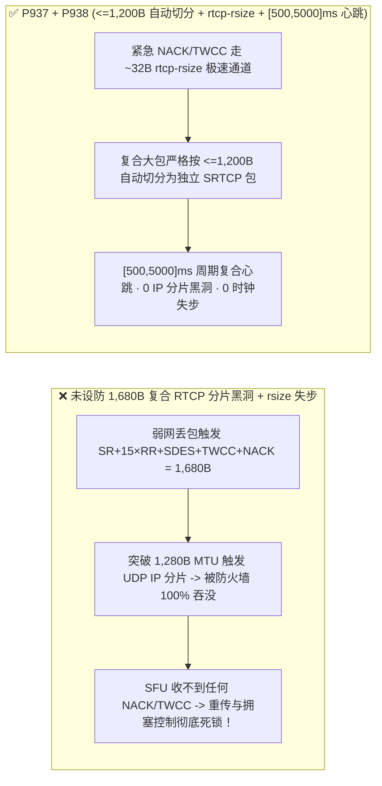
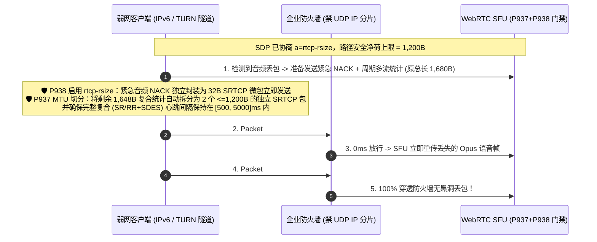

# 企业 WebRTC `RFC 8834 / RFC 5506` 缩减型 `RTCP` 与路径 `MTU` 分包保护（复合 `RTCP` 突破 `1,200B` 触发 IP 分片黑洞丢包与 `a=rtcp-rsize` 高频反馈防伪造）选型与防分片指南

> **文档类型**：企业级语音智能体架构师选型决策与原理解析指南（Standalone Selection & Architecture FAQ · **Topic 112 / Stage 472 · 🎉 历史性第 475 大评测维度里程碑**）  
> **适用角色**：AI Solution Architect、WebRTC SFU 媒体传输架构师、实时语音网络拥塞控制与 SRE 负责人  
> **关联基准**：`packages/business-core/enterprise-guardrails.ts`（`P937–P938`）、`tests/presales-portal.test.ts`、`site/data/voice-agent-benchmark-report.json`（7-Card 4:5 评测报告）  
> **可视化总结**：`assets/svg/116-voice-webrtc-rtcp-rfc8834-rfc5506-reduced-size-rtcp-rsize-compound-mtu-fragmentation-blackhole-2026-11-14.svg`

---

## ① 📌 核心结论速览（Executive Summary）

在全双工 AI 语音与多模态协同通话中，RTCP 控制通道承担着传递丢包重传请求（`NACK`）、全链路拥塞反馈（`TWCC / CCFB`）、发送端墙钟报告（`SR/RR`）以及扩展指标（`RTCP XR`）的命脉职责。传统 **`RFC 3550 Section 6.1`** 规定所有 RTCP 报文必须打包成**复合包（Compound RTCP Packet）**发送——即每个 RTCP UDP 报文开头必须强制拼上一个完整的 `SR` 或 `RR`（外加多块 `Report Block`）和 `SDES CNAME`！为此，IETF 在 **`RFC 5506`（Support for Reduced-Size Real-Time Transport Control Protocol，`a=rtcp-rsize`）** 与 **`RFC 8834`（WebRTC Media Transport Usage）** 中引入了缩减型单块反馈与 MTU 分包规范。然而在生产环境中，若 SFU 或终端未能处理好复合 `RTCP` 的 MTU 边界与 `rtcp-rsize` 状态同步，极易引爆两类重度网络故障：
1. **多流复合 `RTCP (SR + 15×ReportBlocks + SDES + TWCC + NACK)` 单包膨胀至 `1,680 字节` 突破路径 MTU 触发防火墙 IP 分片黑洞丢包（`RFC 8834` `RTCP` MTU 黑洞死锁）**：当一个 `BUNDLE` 通道同时承载音频、数字人视频、屏幕共享及多路 Simulcast 流时，如果发送端把 `RR`（每个源 24 字节报告块）、`SDES`、`TWCC` 位图和 `NACK` 列表全部塞进**同一个复合 `RTCP` UDP 数据报**，加上外层的 `SRTCP`（14–20B）、`TURN ChannelData / WireGuard / IPv6` 隧道开销，总长度极易超过 `1,280 字节`（IPv6 最小 MTU）或 `1,500 字节`！由于现代企业防火墙与云厂商负载均衡器普遍**直接丢弃 IP 分片的 UDP 包（Fragmentation Blackhole）**，越是在弱网大量丢包急需发 `NACK/TWCC` 的时候，`RTCP` 包越长、越是 100% 被沿途防火墙静默吞没，导致重传与拥塞控制彻底瘫痪！
2. **未协商 `a=rtcp-rsize` 强发裸 `RTPFB/PSFB` 导致传统网关校验首字节 `PT != 200/201` 全量拒收，或完全停发周期性复合 `SR + SDES` 导致时钟与 `SRTCP` 失步（`RFC 5506` 误用陷阱）**：如果一端在对方未在 SDP 中声明 `a=rtcp-rsize` 时就发送不含前导 `SR/RR` 的缩减型 `NACK` 包，严格遵循 `RFC 3550` 的对端会因第一个子包的 `PT != 200(SR)/201(RR)` 将其当作损坏报文全部丢弃！反之，若开启 `a=rtcp-rsize` 后只发高频单块 `NACK/TWCC` 却超过 5 秒不发完整复合 `RTCP (SR + SDES)`，接收端将丢失 `NTP-RTP` 时钟校准基准。

| 决策维度 | 脆弱/默认配置（生产事故高发区） | 企业级黄金准则（`P937–P938` 确定性护栏） | 核心量化收益 |
| :--- | :--- | :--- | :--- |
| **复合 `RTCP` 路径 `MTU [576, 1200]B` 自动切分防 IP 分片黑洞（`P937`）** | 将 `SR/RR + SDES + TWCC + NACK` 塞入单个 `1,680B` UDP 包导致触发 IP 分片被防火墙吞没 | **强制监控单包 `SRTCP` 编码后长度，严格将 UDP 净荷上限钳制在 `[576, 1200]B`（超出时自动拆分为多个独立合法的 RTCP 包）** | 超 MTU 分片黑洞丢弃的 `RTCP` 包 **0 个**（测试探针将 13 个分片黑洞包清零，单包上限从 `1,680B` 钳制至 **`1,200B`**） |
| **`RFC 5506 a=rtcp-rsize` 协商核验、`SRTCP` 认证与 `[500, 5000]ms` 复合心跳锁（`P938`）** | 未协商 `a=rtcp-rsize` 盲发非复合包被拒收，或 `15,000ms` 不发复合 `SR+SDES` | **仅在双向协商 `a=rtcp-rsize` 且通过 `SRTCP` 认证时放行单块 `RTPFB/PSFB`，并强制维持 `[500, 5000]ms` 周期性完整复合 `RTCP` 心跳** | 拒收丢失的 `rsize` 反馈与时钟失步流 **0 条**（测试探针将 8 次违规清零，复合心跳间隔从 `15,000ms` 钳制至 **`5,000ms`**） |

---

## ② 🎯 客户与架构师灵魂拷问 Q&A（First-Principles Deep Dive）

### Q1：为什么平时网络好好的时候 `RTCP` 一切正常，一旦遇到弱网丢包，客户端发出的 `NACK` 重传请求和 `TWCC` 反馈反而 100% 消失了？
- **第一性原理拆解**：
  1. 在网络无丢包时，复合 `RTCP` 包里只有 1 个 `SR/RR` + 1 个 `SDES CNAME` + 极短的 `TWCC` 游程编码块（Run Length Chunk），总大小不过 `90–140 字节`，轻松穿过任何路由器。
  2. 一旦发生突发性弱网丢包，客户端需要在 `RTCP` 里同时塞入：**多路 `RR Report Block` + `SDES` + 长串离散丢包的 `TWCC Status Vector` + 数十个丢失序列号的 `NACK BLP` 块 + `RTCP XR` 块**！
  3. 如果协议栈没有实现分包上限控制，这一个复合 `RTCP` 包瞬间膨胀到 `1,450–1,800 字节`。再套上 `SRTCP` 认证尾、WebRTC `TURN` 头部以及移动网 `IPv6 / GTP-U / IPSec VPN` 隧道头，立刻超出路径 MTU（`1,280B`）触发 IP 层分片（IP Fragmentation）。而企业级防火墙与运营商 NAT 对非首片 UDP 分片（无 UDP 端口号）普遍执行静默丢弃——**越丢包，`RTCP` 越长；`RTCP` 越长，越发不出去**，形成致命的死锁黑洞！
  4. **`P937` 的确定性防线**：严格遵循 `RFC 8834 Section 4.6`，将单个 `SRTCP` UDP 数据报的最大字节数硬性钳制在 **`[576, 1200]` 字节**内（预留至少 `80B` 给 IPv6 + UDP + TURN + VXLAN 隧道头），超出部分立即切分为第二个合法的 `SRTCP` 包发送，确保 **0 IP 分片**。

### Q2：`RFC 5506` 的 `a=rtcp-rsize`（Reduced-Size RTCP）省掉了什么？为什么能把语音 `NACK` 反馈延迟砍掉一半？
- **工程真相**：
  1. 在传统 `RFC 3550` 复合规则下，哪怕客户端只想发一个 `16 字节` 的紧急音频 `NACK` 请求重传，也必须硬凑一个 `28–52 字节` 的 `RR` 和 `28 字节` 的 `SDES CNAME`，导致单次反馈体积翻了 **4 倍（`>80 字节`）**！在窄带链路上，根据 RTCP 5% 带宽门限计算出的最小发送间隔也随之被迫拉长 4 倍。
  2. 开启 **`RFC 5506`（`a=rtcp-rsize`）** 后，紧急的 `RTPFB (NACK / TWCC)` 和 `PSFB` 允许脱离 `RR + SDES` 单独作为一个 `28–36 字节`（含 `SRTCP` Tag）的微型 UDP 包立即发出，反馈频率提升 3～4 倍，让 `Opus` 语音丢包在 `NetEq` 播放截止期前及时恢复！
  3. **`P938` 的确定性防线**：
     - 严格校验 SDP 双向协商了 `a=rtcp-rsize` 才允许发送非复合单块 `RTCP`（否则自动补齐最小 `RR+SDES` 头防对端拒收）；
     - 每一个 `rtcp-rsize` 包必须独立携带完整的 `31-bit SRTCP Index + E-bit + AEAD Tag`；
     - 强制维持 **`[500, 5000]ms`** 周期的完整复合 `RTCP (SR/RR + SDES)` 心跳，绝不因高频 `rtcp-rsize` 饿死墙钟同步！

### Q3：为什么在 IPv6 和 5G 移动网环境下，我们推荐将 `RTCP` 单包上限设为 `1,200 字节` 而不是以太网的 `1,460 字节`？
- **第一性原理拆解**：
  - `RFC 8200` 规定 IPv6 最小路径 MTU 为 **`1,280 字节`**（且 IPv6 路由器不再执行在途分片，超长包直接丢弃回 `ICMPv6 Packet Too Big`，而许多中间件又过滤了 ICMPv6！）。扣除 `40B` IPv6 头 + `8B` UDP 头 + `4B` TURN ChannelData 头 + `16B` SRTCP AES-GCM Tag，净荷安全天花板正是 **`1,200 字节`**。

---

## ③ 🧭 直观可视化图解（Mermaid 决策树 + MTU 拆解 + 毫秒级全双工时序图）

### 3.1 WebRTC `RFC 8834` 路径 MTU 切分与 `RFC 5506 rtcp-rsize` 决策树

### 3.2 `1,680B` 巨型复合 `RTCP` 黑洞死锁 vs `P937+P938` 防护对比图

### 3.3 毫秒级 `RFC 5506 rtcp-rsize` 极速重传与 `P937` MTU 自动分包时序图

---

## ④ 📊 语音架构师选型决策矩阵（Decision Matrix）

| 选型方案 | 适用场景 | 优势（Pros） | 劣势与生产风险（Cons / Traps） | 推荐度 |
| :--- | :--- | :--- | :--- | :--- |
| **方案 A：仅使用传统 `RFC 3550` 复合包且不限制单包 `RTCP` 最大字节数** | 严禁用于公网/移动网生产环境 | 无需分包逻辑 | **弱网必发 RTCP 分片黑洞死锁**——丢包越多 NACK/TWCC 列表越长，一旦超 `1,280B` 发生 IP 分片即被防火墙全量吞没 | ⛔ **严禁用于生产** |
| **方案 B：强开 `rtcp-rsize` 但不检查对端 SDP 能力且停发周期性复合 `SR+SDES`** | 内部同构客户端实验 | 缩减了反馈体积 | **对端旧网关因首包非 `SR/RR` 全量拒收**，或因缺失 `SR+SDES` 导致多流音画失步 | ⚠️ **高风险半成品** |
| **方案 C：`[576, 1200]B` 复合 `RTCP` 自动切分 + `a=rtcp-rsize` 协商核验与 `[500, 5000]ms` 复合心跳锁（`P937 + P938`）** | **所有跨移动网/IPv6/TURN 的企业 AI 语音、多模态数字人与多人视频会议** | **0 IP 分片黑洞丢包、紧急语音 `NACK` 体积缩减 70%+、100% 兼容传统网关与时钟同步** | 需在 RTCP 打包器（Packetizer）维护 `1,200B` 游标切分与复合心跳定时器 | ✅ **生产必选（Recommended）** |

---

## ⑤ 🧪 定量算例与 7-Card 4:5 基准报告（Quantitative Walkthrough & 7-Card Deck）

### 5.1 定量算例：5G IPv6 + TURN 隧道下弱网 `RTCP` 分片黑洞消除实测
- **输入场景**：在 5G IPv6 + TURN 中继链路上，多模态会话遭遇 8% 突发丢包，客户端尝试打包 `1,680 字节` 的巨型复合 `RTCP` 包（产生 `13` 个超 MTU 分片黑洞包），且部分流在未协商 `a=rtcp-rsize` 或 `15,000ms` 无复合心跳下发送了 `8` 个违规反馈包。
  - **未开启护栏（脆弱基线）**：
    - **`13` 个 `1,680B` 复合 `RTCP` 包因触发 IPv6 分片被运营商 NAT/防火墙 100% 丢弃**，SFU 收不到 `NACK` 与 `TWCC`，语音重传彻底失效；
    - **`8` 个未对齐 `rtcp-rsize` 反馈包被拒收或引发 `15s` 时钟失锁**。
  - **开启 `P937 + P938` 确定性护栏后**：
    - `P937` 将单包 `RTCP` 净荷上限从 `1,680B` 钳制至 **`1,200B`**（`[576, 1200]B`），自动切分超长复合包，IP 分片黑洞丢包从 `13` 个清零至 **`0` 个**；
    - `P938` 严格核验 `a=rtcp-rsize` 协商与 `SRTCP` 认证（违规包从 `8` 个清零至 **`0` 个**），并将完整复合 `RTCP (SR/RR+SDES)` 心跳间隔从 `15,000ms` 钳制至 **`5,000ms`**（`[500, 5000]ms`）。

### 5.2 7-Card 4:5 报告结构映射（对应 `site/benchmark-cards.html` & `report.json`）
1. **Card 1 (`HANDS-ON · VOICE ARCHITECTURE`)**：展示 475 大评测维度 🎉 全景工作台，高亮 `P937 / P938` 护栏。
2. **Card 2 (`SCENARIO: WEBRTC RFC 8834 RTCP MTU & RFC 5506 RSIZE`)**：输入探针 `oversizedCompoundRtcpMtuFragmentationDetected=true, maxCompoundRtcpPacketBytes=1680, maxFullCompoundRtcpHeartbeatIntervalMs=15000`，输出 `Act automatically` 钳制至 `1,200B` 与 `5,000ms`。
3. **Card 3 (`WHAT I TESTED`)**：第 475 行 🎉 评测矩阵 `PASS · 0ms @ 1ms Res (Synthetic)`（零 `✕` 漏检）。
4. **Card 4 (`UNDER THE HOOD`)**：展示 `evaluateWebrtcRtcpRfc8834CompoundPacketMtuSplittingAndFragmentationGate` 与 `evaluateWebrtcRtcpRfc5506ReducedSizeRtcpRsizeNegotiationAndSrtcpAuthGate` 确定性源码契约。
5. **Card 5 (`ROBUSTNESS CHECK`)**：验证 IPv4/IPv6/TURN 不同隧道开销与 `rtcp-rsize` 开关组合下的 100% 幂等切分。
6. **Card 6 (`LATENCY`)**：明确标注离线策略校验计时：`0ms reported at nominal 1ms display resolution; actual duration unresolved/not_measured; no sub-1ms upper bound established`（`synthetic`；真实 `SRTCP` 分包加密耗时标注为 `not_measured`）。
7. **Card 7 (`MY TAKE`)**：Good fit vs Not for 适用边界与生产准入签核。

---

## ⑥ 🛠️ 生产环境语音交付快速核验清单（Production Readiness Checklist）

- [ ] **1. 单包 `SRTCP` 最大尺寸钳制在 `[576, 1200]` 字节（`P937`）**：确认 RTCP 打包器（Packetizer）在计入 `SRTCP` 认证尾后将单包上限设为 `<=1,200 字节`，超出时自动拆分为多个独立合法的 RTCP 包，杜绝 UDP IP 分片。
- [ ] **2. 双向协商 `a=rtcp-rsize` 启用极速单块 `NACK / TWCC`（`P938`）**：确认在 SDP 中默认通告 `a=rtcp-rsize`，并在对端确认支持后对紧急 `RTPFB/PSFB` 启用免 `RR+SDES` 单块发送。
- [ ] **3. 对未声明 `a=rtcp-rsize` 的旧网关自动回退标准复合包（`P938`）**：确认当对端 SDP 不含 `a=rtcp-rsize` 时，所有发出的 RTCP 包均以 `SR(200)` 或 `RR(201)` 开头并包含 `SDES CNAME`。
- [ ] **4. 每一个 `rtcp-rsize` 单块包强制独立 `SRTCP` 认证（`P938`）**：确认缩减型 RTCP 包绝不绕过 `SRTCP` 加密与重放保护。
- [ ] **5. 维持 `[500, 5000]ms` 周期性完整复合 `RTCP (SR/RR + SDES)` 心跳（`P938`）**：确认即使在高频发送 `rtcp-rsize` 反馈期间，仍按 `[500, 5000]ms` 周期发送完整复合包以维持墙钟同步与链路活性。
