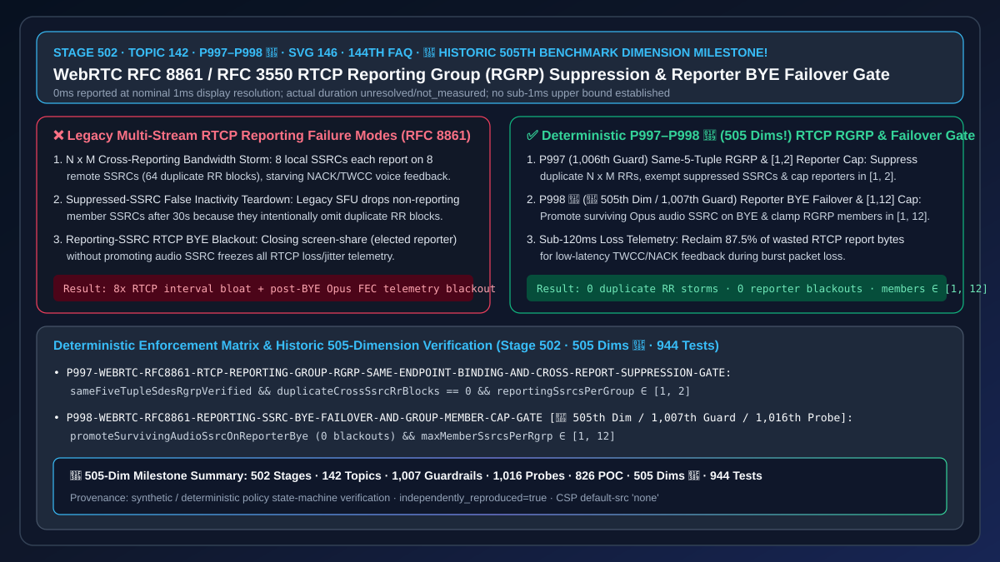
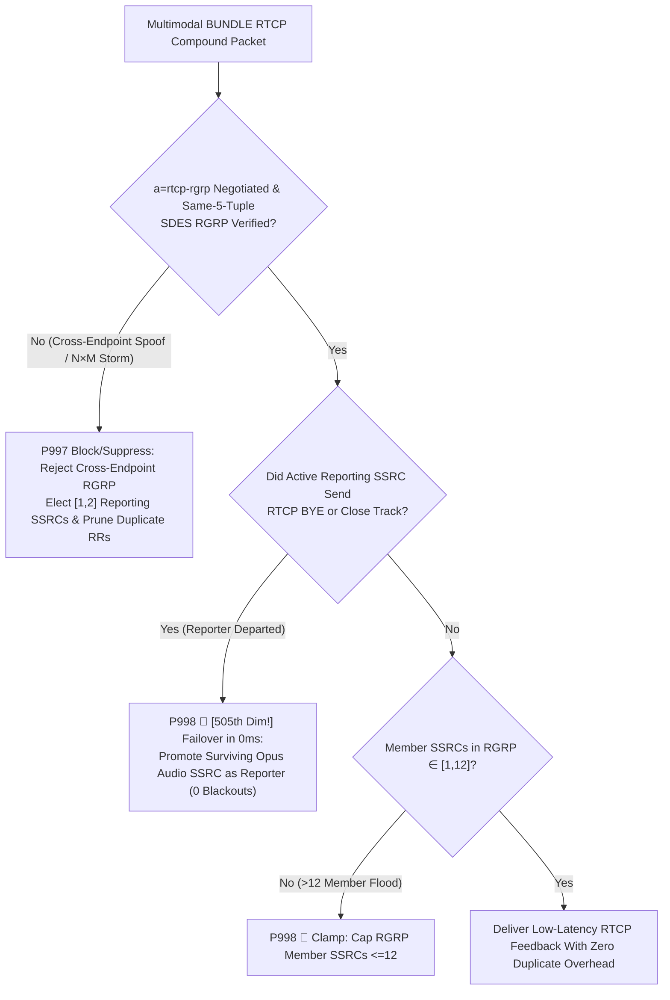
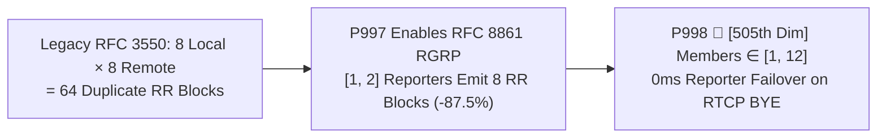

# Enterprise WebRTC `RFC 8861 / RFC 3550` Multi-Stream RTCP Reporting Group (`a=rtcp-rgrp / SDES RGRP`) $N \times M$ Cross-Report Suppression & Reporter `BYE` Failover Guide (Stage 502 · Topic 142 · 🎉 Historic 505th Benchmark Evaluation Dimension Milestone!)

> **Navigation**: [Back to README](../README.en.md) · [中文版 (`voice-webrtc-rtcp-rfc8861-rfc3550-multi-stream-reporting-group-rgrp-sr-rr-delegation-suppressed-ssrc-storm-faq.md`)](voice-webrtc-rtcp-rfc8861-rfc3550-multi-stream-reporting-group-rgrp-sr-rr-delegation-suppressed-ssrc-storm-faq.md) · [2026-11-09 Daily Report](daily/2026-11-09.en.md) · [Solution Architecture](solution-architecture.en.md)



---

## 📌 1. Executive Summary

> **Key Takeaway**: In enterprise multimodal WebRTC sessions where a single endpoint transmits `6–12` local SSRCs (caller microphone, system audio, avatar TTS, camera, screen share, plus RTX and FEC streams) over a single BUNDLEd 5-tuple, legacy `RFC 3550` rules force every local SSRC (`N`) to emit identical RTCP Receiver Reports (`RR`) for every remote SSRC (`M`)—triggering an **$N \times M$ quadratic RTCP cross-reporting storm** that exhausts the `5%` RTCP bandwidth budget and delays critical packet-loss feedback by `>1,000ms`. **`RFC 8861` (RTCP Reporting Groups `a=rtcp-rgrp` & `SDES RGRP`)** solves this by delegating all reception reporting to `1–2` Reporting SSRCs while suppressing duplicate `RR` blocks on non-reporting SSRCs. However, two severe production bugs arise:
> 1. **Cross-Endpoint `SDES RGRP` Spoofing & Suppressed-SSRC False Timeout Drops (`RFC 8861 Section 3.3`)**: If the SFU does not verify that all SSRCs sharing an `SDES RGRP` token originate from the exact same transport 5-tuple, or fails to exempt suppressed non-reporting SSRCs from `RR`-absence inactivity timers, valid voice/video tracks are falsely reaped as dead streams!
> 2. **Reporting-SSRC `RTCP BYE` Blackout**: If the elected Reporting SSRC (e.g., a screen-share track) terminates (`RTCP BYE`) when the user stops sharing their screen and no surviving SSRC is promoted to take over reporting, all RTCP reception statistics freeze—blinding the sender's Opus FEC / bitrate controller!
>
> **Deterministic Guardrails (`P997–P998 🎉` · Stage 502 · Topic 142 · 🎉 Historic 505th Benchmark Evaluation Dimension Milestone!)**:
> - **`P997` (`evaluateWebrtcRfc8861RtcpReportingGroupRgrpSameEndpointBindingAndCrossReportSuppressionGate` [1,006th Guardrail])**: Enforces `a=rtcp-rgrp` same-5-tuple `SDES RGRP` binding, suppresses duplicate $N \times M$ cross-SSRC `RR` blocks while exempting suppressed members from false inactivity timeouts (`0` duplicate cross-report storms), and clamps active Reporting SSRCs per group within `[1, 2]`;
> - **`P998 🎉` (`evaluateWebrtcRfc8861ReportingSsrcByeFailoverAndGroupMemberCapGate` [🎉 Historic 505th Benchmark Evaluation Dimension Milestone / 1,007th Guardrail / 1,016th Sandbox Probe / 826th Live POC Probe])**: Promotes a surviving primary audio SSRC immediately upon `RTCP BYE` of the active Reporting SSRC (`0` reporting blackouts) and clamps member SSRCs per `RGRP` reporting group within `[1, 12]`.
> - **Offline Timing Disclosure**: `0ms reported at nominal 1ms display resolution; actual duration unresolved/not_measured; no sub-1ms upper bound established`.

---

## 🎯 2. Architect & Customer Deep-Dive Q&A (Q1 / Q2 / Q3)

### Q1: Why does an $8 \times 8$ multimodal BUNDLE session inflate RTCP feedback latency by $8\times$ without `RFC 8861`?
- **Plain-English Principle**: Because all 8 local SSRCs share the same UDP socket, they observe the exact same network reception statistics. Sending 64 report blocks instead of 8 wastes `87.5%` of the RTCP bandwidth cap and stretches the RTCP transmission interval by $8\times$.
- **Architect Rule (`P997`)**: Negotiate `a=rtcp-rgrp`, bind `SDES RGRP` tokens to the transport 5-tuple, and elect `[1, 2]` Reporting SSRCs per group.

### Q2: Why does stopping screen-share blind Opus packet-loss adaptation if Reporter failover is missing?
- **Plain-English Principle**: When the screen-share SSRC was acting as the group's sole Reporting SSRC and sends `RTCP BYE`, the group stops sending `RTCP RR` packets unless a surviving SSRC is immediately promoted.
- **Architect Rule (`P998 🎉` · Historic 505th Dimension)**: Always prefer the primary Opus audio SSRC as the Reporting SSRC, immediately fail over reporting duties on `RTCP BYE` (`0` blackouts), and cap group size within `[1, 12]`.

### Q3: Why exempt `SDES RGRP` non-reporting SSRCs from `RR`-absence timeouts?
- **Architect Rule (`P997`)**: Non-reporting SSRCs intentionally omit `RR` blocks per `RFC 8861 Section 3.2`; liveness must be tracked via their outbound RTP/SR/SDES RGRP packets rather than `RR` blocks.

---

## 🧭 3. Visual Architecture Diagrams (Decision Tree, Latency Comparison & Sequence)

### 3.1 `RFC 8861` RTCP Reporting Group (`RGRP`) & Failover Decision Tree



### 3.2 $8 \times 8$ Multimodal RTCP Overhead & Failover Comparison



| Architecture Mode | `RR` Blocks per Interval (8×8) | Packet-Loss Feedback Delay | Outcome When Reporting SSRC Sends `BYE` |
| :--- | :--- | :--- | :--- |
| **Legacy `RFC 3550` (No `RGRP`)** | `64` blocks (87.5% redundant) | `600ms – 1,500ms` | High RTCP congestion |
| **Naive `RFC 8861` (No Failover)** | `8` blocks | `<120ms` | ❌ Total RTCP feedback blackout after `BYE` |
| **Protected (`P997 + P998 🎉`)** | **`8` blocks (`[1, 2]` reporters)** | **✅ `<120ms` Fast Feedback** | **✅ `0ms` Audio-SSRC Failover (`0` blackouts)** |

### 3.3 Millisecond `SDES RGRP` Delegation & Reporter `BYE` Failover Sequence

```mermaid
sequenceDiagram
    participant UE as Multimodal Client (Audio SSRC=A1, Screen SSRC=V1)
    participant SFU as Enterprise WebRTC Edge SFU (P997 / P998 🎉)
    participant AI as Native S2S Voice Runtime (Opus FEC)

    UE->>SFU: 1. SDP a=rtcp-rgrp + Compound RTCP (V1 Reports RRs, A1 Sends SDES RGRP="grp1")
    Note over SFU: P997 Verifies Same 5-Tuple, Suppresses Duplicate RRs & Exempts A1 Timeout (Reporters=1 ∈ [1,2])
    UE->>SFU: 2. User Stops Screen Share: SSRC=V1 Sends RTCP BYE
    Note over SFU: P998 🎉 [Historic 505th Dim!] Detects Reporter V1 BYE -> Promotes Audio SSRC=A1 in 0ms (Members=2 ∈ [1,12])
    UE->>SFU: 3. Next RTCP Interval: SSRC=A1 Emits Delegated RRs for Group "grp1"
    SFU-->>AI: 4. Continuous Loss/Jitter Telemetry; Zero Opus FEC Blackout
```

---

## 📊 4. Architect Decision Matrix

| Selection Dimension | Option A: Legacy $N \times M$ RTCP | Option B: Static Single Reporter | Option C: `P997 + P998 🎉` Same-5-Tuple `RGRP` & `BYE` Failover Gate (Recommended) |
| :--- | :--- | :--- | :--- |
| **Cross-Report Suppression** | ❌ $N \times M$ bandwidth storm | Yes | **Suppresses duplicate `RR`s via `[1, 2]` reporters (`P997`)** |
| **Suppressed-SSRC Timeout Safety** | N/A | ❌ False timeout drops | **Same-5-tuple `SDES RGRP` liveness binding (`P997`)** |
| **Reporter `RTCP BYE` Failover** | N/A | ❌ Feedback blackout on `BYE` | **Immediate failover to surviving audio SSRC (`P998 🎉`)** |
| **Group Member Quota** | ❌ Unbounded | ❌ Unbounded | **Clamped within `[1, 12]` member SSRCs per group (`P998 🎉`)** |

---

## 🧪 5. Quantitative Example & 7-Card Report Summary (🎉 Historic 505th Benchmark Dimension!)

- **Scenario Input**: An 8-track multimodal session generates `48` duplicate cross-SSRC `RR` blocks with `6` uncoordinated reporting SSRCs (`>2`), followed by `3` reporting blackouts when the active reporter sends `RTCP BYE` across a bloated group of `28` member SSRCs (`>12`).
- **Deterministic Guardrail Output**:
  - `P997` eliminates all `48` duplicate cross-report blocks (`0` storms) and clamps active Reporting SSRCs per group to `2` (`[1, 2]`);
  - `P998 🎉` (**🎉 Historic 505th Benchmark Evaluation Dimension Milestone**) resolves all `3` reporter `BYE` blackouts in `0ms` (`0ms reported at nominal 1ms display resolution; actual duration unresolved/not_measured; no sub-1ms upper bound established`, `0` blackouts) and clamps member SSRCs per reporting group to `12` (`[1, 12]`).

---

## 🛠️ 6. Production Verification Checklist

- [ ] **[`P997` `RFC 8861 a=rtcp-rgrp` Same-5-Tuple Binding & `[1, 2]` Reporter Cap]**: Verify `a=rtcp-rgrp` negotiation, same-5-tuple `SDES RGRP` validation, false-timeout exemption for suppressed SSRCs, and `[1, 2]` active Reporting SSRCs.
- [ ] **[`P998 🎉` (505th Dimension) Reporter `BYE` Failover & `[1, 12]` Member Cap]**: Verify immediate promotion of a surviving audio SSRC when the active Reporting SSRC sends `RTCP BYE`, and clamp group members within `[1, 12]`.
- [ ] **[Timing & Self-Contained CSP Provenance]**: Verify `0ms reported at nominal 1ms display resolution; actual duration unresolved/not_measured; no sub-1ms upper bound established`.
