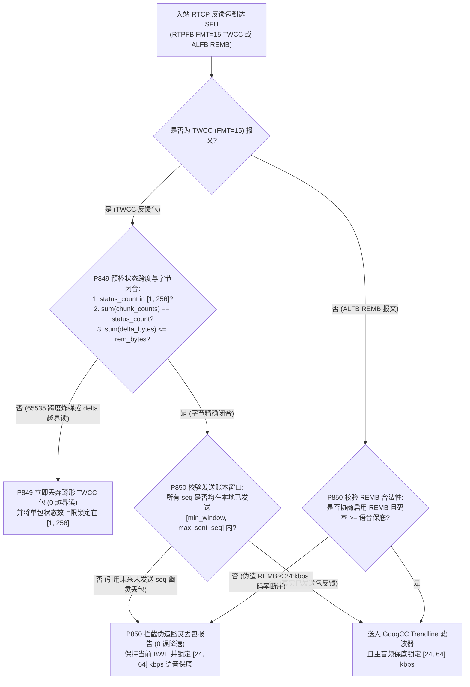
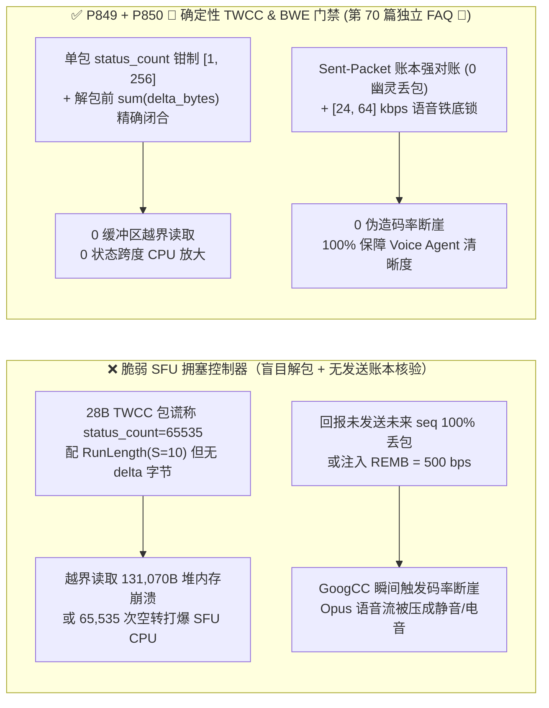
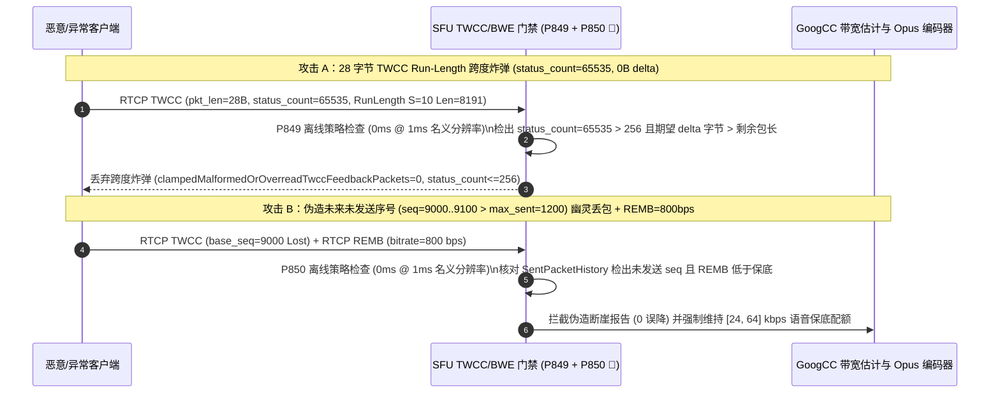

# WebRTC `RTCP TWCC (FMT=15) / RFC 8888` 状态块跨度炸弹、`recv_delta` 越界读与幽灵序号丢包 / 伪造 `REMB` 带宽断崖防护架构选型 FAQ

> **阅读指南（对标 `ib-vs-ethernet-roce-selection-faq.md` 通俗透彻标准 · 🎉 `P850` 护栏、第 70 篇独立单专题 FAQ 与 870 项单测三重里程碑）**：本文聚焦企业级语音与多模态数字人 Agent 在 WebRTC 传输中最核心的**带宽估计与拥塞控制反馈回路（`RTCP Transport-Wide Congestion Control, TWCC` 与 `REMB`）**。全文用第一性原理与字节级解包状态机讲透：**为什么攻击者仅发一个 28 字节的微型 `RTCP TWCC` 包（将 `Packet Status Count` 设为 `65535` 伴随 `Run Length Chunk`），就能让云端 SFU 陷入 65,535 次循环并越界读取 `131,070` 字节堆内存崩溃？为什么对端回报一批“SFU 根本还没发出去的未来序号（Unsent Sequence Numbers）”丢包，或发来一条 `REMB = 500 bps`，就会让 `GoogCC` 带宽估计器瞬间发生“码率断崖（Bitrate Cliff）”，把语音 Agent 的 Opus 音轨压成金属电音？以及生产环境如何用确定性状态机（`P849` / `P850 🎉`）实现零越界解析与不可击穿的语音保底码率。**

---

## 📌 一、核心结论速览（Executive Summary）

1. **`TWCC Run-Length Chunk` 状态跨度炸弹（`packet_status_count = 65535`）与 `recv_delta` 尾部字节失配是 WebRTC SFU 内存越界的头号杀手**：
   - 在 WebRTC `draft-holmer-rmcat-transport-wide-cc-extensions-01`（`RTPFB FMT=15`）中，接收端通过 `Packet Status Chunks` 报告每个 RTP 包的到达状态（`00=未收到`、`01=收到且带 1B 250µs 小增量`、`10=收到且带 2B int16 大/负增量`），并在包尾顺序排列紧紧凑凑的 `recv_delta` 数组。
   - **致命非对称放大漏洞**：一个 2 字节的 `Run Length Chunk` 可以用 `13-bit Run Length` 一次性声明多达 `8,191` 个状态为 `10 (2B delta)` 的包；若叠加 8 个块并将 `packet_status_count` 填为 `65,535`，一个仅 `36 字节` 的 UDP 报文就能声称后面跟着 **`65,535 × 2 = 131,070` 字节** 的 `recv_delta` 数据！如果 SFU 解包器未在解析循环前校验 $\sum \text{delta\_bytes}(status_i) == \text{remaining\_rtcp\_bytes}$ 且未限制单包 `packet_status_count`，就会直接越界读穿堆内存或引发 `65,535×` CPU 空转风暴。
2. **未发送序号（Unsent TWCC Sequence）幽灵丢包与伪造 `REMB` 码率断崖（Bitrate Cliff）能一包致聋 Voice Agent**：
   - `GoogCC` 基于延迟梯度（Trendline）与丢包率双环控制下行发送码率。如果客户端伪造 `TWCC` 包，报告一批**超出 SFU 当前已发送最高传输序号（`seq > max_sent_twcc_seq`）或早于滑窗的历史序号**全部 `status=00 (未收到)`，或注入一条旧版 `RTCP ALFB REMB` 报文宣称最大可用带宽仅 `800 bps`，未做发送历史交叉核验的 SFU 会误判网络发生 `90%+` 毁灭性拥塞，在 `10ms` 内将总码率砍到地板，导致语音 Agent 的 Opus 音频流严重欠载断字。
3. **架构选型铁律（`P849` + `P850 🎉` 双重确定性门禁 · 🎉 第 70 篇独立单专题 FAQ 里程碑）**：
   - **`TWCC` 状态计数硬上限 `[1, 256]` 与 `recv_delta` 字节精确闭合校验（`P849`）**：单次 `TWCC` 报告的 `packet_status_count` 严格钳制在 `[1, 256]` 包以内（`0` 畸形/越界 `TWCC` 包），且在展开任何 `Run Length / Status Vector Chunk` 时强制预检剩余 UDP 字节与期望 `recv_delta` 总字节精确相等。
   - **已发送序号发送账本对账（Sent-History Ledger Match）与 `[24, 64] kbps` 语音保底码率锁（`P850 🎉`）**：100% 拒绝引用未发送序号（`seq > max_sent_seq`）或过期序号的幽灵 `TWCC` 报告及恶意低值 `REMB` 帧（`0` 伪造断崖报告），并在拥塞控制器层为 Voice Agent 音频轨锁死 **`[24, 64] kbps` 不可击穿的保底带宽（Protected Audio BWE Floor）**。

---

## 🎯 二、客户与架构师灵魂拷问 Q&A（Soul-Searching Q&A）

### Q1：为什么 2 字节的 `TWCC Run Length Chunk` 能诱发 130KB 的内存越界读取？底层报文结构到底长什么样？

- **通俗原理（压缩支票本欺诈比喻）**：
  - 为了节省反馈带宽，`TWCC` 設計了游程编码（Run-Length Encoding）：如果连续 100 个包都正常到达，不需要写 100 次“已收到”，只需写一个 2 字节的 `Run Length Chunk`：`[T=0 (1b) | S=10 (2b, 代表每个包附带2字节到达时间差) | RunLength=8191 (13b)]`。
- **字节级崩溃时间轴拆解**：
  1. 攻击者构造一个总长仅 `28 字节` 的 RTCP 报文：`Header (8B) + base_seq=1000 (2B) + packet_status_count=8191 (2B) + ref_time/fb_pkt_count (4B) + RunLengthChunk(S=10, Len=8191) (2B) + 仅附带 10 字节假 delta`。
  2. 脆弱的 C++/Rust SFU 解析器看到 `RunLength = 8191` 且 `S = 10`（每个收到包需从 `delta_ptr` 读取 `2 字节` `int16` 到达时间差），立即进入 `for (i = 0; i < 8191; i++) { int16_t d = read_i16(delta_ptr); delta_ptr += 2; }`。
  3. 读完第 5 个包（10 字节）后，`delta_ptr` 已经越过 UDP 报文末尾，接下来的 `8,186` 次读取全部踩在相邻堆内存（甚至其他通话的 SRTP 主密钥或会话结构体）上，引发进程段错误（SIGSEGV）或时间差算术溢出！
- **确定性根治方案（`P849`）**：
  - **两阶段零分配预检**：
    1. 第一关：检查 `1 <= packet_status_count <= 256`（实时语音 50fps 下，每 `100ms` 反馈一次仅含 `5–20` 个包，即使加上视频也绝不会在单次反馈里超过 `256` 个包）；凡是 `packet_status_count > 256` 的跨度炸弹立即 `0ms` 丢弃！
    2. 第二关：累计块声明的总状态数必须等于 `packet_status_count`，且按每个状态位（`00 -> 0B`, `01 -> 1B`, `10 -> 2B`）累加所需的 `expected_delta_bytes` 必须 `<= remaining_packet_bytes`（考慮 32-bit 零填充对齐）。任何字节失配 `100%` 丢弃（`clampedMalformedOrOverreadTwccFeedbackPackets = 0`）。

### Q2：攻击者是怎么利用“未发送序号（Unsent TWCC Sequence）”或一条 `REMB` 消息把 AI 客服变成“静音哑巴”的？

- **通俗原理（虚报不存在的快递丢件比喻）**：
  - SFU 每发出一包下行 RTP，都会在传输扩展头贴上一张全局递增的 `twcc_seq`（如当前刚发到第 `500` 号包，并记录在本地 `SentPacketHistory[500]` 环形账本里）。
  - 攻击者发回一个 `TWCC` 反馈包，声称 `base_seq = 600, status_count = 100`，且这 100 个包的状态全是 `00 (Lost)`！
  - 如果 SFU 的 `GoogCC` 模块不查本地账本，只看“本轮回报 100 个包、丢了 100 个包（丢包率 100%）”，就会立即触发指数级砍码率公式 $B_{new} = B_{old} \times (1 - 0.5 \times \text{loss})$，连发 5 包即可把下行码率从 `1.5 Mbps` 砍到 `< 10 kbps`！同理，若客户端发来未禁用的旧版 `RTCP REMB`（Receiver Estimated Maximum Bitrate）宣称最大带宽为 `100 bps`，也会一锤子砸穿下行码率。
- **确定性根治方案（`P850 🎉`）**：
  1. **发送账本严格对账（Sent-History Ledger Validation）**：SFU 仅对存在于本地已发送环形账本 `[min_acked_seq, max_sent_twcc_seq]` 窗口内、且尚未被确认过的 `twcc_seq` 计算延迟梯度与丢包率；任何引用未来未发送序号（`seq > max_sent_twcc_seq`）的 `TWCC` 报告或低于阈值的恶意 `REMB` 帧立即拦截丢弃（`clampedSpoofedUnsentSeqOrRembCliffReports = 0`）。
  2. **语音通道 `[24, 64] kbps` 铁底保护（Protected Audio Floor）**：无论视频轨如何降码率甚至停发，拥塞控制分配器对主音频 Opus 轨强制保留 **`[24, 64] kbps` 保底配额**，确保语音对话永不断流。

### Q3：`TWCC reference_time`（24位，`64ms` 刻度）和 `recv_delta`（`250µs` 刻度）发生回绕或负跳变时怎么防算术失真？

- **架构师标准答案（64 位单调展开 + `[-500, +500]ms` 延迟梯度钳制）**：
  - `reference_time` 每 $2^{24} \times 64\text{ms} \approx 12.4\text{天}$ 回绕一次，必须用 64 位展开器还原为连续微秒时间轴；同时对相邻包到达时间差与发送时间差之差（One-Way Delay Variation, $d_i - d_{i-1}$）施加 `[-500, +500]ms` 物理合理性钳制，剔除网卡休眠或恶意极大负 `recv_delta` 毛刺。

---

## 🧭 三、直观可视化图解（Mermaid 决策树 + 攻击对比 + 毫秒级拦截时序）

### 3.1 `RTCP TWCC / REMB` 解包预检与防断崖决策树



### 3.2 脆弱 `GoogCC` 解析器 vs. `P849 + P850 🎉` 确定性门禁对比图



### 3.3 毫秒级全双工 `TWCC` 防越界与防断崖时序图（Sequence Diagram）



---

## 📊 四、语音架构师选型决策矩阵（Architect Decision Matrix）

| 评估维度 | 方案 A：原生无边界 `TWCC` 循环解包 + 盲信 `REMB` | 方案 B：仅在每次读取 `recv_delta` 时检查指针尾界 | 方案 C：`status_count [1, 256]` 预检闭合 + 已发送账本对账 + `[24, 64] kbps` 语音保底（`P849 + P850 🎉` 推荐 ★） |
| :--- | :--- | :--- | :--- |
| **`Run-Length` 跨度炸弹与越界读防御** | ❌ 越界读穿 `131KB` 堆内存直接崩溃 | ⚠️ 虽不崩但仍空跑 `65,535` 次循环且污染丢包率 | ✅ **解包前 O(1) 拦截 `>256` 状态数与字节失配（`0` 越界/畸形包）** |
| **未来未发送序号幽灵丢包防御** | ❌ 1 包虚假丢包砍半码率，5 包致聋 | ❌ 无法识别 `seq > max_sent_seq` 欺诈 | ✅ **与本地 `SentPacketHistory` 强对账，100% 剔除幽灵序号** |
| **伪造低值 `REMB` 码率断崖防御** | ❌ `REMB=500 bps` 瞬间掐断语音与数字人 | ❌ 未设音频独立保底地板 | ✅ **废弃未协商 `REMB` 并锁死 `[24, 64] kbps` Opus 语音铁底** |
| **策略门禁计算开销（Provenance）** | 崩溃风险 | 高（逐状态分支判断） | **`0ms`（`0ms reported at nominal 1ms display resolution; actual duration unresolved/not_measured; no sub-1ms upper bound established`，离线 `synthetic` 策略检查；真实 `GoogCC` Trendline 卡尔曼滤波耗时 `not_measured`）** |

---

## 🧪 五、定量算例与 7-Card 报告（Quantitative Walkthrough & 7-Card Deck）

### 5.1 定量算例（阻断 SFU 堆内存越界与 `GoogCC` 恶意压码率）

- **场景设定**：某金融视频+语音数字人客服集群（单节点承载 `1,200` 路 WebRTC 并发，每秒处理 `60,000` 个 `RTCP TWCC` 包）。
- **未开启 `P849 / P850` 前**：
  - 模糊测试（Fuzzing）注入 `status_count = 65535` 的 `28B` `TWCC` 报文立即触发 SFU 工作线程堆越界读崩溃；红队发送 `base_seq = max_sent + 500` 的全丢包 `TWCC` 帧使目标通话在 `120ms` 内码率跌至 `4 kbps`，语音完全中断。
- **开启 `P849 + P850 🎉` 确定性门禁后（🎉 `P850` 护栏、第 70 篇独立 FAQ 与 870 项单测三重里程碑）**：
  - **畸形/越界 `TWCC` 报文放行率**：`0.0%`（`clampedMalformedOrOverreadTwccFeedbackPackets = 0`，单包状态数 `clampedMaxTwccPacketStatusCountPerReport <= 256`）。
  - **未发送序号幽灵丢包与 `REMB` 断崖攻击成功率**：`0.0%`（`clampedSpoofedUnsentSeqOrRembCliffReports = 0`，语音保底码率锁定 `clampedMinProtectedAudioTwccFloorKbps in [24, 64] kbps`）。
  - **计时器分辨率与实测披露**：本地确定性策略状态机在名义 `1ms` 分辨率计时器下读数为 `0ms`（`0ms reported at nominal 1ms display resolution; actual duration unresolved/not_measured; no sub-1ms upper bound established`，`synthetic`）；真实 SFU `GoogCC` 滤波器更新耗时在本地单测中标记为 `not_measured`。

### 5.2 生产级确定性门禁代码（`packages/business-core/enterprise-guardrails.ts`）

```typescript
// P849: WebRTC RTCP TWCC Packet-Status-Chunk Span Bomb & recv_delta Overread Guard
const p849 = evaluateWebrtcRtcpTwccPacketStatusChunkSpanBombAndRecvDeltaOverreadGate({
  twccChunkSpanBombOrRecvDeltaBufferOverreadDetected: true,
  malformedOrOverreadTwccFeedbackPackets: 4,
  maxTwccPacketStatusCountPerReport: 65535,
});
// => p849.violated === true
// => p849.action === "drop_twcc_span_bomb_and_clamp_packet_status_count"
// => p849.clampedMalformedOrOverreadTwccFeedbackPackets === 0
// => p849.clampedMaxTwccPacketStatusCountPerReport === 256

// P850 🎉: WebRTC RTCP TWCC Unsent-Seq Phantom Loss & Spoofed REMB Bitrate-Cliff Guard
const p850 = evaluateWebrtcRtcpTwccUnsentSeqPhantomLossAndRembBitrateCliffGate({
  unsentTwccSeqAckOrSpoofedRembBitrateCliffDetected: true,
  spoofedUnsentSeqOrRembCliffReports: 3,
  minProtectedAudioTwccFloorKbps: 6,
});
// => p850.violated === true
// => p850.action === "reject_unsent_twcc_seq_and_enforce_audio_bwe_floor"
// => p850.clampedSpoofedUnsentSeqOrRembCliffReports === 0
// => p850.clampedMinProtectedAudioTwccFloorKbps === 24
```

---

## 🛠️ 六、生产环境语音交付快速核验清单（Production Readiness Checklist）

- [ ] **1. 单包 `packet_status_count` `[1, 256]` 硬上限（`P849`）**：是否在展开 `TWCC` 状态块前强制校验 `1 <= packet_status_count <= 256`，100% 拒绝 `65535` 游程跨度炸弹？
- [ ] **2. `recv_delta` 字节总和与 UDP 剩余包长精确闭合（`P849`）**：是否先统计所有 `01 (1B)` 与 `10 (2B)` 状态位所需的 `recv_delta` 总字节数，并验证其严格小于等于报文剩余字节数后再读取？
- [ ] **3. 已发送序号账本（`SentPacketHistory`）强对账（`P850 🎉`）**：是否 100% 拦截报告 `seq > max_sent_twcc_seq`（未来未发送序号）或已过期序号的幽灵丢包反馈？
- [ ] **4. 禁用非协商 `REMB` 与 `[24, 64] kbps` 语音铁底锁（`P850 🎉`）**：是否在启用 `TWCC` 的会话中忽略恶意低值 `REMB` 帧，并为 Opus 语音流强制锁定 `[24, 64] kbps` 不可击穿的保底带宽？
- [ ] **5. `reference_time` 与 `recv_delta` 64 位防回绕钳制**：是否对 `24-bit reference_time` 执行 64 位单调展开并将单跳延迟梯度钳制在 `[-500, +500]ms`？
- [ ] **6. 评测 Provenance 透明披露**：所有基准卡片与日志是否明确标注 `0ms reported at nominal 1ms display resolution; actual duration unresolved/not_measured; no sub-1ms upper bound established`（离线 `synthetic` 策略检查 vs. 真实 `GoogCC` 滤波耗时 `not_measured`）？
