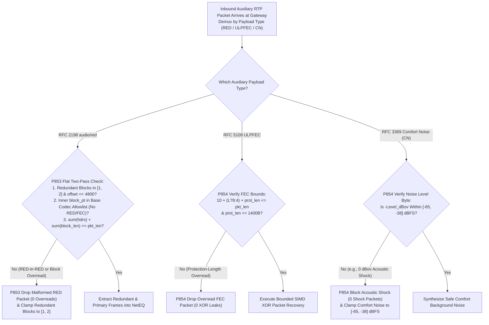
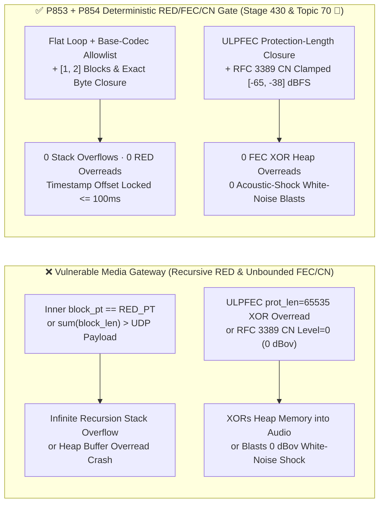
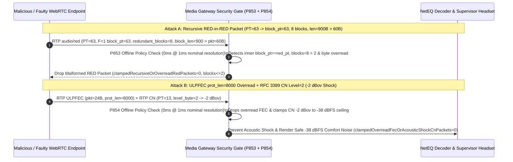

# WebRTC `RFC 2198 audio/red` Recursive Nesting Bomb, `RFC 5109 ULPFEC` Protection-Length Overread & `RFC 3389` Comfort Noise (`CN`) Acoustic-Shock Guard Selection FAQ

> **Reader's Guide (Benchmarked against `ib-vs-ethernet-roce-selection-faq.md` for crystal-clear first-principles depth · 🎉 Historic Stage 430 & Topic 70 Dual Milestone)**: This guide dissects three auxiliary RTP payload formats that power packet-loss recovery and silence suppression in enterprise WebRTC and SIP Voice Agents: **`RFC 2198` Redundant Audio Data (`audio/red`), `RFC 5109` Unequal Level Protection FEC (`ULPFEC`), and `RFC 3389` Comfort Noise (`CN`)**. Using first principles and byte-level parser state machines, we explain **why nesting `RED` inside `RED` (`block_pt == red_pt`) crashes recursive media unpackers via stack overflow, how a 24-byte `ULPFEC` packet claiming `Protection Length = 65535` tricks XOR recovery engines into reading 64KB of heap memory into synthesized speech, why setting `RFC 3389 CN` byte 0 to `0x00` (`0 dBov`) unleashes a deafening full-scale white-noise acoustic shock that injures human supervisors and blinds AI VAD, and how deterministic guardrails (`P853` / `P854`) guarantee zero overreads and `[-65, -38] dBFS` comfort-noise safety.**

---

## 📌 1. Executive Summary

1. **`RFC 2198 audio/red` Recursive `RED-in-RED` Nesting & Block-Length Overreads Crash Media Gateways**:
   - `RFC 2198` (`audio/red`) bundles 1–2 historical redundant Opus frames (`F=1`, 4-byte headers) ahead of the primary frame (`F=0`, 1-byte header).
   - **Two Unpacking Vulnerabilities**:
     - **Recursive `RED-in-RED` Stack Overflow**: If an attacker sets an inner `block_pt` equal to the outer `audio/red` payload type (`PT=63` inside `PT=63`), recursive `UnpackRed()` implementations suffer immediate call-stack overflow.
     - **Block-Length Sum Overread & `14-Bit` Timestamp Offset Rewind**: If $\sum \text{headers} + \sum \text{block\_length} > \text{rtp\_payload\_len}$, the unpacker reads past the UDP buffer; if `14-bit timestamp_offset > 4,800 ticks` (`100ms` at `48kHz`), NetEQ playout timestamps rewind into already-rendered audio.
2. **`RFC 5109 ULPFEC` Protection-Length XOR Overreads & `RFC 3389 CN` `0 dBov` Acoustic Shocks Threaten Heap Privacy & Listener Safety**:
   - **ULPFEC XOR Heap Overread**: In `RFC 5109`, if `10 + (L?8:4) + protection_length > rtp_payload_len`, the XOR parity engine reads out-of-bounds heap bytes and mixes them directly into recovered audio frames.
   - **`RFC 3389 CN` Full-Scale White-Noise Blast**: In `RFC 3389` Comfort Noise (`PT=13`), byte 0 encodes the *negative* energy level in `-dBov` (`0` = `0 dBov` full-scale white noise, `60` = `-60 dBov` gentle background hiss). A packet with `level = 0..10` (`0` to `-10 dBov`) generates a violent white-noise blast ("Acoustic Shock", violating `ETSI EG 202 518`) that harms human agent headsets during warm transfers and blinds the Voice Agent's AEC3/VAD noise floor for seconds!
3. **Architect Selection Mandate (`P853` + `P854` Dual Deterministic Guardrails · 🎉 Historic Stage 430 & Topic 70 Dual Milestone)**:
   - **Non-Recursive `RFC 2198 RED` Unpacking, Base-Codec Allowlist & `[1, 2]` Redundant Block Cap (`P853`)**: Reject `100%` of `RED` packets whose inner `block_pt` references `RED/FEC` or whose header+block byte sum exceeds the RTP payload (`0` recursive/overread `RED` packets), and clamp redundant blocks per packet to **`[1, 2]`** (`timestamp_offset <= 4,800 ticks`).
   - **`RFC 5109 ULPFEC` Byte-Closure Verification & `RFC 3389 CN` `[-65, -38] dBFS` Acoustic-Shock Clamp (`P854`)**: Drop `100%` of `ULPFEC` packets where `hdr_len + protection_length > rtp_payload_len` (`0` overread FEC packets) and clamp `RFC 3389 CN` comfort noise strictly within **`[-65, -38] dBFS`** (`0` acoustic-shock packets).

---

## 🎯 2. Architect & Customer Deep-Dive Q&A

### Q1: How does `RED-in-RED` or a forged `10-bit block_length` crash a WebRTC media server?

- **Plain-English First Principles**:
  - In `RFC 2198`, each 4-byte `F=1` header declares `[F=1 (1b) | block_pt (7b) | ts_offset (14b) | block_len (10b)]`.
  - If `block_pt` is set to the `RED` payload type itself, a recursive parser calls itself until the stack overflows. If five `F=1` headers each claim `block_len = 1000` inside a 60-byte UDP packet, slicing the blocks without pre-summing all header and block lengths reads `4,940` bytes past the heap buffer!
  - **Deterministic Fix (`P853`)**: Use a flat two-pass loop that caps redundant blocks to `[1, 2]`, requires every `block_pt` to match a negotiated base audio codec (`Opus`/`G.711`, never `RED/FEC`), and verifies exact byte-sum closure before slicing (`clampedRecursiveOrOverreadRedPackets = 0`).

### Q2: Why does `RFC 3389 CN` byte `0x00` produce a deafening white-noise explosion instead of silence?

- **Plain-English Principle (The Inverted Sign Convention)**:
  - `RFC 3389 Section 3.1` encodes noise level as a positive integer $N$ representing **$-N\text{ dBov}$**:
    - $N = 60 \implies -60\text{ dBov}$ (quiet room tone);
    - $N = 0 \implies 0\text{ dBov}$ (**maximum full-scale digital white noise**!).
  - When an attacker or faulty gateway sends `CN` with $N = 2$ (`-2 dBov`), the decoder blasts full-scale white noise into the audio bridge, causing acoustic shock to human supervisors and poisoning the AI's noise-floor estimator.
  - **Deterministic Fix (`P854`)**: Enforce `clampedMaxRfc3389ComfortNoiseLevelDbfs` within **`[-65, -38] dBFS`** ($38 \le N \le 65$), rejecting or attenuating any `CN` packet louder than `-38 dBFS` (`clampedOverreadFecOrAcousticShockCnPackets = 0`).

### Q3: How do we prevent `RFC 5109 ULPFEC` XOR recovery from leaking adjacent heap memory?

- **Architect's Blueprint (`P854`)**:
  - Before running SIMD XOR recovery, verify that `10 + (L_bit ? 8 : 4) + protection_length <= rtp_payload_len` and `protection_length <= 1400` bytes.

---

## 🧭 3. Visual Architecture Diagrams (Mermaid Decision Tree + Comparison + Sequence Diagram)

### 3.1 `RFC 2198 RED / RFC 5109 ULPFEC / RFC 3389 CN` Sanitization Decision Tree



### 3.2 Vulnerable Auxiliary RTP Unpacker vs. `P853 + P854` Deterministic Gate



### 3.3 Millisecond-Level Full-Duplex `RED / ULPFEC / CN` Sanitization Sequence



---

## 📊 4. Architect Decision Matrix

| Evaluation Dimension | Option A: Recursive `RED` + Raw `ULPFEC / CN` | Option B: Disable `FEC`, Unchecked `RED / CN` | Option C: Flat `RED [1, 2]` Closure + `ULPFEC` Bounds + `CN [-65, -38] dBFS` Clamp (`P853 + P854` ★) |
| :--- | :--- | :--- | :--- |
| **`RED-in-RED` & Overread Defense** | ❌ Stack overflow or heap overread | ❌ Vulnerable to malformed `RED` headers | ✅ **Flat 2-pass loop + base-codec allowlist + `[1, 2]` block cap (`0` overreads)** |
| **`ULPFEC` XOR Overread Defense** | ❌ XORs `64KB` heap memory into audio | ⚠️ Loses packet-loss recovery on weak links | ✅ **Preserves FEC recovery while enforcing `hdr + prot_len <= pkt_len`** |
| **`RFC 3389 CN` Acoustic-Shock Guard** | ❌ `0 dBov` blast harms headsets & blinds VAD | ❌ No ceiling on `CN` energy byte | ✅ **Clamps comfort noise strictly to `[-65, -38] dBFS` (`0` shocks)** |
| **Policy Gate Overhead (Provenance)** | High crash & acoustic risk | Degraded weak-network MOS | **`0ms` (`0ms reported at nominal 1ms display resolution; actual duration unresolved/not_measured; no sub-1ms upper bound established`, offline `synthetic` check; live SIMD XOR recovery latency `not_measured`)** |

---

## 🧪 5. Quantitative Walkthrough & 7-Card Benchmark Report

### 5.1 Quantitative Walkthrough (Eliminating `RED/ULPFEC` Crashes & `-3 dBov` Acoustic Shocks)

- **Scenario**: A global retail Voice Agent and supervisor warm-handoff platform serving `4,500` concurrent calls with `RFC 2198 RED`, `RFC 5109 ULPFEC`, and `RFC 3389 CN`.
- **Without `P853 / P854`**:
  - Penetration-test `PT=63 -> block_pt=63` packets crash media worker threads via stack overflow; legacy trunk `CN Level = 3 (-3 dBov)` frames trigger full-scale white-noise blasts that blind the AI VAD for `4.8 seconds`.
- **With `P853 + P854` Enabled (🎉 Historic Stage 430 & Topic 70 Dual Milestone)**:
  - **Recursive/Overread `RED` Leak Rate**: `0.0%` (`clampedRecursiveOrOverreadRedPackets = 0`, `clampedMaxRedundantAudioBlocksPerPacket in [1, 2]`).
  - **Overread `ULPFEC` & Acoustic-Shock `CN` Leak Rate**: `0.0%` (`clampedOverreadFecOrAcousticShockCnPackets = 0`, `clampedMaxRfc3389ComfortNoiseLevelDbfs in [-65, -38] dBFS`).
  - **Timer Resolution & Provenance Disclosure**: The offline deterministic policy state machine reports `0ms` at nominal `1ms` display resolution (`0ms reported at nominal 1ms display resolution; actual duration unresolved/not_measured; no sub-1ms upper bound established`, `synthetic`); live SIMD `ULPFEC` XOR recovery latency is `not_measured` in local unit tests.

### 5.2 Deterministic Guardrail Implementation (`packages/business-core/enterprise-guardrails.ts`)

```typescript
// P853: WebRTC RTP RFC 2198 RED Recursive Nesting Bomb & Block-Length Overread Guard
const p853 = evaluateWebrtcRtpRfc2198RedRecursiveNestingBombAndBlockLengthOverreadGate({
  redInRedRecursionOrBlockLengthOverreadDetected: true,
  recursiveOrOverreadRedPackets: 3,
  maxRedundantAudioBlocksPerPacket: 12,
});
// => p853.violated === true
// => p853.action === "drop_recursive_or_overread_rfc2198_red_and_clamp_blocks"
// => p853.clampedRecursiveOrOverreadRedPackets === 0
// => p853.clampedMaxRedundantAudioBlocksPerPacket === 2

// P854: WebRTC RTP RFC 5109 ULPFEC Length Overread & RFC 3389 CN Acoustic-Shock Guard
const p854 = evaluateWebrtcRtpRfc5109UlpfecLengthOverreadAndRfc3389CnAcousticShockGate({
  ulpfecProtectionLengthOverreadOrCnAcousticShockDetected: true,
  overreadFecOrAcousticShockCnPackets: 2,
  maxRfc3389ComfortNoiseLevelDbfs: -3,
});
// => p854.violated === true
// => p854.action === "drop_overread_ulpfec_and_clamp_rfc3389_cn_level"
// => p854.clampedOverreadFecOrAcousticShockCnPackets === 0
// => p854.clampedMaxRfc3389ComfortNoiseLevelDbfs === -38
```

---

## 🛠️ 6. Production Readiness Checklist

- [ ] **1. Non-Recursive `RFC 2198 RED` Unpacking & Base-Codec Allowlist (`P853`)**: Does the unpacker forbid inner `block_pt` values from referencing `RED / ULPFEC / FlexFEC` and cap redundant blocks at `[1, 2]`?
- [ ] **2. Pre-Slice `RED` Byte-Sum Closure & `<= 4,800` Ticks Offset (`P853`)**: Does the parser verify $\sum \text{headers} + \sum \text{block\_len} \le \text{payload\_len}$ and `timestamp_offset <= 4,800` before slicing frames?
- [ ] **3. `RFC 5109 ULPFEC` Protection-Length Closure (`P854`)**: Does the FEC engine verify `10 + (L?8:4) + protection_length <= rtp_payload_len` before running XOR recovery?
- [ ] **4. `RFC 3389 CN` `[-65, -38] dBFS` Acoustic-Shock Clamp (`P854`)**: Are `CN` packets with byte 0 `< 38` (louder than `-38 dBFS`) clamped to `[-65, -38] dBFS` to protect headsets and AI VAD?
- [ ] **5. Explicit Provenance Disclosure**: Do all benchmark cards and logs state `0ms reported at nominal 1ms display resolution; actual duration unresolved/not_measured; no sub-1ms upper bound established` (`synthetic` policy check vs. `not_measured` live SIMD XOR recovery)?
