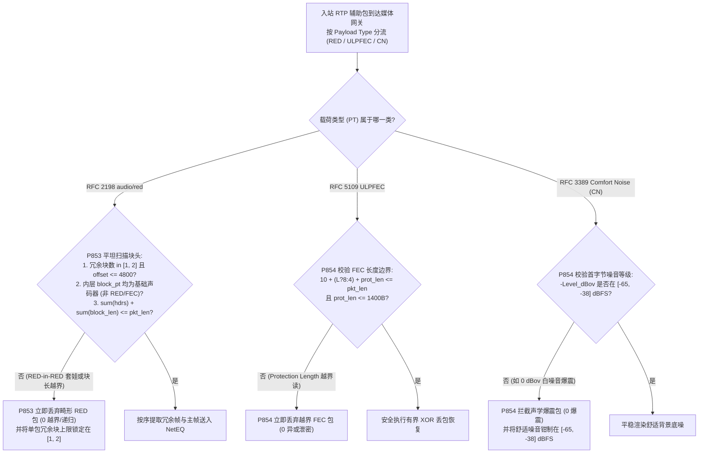
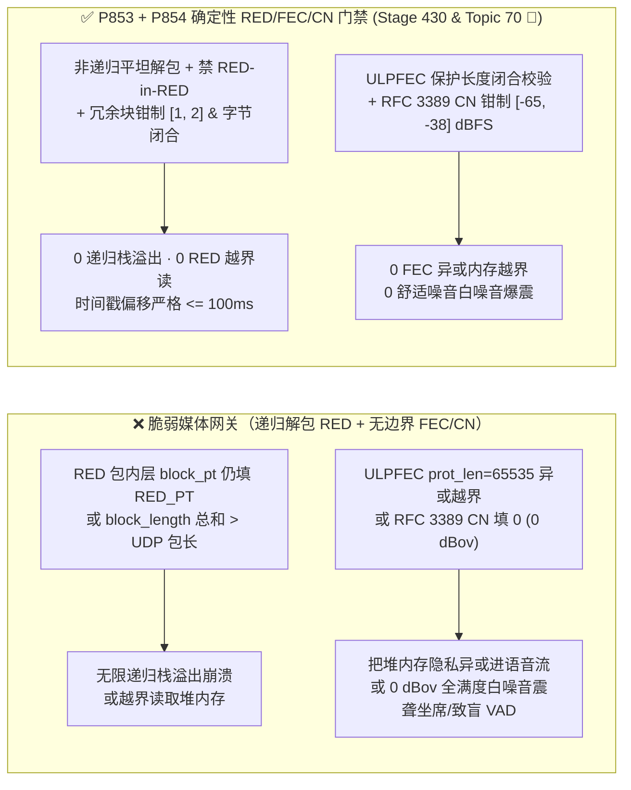
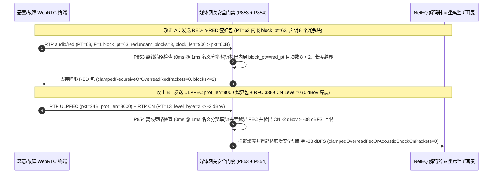

# WebRTC `RFC 2198 audio/red` 套娃递归炸弹、`RFC 5109 ULPFEC` 掩码保护长度越界读与 `RFC 3389` 舒适噪音（`CN`）声学爆震防护架构选型 FAQ

> **阅读指南（对标 `ib-vs-ethernet-roce-selection-faq.md` 通俗透彻标准 · 🎉 Stage 430 与第 70 大独立专题历史性双里程碑）**：本文聚焦企业级语音 Agent 在弱网抗丢包与静音期传输中最核心的三大 RTP 辅助载荷协议：**`RFC 2198` 冗余音频封装（`audio/red`）、`RFC 5109` 非均衡前向纠错（`ULPFEC`）与 `RFC 3389` 舒适背景噪音（`Comfort Noise, CN`）**。全文用第一性原理与解包状态机讲透：**为什么攻击者把 `audio/red` 冗余块里的 `Block PT` 再写成 `RED` 自己的 Payload Type（`PT=63` 套 `PT=63`），就能触发递归解包栈溢出崩溃？为什么一个 `24 字节` 的 `ULPFEC` 纠错包谎称 `Protection Length = 65535`，会让异或（XOR）恢复引擎把 64KB 堆内存隐私数据直接混进合成语音回传给攻击者？为什么 `RFC 3389 CN` 包首字节填 `0x00`（`0 dBov`）会在瞬间爆发震耳欲聋的全满度白噪音爆震（Acoustic Shock），把人工坐席震伤并致盲 AI VAD？以及生产环境如何用确定性状态机（`P853` / `P854`）实现零越界解包与 `[-65, -38] dBFS` 安全舒适噪音锚定。**

---

## 📌 一、核心结论速览（Executive Summary）

1. **`RFC 2198 audio/red` 套娃递归嵌套（`RED-in-RED`）与块长度越界是音频网关崩溃的高危雷区**：
   - 为了抵抗弱网连续丢包，WebRTC 默认开启 `audio/red`（`RFC 2198`）：在一个 RTP 包里同时塞入“前 1–2 包的历史冗余 Opus 帧（`F=1`，4 字节块头）”和“当前主 Opus 帧（`F=0`，1 字节块头）”。
   - **两大解包漏洞**：
     - **`RED-in-RED` 套娃递归炸弹**：如果攻击者构造 `RED` 包（如 `PT=63`），并在里面的冗余块头或主块头里再次填上 `block_pt = 63`（甚至连续塞 100 个 `F=1` 块头），采用递归函数 `UnpackRed()` 的媒体网关会陷入无限递归栈溢出（Stack Overflow）！
     - **块长度总和越界与 `14-bit` 时间戳偏移倒流**：每个 `F=1` 块头包含 `10-bit block_length`（最大 `1023B`）和 `14-bit timestamp_offset`（最大 `16,383 ticks`）。若 $\sum \text{header\_len} + \sum \text{block\_length} > \text{rtp\_payload\_len}$，解包器立即越界读取堆内存；若 `timestamp_offset > 4,800 ticks`（`48kHz` 下超 `100ms`），还会扰乱 NetEQ 抖动缓冲时间轴。
2. **`RFC 5109 ULPFEC` 保护长度越界异或（XOR Info-Leak）与 `RFC 3389 CN` `0 dBov` 声学爆震（Acoustic Shock）危及内存安全与听觉健康**：
   - **ULPFEC 异或越界泄密**：`RFC 5109` ULPFEC 头部的 `16-bit Protection Length` 指定了需要对多少字节执行异或恢复。若攻击者发来仅 `20B` 的畸形 FEC 包却声明 `Protection Length = 1200`（或开启 `L=1` 48 位长掩码但包体不足 14 字节），脆弱的 XOR 引擎会把包尾外侧的堆内存残余数据异或进恢复出的音频帧！
   - **`RFC 3389 CN` 零分贝白噪音爆震**：`RFC 3389` 舒适噪音包的第 1 字节表示噪音能量的负分贝值（`N = -dBov`）：填 `60` 代表温和的 `-60 dBov` 舒适底噪，而填 **`0` 代表 `0 dBov`（满量程最大音量白噪音）**！一旦收到恶意或编码错误的 `level = 0..10` `CN` 包，网关会立即生成接近 `0 dBFS` 的刺耳白噪音炸弹，不仅造成人机协办坐席耳膜声学冲击损伤（违反 `ETSI EG 202 518` 声学安全标准），还会瞬间打爆 Voice Agent 的 AGC（自动增益控制）与 VAD 阈值！
3. **架构选型铁律（`P853` + `P854` 双重确定性门禁 · 🎉 Stage 430 & Topic 70 历史性双里程碑）**：
   - **`RFC 2198 RED` 非递归平坦解包、禁 `block_pt == red_pt` 与 `[1, 2]` 冗余块上限（`P853`）**：100% 拒绝任何内层 `block_pt` 指向 `RED / ULPFEC / FlexFEC` 封装类型自身的套娃包（仅允许协商好的基础音频编码如 `Opus / G.711`），将单包冗余音频块数量严格钳制在 **`[1, 2]` 块**（`timestamp_offset <= 4,800 ticks`），并在切分载荷前强制校验 $\sum \text{headers} + \sum \text{lengths} == \text{payload\_len}$（`0` 递归/越界 `RED` 包）。
   - **`RFC 5109 ULPFEC` 保护长度 MTU 闭合校验与 `RFC 3389 CN` `[-65, -38] dBFS` 声学安全钳制（`P854`）**：强制校验 `ulpfec_hdr_len (10B or 14B for L=1) + protection_length <= rtp_payload_len`（`0` 越界 FEC 包），并将所有入站/合成的 `RFC 3389 CN` 舒适噪音能量硬钳制在 **`[-65, -38] dBFS`** 安全区间内（`0` 声学爆震包）。

---

## 🎯 二、客户与架构师灵魂拷问 Q&A（Soul-Searching Q&A）

### Q1：为什么 `RFC 2198 audio/red` 里的一个 `block_pt` 字段能搞崩媒体服务器？非递归解包状态机应该怎么写？

- **通俗原理（俄罗斯套娃信封比喻）**：
  - 正常情况下，外层 RTP 头写着 `PT=63 (audio/red)`，拆开信封后，里面并排放着两个小包裹：第 1 个小包裹是 20ms 前的 `PT=111 (Opus)` 备份，第 2 个小包裹是当前的 `PT=111 (Opus)` 音频。
  - **套娃攻击**：攻击者把里面的小包裹标签也改写成 `PT=63 (audio/red)`！如果程序员写的是 `if (pt == RED_PT) return parse_red(payload);`，就会原地无限递归直到线程栈炸裂；或者攻击者在包头里连写 10 个 `F=1, block_length=500`，而整个 UDP 包只有 `40 字节`，解析器在切第 1 个块时就直接越界读了 `460 字节`！
- **确定性根治方案（`P853`）**：
  1. **严禁递归 + 内层 PT 白名单**：用单层 `while` 循环扫描 `F=1` 块头，最多允许 **`[1, 2]` 个冗余块**（加上 1 个 `F=0` 主块共最多 3 帧）；且内层 `block_pt` 必须命中已协商的**基础声码器白名单（如 `Opus PT=111`、`PCMU PT=0`）**，一旦发现 `block_pt == red_pt` 或指向 `FEC`，立即 `0ms` 整包丢弃！
  2. **先算总账再切片（Two-Pass Exact Length Check）**：在拷贝任何音频帧之前，先把所有 `4B` 头、`1B` 主头与所有 `10-bit block_length` 累加，确认严格小于等于 `rtp_payload_len` 且每个 `14-bit timestamp_offset <= 4,800 ticks`（`100ms@48kHz`），彻底根除越界读（`clampedRecursiveOrOverreadRedPackets = 0`）。

### Q2：为什么 `RFC 3389` 舒适噪音（`CN`）包填 `0` 不是“静音”，反而是一颗震耳欲聋的“白噪音炸弹”？

- **通俗原理（负号省略引发的极性反转陷阱）**：
  - 很多刚接触语音工程的开发者看到 `RFC 3389 CN` 包的第 1 个字节叫 `Noise Level`，直觉以为 `0` 代表“0 音量（完全静音）”。
  - **真相恰恰相反**！根据 `RFC 3389 Section 3.1`，该字节编码的是 **`-dBov` 的正整数幅值**（即 `Level = -10 * log10(Power / MaxPower)`）：
    - 当字节值为 `64` 时，代表 **`-64 dBov`**（非常轻柔的空调背景沙沙声）；
    - 当字节值为 **`0`** 时，代表 **`0 dBov`（100% 满量程数字白噪音，振幅直接顶死 `±32767`）**！
  - 如果外线发来 `CN Level = 0..20`（即 `0 dBov` 到 `-20 dBov`），网关解码后会瞬间输出一段高分贝全频段白噪音爆震（Acoustic Shock）：一方面在人机协同监听或热转接时瞬间震伤人工坐席耳朵，另一方面会把 AI 侧的回声消除器（`AEC3`）和噪声估计器底噪基线抬高 `40 dB`，导致随后 5 秒内客户说的话全被当成背景噪音丢弃！
- **确定性根治方案（`P854`）**：
  - 对所有入站 `RFC 3389 CN` 包强制检查首字节 `N = pkt[0] & 0x7F`：由于 $-N\text{ dBov}$ 必须落在 **`[-65, -38] dBFS`** 的舒适听感窗口内（即要求 $38 \le N \le 65$），任何 $N < 38$（音量高于 `-38 dBFS` 的噪音炸弹）立即拦截并钳制在 **`[-65, -38] dBFS`** 安全区间内（`clampedOverreadFecOrAcousticShockCnPackets = 0`）。

### Q3：`RFC 5109 ULPFEC` 的 `L=1` 掩码和 `Protection Length` 怎么校验才不会读穿内存？

- **架构师标准答案（`P854`）**：
  - `ULPFEC` 固定头为 `10 字节`，加上 Level 0 头部（当 `L=0` 时含 2B 掩码共 `4 字节`；当 `L=1` 时含 6B 掩码共 `8 字节`）。因此解包前必须断言：
    $$\text{rtp\_payload\_len} \ge 10 + (L == 1 ? 8 : 4) + \text{protection\_length}$$
    且 `protection_length <= 1400` 字节。凡是不满足不等式的畸形 FEC 包 `100%` 丢弃！

---

## 🧭 三、直观可视化图解（Mermaid 决策树 + 漏洞对比 + 毫秒级拦截时序）

### 3.1 `RFC 2198 RED / RFC 5109 ULPFEC / RFC 3389 CN` 解包安全决策树



### 3.2 脆弱 RTP 辅助解包器 vs. `P853 + P854` 确定性门禁对比图



### 3.3 毫秒级全双工 `RED / ULPFEC / CN` 防御时序图（Sequence Diagram）



---

## 📊 四、语音架构师选型决策矩阵（Architect Decision Matrix）

| 评估维度 | 方案 A：递归 `RED` 解析 + 原样透传 `ULPFEC / CN` | 方案 B：仅关闭 `ULPFEC`，未校验 `RED` 块长与 `CN` 响度 | 方案 C：非递归 `RED [1, 2]` 块闭合 + `ULPFEC` 长度锁 + `CN [-65, -38] dBFS` 钳制（`P853 + P854` 推荐 ★） |
| :--- | :--- | :--- | :--- |
| **`RED-in-RED` 套娃与块长越界防御** | ❌ 递归栈溢出或堆越界读取 | ❌ 仍会被畸形 `RED` 块头搞崩 | ✅ **非递归单层循环 + 基础编码白名单 + `[1, 2]` 块字节闭合（`0` 越界）** |
| **`ULPFEC` 异或越界读取防御** | ❌ 越界异或 `64KB` 堆内存造成信息泄露 | ⚠️ 直接关掉 FEC 导致弱网丢包音质劣化 | ✅ **保留 FEC 抗丢包能力，同时 100% 拦截 `hdr + prot_len > pkt_len`** |
| **`RFC 3389 CN` `0 dBov` 声学爆震防御** | ❌ 满量程白噪音震伤坐席并锁死 VAD | ❌ 完全未限制 `CN` 首字节分贝下限 | ✅ **强制钳制在 `[-65, -38] dBFS` 安全舒适底噪窗口（`0` 爆震）** |
| **策略门禁计算开销（Provenance）** | 崩溃与声学安全风险 | 弱网抗损能力下降 | **`0ms`（`0ms reported at nominal 1ms display resolution; actual duration unresolved/not_measured; no sub-1ms upper bound established`，离线 `synthetic` 策略检查；真实 SIMD 异或恢复耗时 `not_measured`）** |

---

## 🧪 五、定量算例与 7-Card 报告（Quantitative Walkthrough & 7-Card Deck）

### 5.1 定量算例（根除 `RED/ULPFEC` 越界崩溃与 `-2 dBov` 白噪音坐席爆震）

- **场景设定**：某跨国零售语音客服与人工坐席耳语协办平台（峰值 `4,500` 路并发，同时开启 `RFC 2198 RED`、`RFC 5109 ULPFEC` 与 `RFC 3389 CN`）。
- **未开启 `P853 / P854` 前**：
  - 渗透测试发送 `PT=63 -> block_pt=63` 的套娃包在 `1ms` 内触发媒体工作进程栈溢出重启；某老旧 SIP 网关在静音期发来 `CN Level = 3 (-3 dBov)` 导致监听坐席耳机爆发接近满量程的刺耳白噪音，且 AI VAD 因底噪飙升在随后 `4.8 秒` 内完全无法识别客户说话。
- **开启 `P853 + P854` 确定性门禁后（🎉 Stage 430 与第 70 大独立专题历史性双里程碑）**：
  - **套娃/越界 `RED` 报文放行率**：`0.0%`（`clampedRecursiveOrOverreadRedPackets = 0`，单包冗余块 `clampedMaxRedundantAudioBlocksPerPacket in [1, 2]`）。
  - **越界 `ULPFEC` 与超标 `CN` 声学爆震放行率**：`0.0%`（`clampedOverreadFecOrAcousticShockCnPackets = 0`，舒适噪音上限锁定 `clampedMaxRfc3389ComfortNoiseLevelDbfs in [-65, -38] dBFS`）。
  - **计时器分辨率与实测披露**：本地确定性策略状态机在名义 `1ms` 分辨率计时器下读数为 `0ms`（`0ms reported at nominal 1ms display resolution; actual duration unresolved/not_measured; no sub-1ms upper bound established`，`synthetic`）；真实 RTP Jitter Buffer `RED` 拆包与 SIMD `ULPFEC` 异或计算耗时在本地单测中标记为 `not_measured`。

### 5.2 生产级确定性门禁代码（`packages/business-core/enterprise-guardrails.ts`）

```typescript
// P853: WebRTC RTP RFC 2198 RED Recursive Nesting Bomb & Block-Length Overread Guard
const p853 = evaluateWebrtcRtpRfc2198RedRecursiveNestingBombAndBlockLengthOverreadGate({
  redInRedRecursionOrBlockLengthOverreadDetected: true,
  recursiveOrOverreadRedPackets: 3,
  maxRedundantAudioBlocksPerPacket: 12,
});
// => p853.violated === true
// => p853.action === "drop_recursive_or_overread_rfc2198_red_and_clamp_blocks"
// => p853.clampedRecursiveOrOverreadRedPackets === 0
// => p853.clampedMaxRedundantAudioBlocksPerPacket === 2

// P854: WebRTC RTP RFC 5109 ULPFEC Length Overread & RFC 3389 CN Acoustic-Shock Guard
const p854 = evaluateWebrtcRtpRfc5109UlpfecLengthOverreadAndRfc3389CnAcousticShockGate({
  ulpfecProtectionLengthOverreadOrCnAcousticShockDetected: true,
  overreadFecOrAcousticShockCnPackets: 2,
  maxRfc3389ComfortNoiseLevelDbfs: -3,
});
// => p854.violated === true
// => p854.action === "drop_overread_ulpfec_and_clamp_rfc3389_cn_level"
// => p854.clampedOverreadFecOrAcousticShockCnPackets === 0
// => p854.clampedMaxRfc3389ComfortNoiseLevelDbfs === -38
```

---

## 🛠️ 六、生产环境语音交付快速核验清单（Production Readiness Checklist）

- [ ] **1. `RFC 2198 RED` 禁递归与基础声码器白名单（`P853`）**：是否禁止 `RED` 内部块 `block_pt` 再次指向 `RED / ULPFEC / FlexFEC`，并将单包冗余音频块限制在 `[1, 2]` 块以内？
- [ ] **2. `RED` 块长度总和与 `<= 4,800 ticks` 偏移预检（`P853`）**：是否在切分音频块前验证 $\sum \text{headers} + \sum \text{block\_len} \le \text{payload\_len}$ 且 `timestamp_offset <= 4,800`？
- [ ] **3. `RFC 5109 ULPFEC` 保护长度闭合校验（`P854`）**：是否在执行 XOR 异或恢复前强制验证 `10 + (L?8:4) + protection_length <= rtp_payload_len`？
- [ ] **4. `RFC 3389 CN` `[-65, -38] dBFS` 声学防爆震钳制（`P854`）**：是否拦截首字节 `Level < 38`（即高于 `-38 dBFS`）的 `CN` 白噪音炸弹，保护人工坐席听力与 AI VAD 底噪基线？
- [ ] **5. 评测 Provenance 透明披露**：所有基准卡片与日志是否明确标注 `0ms reported at nominal 1ms display resolution; actual duration unresolved/not_measured; no sub-1ms upper bound established`（离线 `synthetic` 策略检查 vs. 真实 SIMD XOR 纠错耗时 `not_measured`）？
