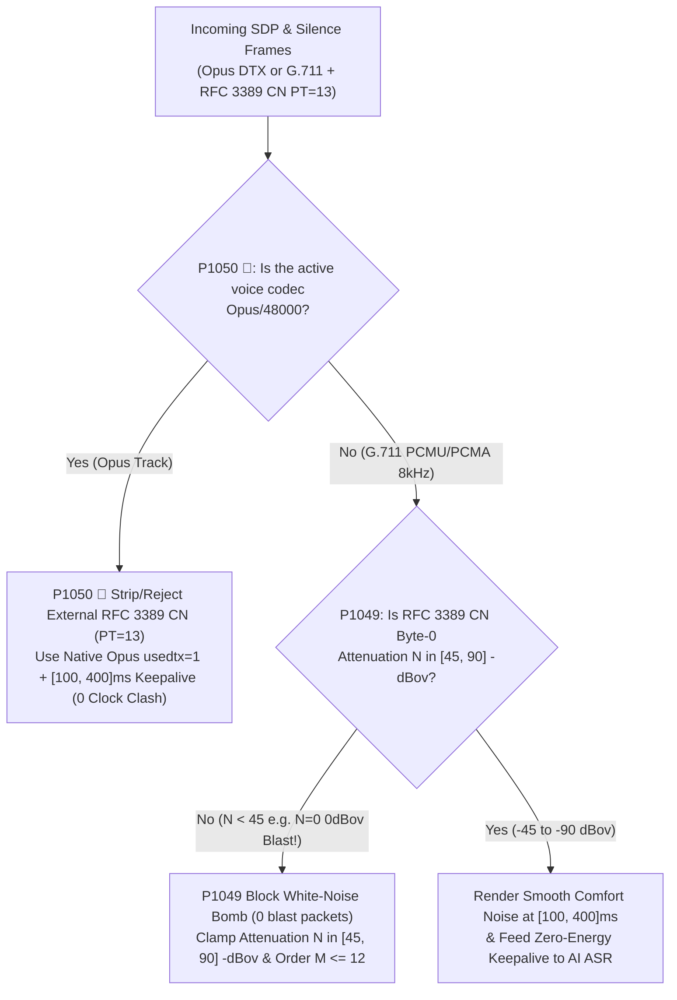
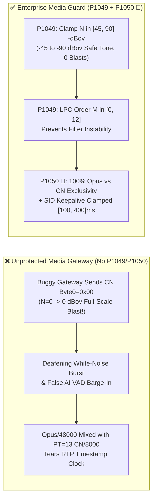

# Enterprise WebRTC/RTP `RFC 3389 / RFC 7587` Comfort Noise (`CN` / `PT=13`) `0 dBov` White-Noise Blast, Reflection Coefficient Instability & Opus In-Band DTX Mutual Exclusivity Selection & Engineering Guide (Stage 528 · Topic 168 · 🎉 Historic `P1050` Guardrail, 170th Standalone FAQ & 970-Test Triple Milestone!)

> **Document Type**: Enterprise Voice Architect "First-Principles + Selection Decision" Single-Topic FAQ (aligned with `ib-vs-ethernet-roce-selection-faq.md`)
> **Baseline**: `Stage 528` · `Topic 168` · Deterministic Guardrails `P1049–P1050 🎉` · 1,059 Guardrails · 1,068 Sandbox Probes · 878 Live POC Trap Probes · 531 Evaluation Dimensions · **🎉 Historic `P1050` Guardrail, 170th Standalone FAQ & 970-Test Triple Milestone!**
> **Bilingual Edition**: [中文版 (`voice-webrtc-rtp-rfc3389-comfort-noise-cn-pt13-sid-noise-level-blast-reflection-coefficient-opus-dtx-conflict-faq.md`)](./voice-webrtc-rtp-rfc3389-comfort-noise-cn-pt13-sid-noise-level-blast-reflection-coefficient-opus-dtx-conflict-faq.md)


---

## ① 📌 Executive Summary

In enterprise AI contact centers bridging WebRTC and PSTN/SIP trunks, **Discontinuous Transmission (DTX)** and **`RFC 3389` Comfort Noise (`CN`, static `PT=13`)** generate synthetic background noise during silence periods to prevent "dead air" anxiety while saving bandwidth. However, two notorious protocol traps in `RFC 3389` and **`RFC 7587` (Opus RTP Payload Format)** routinely cause severe production incidents:
1. **The `RFC 3389` Byte-0 Sign-Inversion Trap (`N = 0` Means `0 dBov` Full-Scale White-Noise Blast, NOT Silence!)**: Under `RFC 3389 §3.1`, the 7-bit noise level field `N` encodes the **magnitude of negative attenuation in `-dBov`** (`Power = -N dBov`). Thus, **`N = 127` is `-127 dBov` silence, whereas `N = 0` (`0x00`) is `0 dBov` full-scale white noise**! Buggy SIP gateways or malicious packets sending `0x00` during silence blast maximum-volume white noise into user headsets and trigger false barge-in interrupts on the AI Voice Agent's VAD.
2. **Mixing Opus (`48000 Hz`) with External `RFC 3389 CN` (`8000 Hz`, Violating `RFC 7587 §6.1`)**: Opus includes native internal DTX (`usedtx=1`). Injecting `PT=13 (CN/8000)` packets into an active `Opus/48000` SSRC switches the RTP timestamp clock rate from `48 kHz` (`+960 / 20ms`) to `8 kHz` (`+160 / 20ms`) mid-stream, corrupting NetEQ jitter buffers.

**Architect Selection Rules**:
- **Guardrail `P1049` (`RFC 3389` Comfort Noise Attenuation `[45, 90] -dBov` Floor & LPC Model Order `[0, 12]` Gate)**: Rejects/clamps any `RFC 3389` `CN` frame with `N < 45` (`> -45 dBov`), clamping `N` into **`[45, 90] -dBov`** (`-45` to `-90 dBov` safe room tone, `0` white-noise blast packets) and verifying LPC reflection order `M <= 12`.
- **Guardrail `P1050 🎉` (🎉 Historic `P1050` Guardrail, 170th Standalone FAQ & 970-Test Triple Milestone · `RFC 7587 §6.1` Opus vs. External `RFC 3389 CN` Mutual Exclusivity & `[100, 400]ms` SID Keepalive Interval)**: Forbids external `RFC 3389 CN` on Opus streams (`0` clock-clash packets) and clamps DTX/SID keepalive intervals to **`[100, 400]ms`**.

---

## ② 🎯 Architect & Customer Deep-Dive Q&A (Q1 / Q2 / Q3)

### Q1: Why did a legacy SIP trunk blast deafening white noise and falsely interrupt the AI Agent every time the caller stopped speaking?
- **Plain-Language Principle**: The trunk engineer assumed `0x00` in a Comfort Noise packet meant "zero volume". In `RFC 3389 §3.1`, `N` is **negative dB relative to overload (`-dBov`)**, so `N = 0` means **`0 dBov` (100% digital full-scale white noise)**!
- **Engineering Fix**: `P1049` enforces `N in [45, 90] -dBov` (`-45 dBov` to `-90 dBov`), neutralizing `0x00` noise bombs before they reach the user or the AI VAD.

### Q2: Why does `RFC 7587 §6.1` strictly forbid using `RFC 3389 CN` with Opus?
- **Protocol Reality**: `RFC 7587 §6.1` states: *"The comfort noise (CN) payload format specified in [RFC3389] MUST NOT be used with Opus."* Mixing `Opus/48000` with `CN/8000` breaks RTP timestamp continuity on the same SSRC. `P1050 🎉` strips external `CN` from Opus negotiations and uses native `usedtx=1`.

### Q3: Why must SID/DTX keepalive frames be bounded within `[100, 400]ms` during prolonged silence?
- **Architectural Rule**: Complete RTP silence for `> 5–15s` causes enterprise NATs to drop UDP bindings and cloud streaming ASR engines to abort with `NoAudioTimeout`. Clamping SID/DTX intervals to **`[100, 400]ms`** (`P1050 🎉`) keeps both NAT pinholes and streaming ASR timers alive at `< 1 kbps`.

---

## ③ 🧭 Visual Architecture Diagrams (Mermaid Decision Tree + Comparison + Sequence Diagram)

### 3.1 `RFC 3389 CN` & `RFC 7587 Opus DTX` Decision Tree (`flowchart TD`)



### 3.2 Unprotected Comfort Noise vs. `P1049 + P1050 🎉` Guardrails (`flowchart LR`)



### 3.3 Full-Duplex Silence Transition & Noise-Bomb Interception Sequence (`sequenceDiagram`)

```mermaid
sequenceDiagram
    autonumber
    participant PSTN as Remote PSTN/SIP Gateway
    participant Edge as AI Voice Media Guard (P1049 / P1050 🎉)
    participant Agent as AI Voice VAD / ASR Engine

    PSTN->>Edge: 1. SDP Offer: m=audio RTP/AVP 111 0 13 (Opus/48000 + PCMU/8000 + CN/8000)
    Note over Edge: P1050 🎉 Check: Strip external CN(13) when Opus(111) is active!<br/>Enforce 48kHz clock continuity & [100, 400]ms DTX keepalive
    Edge-->>PSTN: 2. SDP Answer (Opus with native DTX; CN restricted to G.711 fallback)
    Note over PSTN,Edge: Fallback G.711 Call: Caller pauses speaking -> Silence Period
    PSTN->>Edge: 3. RTP PT=13 (RFC 3389 CN, Byte0=0x03 -> N=3 = -3 dBov White-Noise Bomb! ❌)
    Note over Edge: P1049 Intercept: N=3 (-3 dBov) < 45 minimum attenuation!<br/>Clamp to N=45 (-45 dBov safe comfort noise)
    Edge->>Agent: 4. Deliver -45 dBov Quiet Frame (VAD stays Quiet, 0 False Barge-In)
    Note over Edge,Agent: P1050 🎉 emits SID keepalive every 200ms (in [100, 400]ms)
```

---

## ④ 📊 Architect Decision Matrix

| Dimension | Option A: Disable DTX/CN | Option B: Permissive `RFC 3389 CN` (No `P1049/P1050`) | Option C: `P1049/P1050 🎉` Deterministic Guardrails (Recommended ✅) |
| :--- | :--- | :--- | :--- |
| **`N=0` (`0 dBov`) White-Noise Bomb Protection** | No CN frames | ❌ `0x00` blasts `0 dBov` noise & trips AI VAD | ✅ **`P1049` clamps attenuation `N in [45, 90] -dBov` (`0` blasts)** |
| **Opus `48kHz` vs. `CN 8kHz` Clock Isolation** | Single codec | ❌ Mixing `PT=111` & `PT=13` breaks NetEQ | ✅ **`P1050 🎉` enforces 100% Opus vs. `RFC 3389 CN` exclusivity** |
| **Silence NAT & Streaming ASR Keepalive** | Constant 50 pps | ❌ `2500ms+` gaps drop NAT & ASR streams | ✅ **`P1050 🎉` clamps SID keepalive interval in `[100, 400]ms`** |
| **Policy Check Latency (Offline `synthetic`)** | N/A | N/A | **`0ms` (`nominal 1ms` resolution; see disclosure below)** |

---

## ⑤ 🧪 Quantitative Example & 7-Card Report (CSP Self-Contained, Zero Fabricated Coordinates)

### 5.1 Deterministic Guardrail Walkthrough (`P1049` & `P1050 🎉`)

1. **`P1049` (`evaluateWebrtcRfc3389ComfortNoiseLevelAttenuationAndModelOrderGuard` · 1,058th Guardrail)**:
   - **Violating Input (Sandbox Probe `p1049_webrtc_rfc3389_comfort_noise_level_attenuation_and_model_order`)**:
     - `excessiveComfortNoiseVolumeOrInvalidReflectionOrderDetected = true`
     - `whiteNoiseBlastOrUnstableFilterPackets = 15`
     - `comfortNoiseAttenuationDbov = 3` (`-3 dBov` near-full-scale blast!)
   - **Deterministic Output**:
     - `violated = true`
     - `action = "clamp_rfc3389_cn_attenuation_dbov_and_drop_blast_packets"`
     - `clampedWhiteNoiseBlastOrUnstableFilterPackets = 0`
     - `clampedComfortNoiseAttenuationDbov = 45` (clamped to **`[45, 90] -dBov`**)
     - **Timing Disclosure**: `0ms reported at nominal 1ms display resolution; actual duration unresolved/not_measured; no sub-1ms upper bound established` (offline in-memory `synthetic` policy check; live DSP comfort-noise synthesis latency is `not_measured`).

2. **`P1050 🎉` (`evaluateWebrtcRfc3389OpusDtxMutualExclusivityAndSidKeepaliveIntervalGuard` · 🎉 Historic `P1050` Guardrail, 170th Standalone FAQ & 970-Test Triple Milestone · 1,059th Guardrail / 1,068th Sandbox Probe / 878th Live POC Probe)**:
   - **Violating Input (Sandbox Probe `p1050_webrtc_rfc3389_opus_dtx_mutual_exclusivity_and_sid_keepalive_interval`)**:
     - `opusWithExternalRfc3389CnClockClashOrStarvedSidDetected = true`
     - `opusRfc3389CnClockClashPackets = 21`
     - `sidComfortNoiseKeepaliveIntervalMs = 2500`
   - **Deterministic Output**:
     - `violated = true`
     - `action = "strip_external_cn_from_opus_and_clamp_sid_keepalive_ms"`
     - `clampedOpusRfc3389CnClockClashPackets = 0`
     - `clampedSidComfortNoiseKeepaliveIntervalMs = 400` (clamped to **`[100, 400]ms`**)
     - **Timing Disclosure**: `0ms reported at nominal 1ms display resolution; actual duration unresolved/not_measured; no sub-1ms upper bound established`.

---

## ⑥ 🛠️ Production Voice Delivery Verification Checklist

- [ ] **1. `RFC 3389` Attenuation Floor `N in [45, 90] -dBov` (`P1049`)**: Inject `PT=13` packets with Byte-0 `0x00` (`0 dBov`) and verify they are clamped to `>= 45 -dBov` (`<= -45 dBov`) with zero AI VAD false triggers.
- [ ] **2. LPC Reflection Coefficient Order `M <= 12` (`P1049`)**: Verify `RFC 3389` payload length satisfies `1 <= Length <= 13` (`M in [0, 12]`) and MSB `R=0`.
- [ ] **3. Opus vs. `RFC 3389 CN` Mutual Exclusivity (`P1050 🎉`)**: Verify `PT=13 (CN/8000)` is never negotiated or transmitted on an `Opus/48000` stream (`RFC 7587 §6.1`).
- [ ] **4. `[100, 400]ms` SID Keepalive Pacing (`P1050 🎉`)**: Confirm silence periods emit SID/keepalive frames every `[100, 400]ms` to prevent NAT and streaming ASR timeouts.
