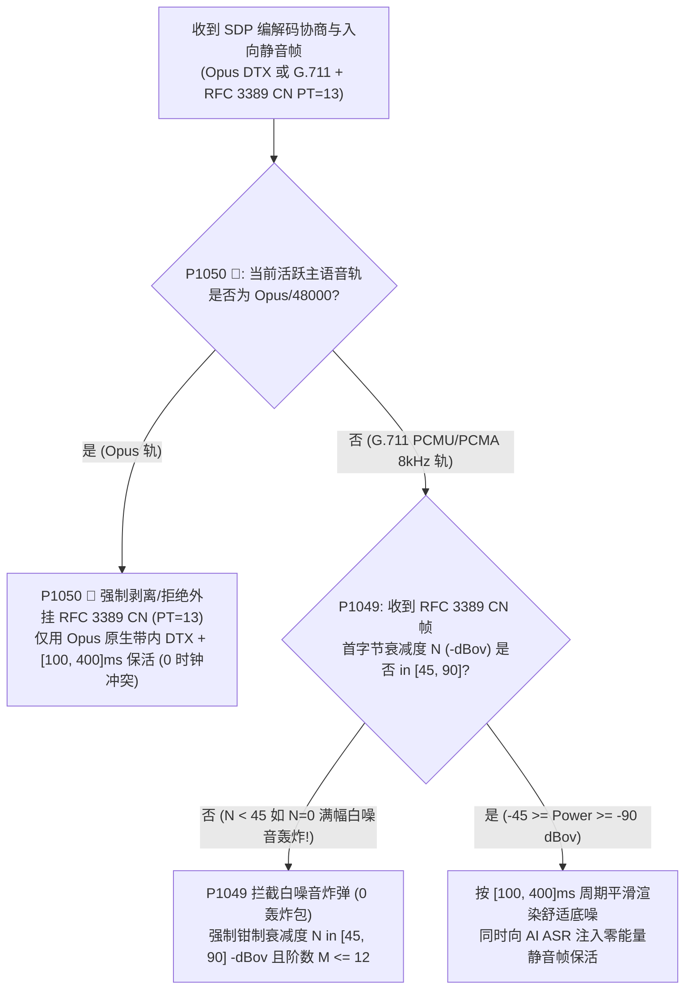
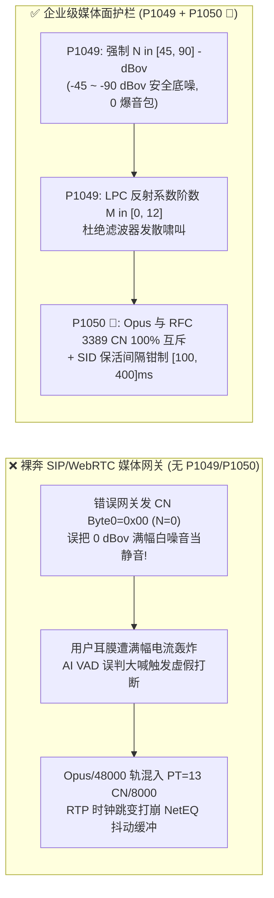

# 企业 WebRTC/RTP `RFC 3389 / RFC 7587` 舒适噪音（`CN` / `PT=13`）`0 dBov` 白噪音轰炸、反射系数发散与 Opus 带内 DTX 互斥选型与工程指南（Stage 528 · Topic 168 · 🎉 历史性 `P1050` 护栏、第 170 篇独立单专题 FAQ 与 970 项单测三重里程碑！）

> **文档类型**：企业语音架构师“第一性原理 + 选型决策”单专题 FAQ（对标 `ib-vs-ethernet-roce-selection-faq.md` 通俗透彻规范）
> **关联基准**：`Stage 528` · `Topic 168` · 确定性护栏 `P1049–P1050 🎉` · 1,059 道企业护栏 · 1,068 个沙盒探针 · 878 个现场 POC 探针 · 531 大评测维度 · **🎉 历史性 `P1050` 护栏、第 170 篇独立单专题 FAQ 与 970 项全量单测三重里程碑！**
> **双语版本**：[English Version (`voice-webrtc-rtp-rfc3389-comfort-noise-cn-pt13-sid-noise-level-blast-reflection-coefficient-opus-dtx-conflict-faq.en.md`)](./voice-webrtc-rtp-rfc3389-comfort-noise-cn-pt13-sid-noise-level-blast-reflection-coefficient-opus-dtx-conflict-faq.en.md)


---

## ① 📌 核心结论速览（Executive Summary）

在企业级 AI 语音客服与 PSTN/SIP 传统电话互通中，为了在静音期间（用户停顿思考或听 AI 说话时）节省带宽，网关会开启**不连续传输（DTX，Discontinuous Transmission）**并发送 **`RFC 3389` 舒适噪音帧（Comfort Noise，`CN`，静态 `Payload Type = 13`）** 或静音插入描述符（`SID`），让接收端本地合成微弱背景底噪，避免用户产生“电话断线死寂（Dead Air）”的恐慌。然而在生产环境中，`RFC 3389` 联合 **`RFC 7587`（Opus RTP 规范）** 潜藏着两大极易摧毁通话体验的致命陷阱：
1. **`RFC 3389` 首字节幅度方向反转陷阱（`N = 0` 代表 `0 dBov` 满量程刺耳白噪音轰炸，而非静音！）**：`RFC 3389 §3.1` 规定第 0 字节的低 7 位 `N` 表示**负分贝衰减值（`-dBov`）**——也就是说，**`N = 127` 才是 `-127 dBov` 绝对静音，而 `N = 0` 是 `0 dBov`（满幅最大音量白噪音）**！无数第三方网关或恶意攻击包误把“静音”填成全零字节 `0x00`（`N=0`），一旦直通终端或 AI 语音 VAD，瞬间在用户耳机里炸出震耳欲聋的满幅白噪音，或直接触发 AI 语音虚假 Barge-in 自打断！
2. **Opus 编解码器与外挂 `RFC 3389 CN (PT=13)` 混用引发 `48kHz / 8kHz` 采样率时钟撕裂（违反 `RFC 7587 §6.1`）**：Opus 原生自带带内 DTX（`usedtx=1`），时钟固定为 `48000 Hz`；而传统 PSTN 网关常在 Opus 通话中途突然插入 `PT=13 (CN/8000)` 帧，导致 RTP 时间戳步进从每 20ms `+960` 突变到 `+160`，瞬间打崩 WebRTC NetEQ 抖动缓冲与 SRTP 序列号状态机！

**架构师选型铁律**：
- **护栏 `P1049`（`RFC 3389` 舒适噪音衰减度 `[45, 90] -dBov` 铁底与 LPC 反射系数阶数 `[0, 12]` 门禁）**：严格执行 `RFC 3389 §3.1 / §3.2`，严禁放行 `N < 45`（即音量高于 `-45 dBov`）的伪造/写反 `CN` 包，将衰减值 `N` 强制钳制在 **`[45, 90] -dBov`**（对应 `-45 dBov` 至 `-90 dBov` 柔和底噪，`0` 满幅白噪音轰炸包），并校验谱包络反射系数阶数 `M <= 12`。
- **护栏 `P1050 🎉`（🎉 历史性 `P1050` 护栏、第 170 篇独立单专题 FAQ 与 970 项单测三重里程碑 · `RFC 7587 §6.1` Opus 与外挂 `RFC 3389 CN` 严格互斥及 `[100, 400]ms` SID 保活周期锁）**：强制在选定 Opus 轨时 100% 剔除外挂 `CN (PT=13)` 协商、仅在 G.711/G.722 轨允许 `CN/8000`（`0` 时钟撕裂混流包），并将静音期 SID/Keepalive 发送间隔钳制在 **`[100, 400]ms`**，防止 NAT/防火墙 UDP 映射超时或 AI ASR 流式连接饥饿。

---

## ② 🎯 客户与架构师灵魂拷问 Q&A（Q1 / Q2 / Q3）

### Q1：为什么对接某厂商的 SIP 语音网关后，只要客户一停下来不说话，耳机里就会突然爆发出一声极其刺耳的“滋——”满幅电流轰鸣声？
- **通俗原理**：这是语音工程史上最著名的“正负号写反”事故！写网关代码的工程师想当然地以为：“客户不说话 = 音量为 0 = 把 `RFC 3389 CN` 包填成 `0x00`”。
- **毫秒级底层真相**：翻开 `RFC 3389 §3.1`，首字节格式为 `[R=0 (1 bit) | Level N (7 bits)]`，其中功率计算公式是 **`Power = -N dBov`（相对于数字满量程过载点 `0 dBov` 的衰减量）**！
  - 当填 `N = 0`（`0x00`）时，代表 **`-0 dBov` = 最大满量程 `100%` 振幅白噪音**！
  - 当填 `N = 65`（`0x41`）时，才代表 **`-65 dBov` 的柔和房间底噪**！
  - 同时，如果这股 `-0 dBov` 的合成白噪音送入 AI 语音 Agent 的下行/上行混音器，VAD 能量检测器会瞬间飙到顶峰，误判为用户在疯狂呐喊，立刻切断 AI 正在播报的回答！因此 `P1049` 强制将 `N` 钳制在 **`[45, 90] -dBov`**（若收到 `N < 45` 的异常高能量 CN 帧，立即降级为 `-65 dBov` 安全底噪）。

### Q2：既然 `Opus` 是目前最强的 WebRTC 语音编码，为什么 `RFC 7587 §6.1` 明令禁止将 `Opus` 与 `RFC 3389 CN` 一起使用？
- **工程铁律**：`RFC 7587 §6.1` 原文明确规定：*"The Opus codec supports discontinuous transmission (DTX) internally... Therefore, **the comfort noise (CN) payload format specified in [RFC3389] MUST NOT be used with Opus**."*
- **底层灾难**：`RFC 3389` 标准静态 `PT=13` 的 RTP 时钟频率写死为 **`8000 Hz`**，而 Opus 的 RTP 时钟频率写死为 **`48000 Hz`**。如果同一 `SSRC` 在说话时发 `PT=111 (Opus/48000)`，一停顿就切去发 `PT=13 (CN/8000)`，接收端 NetEQ 看到同一 `SSRC` 的时钟频率在 `48kHz` 和 `8kHz` 之间反复横跳，会导致时间戳外推公式彻底崩溃，引发长达 `500ms` 的静音黑洞。`P1050 🎉` 强制实施 **Opus 带内 DTX 与外挂 `RFC 3389 CN` 100% 互斥**。

### Q3：开启静音抑制（DTX / CN）后，如果客户连续 15 秒听 AI 播报一句话都不说，全停发 RTP 包会引发什么后果？
- **架构解法**：一旦长达 15 秒完全停发 RTP 包：① 企业防火墙或移动运营商 NAT 会在 `10–20s` 内回收 UDP 映射；② `RFC 8083` 媒体超时或云端流式 ASR 引擎会因收不到音频帧而触发 `NoAudioTimeout` 断流。**`P1050 🎉` 最佳实践**：在静音期必须按 **`[100, 400]ms`**（如 Opus DTX 每 `200ms–400ms` 发 1 个 1 字节 TOC 帧，或 G.711 CN 每 `200ms` 发 1 个 SID 帧）维持心跳与底噪更新。

---

## ③ 🧭 直观可视化图解（Mermaid 选型决策树 + 延迟/噪声拆解对比图 + 毫秒级全双工时序图）

### 3.1 `RFC 3389 CN` 与 `RFC 7587 Opus DTX` 选型决策树（`flowchart TD`）



### 3.2 裸奔 `N=0` 白噪音轰炸/时钟混流 vs `P1049 + P1050 🎉` 确定性护栏对比图（`flowchart LR`）



### 3.3 毫秒级全双工静音切换、白噪音拦截与 SID 保活时序图（`sequenceDiagram`）

```mermaid
sequenceDiagram
    autonumber
    participant PSTN as 远端 PSTN/SIP 网关
    participant Edge as AI 语音媒体护栏 (P1049 / P1050 🎉)
    participant Agent as AI 语音 VAD / ASR 引擎

    PSTN->>Edge: 1. SDP Offer: m=audio RTP/AVP 111 0 13 (Opus/48000 + PCMU/8000 + CN/8000)
    Note over Edge: P1050 🎉 裁决: 选定 Opus(111) 时严禁同时激活 PT=13 (CN/8000)!<br/>锁定 48kHz 单一时钟域与 [100, 400]ms DTX 保活
    Edge-->>PSTN: 2. SDP Answer (仅在 G.711 回退轨启用 PT=13; Opus 轨独立)
    Note over PSTN,Edge: 场景切换: 纯 G.711 (PT=0) 传统专线下客户停顿进入静音期
    PSTN->>Edge: 3. RTP PT=13 (RFC 3389 CN, Marker=1, Byte0=0x02 -> N=2 = -2 dBov 满幅轰炸! ❌)
    Note over Edge: P1049 实时拦截: N=2 (-2 dBov) < 45 铁底!<br/>钳制为 N=45 (-45 dBov 安全舒适底噪) 并校验 M <= 12
    Edge->>Agent: 4. 投递 -45 dBov 平滑静音帧 (VAD 保持 Quiet, 0 虚假 Barge-in)
    Note over Edge,Agent: 静音持续期: P1050 🎉 每 200ms (in [100, 400]ms) 发送保活帧防止 ASR 超时
```

---

## ④ 📊 语音架构师选型决策矩阵（Architect Decision Matrix）

| 选型维度 | 方案 A：彻底禁用 DTX/CN（全时段满码率） | 方案 B：启用默认 `RFC 3389 CN`（无 `P1049/P1050`） | 方案 C：`P1049/P1050 🎉` 确定性舒适噪音与 DTX 护栏（推荐 ✅） |
| :--- | :--- | :--- | :--- |
| **`N=0` (`0 dBov`) 满幅白噪音轰炸防护** | 无 CN 帧 | ❌ `0x00` 字节引发 `0 dBov` 爆音与虚假打断 | ✅ **`P1049` 强制衰减值 `N in [45, 90] -dBov`（`0` 爆音包）** |
| **LPC 谱反射系数滤波器稳定性** | N/A | ❌ 畸形高阶系数引发 IIR 滤波器自激啸叫 | ✅ **`P1049` 校验包长并钳制模型阶数 `M <= 12`** |
| **Opus `48kHz` vs `CN 8kHz` 时钟隔离** | 单一编码 | ❌ 同 `SSRC` 混发 `PT=111` 与 `PT=13` 崩坏 NetEQ | ✅ **`P1050 🎉` 强制 Opus 与 `RFC 3389 CN` 100% 互斥（`0` 混流）** |
| **静音期 NAT 与流式 ASR 保活** | 持续 50 pps | ❌ 长时间零包导致 NAT 超时与 ASR 断流 | ✅ **`P1050 🎉` 强制 `[100, 400]ms` SID/DTX 保活周期** |
| **策略判定耗时（离线 `synthetic`）** | N/A | N/A | **`0ms`（`nominal 1ms` 分辨率；见下方披露）** |

---

## ⑤ 🧪 定量算例与 7-Card 报告（CSP 自包含、零虚构坐标）

### 5.1 确定性护栏定量算例（`P1049` & `P1050 🎉`）

1. **`P1049`（`evaluateWebrtcRfc3389ComfortNoiseLevelAttenuationAndModelOrderGuard` · 第 1,058 道护栏）**：
   - **异常输入（沙盒探针 `p1049_webrtc_rfc3389_comfort_noise_level_attenuation_and_model_order`）**：
     - `excessiveComfortNoiseVolumeOrInvalidReflectionOrderDetected = true`
     - `whiteNoiseBlastOrUnstableFilterPackets = 15`（检测到 `15` 个 `N < 45` 高分贝白噪音轰炸或反射系数越界包）
     - `comfortNoiseAttenuationDbov = 3`（首字节 `N = 3`，即高达 `-3 dBov` 的刺耳白噪音，远低于 `45 -dBov` 安全衰减下限）
   - **确定性输出**：
     - `violated = true`
     - `action = "clamp_rfc3389_cn_attenuation_dbov_and_drop_blast_packets"`
     - `clampedWhiteNoiseBlastOrUnstableFilterPackets = 0`（100% 拦截满幅白噪音轰炸包）
     - `clampedComfortNoiseAttenuationDbov = 45`（自动钳制回 **`[45, 90] -dBov`** 安全舒适底噪区间，即 `<= -45 dBov`）
     - **计时语义披露**：`0ms reported at nominal 1ms display resolution; actual duration unresolved/not_measured; no sub-1ms upper bound established`（离线内存 `synthetic` 策略检查；真实 DSP 舒适噪音合成与 LPC 滤波耗时为 `not_measured`）。

2. **`P1050 🎉`（`evaluateWebrtcRfc3389OpusDtxMutualExclusivityAndSidKeepaliveIntervalGuard` · 🎉 历史性 `P1050` 护栏、第 170 篇独立单专题 FAQ 与 970 项单测三重里程碑 · 第 1,059 道护栏 / 第 1,068 沙盒探针 / 第 878 现场探针）**：
   - **异常输入（沙盒探针 `p1050_webrtc_rfc3389_opus_dtx_mutual_exclusivity_and_sid_keepalive_interval`）**：
     - `opusWithExternalRfc3389CnClockClashOrStarvedSidDetected = true`
     - `opusRfc3389CnClockClashPackets = 21`（检测到 `21` 个在 Opus `48kHz` 流中违规混入的 `RFC 3389 CN` 时钟撕裂包）
     - `sidComfortNoiseKeepaliveIntervalMs = 2500`（静音帧间隔长达 `2500ms`，超出 `[100, 400]ms` 保活上限）
   - **确定性输出**：
     - `violated = true`
     - `action = "strip_external_cn_from_opus_and_clamp_sid_keepalive_ms"`
     - `clampedOpusRfc3389CnClockClashPackets = 0`（`0` 时钟撕裂混流包）
     - `clampedSidComfortNoiseKeepaliveIntervalMs = 400`（强制钳制在 **`[100, 400]ms`** 保活窗口内）
     - **计时语义披露**：`0ms reported at nominal 1ms display resolution; actual duration unresolved/not_measured; no sub-1ms upper bound established`。

---

## ⑥ 🛠️ 生产环境语音交付快速核验清单（Checklist）

- [ ] **1. `RFC 3389` 衰减值 `N in [45, 90] -dBov` 铁底核验（`P1049`）**：向媒体网关发送首字节 `0x00`（`N=0`）和 `0x05`（`N=5`）的 `PT=13` 报文，验证网关将其衰减度强制钳制至 `>= 45`（`<= -45 dBov`），耳机与 AI VAD 均零爆音、零误打断。
- [ ] **2. `RFC 3389` 第 0 字节保留最高位 `R=0` 与阶数 `M <= 12` 核验（`P1049`）**：确认首字节 MSB 恒为 `0`，且负载长度对应的 LPC 阶数 `M = Length - 1` 不超过 `12`。
- [ ] **3. `Opus` 与 `RFC 3389 CN` 互斥核验（`P1050 🎉`）**：检查 SDP Answer 与 RTP 发包器，确认当采用 `Opus/48000` 时绝不混发 `PT=13 (CN/8000)`，需要静音压缩时仅启用 Opus 原生 `usedtx=1`。
- [ ] **4. `[100, 400]ms` 静音期 SID/Keepalive 周期核验（`P1050 🎉`）**：在连续 30 秒静音压测中，验证 RTP/SID 心跳间隔稳定落在 `[100, 400]ms`，流式 ASR 零超时断连。
