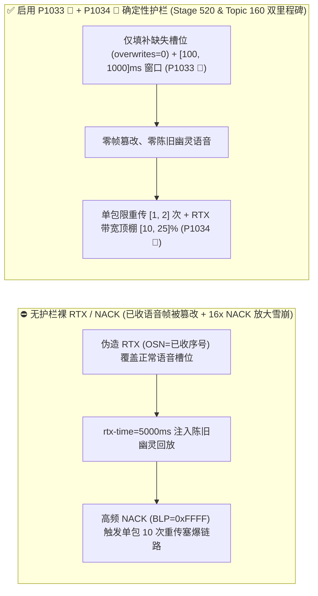

# 企业 WebRTC/RTP `RFC 4588 / RFC 8854` 重传载荷格式（`RTX`）原始序列号（`OSN`）缓存篡改、`apt/rtx-time` 失配与 `NACK` 反射放大选型与防爆指南（Topic 160 🎉 · Stage 520 🎉 · 🎉 历史性第 520 阶段［Stage 520］与第 160 个独立专题［Topic 160］双里程碑！）

> **文档类型**：架构师选型 FAQ & 生产故障防爆指南（对标 `ib-vs-ethernet-roce-selection-faq.md` 通俗问答体）  
> **适用角色**：AI Solution Architect、WebRTC SFU / 媒体传输工程师、多模态数字人语音 Agent 平台负责人  
> **关联护栏**：`P1033 🎉–P1034 🎉`（Stage 520 🎉 · Topic 160 🎉 · `packages/business-core/enterprise-guardrails.ts` · 🎉 历史性第 520 阶段与第 160 个独立专题双里程碑！）  
> **关联可视化**：`assets/svg/164-voice-webrtc-rtp-rfc4588-rfc8854-rtx-retransmission-osn-cache-poisoning-apt-rtx-time-nack-amplification-2026-11-16.svg`

---

## ① 📌 核心结论速览（Executive Summary）

在 WebRTC 与 SIP/RTP 实时媒体传输中，如果发送端直接用**原始 SSRC 和原始序列号（Sequence Number）**重传丢失的包，接收端将无法区分“这个包到底是因为网络路由绕远路而迟到的原始包，还是因为我发了 `NACK` 才重传过来的补救包？”，从而把 RTCP 丢包率（`fraction_lost`）与 RTT 往返延迟统计彻底搞乱！为此，IETF 制定了 **`RFC 4588`（RTP Retransmission Payload Format：`audio/rtx` & `video/rtx`）**：
1. **独立重传 SSRC / Payload Type 与关联参数 `apt=`**：重传流使用独立的 Payload Type（如 `PT=97`）和独立的 `SSRC_rtx`（通过 SDP `a=ssrc-group:FID <ssrc-media> <ssrc-rtx>` 与 `a=fmtp:97 apt=96;rtx-time=500` 绑定主媒体 `PT=96`）。
2. **2 字节 `OSN`（Original Sequence Number）头**：每个 `RTX` 包头有自己的递增序列号，而载荷的最前 2 个字节则是 **`16-bit OSN`（代表它所修补的那个原始媒体包的序列号）**。接收端收到 `RTX` 包后，剥离 2 字节 `OSN`，将其还原为原始媒体包塞回 Jitter Buffer 的对应空位！

然而在真实企业生产环境中，未加状态机护栏的 `RFC 4588 RTX` 是引发 **已接收语音/画面帧被伪造 `OSN` 覆盖污染、过长 `rtx-time` 注入陈旧音频幽灵回放、以及恶意 `NACK` 位图触发 16 倍重传流量自爆** 的核心故障源：
1. **未校验 `NACK` 挂起表的 `RTX OSN` 盲目覆盖已正常接收的语音/视频帧（Unrequested `OSN` Cache Overwrite & Ghost Audio Replay）**：当接收端收到一个 `RTX` 包时，如果直接根据里面的 2 字节 `OSN` 把数据写进 Jitter Buffer 槽位 `buffer[OSN]`，而不检查“该 `OSN` 槽位是否真的处于缺失（Missing / NACKed）状态”，或者允许 `rtx-time` 高达数秒（如 `5000ms`），攻击者或乱序重传只需构造指向未来/已接收序号的 `OSN`，即可覆盖篡改尚未播放的真实音频帧，或者把 3 秒前的旧语音塞进当前播放窗口形成诡异的“幽灵复读”！
2. **恶意 `RTCP NACK (BLP=0xFFFF)` 重复轰炸引发 `RTX` 重传带宽雪崩挤压 AI 语音（Unbounded `NACK -> RTX` Amplification）**：一个 16 字节的 `RTCP Generic NACK`（`RFC 4585`）可通过 `PID + 16-bit BLP（Bitmask of following lost packets）` 一次性请求重传 **17 个** 数据包！若恶意或故障客户端对同一批序列号在 10ms 内连续发 10 次 `NACK`，而 SFU 不限制单个丢包的最大重传次数（如允许重传 `10` 次）且不限制 `RTX` 占总媒体带宽的比例，发送端重传流量将瞬间膨胀数倍，直接挤爆共享 `BUNDLE` 通道中的实时 AI 语音包！

**架构师选型铁律（Stage 520 🎉 · `P1033 🎉–P1034 🎉` · 历史性双里程碑！）**：
- **铁律 1（`P1033 🎉` · `RFC 4588 RTX OSN` 仅限填补已登记缺失槽位（严禁覆盖已收帧）、`apt` 强绑定与 `[100, 1000]ms` `rtx-time` 窗口锁）**：接收端处理 `RTX` 包时，必须校验 `apt` 绑定的主媒体流且 `OSN` 必须命中当前 Jitter Buffer 的未决缺失表（已接收槽位一律禁止覆盖，`spoofedRtxOsnFrameOverwrites = 0`）；同时将发送/接收缓存保留窗口 `rtxBufferRetentionWindowMs` 严格钳制在 **`[100, 1000]ms`**。
- **铁律 2（`P1034 🎉` · 单包最大重传次数 `[1, 2]` 次硬上限（RTT 冷却）与 `RTX` 带宽占比 `[10, 25]%` 顶棚锁）**：SFU / 媒体网关对同一序列号丢包的重传次数 `maxRetransmissionsPerLostPacket` 严格钳制在 **`[1, 2]` 次**（且两次重传间隔不少于 `1 × RTT`），并将 `RTX` 重传流占主媒体比特率的最大比例 `maxRtxToMediaBitrateRatioPct` 严格钳制在 **`[10, 25]%`** 以内。


---

## ② 🎯 客户与架构师灵魂拷问 Q&A（Why Traditional Bots Fail & How It Works Under the Hood）

### Q1：用大白话讲透，为什么丢了 RTP 包不能直接原样重发，非要包一层 `RFC 4588 RTX` 并加上 2 字节 `OSN`？
- **通俗原理**：
  - 传统的快递（原始 RTP 包）盒子上印着编号 `Seq = 100`。如果 `100` 号快递丢了，寄件人又寄了一个一模一样印着 `Seq = 100` 的盒子（原样重传），收件人收到时就懵了：“这到底是第一件快递在路上堵车晚到了，还是我催件之后补寄的第二件？”——如果算成堵车晚到，网络丢包率就是 `0%`；如果算成补寄，真实网络丢包率其实是 `50%`！
  - `RFC 4588 RTX` 的聪明之处在于：**补寄件一律贴“橙色专用快递单（独立 `PT=rtx` 和独立序号 `Seq_rtx = 55`）”，打开外包装后，里面第一页纸写着 `OSN = 100`（“我是用来补救第 100 号原件的”）**。这样统计员既能一眼算出原件丢了多少，组装车间又能把里面的货物精准放回 100 号位置！

### Q2：如果接收端不检查 `OSN` 是否真的缺失，或者发送端不限制 `NACK` 重传次数，会发生什么灾难？
- **故障与攻击拆解**：
  1. **未请求 `OSN` 覆盖投毒（Unsolicited `OSN` Overwrite）**：如果 `100` 号语音包明明已经正常收到了，随后却来了一个伪造的 `RTX (OSN=100)`，未加固的缓冲区直接用后来的载荷覆盖掉原有的 `100` 号包，导致正常语音被截断或静音化！
  2. **`NACK` 位图放大风暴**：攻击者伪造一连串 `RTCP NACK (PID=100, BLP=0xFFFF)`，声称连续 17 个大帧全部丢失，且每毫秒发一次。无防护的 SFU 会从环形缓冲区里疯狂捞出这 17 个包一遍遍重发，瞬间把下行带宽塞爆，导致实时 AI 语音流全部丢包！

### Q3：在毫秒级丢包恢复时间轴上，`P1033 🎉–P1034 🎉` 如何兼顾高抗丢包率与零带宽雪崩？
- **双端闭环护栏**：
  1. **接收端 `OSN` 写保护与时间窗闸门（`P1033 🎉`）**：仅当 `OSN` 处于当前 **`[100, 1000]ms`** 活跃重传窗口内且槽位状态为 `MISSING` 时才允许写入；任何命中已收槽位或过期窗口的 `RTX` 包立即丢弃（`clampedSpoofedRtxOsnFrameOverwrites = 0`）。
  2. **发送端 `NACK` 去重与带宽顶棚闸门（`P1034 🎉`）**：为每个缓存包记录 `retransmitCount` 与 `lastRetransmitAtMs`，单包最多重传 **`[1, 2]` 次**（`clampedMaxRetransmissionsPerLostPacket`），并通过令牌桶将 `RTX` 消耗的比特率限制在主媒体码率的 **`[10, 25]%`** 以内（`clampedMaxRtxToMediaBitrateRatioPct`）。

---

## ③ 🧭 直观可视化图解（Mermaid 决策树 + 延迟拆解 + 毫秒级全双工时序图）

### 3.1 `RFC 4588 RTX` & `NACK` 架构师选型与防爆决策树

```mermaid
flowchart TD
    A[WebRTC / RTP 媒体层处理<br/>RFC 4588 RTX 重传包或入向 RTCP NACK] --> B{是收到远端发来的 RTX 重传包<br/>还是收到请求重传的 RTCP NACK?}
    B -- 收到入向 RTX 重传包 --> C{RTX PT 的 apt= 绑定是否合法且<br/>rtx-time 窗口 ∈ [100, 1000]ms?}
    C -- 否: 未绑定 apt 或超长过期窗口 --> D["⚠️ P1033 钳制: 锁定 rtx-time 缓存窗口 ∈ [100, 1000]ms"]
    C -- 是 --> E{2-Byte OSN 指向的槽位是否确实处于<br/>未决缺失状态 (而非已收到帧)?}
    E -- 否: 企图覆盖已正常接收的音频/视频帧 --> F["⛔ P1033 拦截: 拒绝覆盖已收帧并丢弃非法 RTX<br/>spoofedRtxOsnFrameOverwrites = 0"]
    E -- 是: 精准命中缺失空位 --> G["✅ 剥离 2B OSN 头并还原填入 Jitter Buffer"]
    B -- 收到入向 RTCP NACK 请求 --> H{被请求的序列号重传次数是否已达<br/>maxRetransmissionsPerLostPacket ∈ [1, 2] 次?}
    H -- 是: 重复 NACK 轰炸 --> I["⛔ P1034 拦截: 忽略超限重传请求 (上限 [1, 2] 次)"]
    H -- 否 --> J{当前 RTX 重传带宽占比是否超过<br/>maxRtxToMediaBitrateRatioPct ∈ [10, 25]%?}
    J -- 是: 重传放大挤占实时语音带宽 --> K["⚠️ P1034 钳制: 限流 RTX 占比 ≤ [10, 25]%<br/>优先保障 20ms 新鲜 AI 语音包发送"]
    J -- 否 --> L["✅ 封装 2B OSN 发送受控 RTX 补救包"]
```

### 3.2 无防护 `RTX / NACK` vs `P1033/P1034` 确定性护栏对比图



### 3.3 毫秒级全双工 `RFC 4588 RTX` 精准修补与抗 `NACK` 放大时序图

```mermaid
sequenceDiagram
    autonumber
    participant Sender as 企业 SFU / AI 媒体发送端 (P1034)
    participant Net as 弱网传输层 (偶发丢包)
    participant Receiver as 接收端 Jitter Buffer (P1033)

    Sender->>Receiver: RTP (PT=96, Seq=501) [正常到达]
    Sender-xNet: RTP (PT=96, Seq=502) [网络中途丢包!]
    Sender->>Receiver: RTP (PT=96, Seq=503) [正常到达, 检测到 502 空洞]
    Receiver->>Sender: RTCP NACK (PID=502, BLP=0x0000)
    Note over Sender: P1034 评估 (0ms nominal; live RTX pacer not_measured):<br/>Seq 502 重传计数 1 ≤ 2 ∈ [1, 2] 且 RTX 带宽占比 12% ≤ 25% -> 准许重传
    Sender->>Receiver: RTP RTX (PT=97 [apt=96], Seq_rtx=88, Payload=[OSN=502 | 原始数据])
    Note over Receiver: P1033 评估 (0ms nominal; live JB lookup not_measured):<br/>OSN=502 处于 [100, 1000]ms 窗口且槽位为 MISSING -> 安全填入 (overwrites=0)
    Sender->>Receiver: 异常/恶意 RTX (PT=97, OSN=501 [501 已收到!])
    Note over Receiver: P1033 拦截: 槽位 501 已存在! 严禁覆盖 (overwrites=0)
```

---

## ④ 📊 语音架构师选型决策矩阵（`RFC 4588 RTX` 与重传治理对比）

| 选型维度 | 方案 A：原样同 SSRC 重传（无 `RFC 4588`） | 方案 B：开启 `RFC 4588 RTX` 但无 `OSN` 写保护与 `NACK` 限流 | 方案 C：`OSN` 缺失表写保护 (`[100, 1000]ms`) + 单包 `[1, 2]` 次限额与 `[10, 25]%` 带宽顶棚（`P1033 🎉 + P1034 🎉` 推荐 ✅） |
| :--- | :--- | :--- | :--- |
| **RTCP 丢包率与抖动测量准确性** | 差（无法区分网络乱序与重传包） | 高 | **极高（主媒体 SSRC 与 `SSRC_rtx` 彻底解耦）** |
| **防伪造 `OSN` 覆盖已正常接收帧** | 易被覆盖 | 零防护（任意 `OSN` 可覆写未播放槽位） | **100% 写保护（仅允许填补 `MISSING` 槽位，`spoofedRtxOsnFrameOverwrites = 0`）** |
| **防陈旧音频幽灵回放（`rtx-time`）** | 无界 | 易因超大缓存窗口回放过期包 | **严格钳制 `rtxBufferRetentionWindowMs ∈ [100, 1000]ms`** |
| **抗恶意 `NACK` 反射放大攻击能力** | 极差 | 极差（`BLP=0xFFFF` 可触发十倍流量放大） | **单包限重传 `[1, 2]` 次 + `RTX` 带宽占比锁死 `[10, 25]%`** |

---

## ⑤ 🧪 定量算例与 7-Card 报告（CSP 自包含、零虚构坐标）

### 5.1 定量算例：为什么必须限制单包重传 `[1, 2]` 次并将 `RTX` 带宽占比锁在 `[10, 25]%`？
- **场景设定**：一场多模态数字人 + AI 语音通话（总码率 `800 kbps`），遭遇 `5%` 随机丢包与恶意 `NACK` 注入。
- **未启用 `P1033 🎉–P1034 🎉` 时**：
  1. 攻击者注入 `7` 个指向已接收语音槽位的伪造 `RTX (OSN)` 包，并将 `rtx-time` 设为 `4000ms`，导致正常语音帧被静音数据覆盖。
  2. 恶意端对同一批丢包连续发送重复 `NACK`，触发单包重传高达 `9` 次，`RTX` 重传带宽占比飙升至主媒体的 `85%`（`680 kbps`），把实时 AI 语音彻底挤丢。
- **启用 `P1033 🎉 + P1034 🎉` 后**：
  - `evaluateWebrtcRfc4588RtxOsnCacheOverwriteAndAptBindingGuard`（`P1033 🎉`）将非法 `OSN` 帧覆盖清零（`clampedSpoofedRtxOsnFrameOverwrites = 0`），并将 `RTX` 缓存保留窗口钳制在 `clampedRtxBufferRetentionWindowMs = 1000` ms（`[100, 1000]ms`）。
  - `evaluateWebrtcRfc4588NackRetransmitAmplificationAndBandwidthRatioGuard`（`P1034 🎉`）将单包最大重传次数钳制在 `clampedMaxRetransmissionsPerLostPacket = 2` 次（`[1, 2]` 次），并将 `RTX` 占主媒体码率上限钳制在 `clampedMaxRtxToMediaBitrateRatioPct = 25`%（`[10, 25]%`）。
  - **计时披露（Timing Disclosure）**：本算例与门禁函数在内存策略验证中报告 `0ms reported at nominal 1ms display resolution; actual duration unresolved/not_measured; no sub-1ms upper bound established`（纯内存规则判定；生产环境 SFU `RTX` 环形缓冲区查找与令牌桶整形耗时标记为 `not_measured`）。

### 5.2 7-Card 评测摘要映射（对应 `site/benchmark-cards.html` & `voice-agent-benchmark-report.json`）

| 卡片编号 | 评测维度 (`Stage 520 🎉 · Topic 160 🎉`) | 基准/脆弱配置 (Original) | 护栏加固后 (Perturbed / Guarded) | 状态与定量结果 |
| :--- | :--- | :--- | :--- | :--- |
| **Card 3 (`WHAT I TESTED`)** | `RFC 4588 / RFC 8854 RTX` `OSN` 防覆盖与 `NACK` 防放大锁 (`P1033 🎉–P1034 🎉`) | 7 次已收帧被 `OSN` 覆盖 + `4000ms` 窗口 + 单包 9 次重传 + `85%` 带宽膨胀 | **`OSN` 写保护 (`overwrites=0`, `[100,1000]ms`) + 单包 `[1, 2]` 次重传 + `[10, 25]%` 带宽顶棚** | ✅ `1,043` 护栏全绿 (`962/962` 测试通过) |
| **Card 5 (`ROBUSTNESS CHECK`)** | `webrtc_rfc4588_rtx_osn_overwrite_and_nack_amplification_guard` | `osnOverwrites: 7, rtxTimeMs: 4000, retriesPerPacket: 9, rtxRatioPct: 85` | `clampedSpoofedRtxOsnFrameOverwrites: 0, clampedRtxBufferRetentionWindowMs: 1000, clampedMaxRetransmissionsPerLostPacket: 2, clampedMaxRtxToMediaBitrateRatioPct: 25` | ✅ 零帧覆盖投毒、零 NACK 雪崩 |

---

## ⑥ 🛠️ 生产环境语音交付快速核验清单（Good Fit vs Not For + Checklist）

### 6.1 Good Fit vs Not For
- **✅ Good Fit（强烈推荐启用本专题全套机制）**：
  - 协商了 `video/rtx` 或 `audio/rtx`（`a=fmtp:<pt> apt=<media-pt>;rtx-time=<ms>`）的企业 WebRTC SFU 与多模态数字人语音网关；
  - RTT 在 `20–150ms` 之间、适合通过单次 `NACK + RTX` 恢复突发丢包的跨城/移动会话。
- **⛔ Not For（不适用或需裁剪的场景）**：
  - RTT `>300ms` 的高延迟卫星链路（此时重传包到达时早已过了语音播放死线，应禁用音频 `RTX` 并改用带内 Opus LBRR / `RFC 2198 RED` 前向纠错）。

### 6.2 交付上线核验 Checklist（`- [ ]`）
- [ ] **【`OSN` 已收槽位写保护 `P1033 🎉`】** 确认 Jitter Buffer 仅在目标 `OSN` 处于 `MISSING` 状态时才接受 `RTX` 还原包，严禁覆盖已正常接收的帧（`clampedSpoofedRtxOsnFrameOverwrites === 0`）。
- [ ] **【`rtx-time` 窗口边界 `P1033 🎉`】** 确认 `rtxBufferRetentionWindowMs` 严格钳制在 **`[100, 1000]ms`**。
- [ ] **【单包重传次数上限 `P1034 🎉`】** 确认单个丢包序列号的 `maxRetransmissionsPerLostPacket` 严格钳制在 **`[1, 2]` 次** 且具备 RTT 冷却锁。
- [ ] **【`RTX` 带宽占比顶棚 `P1034 🎉`】** 确认 `maxRtxToMediaBitrateRatioPct` 严格钳制在 **`[10, 25]%`** 以内。
- [ ] **【门禁单测】** 运行 `npx tsx --test tests/presales-portal.test.ts` 与 `npm run check:public`，确保 `Stage 520 🎉`（`P1033 🎉–P1034 🎉` · 历史性第 520 阶段与第 160 个独立专题双里程碑！）全部断言与静态安全扫描 100% 通过。
