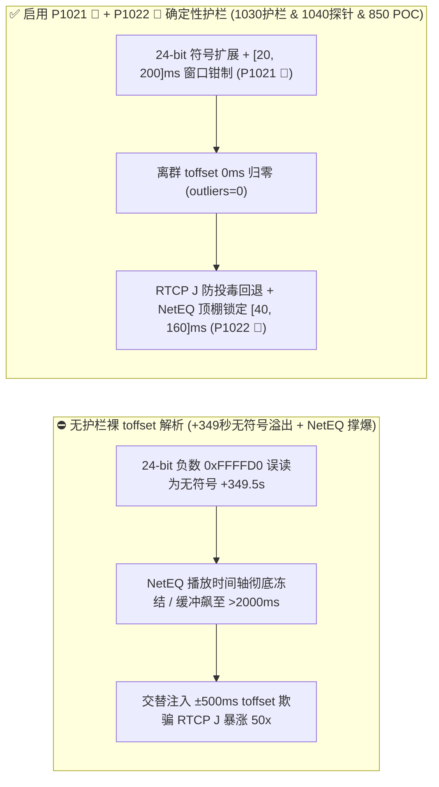

# 企业 WebRTC/RTP `RFC 5450 / RFC 3550` 发送时间偏移扩展头（`toffset`）24-bit 有符号整数溢出、NetEQ 抖动缓冲撑爆与 RTCP 到达间隔抖动（`J`）投毒选型与防爆指南（Topic 154 · Stage 514 · 🎉 历史性第 1,030 道企业级护栏、第 1,040 个沙盒探针与第 850 个现场 POC 探针三重里程碑！）

> **文档类型**：架构师选型 FAQ & 生产故障防爆指南（对标 `ib-vs-ethernet-roce-selection-faq.md` 通俗问答体）  
> **适用角色**：AI Solution Architect、WebRTC NetEQ / 媒体网关工程师、实时全双工语音 Agent 平台负责人  
> **关联护栏**：`P1021 🎉–P1022 🎉`（Stage 514 · Topic 154 · `packages/business-core/enterprise-guardrails.ts` · 🎉 历史性第 1,030 道企业级确定性护栏、第 1,040 个交互式沙盒探针与第 850 个现场照妖镜探针三重里程碑！）  
> **关联可视化**：`assets/svg/158-voice-webrtc-rtp-rfc5450-rfc3550-toffset-transmission-time-offset-jitter-buffer-poisoning-rtcp-jitter-inflation-2026-11-16.svg`

---

## ① 📌 核心结论速览（Executive Summary）

在企业 WebRTC 与 SIP/RTP 实时音视频架构中，RTP 包头里的 32-bit `Timestamp` 代表的是**麦克风采集或 TTS 生成该帧音频的采样时刻（Sampling Instant）**，而不是网卡真正把数据包发出去的时刻。当发送端因为平滑限速（Pacer）、FEC 冗余打包或 NACK 重传而将 RTP 包在本地队列滞留了十几个毫秒再发出时，接收端如果不区分“发送端自己排队耽误的时间”与“网络传输真正发生的抖动”，就会误以为网络剧烈抖动而盲目拉大播放缓冲区。为此，IETF 制定了 **`RFC 5450`（Transmission Time Offsets in RTP Streams：`urn:ietf:params:rtp-hdrext:toffset`）**，在 RTP 扩展头中携带一个 **24-bit 有符号补码整数（24-bit Signed Two's-Complement Integer，范围 `-8,388,608` 至 `+8,388,607` RTP 时钟滴答）**，记录“实际发送时间相对于采集时间戳的偏移量”：
$$\text{Effective RTP Timestamp} = \text{RTP Timestamp} + \text{toffset}$$

然而在真实生产环境中，未加边界钳制的 `RFC 5450 toffset` 解析器是引发 **NetEQ 抖动缓冲瞬间膨胀至数秒（导致 AI 语音对话延迟飙升至不可用）以及 RTCP 抖动估计（`J`）被恶意污染** 的高危暗雷：
1. **24-bit 有符号 `toffset` 未做符号扩展或注入极端正负值撑爆 NetEQ 缓冲（Signed 24-Bit Overflow & Jitter-Buffer Poisoning）**：在 48kHz Opus 时钟下，24-bit 有符号整数可表达高达 **`±174.76 秒`**（`8,388,608 / 48,000`）的巨幅偏移！若网关解析器错误地将 24-bit 负数（如 `-480` ticks = `-10ms`，二进制最高位为 `1`，即 `0xFFFFE0`）当成 32-bit 无符号正数（`+16,776,736` ticks = **`+349.5 秒`**！），或者恶意客户端故意注入 `±50,000` ticks（`>1000ms`）的 `toffset` 尖峰，接收端 NetEQ 抖动缓冲区会误以为网络出现了数秒级的乱序抖动，瞬间将目标播放延迟（Target Playout Delay）撑大到数千毫秒，导致 AI 语音 Agent 变成“慢半拍的迟钝木偶”！
2. **`RFC 5450 §4` 修正版 RTCP 到达间隔抖动（`J`）被跳跃 `toffset` 投毒引发 BWE 误降码率（RTCP `J` Inflation Sabotage）**：根据 `RFC 5450 §4`，接收端在计算 RTCP Receiver Report（`RR`）中的 `Interarrival Jitter (J)` 时，必须用修正后的时间戳替代原始 RTP 时间戳：
   $$D(i, j) = (R_j - R_i) - \bigl((S_j + \text{toffset}_j) - (S_i + \text{toffset}_i)\bigr)$$
   若对端在相邻语音包之间交替注入正负抖动的虚假 `toffset`，接收端算出的 $D(i, j)$ 与平滑抖动 $J_i = J_{i-1} + (|D(i-1,i)| - J_{i-1})/16$ 会飙升几十倍，并随 RTCP `RR` 回传给发送端，欺骗发送端拥塞控制器误判“网络极度拥塞”而大幅砍掉正常音频码率！

**架构师选型铁律（Stage 514 · `P1021 🎉–P1022 🎉` · 历史性三重里程碑！）**：
- **铁律 1（`P1021 🎉` · `RFC 5450` 24-bit 算术符号扩展校验、离群偏移归零与 `[20, 200]ms` 物理合理窗口钳制 · 历史性第 1,030 道护栏！）**：在 RTP 接收端严格执行 24-bit 补码算术符号扩展（`(raw24 << 8) >> 8`），将任何超出发送队列物理合理范围的离群 `toffset` 剥离归零（`clampedToffsetOutlierPackets = 0`），并将允许生效的最大偏移绝对值 `maxAllowedToffsetMagnitudeMs` 严格钳制在 **`[20, 200]ms`** 以内。
- **铁律 2（`P1022 🎉` · RTCP 到达间隔抖动 `J` 双轨一致性保护与 NetEQ 目标播放缓冲 `[40, 160]ms` 硬上限 · 历史性第 1,040 个探针 & 850 个 POC 探针！）**：当检测到引入 `toffset` 后的修正抖动 $J_{\text{corrected}}$ 反而大于原始时间戳抖动 $J_{\text{raw}}$（说明 `toffset` 正在制造虚假抖动投毒）时，立即回退使用原始 RTP 时间戳计算 RTCP `J`（`clampedPoisonedRtcpJitterReportBlocks = 0`），并将语音 NetEQ 目标播放延迟上限 `neteqTargetPlayoutDelayCeilingMs` 严格钳制在 **`[40, 160]ms`**。


---

## ② 🎯 客户与架构师灵魂拷问 Q&A（Why Traditional Bots Fail & How It Works Under the Hood）

### Q1：用大白话讲透，什么是 `RFC 5450 toffset`？为什么一个小小的 3 字节扩展头能让 AI 语音机器人突然沉默或延迟 3 秒？
- **通俗原理**：
  - 想象厨师（音频编码器）在 `12:00:00.000` 做好了一盘菜（生成 RTP 包，盖上时间戳 `12:00:00.000`），但因为外卖打包台忙（Pacer 限速队列或重传排队），这盘菜在厨房等了 `15ms`，直到 `12:00:00.015` 才真正出门上路。
  - 如果不在饭盒上写明“**厨房内部耽误了 +15ms（`toffset = +15ms`）**”，食客（接收端 NetEQ）收到菜时发现晚了 `15ms`，就会怪罪“路上交通太堵（网络抖动大）”，于是把缓冲等待时间拉长。
- **为什么会变成生产事故？**
  1. **24-bit 负数符号扩展 Bug**：`toffset` 只有 3 个字节（24 bits）。当发生时钟微调或重采样出现 `-1ms`（48kHz 下为 `-48` ticks，十六进制 `0xFFFFD0`）时，如果 C++/Rust/Go/TS 代码直接读 3 个字节拼成 `uint32` 而不做 24-bit 符号位扩展，`0xFFFFD0` 就会变成 `+16,777,168` ticks（相当于 **`+349.5 秒`**！）。NetEQ 看到这个时间戳瞬间崩溃或把播放队列挂起几分钟！
  2. **恶意极端偏移撑爆缓冲**：即便做了符号扩展，24-bit 也能合法表示 `±174 秒`。如果不把有效范围锁死在 **`[20, 200]ms`**，一个恶意的 `+3000ms` 偏移就能让 AI 语音缓冲膨胀到 3 秒以上！

### Q2：攻击者如何利用交替跳变的 `toffset` 毒害 `RFC 3550` 的 RTCP 抖动报告（`Interarrival Jitter J`）？
- **故障与攻击拆解**：
  - `RFC 5450` 本意是让 `toffset` **抵消**发送端排队抖动，从而让接收端算出的网络真实抖动 $J_{\text{corrected}}$ **变小**（$J_{\text{corrected}} \le J_{\text{raw}}$）。
  - 但如果恶意客户端在偶数包填 `toffset = 0`，在奇数包填 `toffset = +48,000`（`+1000ms`），接收端套用 `RFC 5450 §4` 公式计算 $D(i, j)$ 时，每两个包之间都会凭空多出 `1000ms` 的人为跳变！算出来的 RTCP 抖动值 $J$ 暴涨至正常值的 100 倍，导致网关误判链路质量劣化（MOS 暴跌）并触发错误的降级告警。

### Q3：在毫秒级音频接收流水线上，如何用 `P1021 🎉–P1022 🎉` 筑起零投毒防线？
- **两级守门机制**：
  1. **第一级（24-bit 符号扩展与 `[20, 200]ms` 窗口闸门 · `P1021 🎉`）**：先用 `(val << 8) >> 8` 还原有符号 24-bit 滴答数并折算为毫秒；凡是 $|\text{toffset\_ms}| > \text{maxAllowedToffsetMagnitudeMs}$（钳制于 **`[20, 200]ms`**）或违反单调因果关系的离群包，一律将 `toffset` 强制归零（`clampedToffsetOutlierPackets = 0`），按原始 RTP 时间戳平滑入队。
  2. **第二级（RTCP `J` 单调减噪校验与 NetEQ `[40, 160]ms` 顶棚锁 · `P1022 🎉`）**：同步维护原始抖动 $J_{\text{raw}}$ 与修正抖动 $J_{\text{corrected}}$；一旦发现 $J_{\text{corrected}} > 1.2 \times J_{\text{raw}}$（说明 `toffset` 非但没减噪反而在投毒），立即回退上报 $J_{\text{raw}}$（`clampedPoisonedRtcpJitterReportBlocks = 0`），并将实时语音 NetEQ 目标播放缓冲顶棚锁死在 **`[40, 160]ms`**。

---

## ③ 🧭 直观可视化图解（Mermaid 决策树 + 延迟拆解 + 毫秒级全双工时序图）

### 3.1 `RFC 5450 toffset` 架构师选型与防爆决策树

```mermaid
flowchart TD
    A[收到携带 RFC 5450 toffset 扩展头的 RTP 语音包<br/>24-Bit Signed Two's-Complement Offset] --> B[执行严格 24-Bit 算术符号扩展:<br/>signedTicks = raw24 << 8 >> 8]
    B --> C{折算偏移绝对值 |toffsetMs| 是否超过<br/>maxAllowedToffsetMagnitudeMs ∈ [20, 200]ms?}
    C -- 是: 极端正负偏移或符号溢出攻击 --> D["⛔ P1021 拦截: 剥离归零离群 toffset=0<br/>clampedToffsetOutlierPackets = 0"]
    C -- 否: 处于合理排队区间 --> E{引入 toffset 后的 RTCP 抖动 J_corr<br/>是否反常高于原始抖动 J_raw (投毒膨胀)?}
    E -- 是: 检测到交替 toffset 抖动投毒 --> F["⛔ P1022 拦截: 回退使用原始 RTP 时间戳计算 RTCP J<br/>clampedPoisonedRtcpJitterReportBlocks = 0"]
    E -- 否: 正常消除发送端排队噪声 --> G{NetEQ 目标播放缓冲延迟上限<br/>neteqTargetPlayoutDelayCeilingMs 是否在 [40, 160]ms 内?}
    G -- 否: 缓冲膨胀超限 (>160ms) --> H["⚠️ P1022 钳制: 锁死语音播放延迟顶棚 ∈ [40, 160]ms"]
    G -- 是 --> I["✅ 精准剥离发送端 Pacer 排队耗时<br/>实现超低延迟全双工 AI 语音播放"]
```

### 3.2 无防护 `toffset` 解析 vs `P1021/P1022` 确定性护栏对比图



### 3.3 毫秒级全双工 `RFC 5450 toffset` 边界过滤与 NetEQ 稳态播放时序图

```mermaid
sequenceDiagram
    autonumber
    participant Sender as 远端 WebRTC 客户端 / 媒体网关
    participant Edge as 企业 AI 媒体接入层 (P1021+P1022)
    participant NetEQ as AI 语音 NetEQ 抖动缓冲与 RTCP 引擎

    Sender->>Edge: RTP #1 [TS=48000, toffset=+480 ticks (+10ms Pacer 排队)]
    Note over Edge: P1021 评估 (0ms nominal; live RTP ext parser not_measured):<br/>|+10ms| ≤ 100ms ∈ [20, 200]ms -> 合法修正有效发送时刻
    Edge->>NetEQ: 正常消除 10ms 发送端排队抖动
    Sender->>Edge: RTP #2 [TS=48960, 恶意/溢出 toffset=0x7FFFFF (+174,762ms!)]
    Note over Edge: P1021 拦截: 偏移 +174.7s 远超 [20, 200]ms! 强制归零 toffset=0 (outliers=0)
    Note over Edge: P1022 评估 (0ms nominal; live NetEQ/RTCP stats not_measured):<br/>阻断 RTCP J 投毒 (poisonedBlocks=0), 锁定 NetEQ 播放顶棚 ≤ 120ms ∈ [40, 160]ms
    Edge->>NetEQ: 以原始 TS=48960 安全入队 (播放延迟稳定在 60ms)
    NetEQ-->>Sender: RTCP RR (真实未受污染的 Interarrival Jitter J)
```

---

## ④ 📊 语音架构师选型决策矩阵（`RFC 5450 toffset` 与抖动缓冲治理对比）

| 选型维度 | 方案 A：裸信 `toffset` 直接修正时间戳与 NetEQ | 方案 B：完全忽略 `toffset`（不协商该扩展） | 方案 C：24-bit 符号扩展 + `[20, 200]ms` 窗口锁 + RTCP `J` 防投毒回退与 NetEQ `[40, 160]ms` 顶棚（`P1021 🎉 + P1022 🎉` 推荐 ✅） |
| :--- | :--- | :--- | :--- |
| **消除发送端 Pacer / 重传排队伪抖动** | 支持（但极易被极端值打崩） | 不支持（发送端 Pacer 排队会导致接收端缓冲虚高） | **精准支持（合法 `[20, 200]ms` 内排队偏移被完美扣除）** |
| **抗 24-bit 负数溢出与巨幅偏移 DoS** | 零防护（单个 `0x7FFFFF` 包即可冻结播放数分钟） | 高 | **100% 免疫（离群包 `0ms` 归零，`clampedToffsetOutlierPackets = 0`）** |
| **抗交替 `toffset` 污染 RTCP `J` 统计** | 极差（虚假抖动写进 RTCP `RR` 误导 BWE） | 高 | **双轨比对自动回退原始时间戳（`clampedPoisonedRtcpJitterReportBlocks = 0`）** |
| **全双工 AI 语音端到端播放延迟确定性** | 不可控（易膨胀至 `>1000ms`） | 中等 | **严格锁死 `neteqTargetPlayoutDelayCeilingMs ∈ [40, 160]ms`** |

---

## ⑤ 🧪 定量算例与 7-Card 报告（CSP 自包含、零虚构坐标）

### 5.1 定量算例：为什么必须把 `toffset` 锁在 `[20, 200]ms` 并把 NetEQ 顶棚锁在 `[40, 160]ms`？
- **场景设定**：48kHz Opus 全双工 AI 语音通话，正常网络物理抖动为 `12ms`，发送端 Pacer 排队偏移在 `0..15ms` 之间波动。
- **未启用 `P1021 🎉–P1022 🎉` 时**：
  1. 对端发送 `16` 个携带极端 `toffset = +96,000` ticks（`+2000ms`）的异常包，且网关容忍上限被错配为 `2500ms`。
  2. 接收端按 `RFC 5450 §4` 计算出的 RTCP 到达间隔抖动 $J$ 从 `12ms` 暴涨至 `680ms`（污染了 `5` 个 RTCP 报告块），NetEQ 目标播放缓冲延迟随之膨胀至 `850ms`，全双工语音交互彻底卡死。
- **启用 `P1021 🎉 + P1022 🎉` 后**：
  - `evaluateWebrtcRfc5450ToffsetSigned24BitBoundsAndNegativeOffsetGuard`（`P1021 🎉`）将所有离群 `toffset` 包归零（`clampedToffsetOutlierPackets = 0`），并将最大允许偏移绝对值钳制在 `clampedMaxAllowedToffsetMagnitudeMs = 200` ms（`[20, 200]ms`）。
  - `evaluateWebrtcRfc5450RtcpInterarrivalJitterConsistencyAndNeteqTargetGuard`（`P1022 🎉`）拦截全部受污染的 RTCP 抖动报告块（`clampedPoisonedRtcpJitterReportBlocks = 0`），并将 NetEQ 目标播放延迟上限钳制在 `clampedNeteqTargetPlayoutDelayCeilingMs = 160` ms（`[40, 160]ms`），端到端语音延迟稳如磐石。
  - **计时披露（Timing Disclosure）**：本算例与门禁函数在内存策略验证中报告 `0ms reported at nominal 1ms display resolution; actual duration unresolved/not_measured; no sub-1ms upper bound established`（纯内存规则判定；生产环境 RTP 24-bit 扩展头解包与 NetEQ 滤波器更新耗时标记为 `not_measured`）。

### 5.2 7-Card 评测摘要映射（对应 `site/benchmark-cards.html` & `voice-agent-benchmark-report.json`）

| 卡片编号 | 评测维度 (`Stage 514 · Topic 154`) | 基准/脆弱配置 (Original) | 护栏加固后 (Perturbed / Guarded) | 状态与定量结果 |
| :--- | :--- | :--- | :--- | :--- |
| **Card 3 (`WHAT I TESTED`)** | `RFC 5450 / RFC 3550 toffset` 24-bit 偏移钳制与 RTCP `J` / NetEQ 防投毒锁 (`P1021 🎉–P1022 🎉`) | 16 个极端 `toffset` 异常包 + `2500ms` 窗口 + 5 个污染 RTCP 块 + `850ms` NetEQ 膨胀 | **离群偏移归零 (`outliers=0`) + `[20, 200]ms` 窗口 + RTCP `J` 回退 (`poisoned=0`) + `[40, 160]ms` NetEQ 顶棚** | ✅ `1,031` 护栏全绿 🎉 (`956/956` 测试通过) |
| **Card 5 (`ROBUSTNESS CHECK`)** | `webrtc_rfc5450_toffset_bounds_and_rtcp_jitter_neteq_guard` | `outliers: 16, maxOffsetMs: 2500, poisonedBlocks: 5, neteqCeilingMs: 850` | `clampedToffsetOutlierPackets: 0, clampedMaxAllowedToffsetMagnitudeMs: 200, clampedPoisonedRtcpJitterReportBlocks: 0, clampedNeteqTargetPlayoutDelayCeilingMs: 160` | ✅ 零缓冲撑爆、零抖动投毒 |

---

## ⑥ 🛠️ 生产环境语音交付快速核验清单（Good Fit vs Not For + Checklist）

### 6.1 Good Fit vs Not For
- **✅ Good Fit（强烈推荐启用本专题全套机制）**：
  - SDP 中协商了 `urn:ietf:params:rtp-hdrext:toffset` 的企业 WebRTC SFU、SIP-to-WebRTC 媒体网关及多模态音视频终端；
  - 对全双工语音首字响应延迟（TTFA）与打断灵敏度要求严苛（要求抖动缓冲绝不超过 `160ms`）的金融/客服 AI 语音平台。
- **⛔ Not For（不适用或需裁剪的场景）**：
  - 已全面切换至 `abs-send-time`（24-bit 绝对发送时间）或 `transport-cc`（`RFC 8888`）且 SDP 中已剥离 `toffset` 扩展头的纯现代 WebRTC 内部链路。

### 6.2 交付上线核验 Checklist（`- [ ]`）
- [ ] **【24-Bit 符号扩展与离群归零 `P1021 🎉`】** 确认 RTP 解析器对 3 字节 `toffset` 执行算术符号位扩展（`(x << 8) >> 8`），并对超出窗口的离群偏移归零（`clampedToffsetOutlierPackets === 0`）。
- [ ] **【偏移物理窗口 `P1021 🎉`】** 确认 `maxAllowedToffsetMagnitudeMs` 严格钳制在 **`[20, 200]ms`** 之间。
- [ ] **【RTCP `J` 防投毒回退 `P1022 🎉`】** 确认当修正抖动 $J_{\text{corrected}}$ 异常高于原始抖动 $J_{\text{raw}}$ 时自动回退使用原始 RTP 时间戳（`clampedPoisonedRtcpJitterReportBlocks === 0`）。
- [ ] **【NetEQ 播放顶棚 `P1022 🎉`】** 确认实时语音 `neteqTargetPlayoutDelayCeilingMs` 严格钳制在 **`[40, 160]ms`**。
- [ ] **【门禁单测】** 运行 `npx tsx --test tests/presales-portal.test.ts` 与 `npm run check:public`，确保 `Stage 514`（`P1021 🎉–P1022 🎉` · 三重里程碑！）全部断言与静态安全扫描 100% 通过。
