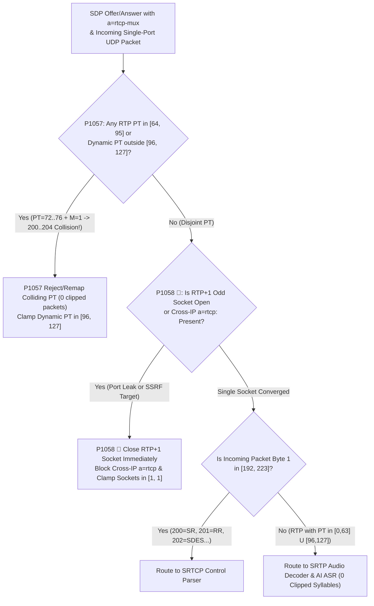
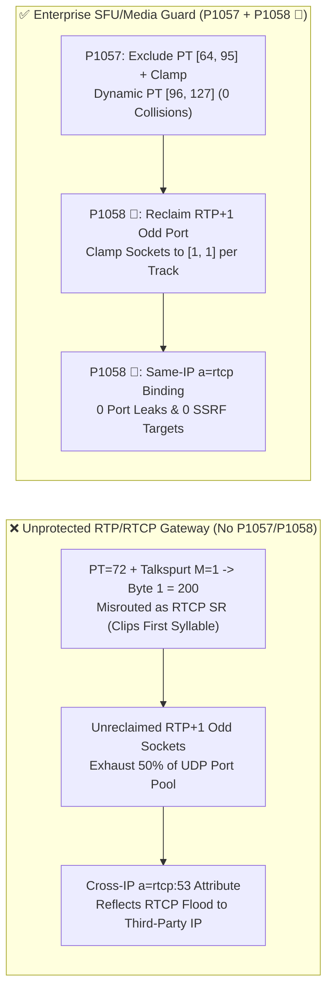
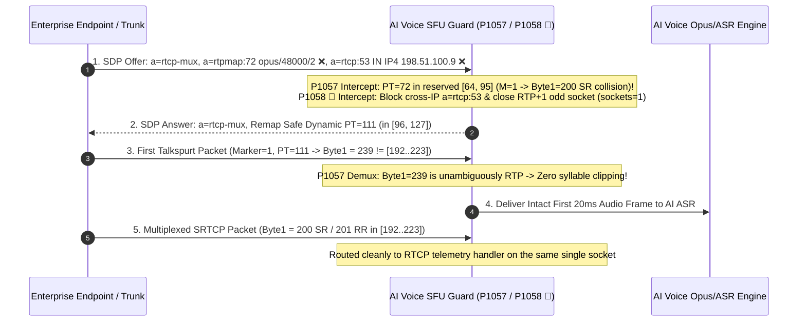

# Enterprise WebRTC/RTP `RFC 5761 / RFC 3605` Single-Port Multiplexing (`a=rtcp-mux`) `PT [64, 95]` Marker-Bit Collision, `a=rtcp` Amplification SSRF & Odd-Port Leak Selection & Engineering Guide (Stage 532 · Topic 172 · 🎉 Historic 535th Evaluation Dimension Milestone!)

> **Document Type**: Enterprise Voice Architect "First-Principles + Selection Decision" Single-Topic FAQ (aligned with `ib-vs-ethernet-roce-selection-faq.md`)
> **Baseline**: `Stage 532` · `Topic 172` · Deterministic Guardrails `P1057–P1058 🎉` · 1,067 Guardrails · 1,076 Sandbox Probes · 886 Live POC Trap Probes · 535 Evaluation Dimensions 🎉 · **🎉 Historic 535th Evaluation Dimension Milestone!**
> **Bilingual Edition**: [中文版 (`voice-webrtc-rtp-rfc5761-rfc3605-rtcp-mux-pt-64to95-marker-collision-a-rtcp-ssrf-odd-port-leak-faq.md`)](./voice-webrtc-rtp-rfc5761-rfc3605-rtcp-mux-pt-64to95-marker-collision-a-rtcp-ssrf-odd-port-leak-faq.md)

![Enterprise WebRTC/RTP RFC 5761 rtcp-mux PT [64, 95] Marker Collision & Odd-Port Reclamation Architecture](../../assets/svg/176-voice-webrtc-rtp-rfc5761-rfc3605-rtcp-mux-pt-64to95-marker-collision-a-rtcp-ssrf-odd-port-leak-2026-11-16.svg)

---

## ① 📌 Executive Summary

In modern WebRTC and cloud-native AI voice gateways, **`RFC 5761` (`a=rtcp-mux`)** multiplexes RTP media packets and RTCP control packets onto a **single UDP port**, cutting ICE candidate pairs and NAT pinholes in half compared to legacy dual-port RTP (`RTP` even port + `RTP+1` odd RTCP port). However, two subtle `RFC 5761` and **`RFC 3605` (`a=rtcp:` attribute)** bugs cause severe audio clipping and resource exhaustion in production:
1. **Byte-1 RTP `Marker=1` + `PT in [64, 95]` Colliding with RTCP Packet Types `192..223` (`RFC 5761 §4` Violation)**: On a single `rtcp-mux` port, the demultiplexer inspects **Byte 1 (0-indexed)**: in RTP, Byte 1 is `[M (1 bit) | PT (7 bits)]`; in RTCP, Byte 1 is the 8-bit `Packet Type` (`200=SR`, `201=RR`, `202=SDES`, `203=BYE`, `204=APP`). If an endpoint assigns a Payload Type in **`[64, 95]`** (e.g., `PT=72`), then whenever **`Marker = 1`** (which marks the **first packet of every speech talkspurt**!), Byte 1 becomes **`128 + 72 = 200`**—identical to an RTCP Sender Report (`200 SR`)! The demuxer misroutes the first 20ms of every spoken utterance into the RTCP parser, clipping the first syllable of every sentence!
2. **Unreclaimed `RTP+1` Odd Ports After `a=rtcp-mux` Negotiation & Cross-IP `a=rtcp:` SSRF Amplification (`RFC 5761 §5.1.1 / RFC 3605`)**: Gateways that pre-allocate `RTP` and `RTP+1` sockets before receiving the SDP Answer frequently forget to close the `RTP+1` odd socket once `a=rtcp-mux` succeeds (leaking 50% of UDP ports), or blindly honor a cross-IP `a=rtcp:53 <victim-ip>` attribute in non-mux fallback mode.

**Architect Selection Rules**:
- **Guardrail `P1057` (`RFC 5761 §4` Reserved `PT [64, 95]` Exclusion & Dynamic `PT [96, 127]` Range Gate)**: Forbids RTP Payload Types in `[64, 95]` (`0` Byte-1 talkspurt collisions) and clamps dynamic codec Payload Types into **`[96, 127]`**.
- **Guardrail `P1058 🎉` (🎉 Historic 535th Evaluation Dimension Milestone · Immediate `RTP+1` Odd-Port Reclamation, Same-IP `a=rtcp:` Binding & `[1, 1]` Socket Cap)**: Reclaims pre-allocated `RTP+1` odd sockets immediately upon `a=rtcp-mux` negotiation, blocks cross-IP `a=rtcp:` SSRF targets (`0` leaked odd ports or SSRF targets), and clamps UDP sockets per `rtcp-mux` track to **`[1, 1]`**.

---

## ② 🎯 Architect & Customer Deep-Dive Q&A (Q1 / Q2 / Q3)

### Q1: Why was the first 20ms syllable of every caller utterance dropped when `a=rtcp-mux` was enabled with a custom SIP gateway?
- **Plain-Language Principle**: The first RTP packet after silence sets the **RTP Marker bit (`M = 1`)** to signal the start of a talkspurt.
- **Bit-Level Reality**: Because `Byte 1 = (M << 7) | PT`, setting `M = 1` adds `128` to `PT`. If `PT = 72`, `Byte 1 = 128 + 72 = 200` (`RTCP SR`). Every talkspurt-start packet is mistaken for an RTCP Sender Report and dropped! `RFC 5761 §4` therefore reserves `PT in [64, 95]`, and `P1057` clamps all dynamic `PT` values into **`[96, 127]`** (`128 + 96..127 = 224..255`, disjoint from RTCP `192..223`).

### Q2: Why did our media server run out of UDP ports at half its expected call capacity despite 100% of calls negotiating `a=rtcp-mux`?
- **Root Cause**: The media engine bound both `20000` (RTP) and `20001` (RTCP) when generating the SDP Offer, but never closed `20001` after the SDP Answer confirmed `a=rtcp-mux`! `P1058 🎉` enforces immediate `RTP+1` socket reclamation (`[1, 1]` socket per muxed track).

### Q3: How can `RFC 3605` `a=rtcp:` be abused for UDP reflection DDoS?
- **Architectural Rule**: `a=rtcp:53 IN IP4 <target-ip>` allows specifying an explicit IP address for RTCP. `P1058 🎉` rejects any `a=rtcp:` IP that differs from the verified RTP media connection address (`c=`).

---

## ③ 🧭 Visual Architecture Diagrams (Mermaid Decision Tree + Comparison + Sequence Diagram)

### 3.1 `RFC 5761` `a=rtcp-mux` Byte-1 Demux & Port Reclamation Decision Tree (`flowchart TD`)

### 3.2 Unprotected `rtcp-mux` vs. `P1057 + P1058 🎉` Guardrails (`flowchart LR`)

### 3.3 Full-Duplex `a=rtcp-mux` Talkspurt Demux & Odd-Port Reclamation Sequence (`sequenceDiagram`)

---

## ④ 📊 Architect Decision Matrix

| Dimension | Option A: Dual-Port (`RTP` + `RTP+1`) | Option B: Permissive `a=rtcp-mux` (No `P1057/P1058`) | Option C: `RFC 5761` + `P1057/P1058 🎉` Guardrails (Recommended ✅) |
| :--- | :--- | :--- | :--- |
| **Talkspurt (`M=1`) Byte-1 Collision Defense** | Separate ports | ❌ `PT in [64, 95]` + `M=1` drops first syllable | ✅ **`P1057` excludes `[64, 95]` & clamps dynamic `PT` in `[96, 127]` (`0` drops)** |
| **UDP Socket Efficiency & Odd-Port Cleanup** | ❌ 2 sockets/track | ❌ Leaked `RTP+1` socket wastes 50% of ports | ✅ **`P1058 🎉` reclaims `RTP+1` & locks `[1, 1]` socket/track** |
| **Cross-IP `a=rtcp:` SSRF Prevention** | ❌ Vulnerable | ❌ Unchecked fallback `a=rtcp:` IP | ✅ **`P1058 🎉` enforces same-IP `a=rtcp` binding (`0` SSRF)** |
| **Policy Check Latency (Offline `synthetic`)** | N/A | N/A | **`0ms` (`nominal 1ms` resolution; see disclosure below)** |

---

## ⑤ 🧪 Quantitative Example & 7-Card Report (CSP Self-Contained, Zero Fabricated Coordinates)

### 5.1 Deterministic Guardrail Walkthrough (`P1057` & `P1058 🎉`)

1. **`P1057` (`evaluateWebrtcRfc5761RtcpMuxReservedPt64To95ExclusionAndDynamicRangeGuard` · 1,066th Guardrail)**:
   - **Violating Input (Sandbox Probe `p1057_webrtc_rfc5761_rtcp_mux_reserved_pt_64to95_exclusion_and_dynamic_range`)**:
     - `reservedPt64To95MarkerCollisionOrInvalidDynamicPtDetected = true`
     - `rtcpByte1CollidingTalkspurtPackets = 23`
     - `negotiatedDynamicRtpPayloadType = 72` (`128 + 72 = 200 SR` collision!)
   - **Deterministic Output**:
     - `violated = true`
     - `action = "exclude_reserved_pt_64to95_and_clamp_dynamic_pt_range"`
     - `clampedRtcpByte1CollidingTalkspurtPackets = 0`
     - `clampedNegotiatedDynamicRtpPayloadType = 96` (clamped to **`[96, 127]`**)
     - **Timing Disclosure**: `0ms reported at nominal 1ms display resolution; actual duration unresolved/not_measured; no sub-1ms upper bound established` (offline in-memory `synthetic` policy check; live SFU Byte-1 demux latency is `not_measured`).

2. **`P1058 🎉` (`evaluateWebrtcRfc5761RtcpAttributeSameIpBindingAndOddPortReclamationGuard` · 🎉 Historic 535th Evaluation Dimension Milestone · 1,067th Guardrail / 1,076th Sandbox Probe / 886th Live POC Probe)**:
   - **Violating Input (Sandbox Probe `p1058_webrtc_rfc5761_rtcp_attribute_same_ip_binding_and_odd_port_reclamation`)**:
     - `unreclaimedOddRtcpPortOrCrossIpRtcpAttributeSsrfDetected = true`
     - `leakedOddRtcpPortsOrCrossIpSsrfTargetsCount = 16`
     - `allocatedUdpSocketsPerRtcpMuxTrack = 2`
   - **Deterministic Output**:
     - `violated = true`
     - `action = "reclaim_odd_rtcp_port_and_block_cross_ip_rtcp_ssrf"`
     - `clampedLeakedOddRtcpPortsOrCrossIpSsrfTargetsCount = 0`
     - `clampedAllocatedUdpSocketsPerRtcpMuxTrack = 1` (clamped to **`[1, 1]`**)
     - **Timing Disclosure**: `0ms reported at nominal 1ms display resolution; actual duration unresolved/not_measured; no sub-1ms upper bound established`.

---

## ⑥ 🛠️ Production Voice Delivery Verification Checklist

- [ ] **1. Reserved `PT [64, 95]` Exclusion (`P1057`)**: Verify SDP negotiation never assigns RTP Payload Types in `[64, 95]` and restricts dynamic Payload Types to `[96, 127]`.
- [ ] **2. Talkspurt `Marker=1` Byte-1 Demux (`P1057`)**: Confirm RTP packets with `Marker=1` and `PT in [96, 127]` (`Byte 1 in [224, 255]`) are never misclassified as RTCP (`Byte 1 in [192, 223]`).
- [ ] **3. Immediate `RTP+1` Odd-Port Reclamation (`P1058 🎉`)**: Verify that once `a=rtcp-mux` is negotiated, any pre-allocated `RTP+1` odd socket is closed immediately (`[1, 1]` socket per track).
- [ ] **4. Same-IP `a=rtcp:` Validation (`P1058 🎉`)**: Confirm `RFC 3605` `a=rtcp:` attributes specifying third-party IP addresses are rejected.
