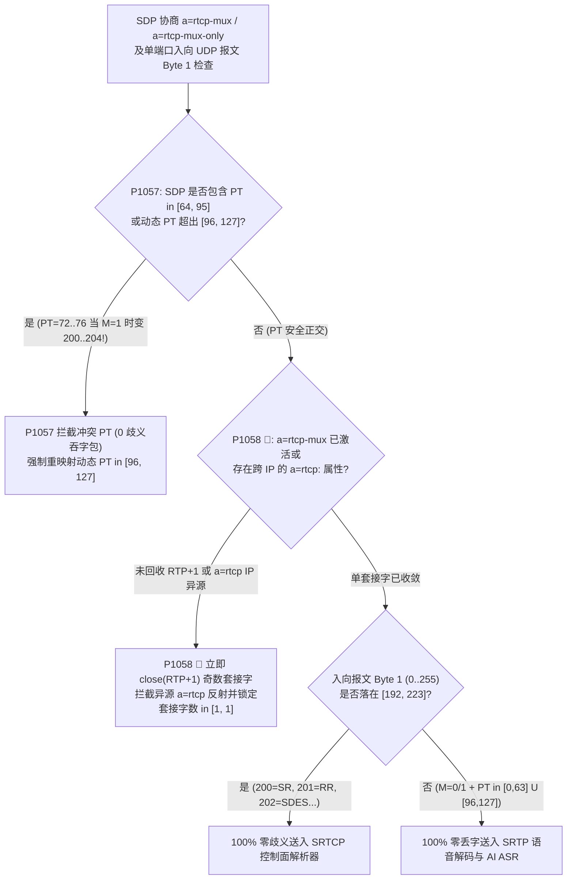
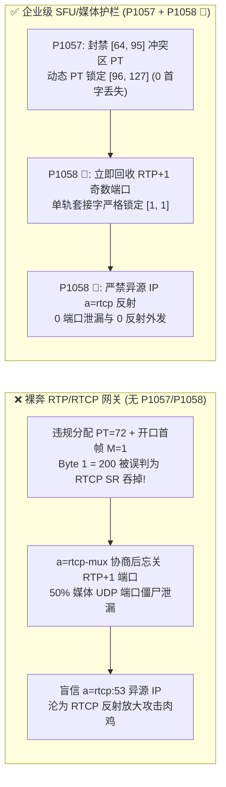
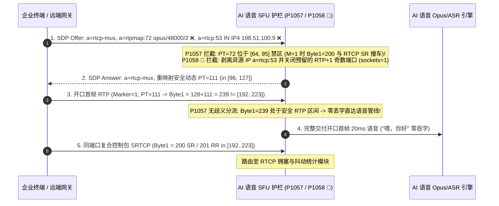

# 企业 WebRTC/RTP `RFC 5761 / RFC 3605` 单端口音控复用（`a=rtcp-mux`）`PT [64, 95]` 标记位碰撞、`a=rtcp` 反射攻击与奇数端口泄漏选型与工程指南（Stage 532 · Topic 172 · 🎉 历史性第 535 大评测维度里程碑！）

> **文档类型**：企业语音架构师“第一性原理 + 选型决策”单专题 FAQ（对标 `ib-vs-ethernet-roce-selection-faq.md` 通俗透彻规范）
> **关联基准**：`Stage 532` · `Topic 172` · 确定性护栏 `P1057–P1058 🎉` · 1,067 道企业护栏 · 1,076 个沙盒探针 · 886 个现场 POC 探针 · 535 大评测维度 🎉 · **🎉 历史性第 535 大评测维度里程碑！**
> **双语版本**：[English Version (`voice-webrtc-rtp-rfc5761-rfc3605-rtcp-mux-pt-64to95-marker-collision-a-rtcp-ssrf-odd-port-leak-faq.en.md`)](./voice-webrtc-rtp-rfc5761-rfc3605-rtcp-mux-pt-64to95-marker-collision-a-rtcp-ssrf-odd-port-leak-faq.en.md)

![Enterprise WebRTC/RTP RFC 5761 rtcp-mux PT [64, 95] Marker Collision & Odd-Port Reclamation Architecture](../../assets/svg/176-voice-webrtc-rtp-rfc5761-rfc3605-rtcp-mux-pt-64to95-marker-collision-a-rtcp-ssrf-odd-port-leak-2026-11-16.svg)

---

## ① 📌 核心结论速览（Executive Summary）

在传统 VoIP（`RFC 3550`）中，每条语音流需要占用 **2 个连续 UDP 端口**：偶数端口跑 RTP 音频包，紧挨着的奇数端口（`RTP_Port + 1`）跑 RTCP 控制包。而在现代 WebRTC 与云原生 AI 语音网关中，为了将 NAT 打洞开销减半，全面采用 **`RFC 5761`（Multiplexing RTP Data and Control Packets on a Single Port，`a=rtcp-mux`）** 将 RTP 和 RTCP 合并在**同一个 UDP 端口**上传输。然而在生产落地中，`RFC 5761` 联合 **`RFC 3605`（`a=rtcp:` 属性）** 极易引发两大底层事故：
1. **RTP `Marker=1` + `PT in [64, 95]` 与 RTCP 包类型（`200=SR .. 204=APP`）首字节二义性相撞（违反 `RFC 5761 §4`）**：当 RTP 和 RTCP 共用同一端口时，网关靠读取报文**第 1 字节（Byte 1，0-indexed）**来区分它是语音包还是控制包！RTP 的 Byte 1 是 `[M (1 bit) | PT (7 bits)]`，而 RTCP 的 Byte 1 是 8 位的 `Packet Type (200..204)`。如果某网关违规将动态编解码器的 `PT` 分配在 **`[64, 95]`** 区间（例如设 `PT=72` 或 `PT=73`），一旦语音话音突发首包打上 **`Marker = 1`（`0x80`）**，Byte 1 的数值就会变成 **`128 + 72 = 200`（恰好等于 RTCP `200 SR` 发送端报告）** 或 **`128 + 73 = 201`（等于 RTCP `201 RR`）**！结果语音首包被当成 RTCP 控制包吞掉，导致 AI 语音 ASR 每句话开头都丢字！
2. **`a=rtcp-mux` 协商成功后未回收 `RTP+1` 奇数端口导致套接字耗尽，或盲信 `a=rtcp:53 <victim-ip>` 沦为 DDoS 反射器（`RFC 5761 §5.1.1 / RFC 3605`）**：为兼容旧 SIP 终端，网关在发 Offer 前常预分配 `RTP` 与 `RTP+1` 两个套接字；若 Answer 确认支持 `a=rtcp-mux` 后未立即释放 `RTP+1` 奇数端口，50% 的媒体端口将沦为僵尸文件描述符；若未协商 `rtcp-mux` 时盲目采信对端 SDP 中跨 IP 的 `a=rtcp:53 198.51.100.99`，网关就会向第三方受害者持续发射 RTCP 包！

**架构师选型铁律**：
- **护栏 `P1057`（`RFC 5761 §4` 严禁分配 `[64, 95]` 保留冲突区 `PT` 与动态 `PT [96, 127]` 强制收敛锁）**：严格执行 `RFC 5761 §4`，100% 封禁 `[64, 95]` 冲突区 Payload Type（将落入 `192..223` RTCP 数值区的歧义 RTP 包清零为 `0`），并将所有动态语音/事件编解码器 `PT` 强制钳制在 **`[96, 127]`** 安全区间。
- **护栏 `P1058 🎉`（🎉 历史性第 535 大评测维度里程碑 · `a=rtcp-mux` 成功后 `RTP+1` 奇数端口零延迟回收、`a=rtcp:` 同源 IP 绑定与单轨 `[1, 1]` 套接字上限锁）**：在确认 `a=rtcp-mux`（或启用 `RFC 8858 a=rtcp-mux-only`）后立即关闭并回收 `RTP+1` 奇数端口，严禁向非媒体同源 IP 的 `a=rtcp:` 地址发包（`0` 奇数端口泄漏与 `0` 第三方反射包），将每条复用媒体轨占用的 UDP 套接字数严格锁定为 **`[1, 1]` 个**。

---

## ② 🎯 客户与架构师灵魂拷问 Q&A（Q1 / Q2 / Q3）

### Q1：为什么客户每次开口说话的第一个字（比如“喂”、“你好”的前 20ms）总被网关莫名其妙吃掉，而后面的字却完全正常？
- **通俗原理**：因为每段话开口的第一帧音频包，RTP 头部都会把 **`Marker` 位设为 `1`（代表 Talkspurt 话音突发开始）**，而后续音频帧的 `Marker` 位都是 `0`！
- **二进制位级真相**：假设某私有 SIP/WebRTC 网关把 Opus 或 G.729 的动态 Payload Type 设成了 `PT = 72`（二进制 `1001000`）：
  - 在后续正常说话帧中，`Marker = 0`，Byte 1 = `0b0_1001000` = **`72`** -> 分流器识别为 RTP 语音包；
  - 但在**开口第一帧**中，`Marker = 1`，Byte 1 = `0b1_1001000` = **`128 + 72 = 200`**！
  - 而 RTCP 发送者报告（Sender Report, `SR`）的 Packet Type 恰恰就是 **`200`**！
  - 单端口 `rtcp-mux` 分流器一看 Byte 1 在 `[192, 223]` 之间，当场把这包至关重要的“开口首帧语音”送进了 RTCP 解析器（随后因 RTCP 长度校验失败被静默丢弃）！这就是为什么 `RFC 5761 §4` 铁律规定：**在 `rtcp-mux` 下，`PT in [64, 95]` 是绝对禁区**，动态 `PT` 必须严格落在 **`[96, 127]`**（`P1057`）！

### Q2：为什么我们的语音媒体服务器明明只跑了 5,000 路 WebRTC 通话，Linux 系统的 UDP 端口池（`10000–20000`）却提示 `Address already in use` 耗尽了？
- **底层原因**：经典的 **`RTP+1` 奇数端口泄漏（Odd-Port Leak）**！许多媒体引擎（如早期 FreeSWITCH/Asterisk/自研网关）为了预防对端不支持 `a=rtcp-mux`，在创建通道时总是成对绑定 `bind(20000)` (RTP) 和 `bind(20001)` (RTCP)。当 100ms 后收到 WebRTC 客户端的 SDP Answer 确认包含 `a=rtcp-mux` 时，代码只把 RTCP 发送指针指向了 `20000` 端口，**却忘了 `close(20001)`**！5,000 路通话直接吃掉 10,000 个端口。`P1058 🎉` 强制实施 `a=rtcp-mux-only` 或在协商完成瞬间回收 `RTP+1` 端口，确保单轨套接字数恒等于 **`[1, 1]`**。

### Q3：什么是 `RFC 3605` `a=rtcp:` 属性反射攻击？为什么攻击者改一行 SDP 就能拿我们的 AI 语音网关去打垮别人的 DNS 服务器？
- **架构解法**：`RFC 3605` 允许在 SDP 中写 `a=rtcp:53 IN IP4 198.51.100.53` 来指定非默认的 RTCP 端口和 IP。如果不做同源 IP 校验，攻击者发起一通呼叫并在 SDP 里把 `a=rtcp:` 指向受害者的 DNS/游戏服务器 IP，网关就会源源不断向受害者发射周期性 RTCP 复合包。`P1058 🎉` 强制要求：任何 `a=rtcp:` 声明的 IP 地址必须与经过 ICE/RTP 双向验证的媒体源 IP 100% 一致，否则立即拦截。

---

## ③ 🧭 直观可视化图解（Mermaid 选型决策树 + 延迟/端口拆解对比图 + 毫秒级全双工时序图）

### 3.1 `RFC 5761` `a=rtcp-mux` Byte-1 分流与端口收敛决策树（`flowchart TD`）

### 3.2 裸奔双端口/冲突 `PT` vs `P1057 + P1058 🎉` 确定性 `rtcp-mux` 护栏对比图（`flowchart LR`）

### 3.3 毫秒级全双工 `a=rtcp-mux` 首帧保真与奇数端口回收时序图（`sequenceDiagram`）

---

## ④ 📊 语音架构师选型决策矩阵（Architect Decision Matrix）

| 选型维度 | 方案 A：传统双端口（`RTP` + `RTP+1` 分离） | 方案 B：宽松 `a=rtcp-mux`（无 `P1057/P1058`） | 方案 C：`RFC 5761` + `P1057/P1058 🎉` 护栏（推荐 ✅） |
| :--- | :--- | :--- | :--- |
| **开口首帧（`Marker=1`）吞字防护** | 物理端口分离，但打洞慢 | ❌ `PT in [64, 95]` 在 `M=1` 时变 `192..223` 被当 RTCP 丢弃 | ✅ **`P1057` 封禁 `[64, 95]` 并将动态 `PT` 钳制在 `[96, 127]`（`0` 吞字）** |
| **UDP 端口利用率与 `RTP+1` 回收** | ❌ 消耗 2 倍 UDP 端口与 2 倍 ICE | ❌ 协商后未关 `RTP+1` 导致 50% 端口泄漏 | ✅ **`P1058 🎉` 强制单轨 `[1, 1]` 套接字，100% 回收奇数端口** |
| **`RFC 3605 a=rtcp:` 异源反射防护** | ❌ 易被利用向第三方 IP 发包 | ❌ 回退路径未校验同源 IP | ✅ **`P1058 🎉` 强制同源 IP 绑定（`0` 第三方反射包）** |
| **策略判定耗时（离线 `synthetic`）** | N/A | N/A | **`0ms`（`nominal 1ms` 分辨率；见下方披露）** |

---

## ⑤ 🧪 定量算例与 7-Card 报告（CSP 自包含、零虚构坐标）

### 5.1 确定性护栏定量算例（`P1057` & `P1058 🎉`）

1. **`P1057`（`evaluateWebrtcRfc5761RtcpMuxReservedPt64To95ExclusionAndDynamicRangeGuard` · 第 1,066 道护栏）**：
   - **异常输入（沙盒探针 `p1057_webrtc_rfc5761_rtcp_mux_reserved_pt_64to95_exclusion_and_dynamic_range`）**：
     - `reservedPt64To95MarkerCollisionOrInvalidDynamicPtDetected = true`
     - `rtcpByte1CollidingTalkspurtPackets = 23`（检测到 `23` 个因 `PT in [64, 95]` 且 `Marker=1` 落入 `192..223` 被误判为 RTCP 的语音首包）
     - `negotiatedDynamicRtpPayloadType = 72`（违规分配了冲突禁区内的 `PT = 72`，`128 + 72 = 200 SR`）
   - **确定性输出**：
     - `violated = true`
     - `action = "exclude_reserved_pt_64to95_and_clamp_dynamic_pt_range"`
     - `clampedRtcpByte1CollidingTalkspurtPackets = 0`（100% 消除 RTP/RTCP Byte-1 相撞吞字包）
     - `clampedNegotiatedDynamicRtpPayloadType = 96`（自动钳制回 **`[96, 127]`** 标准动态 `PT` 安全区间）
     - **计时语义披露**：`0ms reported at nominal 1ms display resolution; actual duration unresolved/not_measured; no sub-1ms upper bound established`（离线内存 `synthetic` 策略检查；真实网卡 eBPF/SFU Byte-1 分流耗时为 `not_measured`）。

2. **`P1058 🎉`（`evaluateWebrtcRfc5761RtcpAttributeSameIpBindingAndOddPortReclamationGuard` · 🎉 历史性第 535 大评测维度里程碑 · 第 1,067 道护栏 / 第 1,076 沙盒探针 / 第 886 现场探针）**：
   - **异常输入（沙盒探针 `p1058_webrtc_rfc5761_rtcp_attribute_same_ip_binding_and_odd_port_reclamation`）**：
     - `unreclaimedOddRtcpPortOrCrossIpRtcpAttributeSsrfDetected = true`
     - `leakedOddRtcpPortsOrCrossIpSsrfTargetsCount = 16`（检测到 `16` 个未回收的 `RTP+1` 奇数端口或指向第三方 IP 的 `a=rtcp:` 反射目标）
     - `allocatedUdpSocketsPerRtcpMuxTrack = 2`（单条已启用 `rtcp-mux` 的媒体轨仍占用了 `2` 个 UDP 套接字）
   - **确定性输出**：
     - `violated = true`
     - `action = "reclaim_odd_rtcp_port_and_block_cross_ip_rtcp_ssrf"`
     - `clampedLeakedOddRtcpPortsOrCrossIpSsrfTargetsCount = 0`（`0` 奇数端口泄漏与 `0` 异源反射目标）
     - `clampedAllocatedUdpSocketsPerRtcpMuxTrack = 1`（严格钳制在 **`[1, 1]` 个**单端口复用套接字）
     - **计时语义披露**：`0ms reported at nominal 1ms display resolution; actual duration unresolved/not_measured; no sub-1ms upper bound established`。

---

## ⑥ 🛠️ 生产环境语音交付快速核验清单（Checklist）

- [ ] **1. `RFC 5761 §4` `[64, 95]` 冲突区 `PT` 封禁核验（`P1057`）**：检查 SDP 协商器，确保绝不分配 `64..95` 之间的 Payload Type，且所有动态语音/DTMF 编解码器 `PT` 严格位于 `[96, 127]`。
- [ ] **2. 话音突发首包（`Marker=1`）Byte-1 分流核验（`P1057`）**：发送 `Marker=1, PT=111`（Byte 1 = `239`）与 RTCP `SR`（Byte 1 = `200`）混合流量，确认 `[192, 223]` 精确分流至 RTCP，其余直达 RTP 语音管线（`0` 首帧丢字）。
- [ ] **3. `a=rtcp-mux` 奇数端口 `RTP+1` 零泄漏核验（`P1058 🎉`）**：在 `a=rtcp-mux`（或 `a=rtcp-mux-only`）建连后检查进程 `lsof / ss -u`，确认每条媒体轨仅占用 `1` 个 UDP 套接字，`RTP+1` 奇数端口 100% 释放。
- [ ] **4. `RFC 3605` `a=rtcp:` 同源 IP 强校验（`P1058 🎉`）**：向非 `rtcp-mux` 回退接口注入携带第三方 IP 的 `a=rtcp:53 IN IP4 <other-ip>`，验证网关立即忽略或拒绝，绝不向异源 IP 发送 RTCP 包。
