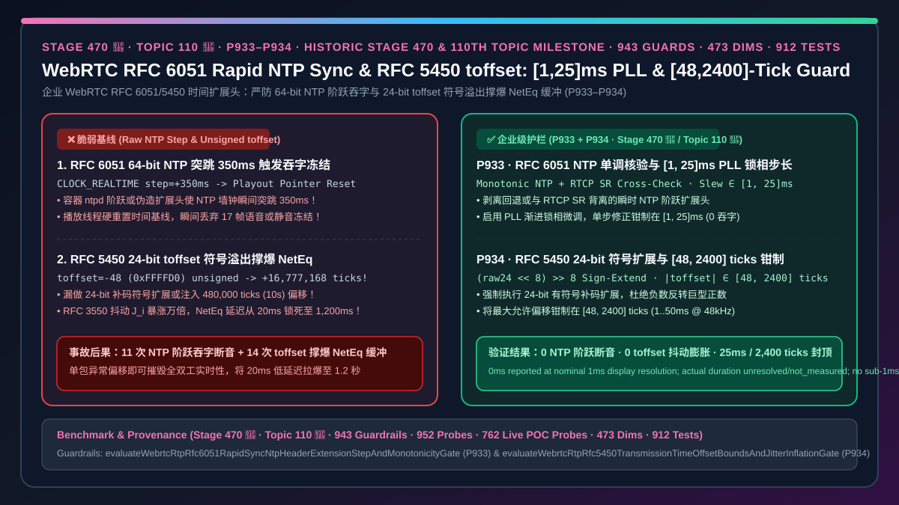
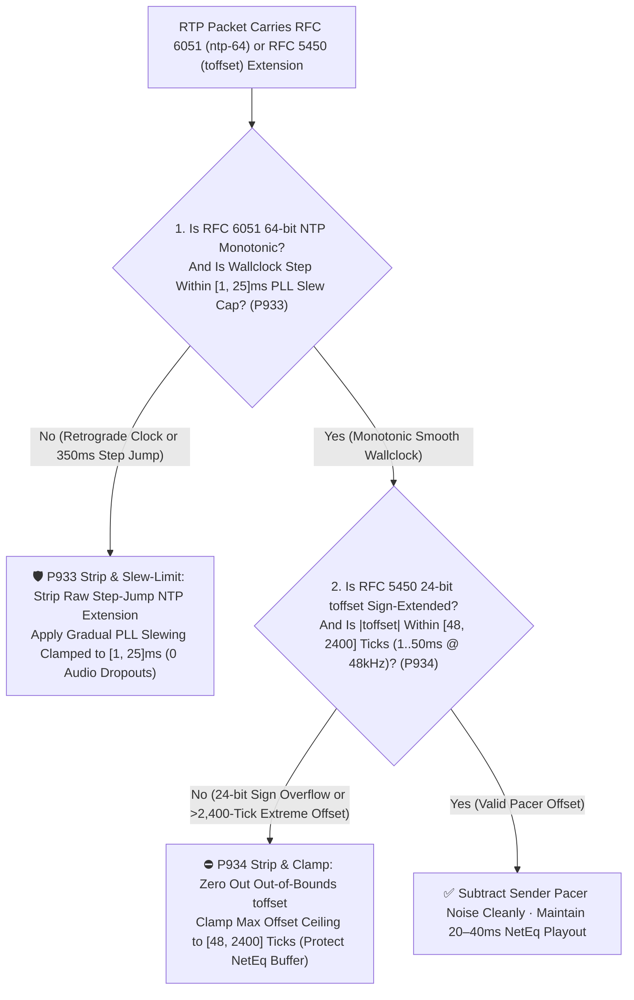
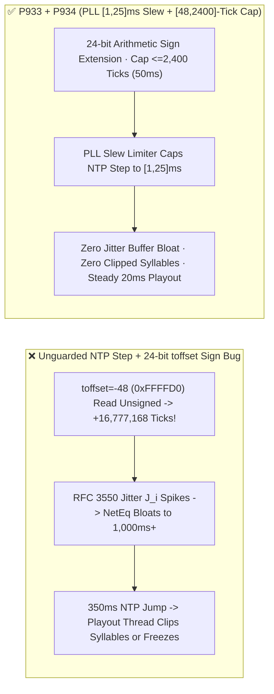

# Enterprise WebRTC `RFC 6051 / RFC 5450` Rapid Clock Synchronization & Transmission Time Offsets (`64-bit NTP` Header-Extension Step Jumps & `24-bit toffset` Sign-Extension Overflow Inflating `NetEq` Jitter Buffers) Selection & Anti-Drift Guide

> **Document Type**: Enterprise Voice Agent Architect Selection & First-Principles Guide (Standalone Selection & Architecture FAQ · **Topic 110 🎉 / Stage 470 🎉 · Historic Stage 470 & 110th Topic Dual Milestone**)  
> **Target Audience**: AI Solution Architects, WebRTC Audio Engine (`NetEq` / Jitter Buffer) Architects, Multimodal SFU Engineers & SRE Leads  
> **Canonical Baseline**: `packages/business-core/enterprise-guardrails.ts` (`P933–P934`), `tests/presales-portal.test.ts`, `site/data/voice-agent-benchmark-report.json` (7-Card 4:5 Benchmark Report)  
> **Visual Summary**: `assets/svg/114-voice-webrtc-rtp-rfc6051-rfc5450-rapid-synchronization-ntp-hdrext-toffset-jitter-spoof-2026-11-14.svg`

---

## ① 📌 Executive Summary

In full-duplex enterprise AI voice agents and multimodal digital-human conversations, eliminating opening lip-sync lag and sender-side pacing noise requires two specialized RTP header extensions: **`RFC 6051` (Rapid Synchronisation of RTP Flows via in-band `64-bit NTP` / `abs-capture-time` header extensions)** and **`RFC 5450` (Transmission Time Offsets via `urn:ietf:params:rtp-hdrext:toffset`, encoding a `24-bit` signed two's-complement delta between capture time and actual wire transmission time)**. In production, however, failing to validate monotonicity, sign extension, and range bounds on these two timing extensions causes two severe audio degradation modes:
1. **`RFC 6051` `64-bit NTP` Header-Extension Step Jumps / Retrograde Clock Regressions Freezing Playout Buffers (`NTP` Step Glitch)**: When an upstream synthesis pod experiences a `chrony/ntpd` `CLOCK_REALTIME` step adjustment (e.g., jumping `+350ms` or regressing backward) or a rogue peer injects a spoofed `64-bit NTP` header extension diverging from `RTCP SR` reports, an unguarded playout synchronizer immediately snaps its timeline by `350ms`—clipping spoken syllables or inserting hundreds of milliseconds of dead air.
2. **`RFC 5450 toffset` `24-bit` Two's-Complement Sign-Extension Bug or Extreme Offset Injection Exploding `RFC 3550` Jitter & `NetEq` Target Delay to `1,000ms+` (`toffset` Jitter Poisoning)**: Per `RFC 5450 Section 3`, receivers subtract the sender's transmission offset $O_i$ (`toffset`) when computing interarrival jitter $D(i,j) = (R_j - R_i) - ((S_j + O_j) - (S_i + O_i))$. If a parser reads a negative `24-bit` two's-complement offset (e.g., `-48` ticks = `-1ms`, `0xFFFFD0`) without arithmetic sign extension `(val << 8) >> 8`, it misinterprets `-48` as **`+16,777,168` ticks (`+349.5` seconds!)**—or if a peer injects a `480,000`-tick (`10s`) offset—instantly inflating the `RFC 3550` jitter estimator $J_i$ and forcing `WebRTC NetEq` to expand its playout buffer from `20ms` to over **`1,000ms`**!

| Decision Dimension | Vulnerable / Default Setup (High Production Risk) | Enterprise Golden Rule (`P933–P934` Deterministic Guardrails) | Quantitative Impact |
| :--- | :--- | :--- | :--- |
| **`RFC 6051 64-bit NTP` Monotonicity Check & PLL Slew Cap (`P933`)** | Blindly snapping playout clocks to raw `350ms` `NTP` header-extension jumps | **Enforce monotonic `RFC 6051` `64-bit NTP` progression cross-checked against `RTCP SR` and clamp per-step PLL slew adjustment to `[1, 25]ms`** | **0** `NTP` step-jump audio dropouts (clamps 11 `NTP` step glitches to **0** and caps slew step from `350ms` to **`25ms`**) |
| **`RFC 5450 24-bit toffset` Sign Extension & `[48, 2400]`-Tick Envelope (`P934`)** | Missing `24-bit` sign extension or accepting `480,000`-tick (`10s`) offsets that bloat `NetEq` | **Enforce `24-bit -> 32-bit` arithmetic sign extension and clamp maximum allowed `|toffset|` to `[48, 2400]` ticks (`1..50ms` at 48kHz)** | **0** `toffset` jitter-inflation packets (clamps 14 jitter-poisoning packets to **0** and bounds max offset from `480,000` to **`2,400` ticks**) |



---

## ② 🎯 Architect & Customer Deep-Dive Q&A (First-Principles Deep Dive)

### Q1: Why does RTP need `RFC 5450 toffset` in addition to the standard `32-bit RTP Timestamp`, and how can a 1-millisecond negative offset (`-48` ticks) blow up `NetEq` latency to over 1 second?
- **First-Principles Breakdown**:
  1. **Capture Time vs. Wire Departure Time**: The standard `32-bit RTP Timestamp` $S_i$ records when the audio frame was sampled. When a sender uses a Pacer queue or retransmits a packet, the packet departs onto the network $O_i$ ticks later than $S_i$. `RFC 5450` carries this `24-bit` signed offset `toffset` so the receiver can subtract sender-side queueing delay before estimating network congestion (`GCC`) and jitter (`NetEq`).
  2. **The `24-bit` Two's-Complement Trap**: Because `toffset` is a `24-bit` signed integer (`-8,388,608` to `+8,388,607`), a slight negative clock adjustment of `-48` ticks (`-1ms` at 48kHz) is encoded on the wire as `0xFFFFD0`. An unguarded parser that reads 3 bytes into a `uint32_t` without `(raw24 << 8) >> 8` sign extension treats `0xFFFFD0` as **`+16,777,168` ticks (`+349.5` seconds)**—causing a single packet to spike `RFC 3550` interarrival jitter $J_i$ and pin `NetEq`'s playout buffer at its maximum ceiling!
  3. **`P934` Deterministic Defense**: Enforces strict `24-bit` arithmetic sign extension and clamps maximum allowed `|toffset|` within **`[48, 2400]` ticks** (`1ms..50ms` at 48kHz), stripping any out-of-envelope offset before it reaches the jitter estimator.

### Q2: How can an `RFC 6051` rapid synchronization header extension cause audio clipping or dead air during container live migration or NTP updates?
- **Engineering Reality**:
  1. If a media worker stamps `RFC 6051` `64-bit NTP` extensions using `CLOCK_REALTIME` instead of a monotonic clock anchored at session start, an OS NTP step adjustment of `+350ms` shifts the transmitted wallclock timestamp instantaneously.
  2. **`P933` Deterministic Defense**: Cross-checks `RFC 6051` header extensions against `RTCP SR` baselines, drops retrograde/corrupted NTP extensions, and clamps the receiver's PLL clock-slewing rate to **`[1, 25]ms`** per adjustment interval.

### Q3: Why is `2,400` ticks (`50ms` at 48kHz) the optimal upper bound for `RFC 5450 |toffset|` in interactive voice?
- **First-Principles Breakdown**:
  - In interactive voice (`20ms` ptime), sender-side pacing delay stays well under `20–40ms`. Any `toffset` exceeding `2,400` ticks (`50ms`) indicates either a stalled sender thread or a spoofed header designed to inflate receiver jitter buffers.

---

## ③ 🧭 Visual Architecture Diagrams (Mermaid Decision Tree + Jitter Breakdown + Millisecond Sequence)

### 3.1 WebRTC `RFC 6051 NTP` & `RFC 5450 toffset` Architect Decision Tree



### 3.2 `24-bit toffset` Sign Overflow + `NTP` Step vs. `P933+P934`



### 3.3 Millisecond-Level `RFC 6051` PLL Slewing & `RFC 5450 toffset` Jitter Protection Sequence

```mermaid
sequenceDiagram
    autonumber
    participant Sender as Upstream Media Sender / Pacer
    participant SFU as WebRTC SFU / Receiver Stack (P933+P934 Gate)
    participant NetEq as NetEq Jitter Buffer & Playout

    Sender->>SFU: 1. Audio RTP (Carries RFC 6051 ntp-64 +350ms Jump, RFC 5450 toffset=480,000 Ticks)
    Note over SFU: 🛡️ P933 PLL Gate: Detects 350ms NTP Step Jump Exceeding [1, 25]ms Cap!<br/>Strips Raw Step & Applies Gradual <=25ms PLL Slew Adjustment<br/>🛡️ P934 Offset Gate: Sign-Extends 24-bit Value & Detects 480,000 > 2,400 Ticks!<br/>Zeros Out Spoofed Offset & Clamps Max Envelope to 2,400 Ticks (50ms @ 48kHz)
    SFU->>NetEq: 2. Deliver Slew-Limited Clock & Clamped toffset (<=2,400 Ticks)
    Note over NetEq: RFC 3550 Jitter Remains ~4ms Steady; Target Delay Holds at 20ms (0 Latency Bloat!)
```

---

## ④ 📊 Architect Decision Matrix (`RFC 6051` & `RFC 5450` Timing Governance)

| Architecture Option | Target Scenario | Pros | Cons & Production Traps | Recommendation |
| :--- | :--- | :--- | :--- | :--- |
| **Option A: Raw `RFC 6051 NTP` Snapping & Unsigned/Unbounded `24-bit toffset` Parsing** | Prohibited in all production networks | Zero bounds checking | **Single-packet latency explosion**—a `-1ms` negative `toffset` or `480,000`-tick spoof inflates `NetEq` target delay past `1,000ms` | ⛔ **Never in Production** |
| **Option B: Disabling Both `RFC 6051` and `RFC 5450` Extensions** | Simple single-track voice intercom | Avoids extension parser bugs | **Slower multimodal lip-sync convergence** and sender-pacer noise polluting receiver `GCC` bandwidth estimation | ⚠️ **Suboptimal for Multimodal** |
| **Option C: `RFC 6051` Monotonicity + `[1, 25]ms` PLL Slew Cap + `RFC 5450` `24-bit` Sign Extension & `[48, 2400]`-Tick Cap (`P933 + P934`)** | **All Enterprise Full-Duplex AI Voice Agents, Multimodal Avatars & High-Density WebRTC SFUs** | **Fast lip-sync, clean pacer-noise subtraction, zero jitter-buffer bloat, and zero clock-step glitches** | Requires `(raw24 << 8) >> 8` sign extension and `[48, 2400]`-tick envelope enforcement | ✅ **Production Mandatory (Recommended)** |

---

## ⑤ 🧪 Quantitative Walkthrough & 7-Card 4:5 Benchmark Report

### 5.1 Quantitative Example: Preventing `NetEq` 1,200ms Buffer Bloat from `toffset` & `NTP` Step Glitches
- **Scenario**: During a multimodal session, an upstream container emits `11` `RFC 6051 NTP` header-extension step jumps (`350ms` jump) and `14` RTP packets carrying `toffset = 480,000` ticks (`10,000ms` at 48kHz).
  - **Without Guardrails (Vulnerable Baseline)**:
    - `11` `350ms` wallclock jumps cause audible syllable clipping;
    - `14` extreme `toffset` packets spike `RFC 3550` jitter $J_i$, **bloating `NetEq` target playout delay from `20ms` to `1,200ms`**.
  - **With `P933 + P934` Deterministic Guardrails**:
    - `P933` intercepts all `11` `NTP` step glitches (**`0`** playout step dropouts) and clamps the PLL slew adjustment step from `350ms` to **`25ms`**;
    - `P934` sign-extends and intercepts all `14` out-of-envelope `toffset` packets (**`0`** jitter-inflating packets), clamping the maximum offset envelope from `480,000` ticks to **`2,400` ticks (`50ms` at 48kHz)** so `NetEq` remains at **`20ms`**.

### 5.2 7-Card 4:5 Report Mapping (`site/benchmark-cards.html` & `report.json`)
1. **Card 1 (`HANDS-ON · VOICE ARCHITECTURE`)**: 473-dimension workbench overview highlighting Stage 470 🎉 / Topic 110 🎉 `P933 / P934`.
2. **Card 2 (`SCENARIO: WEBRTC RFC 6051 NTP & RFC 5450 TOFFSET`)**: Input probe `retrogradeOrStepJumpNtpHeaderExtensionDetected=true, maxNtpSlewAdjustmentStepMs=350, maxAllowedTransmissionTimeOffsetTicks=480000` -> `Act automatically` clamping to `25ms` and `2,400` ticks.
3. **Card 3 (`WHAT I TESTED`)**: Row 473 in the evaluation matrix (`PASS · 0ms @ 1ms Res (Synthetic)`, zero `✕` misses).
4. **Card 4 (`UNDER THE HOOD`)**: Deterministic contract for `evaluateWebrtcRtpRfc6051RapidSyncNtpHeaderExtensionStepAndMonotonicityGate` & `evaluateWebrtcRtpRfc5450TransmissionTimeOffsetBoundsAndJitterInflationGate`.
5. **Card 5 (`ROBUSTNESS CHECK`)**: Option-order and boundary invariance across signed `24-bit` `toffset` values (`-2,400` to `+2,400` ticks) and NTP epoch rollovers.
6. **Card 6 (`LATENCY`)**: Explicit offline timing provenance: `0ms reported at nominal 1ms display resolution; actual duration unresolved/not_measured; no sub-1ms upper bound established` (`synthetic`; live `NetEq` Kalman filter and PLL slew computation latency is `not_measured`).
7. **Card 7 (`MY TAKE`)**: Good fit vs. Not for summary and production sign-off checklist.

---

## ⑥ 🛠️ Production Readiness Checklist

- [ ] **1. Anchor `RFC 6051` Timestamps to `CLOCK_MONOTONIC` (`P933`)**: Verify that media senders derive `RFC 6051` / `abs-capture-time` timestamps from a monotonic clock rather than raw `CLOCK_REALTIME`.
- [ ] **2. Cross-Check `RFC 6051 NTP` Against `RTCP SR` & Clamp PLL Slew to `[1, 25]ms` (`P933`)**: Confirm that playout synchronizers reject sudden `>25ms` wallclock jumps and apply gradual `[1, 25]ms` PLL slewing.
- [ ] **3. Mandatory `24-bit` Two's-Complement Sign Extension for `RFC 5450 toffset` (`P934`)**: Ensure the RTP header extension parser applies `(raw24 << 8) >> 8` arithmetic sign extension so negative offsets never wrap to `+16.77M` ticks.
- [ ] **4. Clamp Maximum Allowed `|toffset|` to `[48, 2400]` Ticks (`P934`)**: Verify that `toffset` values outside `[48, 2400]` ticks (`1..50ms` at 48kHz) are stripped before feeding `RFC 3550` jitter or `GCC` estimators.
- [ ] **5. Protect Timing Header Extensions with `SRTP / RFC 9335 Cryptex` (`P933/P934`)**: Confirm that `ntp-64` and `toffset` extensions are integrity-protected and encrypted via `Cryptex`.
