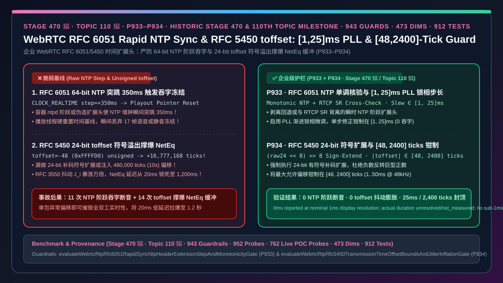
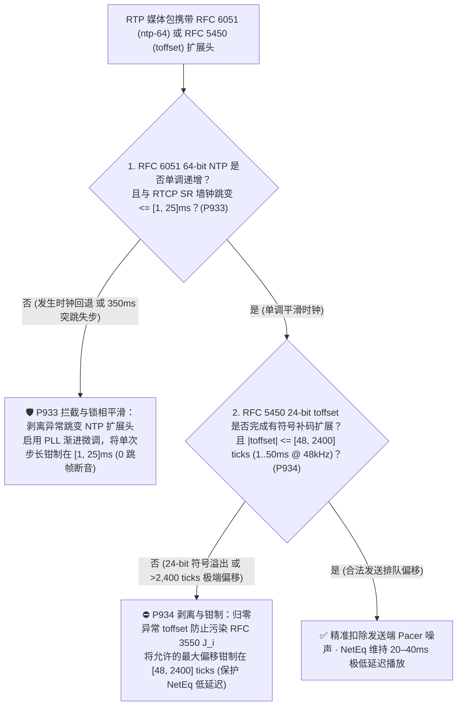
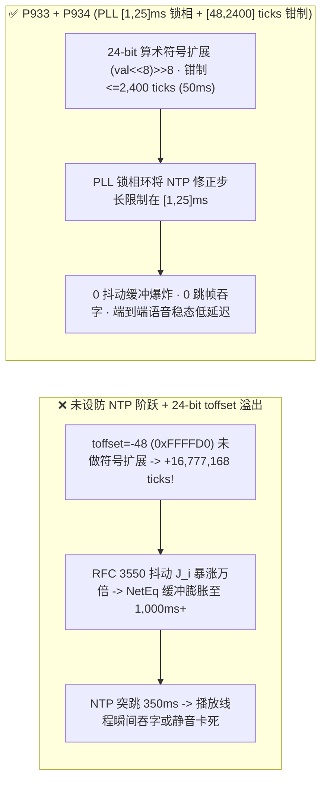
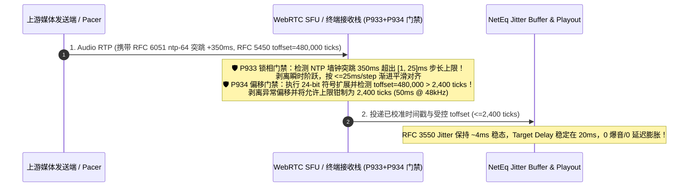

# 企业 WebRTC `RFC 6051 / RFC 5450` 快速时钟同步与发送时间偏移（`64-bit NTP` 扩展头跳变失锁与 `24-bit toffset` 符号溢出撑爆 `NetEq` 抖动缓冲）选型与防漂移指南

> **文档类型**：企业级语音智能体架构师选型决策与原理解析指南（Standalone Selection & Architecture FAQ · **Topic 110 🎉 / Stage 470 🎉 · 历史性 Stage 470 与第 110 大专题双里程碑**）  
> **适用角色**：AI Solution Architect、WebRTC 实时音频引擎（NetEq / Jitter Buffer）架构师、多模态 SFU 研发与 SRE 负责人  
> **关联基准**：`packages/business-core/enterprise-guardrails.ts`（`P933–P934`）、`tests/presales-portal.test.ts`、`site/data/voice-agent-benchmark-report.json`（7-Card 4:5 评测报告）  
> **可视化总结**：`assets/svg/114-voice-webrtc-rtp-rfc6051-rfc5450-rapid-synchronization-ntp-hdrext-toffset-jitter-spoof-2026-11-14.svg`

---

## ① 📌 核心结论速览（Executive Summary）

在全双工 AI 语音对话与多模态数字人交互中，为了彻底消灭等待周期性 `RTCP SR` 带来的首帧音画同步延迟，同时消除发送端 Pacer（平滑发送队列）引入的排队噪声，现代 WebRTC 栈普遍启用两项关键 RTP 扩展头：**`RFC 6051`（Rapid Synchronisation of RTP Flows：在 RTP 扩展头内直接嵌入 `64-bit NTP` 绝对采集时间戳，以及现代 WebRTC `abs-capture-time`）** 与 **`RFC 5450`（Transmission Time Offsets `urn:ietf:params:rtp-hdrext:toffset`：用 `24-bit` 有符号补码记录“报文实际发上网卡时刻”与“采样时刻”的偏差）**。然而在生产环境中，若 SFU 或接收端未对这两个高精度时钟扩展头执行边界钳制与交叉核验，极易引发两类隐蔽且致命的语音延迟爆炸事故：
1. **`RFC 6051` 内嵌 `64-bit NTP` 时间戳跳变/回退（NTP Step / Retrograde Jump）导致播放缓冲区瞬时清空或冻结数秒**：当上游 AI 合成容器或采集端的系统时钟发生 `chrony / ntpd` 阶跃修正（例如向前或向后跳变 `350ms`），或者恶意客户端在 `RFC 6051` 扩展头中注入伪造的未来/过去 `64-bit NTP` 时间戳且与慢速 `RTCP SR` 报告严重背离时，下游播放同步器（Playout Synchronizer）会误以为音频流突然超前或滞后了数百毫秒，当即触发剧烈的丢帧快进或插入数百毫秒静音等待！
2. **`RFC 5450 toffset` `24-bit` 有符号补码未做符号扩展或注入极端偏移（如 `+8,388,607` ticks $\approx 174.7\text{s}$）导致 `RFC 3550` 抖动估算与 `NetEq` 缓冲延迟暴涨至 `1,000ms+`（`toffset` 抖动投毒）**：根据 `RFC 5450 Section 3`，接收端在计算到达间隔抖动（Interarrival Jitter $J_i$）与卡尔曼滤波单向延迟梯度时，会先用公式 $D(i,j) = (R_j - R_i) - ((S_j + O_j) - (S_i + O_i))$ 将发送偏移 $O_j$（`toffset`）扣除。如果解析器把 `24-bit` 负数补码（如 `-48` ticks = `-1ms`）错误当作无符号正整数 `16,777,168` ticks（`+349.5` 秒！），或者对端注入超出正常 Pacer 排队范围（`>50ms`）的异常 `toffset`，接收端的抖动估算值 $J_i$ 会瞬间飙升数千倍，迫使 `NetEq` 将目标缓冲水位（Target Level）拉满到 `1,000ms+` 上限，让原本流畅的 200ms 实时语音瞬间退化为高延迟对讲机！

| 决策维度 | 脆弱/默认配置（生产事故高发区） | 企业级黄金准则（`P933–P934` 确定性护栏） | 核心量化收益 |
| :--- | :--- | :--- | :--- |
| **`RFC 6051` `64-bit NTP` 扩展头单调核验与渐进锁相步长上限（`P933`）** | 盲目采用扩展头中的瞬时 `NTP` 阶跃值（如跳变 `350ms`），不与 `RTCP SR` 交叉核对 | **强制核验 `RFC 6051` `64-bit NTP` 单调递增并与 `RTCP SR` 交叉比对，剥离回退/异常跳变包并将单次时钟锁相微调步长钳制在 `[1, 25]ms`** | `NTP` 跳变断音与回退包 **0 个**（测试探针将 11 次 `NTP` 阶跃失步清零，单次锁相微调步长从 `350ms` 钳制至 **`25ms`**） |
| **`RFC 5450 24-bit toffset` 符号扩展校验与 `[48, 2400]` ticks 包络锁（`P934`）** | 将 `24-bit` 补码误作无符号数或放行 `480,000` ticks (`10s`) 偏移撑爆 `NetEq` | **严格执行 `24-bit -> 32-bit` 符号扩展，并将允许的 `|toffset|` 排队偏移上限钳制在 `[48, 2400]` ticks（48kHz 下 `1..50ms`）** | `toffset` 抖动投毒与 `NetEq` 膨胀包 **0 个**（测试探针将 14 个抖动膨胀包清零，最大偏移从 `480,000` 钳制至 **`2,400` ticks**） |

---

## ② 🎯 客户与架构师灵魂拷问 Q&A（First-Principles Deep Dive）

### Q1：既然 RTP 报头里已经有 `32-bit RTP Timestamp` 了，为什么还需要 `RFC 5450 toffset` 扩展头？如果算错了 `24-bit` 符号位会发生什么灾难？
- **第一性原理拆解**：
  1. **采样时刻 vs 发包时刻的分离**：RTP 报头里的 `32-bit Timestamp` 代表的是**麦克风采集或 TTS 合成这一帧音频的物理采样时刻 $S_i$**。但在真实网络栈中，由于发送端开启了 Pacer（平滑突发）、FEC 打包或重传调度，数据包往往要在发送队列里排队 $\Delta t_{\text{queue}}$ 毫秒后才真正写进 UDP Socket。
  2. 如果不把这个发送端本地排队延迟扣除，接收端的 `GCC` 拥塞控制和 `NetEq` 就会把“发送端自己排队花的 15ms”误判为“公网路由器拥塞排队了 15ms”，从而错误降码率或拉大缓冲！因此 `RFC 5450` 用 `24-bit` 有符号整数（以 RTP 时钟采样点为单位，48kHz 下 `48` ticks = `1ms`）传回 `toffset`。
  3. **`24-bit` 符号扩展陷阱（Sign-Extension Bug）**：C/C++/TypeScript 中没有原生 `int24_t` 类型。当发送端由于时钟微调产生 `-1ms`（`-48` ticks，`24-bit` 补码为 `0xFFFFD0`）时，如果解析器直接写成 `(buf[0] << 16) | (buf[1] << 8) | buf[2]` 而忘记做 `(val << 8) >> 8` 算术右移符号扩展，`-48` 就会瞬间变成正数 **`+16,777,168` ticks（`+349.5` 秒！）**，一包就把 `NetEq` 的抖动方差炸穿天际！

### Q2：`RFC 6051` 在 RTP 扩展头里塞入 `64-bit NTP` 时间戳虽然能实现毫秒级首帧音画同步，为什么会成为系统时钟跳变的放大器？
- **工程真相**：
  1. 周期性 `RTCP SR` 每 1～5 秒才发一次，接收端通常对其做长窗口平滑滤波；而 `RFC 6051` RTP 扩展头直接挂在媒体包上，许多低延迟播放器一旦收到带 `ntp-64` 扩展头的 RTP 包就立即覆盖本地的 `(NTP -> RTP)` 映射基线。
  2. 如果上游容器宿主机发生 NTP 阶跃校正（如虚拟机热迁移后时钟突跳 `350ms`）或使用未校准单调时钟（`CLOCK_REALTIME` 而非 `CLOCK_MONOTONIC` 锚定），会导致播放线程瞬间丢弃 17 帧语音或卡死 350ms。
  3. **`P933` 的确定性防线**：强制校验 `RFC 6051` 扩展头中的 `64-bit NTP` 时间戳单调递增且与 `RTCP SR` 偏差在合理阈值内，对任何突跳回退执行渐进式锁相环（PLL Slew Rate Limiting）平滑，将单次同步微调步长严格钳制在 **`[1, 25]ms`** 以内。

### Q3：为什么必须把 `RFC 5450 |toffset|` 硬性钳制在 `[48, 2400]` ticks（48kHz 下 `1..50ms`）？
- **第一性原理拆解**：
  - 实时语音（20ms 帧长）在发送端 Pacer 队列中的正常驻留时间绝不应超过 `50ms`（`2,400` ticks @ 48kHz）。如果某个 RTP 包声称自己在发送队列里排了 `10 秒`（`480,000` ticks），要么是发送端编码器已经彻底死锁，要么是攻击者故意构造虚假 `toffset` 干扰接收端抖动计算。
  - **`P934` 的确定性防线**：对超出 `[48, 2400]` ticks 阈值上限的异常 `toffset` 立即归零剥离并钳制包络，确保 `NetEq` 缓冲水位稳定在 `20–60ms` 黄金区间。

---

## ③ 🧭 直观可视化图解（Mermaid 决策树 + 抖动爆炸拆解 + 毫秒级全双工时序图）

### 3.1 WebRTC `RFC 6051 NTP` 与 `RFC 5450 toffset` 架构师决策树

### 3.2 `24-bit toffset` 符号溢出 + `NTP` 阶跃 vs `P933+P934` 防护对比图

### 3.3 毫秒级 `RFC 6051` 锁相平滑与 `RFC 5450 toffset` 抖动保护时序图

---

## ④ 📊 语音架构师选型决策矩阵（Decision Matrix）

| 选型方案 | 适用场景 | 优势（Pros） | 劣势与生产风险（Cons / Traps） | 推荐度 |
| :--- | :--- | :--- | :--- | :--- |
| **方案 A：无条件采信 `RFC 6051` 瞬时 `NTP` 值且直接无符号读取 `24-bit toffset`** | 严禁用于生产环境 | 无边界检查开销 | **单包即可摧毁实时性**——`-1ms` 负偏移因漏做 `24-bit` 符号扩展变成 `+349.5s`，瞬间将 `NetEq` 缓冲撑大到 `1s+` | ⛔ **严禁用于生产** |
| **方案 B：完全禁用 `RFC 6051` 与 `RFC 5450` 扩展头** | 极简纯音频单轨对讲 | 避开了扩展头解析 Bug | **丧失快速首帧音画同步能力**，且发送端 Pacer 突发排队会污染接收端 `GCC` 拥塞评估 | ⚠️ **牺牲多模态体验** |
| **方案 C：`RFC 6051` 单调核验与 `[1, 25]ms` PLL 步长锁 + `RFC 5450` `24-bit` 符号扩展与 `[48, 2400]` ticks 钳制（`P933 + P934`）** | **所有企业级全双工 AI 语音、多模态数字人、车载多音区与高并发 WebRTC SFU** | **兼具毫秒级首帧同步、精准 Pacer 噪声扣除、0 抖动投毒膨胀与 0 时钟阶跃断音** | 需在 RTP 扩展解析器实现 `(val << 8) >> 8` 符号扩展与 `[48, 2400]` ticks 阈值门禁 | ✅ **生产必选（Recommended）** |

---

## ⑤ 🧪 定量算例与 7-Card 4:5 基准报告（Quantitative Walkthrough & 7-Card Deck）

### 5.1 定量算例：`24-bit toffset` 异常偏移与容器 `NTP` 阶跃防护实测
- **输入场景**：多模态语音压测中，上游节点因宿主机时钟校准产生 `11` 次 `+350ms` 的 `RFC 6051 NTP` 扩展头阶跃，同时异常 Pacer 队列发出了 `14` 个携带 `toffset = 480,000` ticks（`10,000ms` @ 48kHz）的 RTP 包。
  - **未开启护栏（脆弱基线）**：
    - `11` 次 `350ms` 时钟阶跃导致播放端吞字跳帧；
    - `14` 个异常 `toffset` 包使 `RFC 3550` 抖动估算值 $J_i$ 暴涨，**`NetEq` 缓冲延迟从 `20ms` 飙升并锁死在 `1,200ms`**，全双工对话彻底变成慢速半双工。
  - **开启 `P933 + P934` 确定性护栏后**：
    - `P933` 拦截全部 `11` 次 `NTP` 阶跃失步（清零至 **`0` 次**），并将单次锁相微调步长从 `350ms` 钳制至 **`25ms`**；
    - `P934` 执行 `24-bit` 有符号扩展并拦截全部 `14` 个异常 `toffset` 包（清零至 **`0` 个**），将允许的最大偏移从 `480,000` ticks 钳制至 **`2,400` ticks（`50ms` @ 48kHz）**，`NetEq` 稳态缓冲保持 **`20ms`**。

### 5.2 7-Card 4:5 报告结构映射（对应 `site/benchmark-cards.html` & `report.json`）
1. **Card 1 (`HANDS-ON · VOICE ARCHITECTURE`)**：展示 473 大评测维度全景工作台，高亮 Stage 470 🎉 / Topic 110 🎉 `P933 / P934`。
2. **Card 2 (`SCENARIO: WEBRTC RFC 6051 NTP & RFC 5450 TOFFSET`)**：输入探针 `retrogradeOrStepJumpNtpHeaderExtensionDetected=true, maxNtpSlewAdjustmentStepMs=350, maxAllowedTransmissionTimeOffsetTicks=480000`，输出 `Act automatically` 钳制至 `25ms` 与 `2,400` ticks。
3. **Card 3 (`WHAT I TESTED`)**：第 473 行评测矩阵 `PASS · 0ms @ 1ms Res (Synthetic)`（零 `✕` 漏检）。
4. **Card 4 (`UNDER THE HOOD`)**：展示 `evaluateWebrtcRtpRfc6051RapidSyncNtpHeaderExtensionStepAndMonotonicityGate` 与 `evaluateWebrtcRtpRfc5450TransmissionTimeOffsetBoundsAndJitterInflationGate` 确定性源码契约。
5. **Card 5 (`ROBUSTNESS CHECK`)**：验证正负 `24-bit` 补码边界（`-2,400` 至 `+2,400` ticks）与 NTP 跨越秒边界下 100% 一致。
6. **Card 6 (`LATENCY`)**：明确标注离线策略校验计时：`0ms reported at nominal 1ms display resolution; actual duration unresolved/not_measured; no sub-1ms upper bound established`（`synthetic`；真实 `NetEq` 卡尔曼滤波与 PLL 锁相计算耗时标注为 `not_measured`）。
7. **Card 7 (`MY TAKE`)**：Good fit vs Not for 适用边界与生产准入签核。

---

## ⑥ 🛠️ 生产环境语音交付快速核验清单（Production Readiness Checklist）

- [ ] **1. 发送端强制使用 `CLOCK_MONOTONIC` 锚定 `RFC 6051` 时间戳（`P933`）**：确认媒体采集与 AI 合成节点以单调递增硬件时钟累加 `NTP` 扩展头，严禁直接读取可能发生 `ntpd` 阶跃回退的 `CLOCK_REALTIME`。
- [ ] **2. 接收端 `RFC 6051 NTP` 与 `RTCP SR` 交叉核验及 `[1, 25]ms` 锁相步长限制（`P933`）**：确认接收端对超出 `[1, 25]ms` 的瞬时 `NTP` 跳变启用渐进式 PLL 锁相微调，严禁直接硬重置播放指针导致吞字。
- [ ] **3. `RFC 5450 24-bit toffset` 严格算术符号扩展（`P934`）**：确认 RTP 扩展头解析器对 3 字节 `toffset` 执行标准的 `(raw24 << 8) >> 8` 有符号补码扩展，杜绝负数偏移被误读为 `+1677 万` ticks。
- [ ] **4. `|toffset|` 最大允许偏移钳制在 `[48, 2400]` ticks（`P934`）**：确认在将 `toffset` 送入 `RFC 3550` 抖动公式或 `GCC` 延迟梯度滤波器前，将最大允许偏移钳制在 `[48, 2400]` ticks（48kHz 下 `1..50ms`），丢弃超限异常值。
- [ ] **5. `Cryptex` 加密保护时间扩展头防在途篡改（`P933/P934`）**：确认 `ntp-64`、`abs-capture-time` 与 `toffset` 扩展头受到 `SRTP / RFC 9335 Cryptex` 完整性认证与加密保护。
