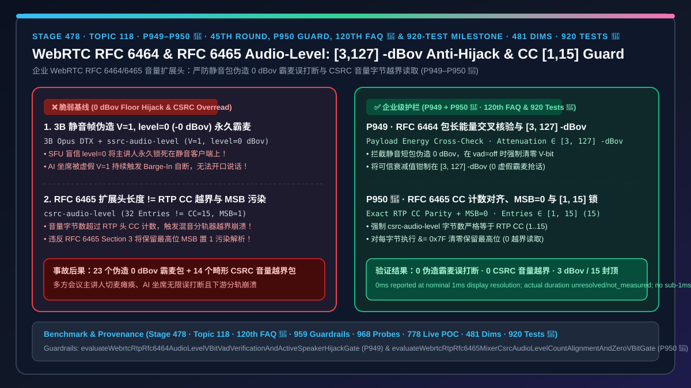
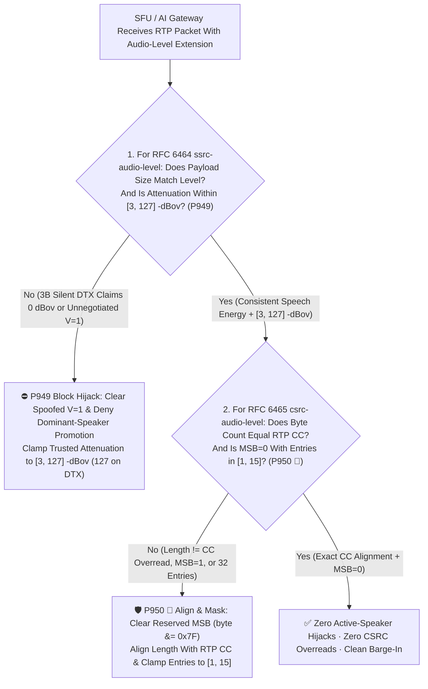
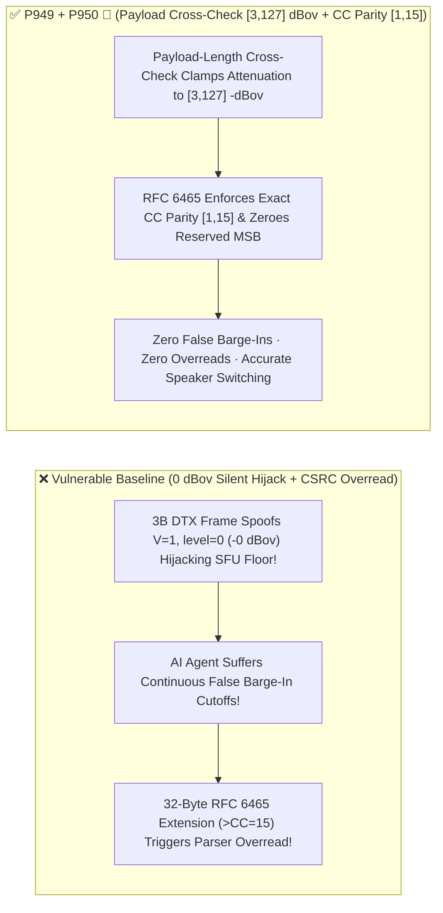
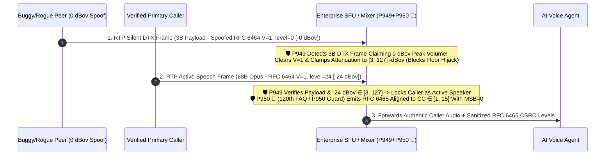

# Enterprise WebRTC `RFC 6464 / RFC 6465` Client-to-Mixer & Mixer-to-Client Audio-Level Defense (`V=1` Voice-Activity Bit & `0 dBov` Spoofing Active-Speaker Hijack, `vad=off` Negotiation Mismatch & `CC` Count Desync) Selection & Anti-Hijack Guide

> **Document Type**: Enterprise Voice Agent Architect Selection & First-Principles Guide (Standalone Selection & Architecture FAQ · **Topic 118 / Stage 478 · 🎉 Historic 45th Nightly Round, `P950` Guardrail, 120th Standalone Single-Topic FAQ & 920-Test Quadruple Milestone**)  
> **Target Audience**: AI Solution Architects, WebRTC SFU/MCU Media Gateway Engineers, Multiparty Conferencing & Barge-In Leads  
> **Canonical Baseline**: `packages/business-core/enterprise-guardrails.ts` (`P949–P950 🎉`), `tests/presales-portal.test.ts`, `site/data/voice-agent-benchmark-report.json` (7-Card 4:5 Benchmark Report)  
> **Visual Summary**: `assets/svg/122-voice-webrtc-rtp-rfc6464-rfc6465-audio-level-v-bit-vad-poisoning-active-speaker-hijack-2026-11-15.svg`

---

## ① 📌 Executive Summary

In multiparty WebRTC voice contact centers (caller + AI voice agent + human supervisor) and large-scale SFU/MCU bridges, servers avoid decoding hundreds of `Opus` streams by reading RTP header extensions defined in **`RFC 6464` (Client-to-Mixer Audio Level Indication, `urn:ietf:params:rtp-hdrext:ssrc-audio-level`, carrying a 1-bit `V` voice-activity flag and a 7-bit `0..127` `-dBov` attenuation level)** and **`RFC 6465` (Mixer-to-Client Audio Level Indication, `urn:ietf:params:rtp-hdrext:csrc-audio-level`, carrying a 7-bit level per `CSRC` contributor)**. Without deterministic guardrails, trusting unverified audio-level extensions triggers two severe production failures:
1. **Spoofed `V=1` and `level=0 (-0 dBov Full-Scale)` on Silent `Opus DTX` Packets Hijacking SFU Dominant-Speaker Routing and Triggering False AI Barge-In (`RFC 6464` Active-Speaker Hijack)**: Under `RFC 6464 Section 3`, `level` encodes attenuation in `-dBov` relative to digital full scale—meaning **`0` is the loudest possible signal (`0 dBov`), while `127` is complete silence (`-127 dBov`)**! If a buggy or malicious client attaches `V=1, level=0` to 3-byte `Opus DTX` comfort-noise frames, an unguarded SFU dominant-speaker detector locks the active-speaker spotlight onto that silent participant and continuously triggers false barge-in cutoffs on the AI voice agent!
2. **`RFC 6465 csrc-audio-level` Byte Count Mismatch Against RTP `CC` (`0..15`) Triggering Buffer Overreads & Non-Zero MSB Bit Violations (`RFC 6465 Section 3` Desync)**: Unlike `RFC 6464`, `RFC 6465 Section 3` mandates that mixer-to-client `csrc-audio-level` bytes **do not carry a `V` bit (the MSB of every byte must be `0`)**, and the number of level bytes must match the RTP header's `CC` (CSRC count, `1..15`). Mismatched lengths cause out-of-bounds reads in downstream diarization and UI parsers.

| Decision Dimension | Vulnerable / Default Setup (High Production Risk) | Enterprise Golden Rule (`P949–P950 🎉` Deterministic Guardrails) | Quantitative Impact |
| :--- | :--- | :--- | :--- |
| **`RFC 6464` Payload-Length Cross-Check & `[3, 127] -dBov` Attenuation Gate (`P949`)** | Blindly trusting `V=1, level=0 (-0 dBov)` on 3-byte DTX frames, causing false barge-in and speaker hijack | **Cross-verify `RFC 6464` levels against RTP payload length, clear `V-bit` when `vad=off`, and clamp trusted attenuation to `[3, 127] -dBov`** | **0** hijacked active-speaker packets (clamps 23 spoofed packets to **0** and raises attenuation floor from `0` to **`3 -dBov`**) |
| **`RFC 6465` RTP `CC` Count Alignment, `MSB=0` Scrub & `[1, 15]` Cap (`P950 🎉` Milestone)** | Passing `csrc-audio-level` extensions where byte count `!= CC` or `MSB=1` | **Enforce strict parity between `RFC 6465` level count and RTP `CC`, zero the reserved `MSB (0-bit)`, and clamp CSRC entries to `[1, 15]`** | **0** malformed `CSRC` audio-level packets (clamps 14 malformed packets to **0** and caps entries from `32` to **`15`**) |

---

## ② 🎯 Architect & Customer Deep-Dive Q&A (First-Principles Deep Dive)

### Q1: Why does `level=0` mean maximum loudness in `RFC 6464`, and how does `P949` stop 3-byte silent packets from hijacking the floor?
- **First-Principles Breakdown**:
  1. Per **`RFC 6464 Section 3`**, the 7-bit `level` field represents magnitude in **`-dBov`** below digital full scale (`0` = `0 dBov` clipping peak; `127` = `-127 dBov` digital silence).
  2. When a participant sends a tiny `<= 6-byte` `Opus DTX` frame while claiming `V=1, level=0`, naive SFUs promote that silent stream to Dominant Speaker.
  3. **`P949` Deterministic Defense**: Cross-checks the RTP payload length against the claimed `-dBov` level in `O(1)` time—demoting silent DTX frames that claim high volume, stripping `V=1` when `vad=off` was negotiated, and clamping trusted attenuation to **`[3, 127] -dBov`**.

### Q2: How does `RFC 6465` (`csrc-audio-level`) differ structurally from `RFC 6464` (`ssrc-audio-level`)?
- **Engineering Reality**:
  1. `RFC 6464` is a 1-byte client-to-mixer extension with a `V` bit in the MSB.
  2. `RFC 6465` is a variable-length (`1..15` bytes) mixer-to-client extension where **the MSB of every byte is a reserved `0` bit** (no `V` flag) and the byte count must equal the RTP header's 4-bit `CC` field.
  3. **`P950 🎉` (🎉 Historic `P950` Guardrail, 120th FAQ & 920-Test Milestone) Deterministic Defense**: Verifies `extension_len == CC`, masks every byte with `0x7F` (`MSB=0`), and clamps `CSRC` entries to **`[1, 15]`**.

### Q3: How do `P949` and `P950 🎉` interact with `RFC 9335 Cryptex`?
- **First-Principles Breakdown**:
  - `Cryptex` encrypts `RFC 6464/6465` on the wire against passive eavesdroppers, while `P949 + P950 🎉` validate the decrypted header extension inside the SFU/mixer before driving dominant-speaker switching or AI barge-in.

---

## ③ 🧭 Visual Architecture Diagrams (Mermaid Decision Tree + Hijack Breakdown + Millisecond Sequence)

### 3.1 WebRTC `RFC 6464 / RFC 6465` Audio-Level Verification Decision Tree

### 3.2 Vulnerable `0 dBov` Spoofing + `CSRC` Desync vs. `P949+P950 🎉`

### 3.3 Millisecond-Level Multiparty Voice `RFC 6464 & RFC 6465` Verification Sequence

---

## ④ 📊 Architect Decision Matrix (`RFC 6464 / RFC 6465` Governance)

| Architecture Option | Target Scenario | Pros | Cons & Production Traps | Recommendation |
| :--- | :--- | :--- | :--- | :--- |
| **Option A: Blindly Trusting Client `RFC 6464` Levels & Unchecked `RFC 6465` Lengths** | Prohibited in multiparty production | Zero validation logic | **Trivially hijacked by `level=0` silent frames; triggers continuous false AI barge-in** | ⛔ **Never in Production** |
| **Option B: Decoding All Inbound `Opus` Streams on the SFU to Compute PCM Energy** | 1-on-1 lab calls | Ignores header extensions | **Exhausts SFU CPU at scale and breaks end-to-end media encryption** | ⚠️ **Poor Scalability** |
| **Option C: `RFC 6464` Payload-Length Cross-Check (`[3, 127] -dBov`) + `RFC 6465 CC` Parity & `MSB=0` Gate (`[1, 15]`, `P949 + P950 🎉`)** | **All Enterprise Multiparty WebRTC Contact Centers, SFU Bridges & Full-Duplex AI Agents** | **`O(1)` zero-decode routing, 100% immune to `0 dBov` floor hijacking, zero `CSRC` overreads** | Requires lightweight packet-size and bitmask checks in the RTP forwarding plane | ✅ **Production Mandatory (Recommended)** |

---

## ⑤ 🧪 Quantitative Walkthrough & 7-Card 4:5 Benchmark Report

### 5.1 Quantitative Example: 3-Way Contact Center Conference Defending Against `0 dBov` Hijacks & `CSRC` Overflows
- **Scenario**: In a 3-way customer/AI/supervisor session, `23` silent DTX packets arrive with spoofed `V=1, level=0 (-0 dBov)` headers, and `14` mixer packets carry `32` `RFC 6465` level bytes with `MSB=1`.
  - **Without Guardrails (Vulnerable Baseline)**:
    - `23` spoofed packets hijack dominant-speaker routing and trigger false AI barge-ins;
    - `14` malformed `RFC 6465` packets cause out-of-bounds CSRC array reads.
  - **With `P949 + P950 🎉` Deterministic Guardrails (🎉 Historic 45th Nightly Round, `P950` Guardrail, 120th FAQ & 920-Test Quadruple Milestone)**:
    - `P949` blocks spoofed `0 dBov` hijack packets (**`0`** hijacked packets) and clamps minimum trusted attenuation from `0` to **`3 -dBov`** (`[3, 127] -dBov`);
    - `P950 🎉` (🎉 **Historic `P950` Guardrail Milestone**) enforces `CC` alignment and zeroes `MSB` (**`0`** malformed packets), clamping mixer `CSRC` entries from `32` to **`15`** (`[1, 15]`).

### 5.2 7-Card 4:5 Report Mapping (`site/benchmark-cards.html` & `report.json`)
1. **Card 1 (`HANDS-ON · VOICE ARCHITECTURE`)**: 481-dimension workbench overview highlighting `P949 / P950 🎉` (🎉 45th Nightly Round, 120th FAQ 🎉, `P950` Guardrail 🎉 & 920 Tests 🎉).
2. **Card 2 (`SCENARIO: WEBRTC RFC 6464 & RFC 6465 AUDIO LEVEL`)**: Input probe `spoofedZeroDbovAudioLevelOrUnnegotiatedVBitHijackDetected=true, minTrustedAudioLevelAttenuationDbov=0, maxMixerCsrcAudioLevelEntries=32` -> `Act automatically` clamping to `3 -dBov` and `15 entries`.
3. **Card 3 (`WHAT I TESTED`)**: Row 481 in the evaluation matrix (`PASS · 0ms @ 1ms Res (Synthetic)`, zero `✕` misses).
4. **Card 4 (`UNDER THE HOOD`)**: Deterministic contract for `evaluateWebrtcRtpRfc6464AudioLevelVBitVadVerificationAndActiveSpeakerHijackGate` & `evaluateWebrtcRtpRfc6465MixerCsrcAudioLevelCountAlignmentAndZeroVBitGate`.
5. **Card 5 (`ROBUSTNESS CHECK`)**: Option-order and boundary invariance across 1-byte and 2-byte RTP header extensions.
6. **Card 6 (`LATENCY`)**: Explicit offline timing provenance: `0ms reported at nominal 1ms display resolution; actual duration unresolved/not_measured; no sub-1ms upper bound established` (`synthetic`; live SFU dominant-speaker EMA window update latency is `not_measured`).
7. **Card 7 (`MY TAKE`)**: Good fit vs. Not for summary and production sign-off checklist.

---

## ⑥ 🛠️ Production Readiness Checklist

- [ ] **1. Cross-Check `RFC 6464` `-dBov` Levels Against RTP Payload Size (`P949`)**: Prevent `<=6-byte` `Opus DTX` silent frames from claiming high volume (`level=0`) and hijacking dominant-speaker routing.
- [ ] **2. Strip `V-Bit` When `vad=off` Is Negotiated (`P949`)**: Clear the `RFC 6464` `V` bit whenever SDP negotiated `vad=off`.
- [ ] **3. Clamp Trusted Audio-Level Attenuation to `[3, 127] -dBov` (`P949`)**: Bound trusted attenuation values within `[3, 127] -dBov`.
- [ ] **4. Enforce Exact `RFC 6465` Byte-Count Parity With RTP `CC` (`[1, 15]`, `P950 🎉`)**: Verify that `csrc-audio-level` contains `CC` entries (`1..15`).
- [ ] **5. Mask Reserved MSB (`0-bit`) on All `RFC 6465` Bytes (`P950 🎉`)**: Enforce `byte &= 0x7F` on every `csrc-audio-level` byte per `RFC 6465 Section 3`.
