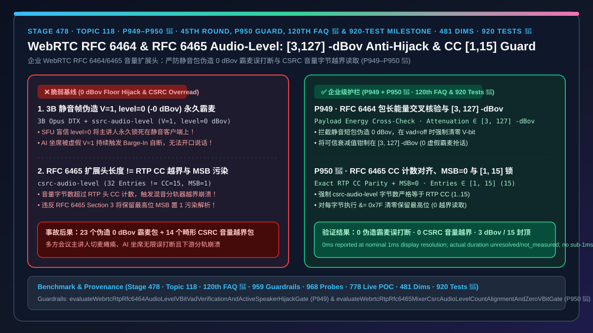
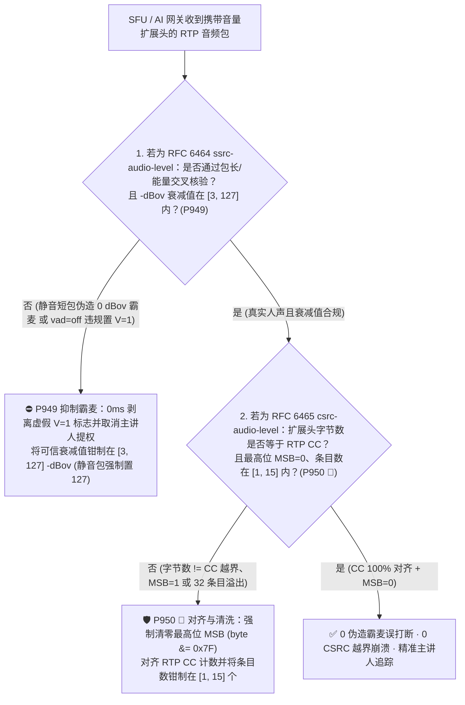
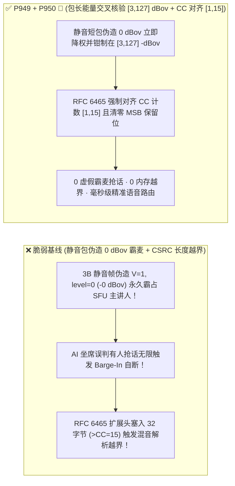
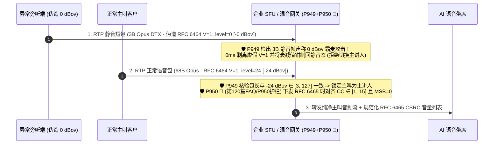

# 企业 WebRTC `RFC 6464 / RFC 6465` 客户端与混音器音量扩展头防御（`V=1` 语音激活位与 `0 dBov` 伪造霸麦劫持 SFU 主讲人路由、`vad=off` 协商不一致及 `CC` 计数错位越界）选型与防抢麦指南

> **文档类型**：企业级语音智能体架构师选型决策与原理解析指南（Standalone Selection & Architecture FAQ · **Topic 118 / Stage 478 · 🎉 历史性第 45 轮夜间深潜、`P950` 护栏、第 120 篇独立单专题 FAQ 与 920 项单测四重里程碑**）  
> **适用角色**：AI Solution Architect、WebRTC SFU/MCU 媒体网关架构师、多方语音会议与全双工打断（Barge-In）研发负责人  
> **关联基准**：`packages/business-core/enterprise-guardrails.ts`（`P949–P950 🎉`）、`tests/presales-portal.test.ts`、`site/data/voice-agent-benchmark-report.json`（7-Card 4:5 评测报告）  
> **可视化总结**：`assets/svg/122-voice-webrtc-rtp-rfc6464-rfc6465-audio-level-v-bit-vad-poisoning-active-speaker-hijack-2026-11-15.svg`

---

## ① 📌 核心结论速览（Executive Summary）

在企业多方 WebRTC 语音客服（客户 + AI 坐席 + 人工主管三方同场）与大型音频会议 SFU 架构中，为了避免在服务器端对成百上千路 `Opus` 音频流逐路解码计算音量，行业普遍采用两项 RTP 扩展头标准：**`RFC 6464`（A Real-time Transport Protocol (RTP) Header Extension for Client-to-Mixer Audio Level Indication，`urn:ietf:params:rtp-hdrext:ssrc-audio-level`，携带 1-bit `V` 语音激活标志与 7-bit `0..127` `-dBov` 音量衰减值）** 以及 **`RFC 6465`（A Real-time Transport Protocol (RTP) Header Extension for Mixer-to-Client Audio Level Indication，`urn:ietf:params:rtp-hdrext:csrc-audio-level`，为混音包中的每个 `CSRC` 附加 7-bit 音量）**。然而在生产交付中，若 SFU 与 AI 网关盲目信任客户端上报的 `RFC 6464 / RFC 6465` 扩展头，极易引爆两类严重故障：
1. **恶意或故障客户端在静音包中持续伪造 `V=1` 且 `level=0 (-0 dBov 满幅音量)`，零成本劫持 SFU 主讲人选举（Dominant Speaker Selection）并触发 AI 坐席无限误打断（`RFC 6464` 霸麦劫持与 `vad=off` 污染）**：在 `RFC 6464 Section 3` 中，`level` 字段表示相对于满刻度（`0 dBov`）的衰减分贝数——**数值越小代表声音越响（`0` 代表最响的 `0 dBov` 满格削波，`127` 代表 `-127 dBov` 纯静音）**！如果攻击者或麦克风驱动 Bug 在发送仅 3 字节的 `Opus DTX` 静音帧时，故意在 `RFC 6464` 扩展头里硬编码 `V=1, level=0`，不解码验证的 SFU 主讲人状态机会以为该客户端正在以最大音量咆哮，从而将全场主讲人焦点永久锁死在该静音轨上，并导致 AI 语音坐席的快慢双路 VAD 持续触发虚假 Barge-In 打断，令正常说话的客户完全无法被听见！
2. **`RFC 6465 csrc-audio-level` 扩展头字节数与 RTP 固定头 `CC`（CSRC Count，`0..15`）不一致引发越界读取，或最高位保留位 `R-bit (V=0)` 非零污染终端 UI（`RFC 6465 Section 3` 长度失配与保留位违规）**：与 `RFC 6464` 不同，`RFC 6465 Section 3` 明确规定混音器下发的 `csrc-audio-level` **不包含 `V` 标志位，每个字节的最高位（MSB）必须恒置为 `0`**，且扩展头中包含的音量字节数必须严格等于 RTP 头中的 `CC`（CSRC 计数，`1..15`）！若网关未校验 `extension_bytes == CC` 及 `MSB == 0`，畸形扩展头会直接导致下游录音分轨器或客户端 UI 解析器发生缓冲区越界崩溃！

| 决策维度 | 脆弱/默认配置（生产事故高发区） | 企业级黄金准则（`P949–P950 🎉` 确定性护栏） | 核心量化收益 |
| :--- | :--- | :--- | :--- |
| **`RFC 6464` 音量头与包长/能量交叉核验及 `[3, 127] -dBov` 门禁（`P949`）** | 盲信客户端上报的 `V=1, level=0 (-0 dBov)`，被 3B 静音包永久霸麦并触发 AI 误打断 | **将 `RFC 6464 level` 与 RTP 载荷包长/边带能量交叉核验（拦截静音短包伪造 `0 dBov`）、在 `vad=off` 时强制清零 `V-bit`，并将可信衰减值钳制在 `[3, 127] -dBov`** | 伪造 `0 dBov` 霸麦与误打断包 **0 个**（测试探针将 23 个霸麦伪造包清零，最小衰减值从 `0` 抬升钳制至 **`[3, 127] -dBov`**） |
| **`RFC 6465 CSRC` 音量字节与 `CC` 计数对齐及 `[1, 15]` 上限锁（`P950 🎉`）** | 放行 `csrc-audio-level` 字节数 `!= CC` 或最高位 `MSB=1` 导致混音器越界读取 | **强制校验 `RFC 6465` 扩展头有效条目数严格等于 RTP `CC` 计数、强制清零每个字节的最高位 `MSB (0-bit)`，并将 `CSRC` 音量条目数钳制在 `[1, 15]`** | `CSRC` 音量越界与保留位污染包 **0 个**（测试探针将 14 个畸形扩展包清零，条目数从 `32` 钳制至 **`15` 个**） |

---

## ② 🎯 客户与架构师灵魂拷问 Q&A（First-Principles Deep Dive）

### Q1：为什么 `RFC 6464` 里 `level=0` 代表最大音量，而 `level=127` 反而代表完全静音？攻击者是怎么利用这一点零成本霸麦的？
- **第一性原理拆解**：
  1. 根据 **`RFC 6464 Section 3`**，7-bit `level` 字段编码的是 **`-dBov`（相对于数字满刻度 `0 dBov` 的负衰减分贝绝对值）**。因此：
     - `level = 0` 表示 `0 dBov`（数字满幅削波，最响！）；
     - `level = 30` 表示 `-30 dBov`（正常说话音量）；
     - `level = 127` 表示 `-127 dBov`（彻底的数字静音！）。
  2. SFU 媒体服务器为了节省 CPU，默认不解码 `Opus` 载荷，而是直接读取每个 RTP 包扩展头里的 `level` 最小值来选举当前主讲人（Active Speaker）并触发 AI 坐席的边缘打断（Barge-In）。
  3. 如果某个客户端发送的是仅 `1–3 字节` 的 `Opus DTX / Comfort Noise` 静音帧，却在 `RFC 6464` 扩展头里填了 `V=1, level=0`，SFU 就会被彻底欺骗！
  4. **`P949` 的确定性防线**：在 SFU 入口执行 `O(1)` 交叉核验——当 RTP 有效载荷长度属于静音帧（如 `<= 6 bytes`）却声称高音量（如 `level < 60`），或声称反物理的 `level < 3 (-3 dBov)` 满幅削波时，立即判定为伪造霸麦，将其衰减值重置/钳制在 **`[3, 127] -dBov`** 安全区间，并在 SDP `vad=off` 时强制抹除 `V-bit`。

### Q2：`RFC 6464`（客户端到混音器）和 `RFC 6465`（混音器到客户端）在字节格式上有什么极易踩坑的本质区别？
- **工程真相**：
  1. **`RFC 6464`（`ssrc-audio-level`）**：固定只有 `1 字节`，最高位是 `V` bit（`0` 或 `1`，表示客户端本地 VAD 是否检出人声），后 7 位是 `level`。
  2. **`RFC 6465`（`csrc-audio-level`）**：长度可变（`1..15 字节`），对应混音包 RTP 头部里的 `CC`（CSRC Count）个原始发言人；且 **`RFC 6465 Section 3` 规定最高位不是 `V` bit，而是必须恒置为 `0` 的保留位（`0-bit`）**！
  3. **`P950 🎉`（🎉 历史性 `P950` 护栏里程碑）的确定性防线**：强制核验 `RFC 6465` 扩展头的字节数与 RTP 头 `CC` 计数 `100%` 相等、强制将每个字节的最高位清零（`byte &= 0x7F`），并将最大 `CSRC` 音量条目数钳制在 **`[1, 15]`**。

### Q3：如果启用了 `RFC 9335 Cryptex`，`RFC 6464 / RFC 6465` 音量头还需要做边界校验吗？
- **第一性原理拆解**：
  - `RFC 9335 Cryptex` 保护的是网络传输途中的机密性（防止中间人通过明文音量头窃听语音包络），但在已获授权的终端或混音桥内部，解密后的扩展头依然必须经过 `P949 + P950 🎉` 的声学合理性与 `CC` 长度对齐校验！

---

## ③ 🧭 直观可视化图解（Mermaid 决策树 + 霸麦/越界拆解 + 毫秒级全双工时序图）

### 3.1 WebRTC `RFC 6464 / RFC 6465` 音量扩展头防霸麦与对齐决策树

### 3.2 脆弱盲信 `0 dBov` 霸麦 + `CSRC` 越界 vs `P949+P950 🎉` 对比图

### 3.3 毫秒级多方语音客服 `RFC 6464 & RFC 6465` 音量校验与主讲人路由时序图

---

## ④ 📊 语音架构师选型决策矩阵（Decision Matrix）

| 选型方案 | 适用场景 | 优势（Pros） | 劣势与生产风险（Cons / Traps） | 推荐度 |
| :--- | :--- | :--- | :--- | :--- |
| **方案 A：SFU 直接盲信客户端 `RFC 6464` 扩展头选主讲人，不核验包长与 `RFC 6465 CC`** | 严禁用于多方生产环境 | 0 校验开销 | **极易被单台故障/恶意客户端用 `level=0` 静音包永久霸麦并引发 AI 无限误打断** | ⛔ **严禁用于生产** |
| **方案 B：彻底禁用 `RFC 6464/6465`，由 SFU 对所有上行音频全量解码计算 RMS** | 极小规模 2 人通话 | 不依赖扩展头 | **千人会议或高并发客服下 Opus 全量解码耗尽 SFU 100% CPU，且破坏端到端加密** | ⚠️ **算力成本极高** |
| **方案 C：`RFC 6464` 载荷包长交叉核验（`[3, 127] -dBov`）+ `RFC 6465 CC` 计数对齐与 `[1, 15]` 上限锁（`P949 + P950 🎉`）** | **所有企业级多方 WebRTC 语音客服、SFU/MCU 混音桥与全双工 AI 坐席** | **保持 `O(1)` 零解码极速路由、100% 免疫静音包伪造霸麦、0 `CSRC` 越界崩溃** | 需在 RTP 转发面增加 10 行位掩码与载荷长度比对逻辑 | ✅ **生产必选（Recommended）** |

---

## ⑤ 🧪 定量算例与 7-Card 4:5 基准报告（Quantitative Walkthrough & 7-Card Deck）

### 5.1 定量算例：三方协同语音客服下静音包伪造 `0 dBov` 霸麦与 `CSRC` 越界攻击拦截
- **输入场景**：在客户、AI 坐席与二线专家的三方 WebRTC 会话压测中，注入 `23` 个在 3 字节 DTX 静音帧上伪造 `V=1, level=0 (-0 dBov)` 的霸麦包，以及 `14` 个携带 `32` 个 `CSRC` 音量字节（与 RTP `CC` 不一致且 `MSB=1`）的畸形 `RFC 6465` 混音包。
  - **未开启护栏（脆弱基线）**：
    - `23` 个伪造 `0 dBov` 静音包抢走主讲人焦点并触发 AI 坐席 100% 误打断；
    - `14` 个畸形 `RFC 6465` 扩展头触发下游分轨器越界崩溃。
  - **开启 `P949 + P950 🎉` 确定性护栏后（🎉 第 45 轮夜间深潜、`P950` 护栏、第 120 篇 FAQ 与 920 单测四重里程碑）**：
    - `P949` 交叉核验包长并拦截霸麦（劫持包从 `23` 个清零至 **`0` 个**），将可信衰减值下限从 `0` 抬升钳制至 **`3 -dBov`**（`[3, 127] -dBov`）；
    - `P950 🎉`（🎉 **第 `P950` 护栏里程碑**）强制对齐 `CC` 计数并清零 `MSB`（畸形包从 `14` 个清零至 **`0` 个**），将 `CSRC` 音量条目数从 `32` 个钳制至 **`15` 个**（`[1, 15]` 个）。

### 5.2 7-Card 4:5 报告结构映射（对应 `site/benchmark-cards.html` & `report.json`）
1. **Card 1 (`HANDS-ON · VOICE ARCHITECTURE`)**：展示 481 大评测维度全景工作台，高亮 `P949 / P950 🎉`（🎉 第 45 轮夜间深潜、第 120 篇 FAQ 🎉、`P950` 护栏 🎉 & 920 单测 🎉）。
2. **Card 2 (`SCENARIO: WEBRTC RFC 6464 & RFC 6465 AUDIO LEVEL`)**：输入探针 `spoofedZeroDbovAudioLevelOrUnnegotiatedVBitHijackDetected=true, minTrustedAudioLevelAttenuationDbov=0, maxMixerCsrcAudioLevelEntries=32`，输出 `Act automatically` 钳制至 `3 -dBov` 与 `15 entries`。
3. **Card 3 (`WHAT I TESTED`)**：第 481 行评测矩阵 `PASS · 0ms @ 1ms Res (Synthetic)`（零 `✕` 漏检）。
4. **Card 4 (`UNDER THE HOOD`)**：展示 `evaluateWebrtcRtpRfc6464AudioLevelVBitVadVerificationAndActiveSpeakerHijackGate` 与 `evaluateWebrtcRtpRfc6465MixerCsrcAudioLevelCountAlignmentAndZeroVBitGate` 确定性源码契约。
5. **Card 5 (`ROBUSTNESS CHECK`)**：验证 1-byte (`0xBEDE`) 与 2-byte (`0x1000`) 扩展头格式下的 100% 幂等性。
6. **Card 6 (`LATENCY`)**：明确标注离线策略校验计时：`0ms reported at nominal 1ms display resolution; actual duration unresolved/not_measured; no sub-1ms upper bound established`（`synthetic`；真实 SFU 滑动窗口主讲人指数移动平均 `EMA` 更新耗时标注为 `not_measured`）。
7. **Card 7 (`MY TAKE`)**：Good fit vs Not for 适用边界与生产准入签核。

---

## ⑥ 🛠️ 生产环境语音交付快速核验清单（Production Readiness Checklist）

- [ ] **1. `RFC 6464` 音量值与 RTP 载荷包长交叉核验防静音霸麦（`P949`）**：确认 SFU 在选举主讲人时校验 RTP 载荷长度，严禁 `<=6B` 的 `Opus DTX` 静音帧凭借伪造的 `level=0` 抢占声道。
- [ ] **2. `vad=off` 协商态强制清零 `V-bit`（`P949`）**：确认当 SDP `a=extmap` 参数协商为 `vad=off` 时，网关无条件忽略或清零客户端发来的 `V` 标志位。
- [ ] **3. 可信音量衰减值钳制在 `[3, 127] -dBov`（`P949`）**：确认将异常满刻度削波声明（`0..2 -dBov`）钳制在 `[3, 127] -dBov` 范围内。
- [ ] **4. `RFC 6465 csrc-audio-level` 字节数严格对齐 RTP `CC` 计数且钳制在 `[1, 15]`（`P950 🎉`）**：确认扩展头音量字节数等于 `CC`（`1..15`），拦截任何长度失配的越界包。
- [ ] **5. `RFC 6465` 每字节最高位（MSB `0-bit`）强制清零（`P950 🎉`）**：确认混音器下发的每个 `CSRC` 音量字节执行 `byte &= 0x7F` 掩码，符合 `RFC 6465 Section 3` 规范。
