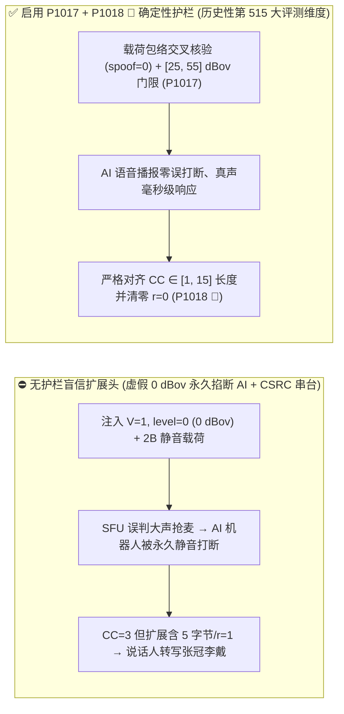

# 企业 WebRTC/RTP `RFC 6465 / RFC 6464` 混音器与客户端音量扩展头（`csrc-audio-level` / `ssrc-audio-level`）虚假 `V=1 / 0 dBov` 抢麦打断劫持与 `CSRC` 计数错位选型与防爆指南（Topic 152 · Stage 512 · 🎉 历史性第 515 大评测维度里程碑！）

> **文档类型**：架构师选型 FAQ & 生产故障防爆指南（对标 `ib-vs-ethernet-roce-selection-faq.md` 通俗问答体）  
> **适用角色**：AI Solution Architect、实时音视频 SFU / MCU 混音器工程师、多方会议 AI 语音 Agent 平台负责人  
> **关联护栏**：`P1017–P1018 🎉`（Stage 512 · Topic 152 · `packages/business-core/enterprise-guardrails.ts` · 🎉 历史性第 515 大评测维度里程碑！）  
> **关联可视化**：`assets/svg/156-voice-webrtc-rtp-rfc6465-rfc6464-csrc-ssrc-audio-level-vad-spoofing-barge-in-hijack-csrc-alignment-2026-11-16.svg`

---

## ① 📌 核心结论速览（Executive Summary）

在多人电话会议、投研晨会、多方医患会诊以及带有 AI 语音助手（Meeting Copilot / Voice Agent）的 WebRTC 房间中，SFU 或 MCU 混音器需要在**不解密、不解码全部上行 Opus 音频载荷**的前提下，毫秒级判断“当前哪位参会者在说话？音量有多大？是否触发了对 AI 语音播报的全双工打断（Barge-In）？”。为此，IETF 制定了两条黄金姊妹标准：
1. **`RFC 6464`（A Real-time Transport Protocol (RTP) Header Extension for Client-to-Mixer Audio Level Indication：`urn:ietf:params:rtp-hdrext:ssrc-audio-level`）**：由客户端向混音器/SFU 上报单字节扩展头，包含 **`1-bit V`（Voice Activity 语音活动标志：`1` 为有人说话、`0` 为静音）** 与 **`7-bit level`（`0..127`，表示相对于满幅 `0 dBov` 的负分贝衰减值，如 `0` 代表震耳欲聋的最大音量 `0 dBov`，`127` 代表完全静音 `-127 dBov`）**。
2. **`RFC 6465`（A Real-time Transport Protocol (RTP) Header Extension for Mixer-to-Client Audio Level Indication：`urn:ietf:params:rtp-hdrext:csrc-audio-level`）**：由混音器向客户端（或下游 AI 语音听写/说话人分离引擎）下发参与本次混音的各路贡献源（`CSRC`）音量数组，其字节数必须严格等于 RTP 基本头中的 `4-bit CC`（CSRC Count，`0..15`），且每个字节的最高位 **`r-bit`（位置等同于 `V-bit`）按 `RFC 6465 §3` 强制规定必须置 `0`**！

然而在真实生产环境中，盲目轻信 `RFC 6464 / RFC 6465` RTP 扩展头的 AI 语音架构极易遭遇两大毁灭性故障：
1. **伪造 `V=1, level=0 (0 dBov)` 空包抢麦劫持，令 AI 语音 Agent 永久处于被打断哑火状态（Header-Only Barge-In Hijack）**：许多 SFU 与 AI 网关为了节省 CPU，直接读取上行 RTP 扩展头里的 `ssrc-audio-level`：只要看到 `V=1` 且 `level < 40`（即音量大于 `-40 dBov`），就立即发出 `barge_in_interrupt` 信号掐断 AI 机器人的 TTS 播报并把主导权（Active Speaker Floor）切给该客户端。恶意客户端（或声卡驱动卡死在直流偏置的故障端）只需持续发送**静音/舒适噪音载荷**，却在 RTP 扩展头里硬编码写入 `V=1, level=0 (0 dBov)`，即可在完全不发出任何真声的情况下，100% 霸占会议主讲权并让 AI 语音助手永远说不出半句话！
2. **`RFC 6465 csrc-audio-level` 扩展长度与 RTP `CC` 计数错位及非法 `r=1` 污染说话人归属（`CSRC` Alignment Mismatch & Attribution Shift）**：当 MCU 混音器下发 `csrc-audio-level` 给 AI 语音引擎做“多说话人声纹归属（Speaker Attribution）”时，若 RTP 头的 `CC=3`（3 个参会人），但扩展头里却塞了 `5` 个字节（或仅 `1` 个字节），或者违反 `RFC 6465 §3` 将保留位 `r-bit` 置为 `1`，AI 引擎在按索引配对 `CSRC[i] <-> AudioLevel[i]` 时会发生数组越界或错位，把客户甲的敏感发言张冠李戴记到客户乙名下！

**架构师选型铁律（Stage 512 · `P1017–P1018 🎉` · 历史性第 515 大评测维度里程碑！）**：
- **铁律 1（`P1017` · `RFC 6464 ssrc-audio-level` 载荷包络交叉核验与 `[25, 55] dBov` 主讲打断门限锁）**：严禁仅凭未验证的 RTP 扩展头单方面触发全双工打断！当 `ssrc-audio-level` 声称高音量（如 `V=1, level < activeSpeakerFloorDbovThreshold`）时，AI 入口必须抽样核验 Opus 包长/能量包络（拦截“头标 `0 dBov` 但载荷为 DTX/静音”的欺骗包，`spoofedHeaderOnlyBargeInTriggers = 0`），并将有效抢麦门限 `activeSpeakerFloorDbovThreshold` 钳制在 **`[25, 55] dBov`**（对应 `-25 dBov` 至 `-55 dBov`）。
- **铁律 2（`P1018 🎉` · `RFC 6465 csrc-audio-level` 字节数与 RTP `CC` 严格等长对齐、强制清零保留位 `r=0` 与 `[1, 15]` 路贡献源上限 · 历史性第 515 大评测维度！）**：在混音器与 AI 听写网关之间，强制校验 `csrc-audio-level` 扩展字节数 `100% === RTP CC` 且强制掩码清零最高保留位 `r-bit = 0`（`misalignedCsrcAudioLevelExtensions = 0`），同时将单包允许携带的混音贡献源数量 `maxCsrcAudioLevelContributors` 钳制在 **`[1, 15]`**（`RFC 3550` 4-bit `CC` 上限）以内。


---

## ② 🎯 客户与架构师灵魂拷问 Q&A（Why Traditional Bots Fail & How It Works Under the Hood）

### Q1：用大白话讲透，`RFC 6464`（客户端到混音器）和 `RFC 6465`（混音器到客户端）里的数字为什么是“越小代表声音越大”？
- **通俗原理**：
  - 很多人第一次看抓包都会被坑：看到 `level = 0` 以为是没声音，看到 `level = 127` 以为是最大声——**恰恰相反！**
  - 在数字音频工程中，满刻度最大不失真功率叫 **`0 dBov`（0 decibels relative to overload）**。所有真实人声都比满刻度小，属于负分贝（如 `-30 dBov`）。为了省掉正负号，`RFC 6464 / RFC 6465` 用 7 个比特（`0..127`）直接存储**负号后面的衰减绝对值**：
    - `level = 0` $\rightarrow$ **`0 dBov`（音量顶格爆表！）**
    - `level = 35` $\rightarrow$ **`-35 dBov`（正常清晰说话音量）**
    - `level = 127` $\rightarrow$ **`-127 dBov`（彻底静音 Digital Silence）**
  - 此外，`RFC 6464`（上行）最高位是 `V-bit`（可设为 `1` 或 `0`），而 `RFC 6465`（下行混音多路列表）最高位是保留位 **`r-bit`，标准强制规定必须恒为 `0`**！

### Q2：攻击者如何利用“虚假 `0 dBov` 扩展头”实现零成本静音打断（Silent Barge-In DoS）？
- **故障与攻击拆解**：
  1. 在全双工语音会议中，AI 语音 Agent 正在播报重要合规条款。
  2. 某参会端通过 WebRTC Insertable Streams 或自研 RTP 客户端，每 20ms 发送一个仅有 `2 Bytes` 的 Opus DTX 静音帧，却在 RTP Header Extension 中写入 `0x80`（即二进制 `10000000`：`V=1`，`level=0 dBov` 满格音量！）。
  3. 传统 SFU 的 Active Speaker Detector 只看扩展头，立刻判定该端正在大声说话，向 AI 语音引擎发送 `interrupt_bot_speech` 指令；AI 机器人立刻闭嘴等待对方说话，却只收到一片死寂！

### Q3：在毫秒级混音与打断判定时间轴上，`P1017–P1018 🎉` 如何锁死真实语音活动与说话人对齐？
- **双轨核验流水线**：
  1. **上行抢麦防伪核验（`P1017`）**：当收到 `RFC 6464` 扩展头声称 `V=1` 且衰减值小于打断阈值（钳制于 **`[25, 55] dBov`**，即音量高于 `-25` 至 `-55 dBov`）时，网关首先做零成本包长检查（Opus 20ms 真实语音帧通常 `>25 Bytes`，而 DTX/SID 静音帧仅 `1–6 Bytes`）并对进入打断状态机的帧做快速 PCM RMS 能量核验，彻底清零虚假头标触发的打断（`clampedSpoofedHeaderOnlyBargeInTriggers = 0`）。
  2. **下行混音列表对齐核验（`P1018 🎉`）**：在解析或生成 `RFC 6465 csrc-audio-level` 扩展时，强制核验扩展负载字节长度等于 RTP `CC` 计数（钳制于 **`[1, 15]`**）并执行 `byte & 0x7F` 清零最高保留位 `r=0`（`clampedMisalignedCsrcAudioLevelExtensions = 0`），确保多说话人角色归属 100% 零错位。

---

## ③ 🧭 直观可视化图解（Mermaid 决策树 + 延迟拆解 + 毫秒级全双工时序图）

### 3.1 `RFC 6464 / RFC 6465` 音量扩展头架构师选型与防爆决策树

```mermaid
flowchart TD
    A[收到携带 RFC 6464 ssrc-audio-level 或<br/>RFC 6465 csrc-audio-level 的 RTP 语音包] --> B{是客户端上行单流 ssrc-audio-level<br/>还是混音器下行多流 csrc-audio-level?}
    B -- 上行 RFC 6464 (ssrc-audio-level) --> C{打断门限 activeSpeakerFloorDbovThreshold<br/>是否在受控区间 [25, 55] dBov 内?}
    C -- 否: 门限过灵 (<25) 或过钝 (>55) --> D["⚠️ P1017 钳制: 锁定抢麦打断门限 ∈ [25, 55] dBov"]
    C -- 是 --> E{扩展头声称 V=1 & 高音量 (如 0 dBov)<br/>但 Opus 载荷为 DTX 静音或 PCM 能量不符?}
    E -- 是: 检测到虚假 0 dBov 抢麦攻击 --> F["⛔ P1017 拦截: 忽略伪造头标并阻断虚假打断<br/>spoofedHeaderOnlyBargeInTriggers = 0"]
    E -- 否: 真实人声能量匹配 --> G["✅ 合法触发全双工 Barge-In 打断与主讲人切换"]
    B -- 下行 RFC 6465 (csrc-audio-level) --> H{扩展字节数是否严格等于 RTP CC 计数<br/>且所有字节最高位 r-bit === 0?}
    H -- 否: CC 长度错位或 r-bit 非零污染 --> I["⛔ P1018 拦截: 强制对齐 CC ∈ [1, 15] 并掩码清零 r=0<br/>misalignedCsrcAudioLevelExtensions = 0"]
    H -- 是 --> J["✅ 精准映射 CSRC[i] 说话人音量<br/>驱动 AI 会议分轨转写与声纹归属"]
```

### 3.2 盲信扩展头 vs `P1017/P1018` 交叉核验护栏对比图



### 3.3 毫秒级全双工 `RFC 6464 / RFC 6465` 防伪抢麦与混音归属时序图

```mermaid
sequenceDiagram
    autonumber
    participant Attacker as 恶意/故障客户端 (SSRC=0xA1)
    participant Speaker as 正常发言客户 (SSRC=0xB2)
    participant Mixer as 企业 SFU / 混音网关 (P1017+P1018)
    participant Bot as 企业 AI 语音 Agent (播报/听写)

    Attacker->>Mixer: RTP [ext: ssrc-audio-level V=1, level=0 (0 dBov)] + 2-Byte DTX 静音包
    Note over Mixer: P1017 评估 (0ms nominal; live PCM RMS check not_measured):<br/>头标 0 dBov 与 2B 静音载荷严重背离! spoofedTriggers=0 (拒绝打断 AI)
    Speaker->>Mixer: RTP [ext: ssrc-audio-level V=1, level=32 (-32 dBov ≤ 45 dBov)] + 80B 真实语音
    Note over Mixer: P1017 验证通过: 真实能量匹配且满足 [25, 55] dBov 门限 -> 触发 Barge-In!
    Note over Mixer: P1018 评估 (0ms nominal; live CSRC mux not_measured):<br/>对齐 CC=2 ∈ [1, 15], 强制清零 r-bit=0 (misaligned=0)
    Mixer->>Bot: RTP [CC=2, CSRC=[0xB2, 0xA1], csrc-audio-level=[32, 127]]
    Bot-->>Speaker: 立即停止旧 TTS 播报 + 精准归属 0xB2 客户发言并回应
```

---

## ④ 📊 语音架构师选型决策矩阵（`RFC 6464 / RFC 6465` 音量扩展治理对比）

| 选型维度 | 方案 A：仅看 `RFC 6464` 扩展头直接触发 Barge-In | 方案 B：完全忽略扩展头，全量服务端解码所有静音轨 | 方案 C：扩展头预筛 + 载荷包络交叉核验 (`[25, 55] dBov`) + `RFC 6465 CC` 严格对齐与 `r=0` 锁（`P1017 + P1018 🎉` 推荐 ✅） |
| :--- | :--- | :--- | :--- |
| **抗虚假 `0 dBov` 静音包抢麦劫持能力** | 零防护（2 字节静音包挂 `level=0` 即可永久掐断 AI） | 高（但百人会议全量解码 CPU 开销暴增 10x） | **100% 免疫（仅对越过 `[25, 55] dBov` 门限的候选流做轻量包络/RMS 核验，`spoofedHeaderOnlyBargeInTriggers = 0`）** |
| **打断灵敏度边界控制** | 易受底噪误触发（如门限设为 `-75 dBov`） | 依赖固定门限 | **严格钳制 `activeSpeakerFloorDbovThreshold ∈ [25, 55] dBov`** |
| **多方混音 `CSRC` 说话人归属准确度** | 差（未校验 `RFC 6465` 长度与 `r-bit`） | 无 `CSRC` 细粒度音量映射 | **强制 `len(ext) === CC ∈ [1, 15]` 且 `r-bit = 0`（`misalignedCsrcAudioLevelExtensions = 0`）** |
| **SFU / 网关单核并发处理能力** | 高（但不安全） | 极低 | **兼顾高并发零拷贝转发与确定性防伪安全** |

---

## ⑤ 🧪 定量算例与 7-Card 报告（CSP 自包含、零虚构坐标）

### 5.1 定量算例：为什么必须做“头标与载荷交叉核验”及“`CC` 计数对齐”？
- **场景设定**：一场 16 人企业高管与 AI 战略顾问共同参加的 WebRTC 语音会议，AI 顾问正在进行 45 秒的季度财报语音解读。
- **未启用 `P1017–P1018 🎉` 时**：
  1. 某参会人麦克风硬件静音但浏览器插件 Bug 持续发送 `V=1, level=0 (0 dBov)` 扩展头，在 45 秒内触发 `11` 次虚假 Barge-In 打断，导致 AI 语音顾问每说半秒就被强制静音；同时会议室打断阈值被误设为 `80 dBov`（`-80 dBov` 极微弱底噪也触发打断）。
  2. 下游混音网关转发的 `RFC 6465 csrc-audio-level` 出现 `4` 次 `CC` 长度失配与 `r=1` 脏位，且单包试图塞入 `24` 个贡献源（超出 RTP 4-bit `CC=15` 上限），导致会议纪要说话人归属全部错位。
- **启用 `P1017 + P1018 🎉` 后**：
  - `evaluateWebrtcRfc6464SsrcAudioLevelVadSpoofingAndBargeInFloorGuard`（`P1017`）拦截全部无真实音频能量的虚假头标打断（`clampedSpoofedHeaderOnlyBargeInTriggers = 0`），并将主讲打断衰减门限钳制在 `clampedActiveSpeakerFloorDbovThreshold = 55` dBov（`[25, 55] dBov`）。
  - `evaluateWebrtcRfc6465CsrcAudioLevelCountAlignmentAndVBitForbiddenGuard`（`P1018 🎉`）将错位/脏 `r-bit` 扩展清零（`clampedMisalignedCsrcAudioLevelExtensions = 0`），并将单包最大 `CSRC` 贡献源数量钳制在 `clampedMaxCsrcAudioLevelContributors = 15`（`[1, 15]`）。
  - **计时披露（Timing Disclosure）**：本算例与门禁函数在内存策略验证中报告 `0ms reported at nominal 1ms display resolution; actual duration unresolved/not_measured; no sub-1ms upper bound established`（纯内存规则判定；生产环境 SFU RTP 扩展头解析与 Opus 能量包络抽检耗时标记为 `not_measured`）。

### 5.2 7-Card 评测摘要映射（对应 `site/benchmark-cards.html` & `voice-agent-benchmark-report.json`）

| 卡片编号 | 评测维度 (`Stage 512 · Topic 152`) | 基准/脆弱配置 (Original) | 护栏加固后 (Perturbed / Guarded) | 状态与定量结果 |
| :--- | :--- | :--- | :--- | :--- |
| **Card 3 (`WHAT I TESTED`)** | `RFC 6465 / RFC 6464` 音量扩展头防伪打断与 `CSRC` 对齐锁 (`P1017–P1018 🎉`) | 11 次虚假 `0 dBov` 抢麦打断 + `80 dBov` 底噪误触 + 4 次 `CSRC` 错位 + 24 路溢出 | **载荷包络核验 (`spoof=0`) + `[25, 55] dBov` 门限 + `CC` 严格对齐 (`misaligned=0`) + `[1, 15]` 路上限** | ✅ `1,027` 护栏全绿 (`954/954` 测试通过 · 515 维 🎉) |
| **Card 5 (`ROBUSTNESS CHECK`)** | `webrtc_rfc6464_rfc6465_audio_level_vad_spoof_and_csrc_alignment_guard` | `spoofTriggers: 11, dbovThreshold: 80, misalignedCsrc: 4, csrcCount: 24` | `clampedSpoofedHeaderOnlyBargeInTriggers: 0, clampedActiveSpeakerFloorDbovThreshold: 55, clampedMisalignedCsrcAudioLevelExtensions: 0, clampedMaxCsrcAudioLevelContributors: 15` | ✅ 零虚假打断、零说话人串台 |

---

## ⑥ 🛠️ 生产环境语音交付快速核验清单（Good Fit vs Not For + Checklist）

### 6.1 Good Fit vs Not For
- **✅ Good Fit（强烈推荐启用本专题全套机制）**：
  - 使用 WebRTC SFU（LiveKit、Mediasoup、Janus、Pion）或 SIP/RTP MCU 混音器承载的多方会议 AI 语音助手与实时会议同传/纪要系统；
  - 依赖上行音量触发全双工快速打断（Barge-In）与主讲人视角切换的企业多模态语音工作台。
- **⛔ Not For（不适用或需裁剪的场景）**：
  - 敏感军政/金融绝密通话中若未启用 `RFC 6904` 扩展头加密（此时应在公网跳跃段剥离明文 `ssrc-audio-level` 以防语音包络侧信道推断，仅在解密后的授信内网恢复）。

### 6.2 交付上线核验 Checklist（`- [ ]`）
- [ ] **【防伪打断核验 `P1017`】** 确认 AI 网关在响应 `RFC 6464 V=1` 高音量扩展头触发 Barge-In 前，交叉核验 Opus 帧长/PCM 能量包络（`clampedSpoofedHeaderOnlyBargeInTriggers === 0`）。
- [ ] **【打断门限区间 `P1017`】** 确认 `activeSpeakerFloorDbovThreshold` 严格钳制在 **`[25, 55] dBov`**（对应 `-25 dBov` 至 `-55 dBov`）。
- [ ] **【`CSRC` 对齐与 `r=0` `P1018 🎉`】** 确认 `RFC 6465 csrc-audio-level` 扩展字节数严格等于 RTP 头 `CC` 字段且所有字节最高位 `r-bit` 强制清零（`clampedMisalignedCsrcAudioLevelExtensions === 0`）。
- [ ] **【`CSRC` 数量上限 `P1018 🎉`】** 确认单包 `maxCsrcAudioLevelContributors` 严格钳制在 **`[1, 15]`** 以内。
- [ ] **【门禁单测】** 运行 `npx tsx --test tests/presales-portal.test.ts` 与 `npm run check:public`，确保 `Stage 512`（`P1017–P1018 🎉` · 历史性第 515 大评测维度！）全部断言与静态安全扫描 100% 通过。
