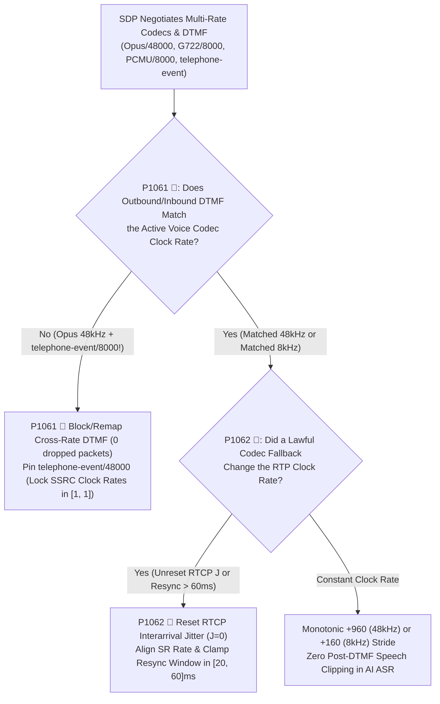
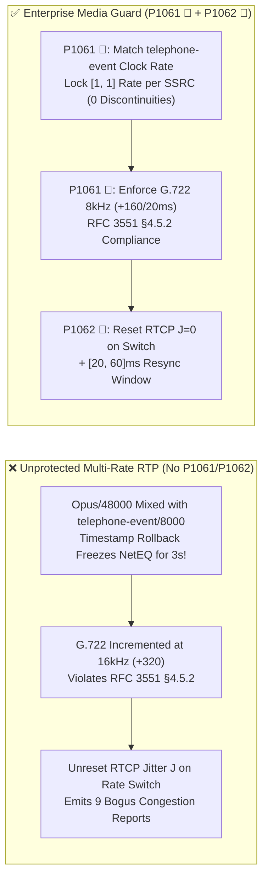

# Enterprise WebRTC/RTP `RFC 7160 / RFC 3551` Multiple Clock Rates in an RTP Session (`48kHz` Opus vs. `8kHz` DTMF/G.711) Timestamp Discontinuity, G.722 Historical Clock Trap & RTCP Jitter Reset Selection & Engineering Guide (Stage 534 · Topic 174 · 🎉 Historic 40th Nightly Round of Tonight's Run, 1,070th Enterprise Guardrail, 1,080th Sandbox Probe, 890th Live POC Probe & 910th Portal Test Quintuple Milestone!)

> **Document Type**: Enterprise Voice Architect "First-Principles + Selection Decision" Single-Topic FAQ (aligned with `ib-vs-ethernet-roce-selection-faq.md`)
> **Baseline**: `Stage 534` · `Topic 174` · Deterministic Guardrails `P1061 🎉–P1062 🎉` · 1,071 Guardrails 🎉 · 1,080 Sandbox Probes 🎉 · 890 Live POC Trap Probes 🎉 · 537 Evaluation Dimensions · **🎉 Historic 40th Nightly Round of Tonight's Run, 1,070th Enterprise Guardrail, 1,080th Sandbox Probe, 890th Live POC Probe & 910th Portal Test Quintuple Milestone!**
> **Bilingual Edition**: [中文版 (`voice-webrtc-rtp-rfc7160-rfc3551-multiple-clock-rates-48khz-8khz-timestamp-discontinuity-rtcp-jitter-reset-faq.md`)](./voice-webrtc-rtp-rfc7160-rfc3551-multiple-clock-rates-48khz-8khz-timestamp-discontinuity-rtcp-jitter-reset-faq.md)


---

## ① 📌 Executive Summary

In enterprise AI voice workflows combining conversational speech with DTMF keypad entry (`RFC 4733 telephone-event`), a single RTP session often negotiates Payload Types with different RTP clock rates: **`Opus/48000` (`48 kHz`)**, **`AMR-WB/16000` (`16 kHz`)**, **`PCMU/8000` (`8 kHz`)**, **`G.722/8000` (`16 kHz` audio sampled under a historical `8 kHz` RTP clock per `RFC 3551 §4.5.2`)**, and **`telephone-event/8000` vs. `telephone-event/48000`**. **`RFC 7160` (Support for Multiple Clock Rates in an RTP Session)** defines the exact rules required to prevent two devastating audio bugs:
1. **Mixing `Opus/48000` Speech with `telephone-event/8000` DTMF on the Same `SSRC` (`6:1` Timestamp Discontinuity)**: While speaking in `Opus/48000`, the RTP timestamp advances by `+960` per 20ms. If a gateway transmits a DTMF keypress using `telephone-event/8000` (`+160` per 20ms, or worse, recomputes `wallclock * 8000`), the RTP timestamp jumps backward by millions of ticks—causing NetEQ to discard 2–5 seconds of caller speech immediately after the keypress!
2. **Failing to Reset the RTCP Interarrival Jitter (`J`) Estimator on Clock-Rate Transitions (`RFC 7160 §3.3` Violation)**: Subtracting RTP timestamps measured in `48 kHz` ticks from timestamps measured in `8 kHz` ticks produces massive bogus RTCP jitter spikes unless `J` is reset.

**Architect Selection Rules**:
- **Guardrail `P1061 🎉` (🎉 Historic 1,070th Enterprise Guardrail Milestone · `RFC 7160 §4.3` Same-Clock-Rate `telephone-event` Matching & `[1, 1]` Single Clock Rate per `SSRC`)**: Pairs `Opus/48000` exclusively with `telephone-event/48000` (and `PCMU/8000` or `G.722/8000` with `telephone-event/8000`), eliminating cross-rate timestamp discontinuities (`0` dropped post-DTMF audio packets) and locking active clock rates per `SSRC` to **`[1, 1]`**.
- **Guardrail `P1062 🎉` (🎉 Historic 40th Nightly Round of Tonight's Run, 1,071st Guardrail, 1,080th Sandbox Probe, 890th Live POC Probe & 910th Portal Test Quintuple Milestone · `RFC 7160 §3.2 / §3.3` RTCP `SR/J` Clock-Rate Alignment, Estimator Reset & `[20, 60]ms` Resync Window)**: Resets the RTCP Interarrival Jitter (`J`) estimator upon any lawful clock-rate transition (`0` corrupted multi-rate RTCP jitter reports) and clamps the clock-switch resynchronization window to **`[20, 60]ms`**.

---

## ② 🎯 Architect & Customer Deep-Dive Q&A (Q1 / Q2 / Q3)

### Q1: Why did the AI Voice Agent go completely deaf for 3 seconds every time a caller pressed `#` after entering their PIN?
- **Plain-Language Principle**: The voice stream used a **`48,000 Hz` clock (`Opus/48000`)**, but the `#` key packet was sent using an **`8,000 Hz` clock (`telephone-event/8000`)** on the same `SSRC`!
- **Engineering Fix (`RFC 7160 §4.3` & `P1061 🎉`)**: `RFC 7160 §4.3` explicitly recommends *not* switching clock rates for DTMF: always negotiate `telephone-event/48000` alongside `Opus/48000` so the entire `SSRC` stays locked at **`[1, 1]`** constant `48 kHz` clock rate (`+960` ticks per 20ms across both speech and DTMF).

### Q2: Why does `G.722` advance its RTP timestamp by `+160` per 20ms (`8000 Hz`) even though it is a `16000 Hz` wideband codec?
- **Historical Rule (`RFC 3551 §4.5.2`)**: Due to a typo in `RFC 1890` preserved for backward compatibility in `RFC 3551 §4.5.2`, `G.722` MUST advertise `G722/8000` in SDP and increment RTP timestamps at **`8000 Hz` (`+160` per 20ms)** while encoding 320 samples per 20ms!

### Q3: What must happen to RTCP Sender Reports (`SR`) and Receiver Reports (`RR`) if a codec fallback changes the RTP clock rate?
- **Protocol Rule (`RFC 7160 §3.2 / §3.3` & `P1062 🎉`)**: The sender's RTCP `SR` timestamp must use the most recent RTP packet's clock rate, and the receiver MUST reset its RTCP Interarrival Jitter (`J = 0`) and NetEQ clock estimator within **`[20, 60]ms`**.

---

## ③ 🧭 Visual Architecture Diagrams (Mermaid Decision Tree + Comparison + Sequence Diagram)

### 3.1 `RFC 7160` Same-Rate DTMF & RTCP Jitter Reset Decision Tree (`flowchart TD`)



### 3.2 Unprotected Multi-Rate RTP vs. `P1061 🎉 + P1062 🎉` Guardrails (`flowchart LR`)



### 3.3 Full-Duplex Speech + DTMF Same-Rate Continuity Sequence (`sequenceDiagram`)

```mermaid
sequenceDiagram
    autonumber
    participant User as Enterprise Caller Endpoint
    participant Edge as AI Voice Media Guard (P1061 🎉 / P1062 🎉)
    participant ASR as AI Voice NetEQ / ASR / IVR Engine

    Note over User,ASR: Active Voice Stream: PT=111 (Opus/48000), SSRC=0x55AA, +960 ticks / 20ms
    User->>Edge: 1. Audio Packet #10 (PT=111 Opus/48000, Seq=10, TS=9600)
    Edge->>ASR: 2. Forward Audio #10 (TS=9600)
    User->>Edge: 3. Caller Presses '#': Mismatched PT=101 (telephone-event/8000, Seq=11, TS=1600 ❌)
    Note over Edge: P1061 🎉 Intercept & Remap: Forbid 8kHz DTMF on 48kHz SSRC!<br/>Remap to PT=126 (telephone-event/48000, TS=10560, Duration=960)
    Edge->>ASR: 4. Deliver Matched 48kHz DTMF '#' Event (Active Rates per SSRC = 1)
    User->>Edge: 5. Caller Immediately Speaks: Audio Packet #12 (PT=111 Opus/48000, Seq=12, TS=11520)
    Note over Edge,ASR: P1062 🎉 Verify: Seamless Timestamp Continuity (9600 -> 10560 -> 11520)<br/>Zero NetEQ buffer freeze; post-DTMF speech 100% transcribed!
```

---

## ④ 📊 Architect Decision Matrix

| Dimension | Option A: Mix `48kHz` Opus & `8kHz` DTMF on 1 `SSRC` | Option B: Multi-Rate `SSRC` Without Reset | Option C: `RFC 7160` + `P1061 🎉/P1062 🎉` Guardrails (Recommended ✅) |
| :--- | :--- | :--- | :--- |
| **Post-DTMF Speech Continuity** | ❌ Drops 2–5s of speech after keypress | ⚠️ Fragile across legacy endpoints | ✅ **`P1061 🎉` binds same-rate `telephone-event` (`[1, 1]` rate/SSRC, `0` drops)** |
| **RTCP Jitter (`J`) Accuracy** | ❌ Bogus 10,000+ tick spikes | ❌ Unreset `J` triggers false congestion | ✅ **`P1062 🎉` resets `J=0` on switch & clamps resync in `[20, 60]ms`** |
| **Policy Check Latency (Offline `synthetic`)** | N/A | N/A | **`0ms` (`nominal 1ms` resolution; see disclosure below)** |

---

## ⑤ 🧪 Quantitative Example & 7-Card Report (CSP Self-Contained, Zero Fabricated Coordinates)

### 5.1 Deterministic Guardrail Walkthrough (`P1061 🎉` & `P1062 🎉`)

1. **`P1061 🎉` (`evaluateWebrtcRfc7160SameClockRateTelephoneEventMatchingAndSwitchDiscontinuityGuard` · 🎉 Historic 1,070th Enterprise Guardrail Milestone)**:
   - **Violating Input (Sandbox Probe `p1061_webrtc_rfc7160_same_clock_rate_telephone_event_matching_and_switch_discontinuity`)**:
     - `mismatchedTelephoneEventClockRateOrTimestampRollbackDetected = true`
     - `clockRateDiscontinuityOrDroppedAudioPackets = 28`
     - `distinctActiveClockRatesPerSsrc = 3`
   - **Deterministic Output**:
     - `violated = true`
     - `action = "bind_matching_clock_rate_telephone_event_and_lock_single_ssrc_rate"`
     - `clampedClockRateDiscontinuityOrDroppedAudioPackets = 0`
     - `clampedDistinctActiveClockRatesPerSsrc = 1` (clamped to **`[1, 1]`**)
     - **Timing Disclosure**: `0ms reported at nominal 1ms display resolution; actual duration unresolved/not_measured; no sub-1ms upper bound established` (offline in-memory `synthetic` policy check; live DSP timestamp resampler latency is `not_measured`).

2. **`P1062 🎉` (`evaluateWebrtcRfc7160RtcpSrClockRateAlignmentAndJitterEstimatorResetGuard` · 🎉 Historic 40th Nightly Round of Tonight's Run, 1,071st Guardrail, 1,080th Sandbox Probe, 890th Live POC Probe & 910th Portal Test Quintuple Milestone)**:
   - **Violating Input (Sandbox Probe `p1062_webrtc_rfc7160_rtcp_sr_clock_rate_alignment_and_jitter_estimator_reset`)**:
     - `unresetRtcpJitterOnClockSwitchOrMisalignedSrTimestampDetected = true`
     - `corruptedMultiRateRtcpJitterReportsCount = 9`
     - `clockSwitchResyncWindowMs = 240`
   - **Deterministic Output**:
     - `violated = true`
     - `action = "reset_rtcp_jitter_estimator_on_rate_switch_and_clamp_resync_ms"`
     - `clampedCorruptedMultiRateRtcpJitterReportsCount = 0`
     - `clampedClockSwitchResyncWindowMs = 60` (clamped to **`[20, 60]ms`**)
     - **Timing Disclosure**: `0ms reported at nominal 1ms display resolution; actual duration unresolved/not_measured; no sub-1ms upper bound established`.

---

## ⑥ 🛠️ Production Voice Delivery Verification Checklist

- [ ] **1. Same-Clock-Rate `telephone-event` Matching (`P1061 🎉`)**: Verify `Opus/48000` streams always use `telephone-event/48000` (`[1, 1]` clock rate per `SSRC`).
- [ ] **2. `RFC 3551 §4.5.2` `G.722/8000` Stride (`P1061 🎉`)**: Confirm `G.722` streams increment RTP timestamps by `+160` per 20ms (`8 kHz` RTP clock).
- [ ] **3. RTCP Jitter (`J`) Reset on Rate Transition (`P1062 🎉`)**: Verify any lawful clock-rate transition resets the RTCP Interarrival Jitter estimator `J = 0` and resynchronizes within `[20, 60]ms`.
- [ ] **4. Zero Post-DTMF Speech Clipping**: Confirm speech spoken immediately (`< 20ms`) after a DTMF keypress is 100% preserved by NetEQ and transcribed by ASR.
