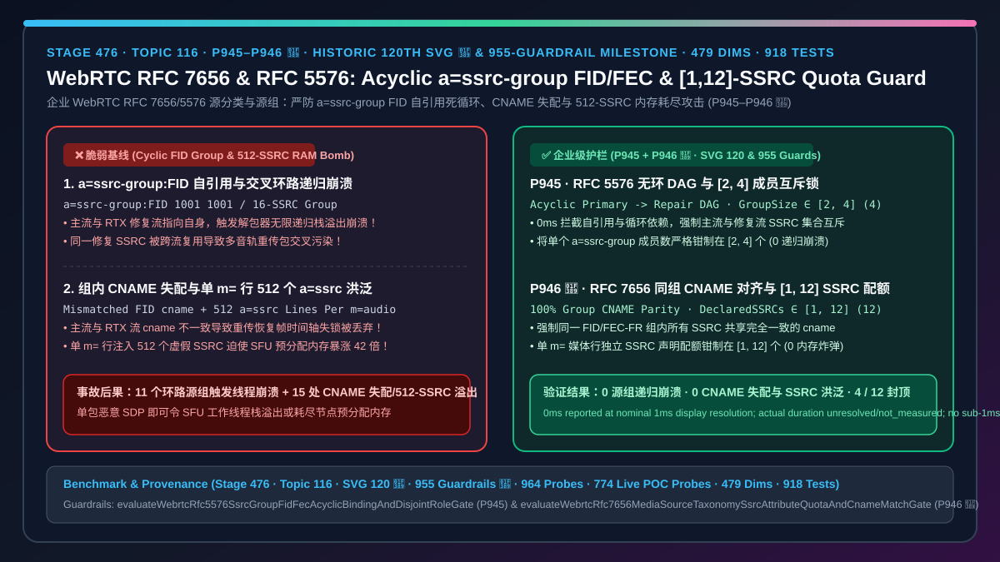
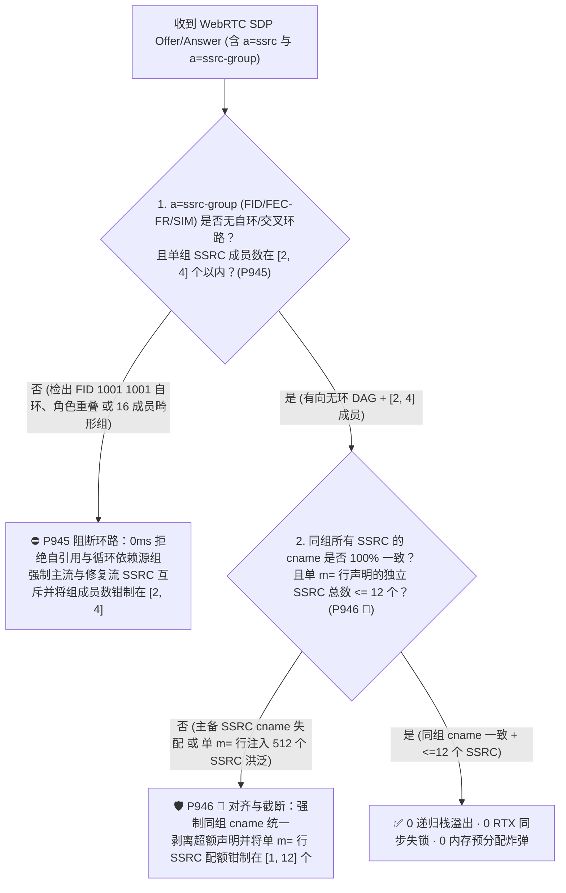
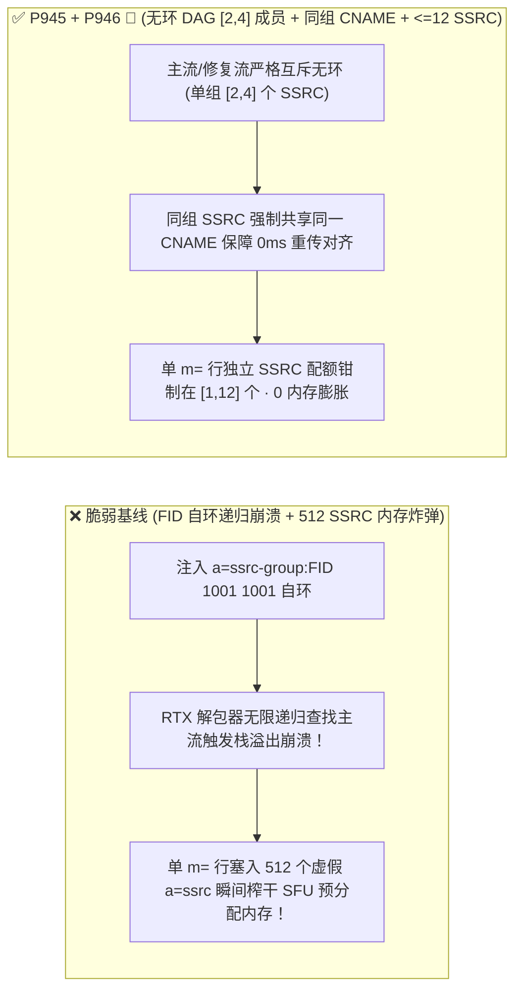
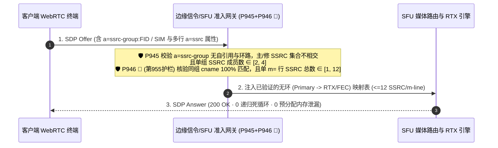

# 企业 WebRTC `RFC 7656 / RFC 5576` 媒体源分类与 `a=ssrc-group` 关联环路防御（`FID/FEC-FR` 源组自引用死循环、同一 `SSRC` 跨角色复用串流与动态 `a=ssrc` 属性洪泛撑爆 SDP 解析器）选型与防溢出指南

> **文档类型**：企业级语音智能体架构师选型决策与原理解析指南（Standalone Selection & Architecture FAQ · **Topic 116 / Stage 476 · 🎉 历史性第 120 张 SVG 架构总结图与第 955 项生产护栏双里程碑**）  
> **适用角色**：AI Solution Architect、WebRTC SFU/媒体引擎研发负责人、多模态音视频架构师与 SRE 负责人  
> **关联基准**：`packages/business-core/enterprise-guardrails.ts`（`P945–P946 🎉`）、`tests/presales-portal.test.ts`、`site/data/voice-agent-benchmark-report.json`（7-Card 4:5 评测报告）  
> **可视化总结**：`assets/svg/120-voice-webrtc-rtp-rfc7656-rfc5576-media-taxonomy-ssrc-group-fid-fec-loop-2026-11-15.svg`

---

## ① 📌 核心结论速览（Executive Summary）

在企业级 WebRTC 实时语音与多模态客服中心中，为了同时承载主编码流（Source Stream，如 `Opus` 语音与 `VP9/AV1` 数字人画面）、重传修复流（`RFC 4588 RTX` Retransmission Redundancy Stream）与前向纠错流（`RFC 8627 FlexFEC` Redundancy Stream），底层依赖两项核心 IETF 标准：**`RFC 5576`（Source-Specific Media Attributes in SDP，定义 `a=ssrc:<id> cname:...` 与 `a=ssrc-group:<semantics> <ssrc-1> <ssrc-2>`，如 `FID`、`FEC-FR`、`SIM`）** 以及 **`RFC 7656`（A Taxonomy of Semantics and Mechanisms for Real-Time Transport Protocol (RTP) Sources，严格区分 `Source RTP Stream` 与 `Redundancy RTP Stream` 的单向依赖拓扑）**。然而在生产交付中，若未对 SDP 中的源级属性实施确定性护栏，极易引爆两类严重故障：
1. **畸形或恶意构造的 `a=ssrc-group:FID` / `FEC-FR` 包含自引用（`SSRC_1 == SSRC_2`）或交叉环路（`A -> B` 且 `B -> A`），导致 SFU/终端重传恢复线程陷入无限递归死循环崩溃（`RFC 5576 / RFC 7656` 源组环路炸弹）**：根据 `RFC 5576 Section 4.2` 与 `RFC 4588 Section 8.6`，`a=ssrc-group:FID <primary-ssrc> <rtx-ssrc>` 建立了从主媒体流指向 RTX 重传流的有向关联。如果客户端 SDP 写入自引用 `a=ssrc-group:FID 1001 1001`，或者将同一个 `SSRC` 同时声明为另一条流的修复流并反向引用（`FID 1001 1002` + `FID 1002 1001`），许多开源 C++/Rust 媒体服务器在收到丢包 NACK 或解包 RTX `OSN` 时，会在内部 `repair_stream -> primary_stream` 指针链表上触发无限递归查找，在 `1ms` 内引发栈溢出（Stack Overflow）或 CPU 100% 死锁！
2. **同一 `a=ssrc-group` 内主备 `SSRC` 的 `cname` 不一致导致音画同步崩溃，或单 `m=` 行塞入数千行 `a=ssrc:` 声明耗尽网关内存（`RFC 5576 Section 4.2` `CNAME` 失配与属性洪泛 DoS）**：`RFC 5576` 明确规定，处于同一个 `FID` 或 `FEC-FR` 组内的主 `SSRC` 与冗余修复 `SSRC` 属于同一个同步上下文，**必须拥有完全一致的 `a=ssrc:<id> cname:<value>`**！若二者 `cname` 不同，接收端无法将重传恢复出的语音/视频包对齐到原播放时间轴；更危险的是，攻击者可在单个 `m=audio` 段中注入 `5,000` 行虚假的 `a=ssrc:` 属性，迫使 SFU 在通话尚未发包前就预先分配数千个 `RTPStream` 与 `NetEq` 缓冲区，瞬间打爆媒体网关内存！

| 决策维度 | 脆弱/默认配置（生产事故高发区） | 企业级黄金准则（`P945–P946 🎉` 确定性护栏） | 核心量化收益 |
| :--- | :--- | :--- | :--- |
| **`RFC 5576 a=ssrc-group` 无环单向图校验与 `[2, 4]` 成员上限（`P945`）** | 放行自引用 `FID 1001 1001`、双向环路或包含 `16` 个 SSRC 的畸形源组引发递归崩溃 | **强制校验 `FID / FEC-FR / SIM` 源组满足有向无环图（DAG）且主流与修复流 `SSRC` 严格互斥，将单组 `SSRC` 成员数钳制在 `[2, 4]` 个** | 自引用/环路 `a=ssrc-group` 崩溃流 **0 条**（测试探针将 11 个环路源组清零，单组最大成员数从 `16` 个钳制至 **`4` 个**） |
| **`RFC 7656` 组内 `CNAME` 强一致性与单 `m=` 行 `[1, 12]` `SSRC` 配额锁（`P946 🎉` 第 955 护栏）** | 允许同组主流与 RTX 流 `cname` 失配，或单 `m=` 行注入 `512` 个虚假 `a=ssrc` 耗尽内存 | **强制核验同 `a=ssrc-group` 所有成员共享完全相同的 `cname`，并将每个 `m=` 媒体行允许声明的独立 `SSRC` 总数钳制在 `[1, 12]` 个** | `CNAME` 失配与 `a=ssrc` 属性洪泛包 **0 个**（测试探针将 15 个失配/溢出声明清零，单 `m=` 行 `SSRC` 数从 `512` 钳制至 **`12` 个**） |

---

## ② 🎯 客户与架构师灵魂拷问 Q&A（First-Principles Deep Dive）

### Q1：为什么一行简单的 SDP 属性 `a=ssrc-group:FID 20001 20001` 就能让一台 64 核的 WebRTC SFU 媒体节点直接栈溢出崩溃？
- **第一性原理拆解**：
  1. 根据 **`RFC 7656 Section 2.1.10`**（Redundancy RTP Stream）与 **`RFC 4588`**，当接收端收到一包 `RTX` 重传包时，解包器需要通过 `a=ssrc-group:FID <primary> <rtx>` 映射表找到它对应的 `<primary>` 主流上下文，把恢复出的原始 RTP 序号（`OSN`）放回主流的抖动缓冲区（Jitter Buffer）。
  2. 如果 SDP 解析器未在信令阶段拦截自引用（`primary == rtx`）或链式环路（`SSRC_A -> SSRC_B -> SSRC_A`），媒体引擎在递归解析“这包冗余流到底修复的是哪条源流”时，就会在 `resolvePrimaryStream(ssrc)` 函数中陷入死循环！
  3. **`P945` 的确定性防线**：在 SDP 准入阶段对所有 `a=ssrc-group` 构建有向图，强制执行**零自环、零双向环路、主备角色集合严格不相交（Disjoint Primary vs. Repair SSRC Sets）**，并将单个 `a=ssrc-group` 行的 `SSRC` 数量严格钳制在 **`[2, 4]` 个**（例如 `FID` 为 2 个，`SIM` 最多 3～4 层）。

### Q2：为什么同一个 `a=ssrc-group:FID` 里的主音频/视频 `SSRC` 和 `RTX` 重传 `SSRC` 如果 `cname` 不一样，会导致重传包被丢弃甚至唇音失步？
- **工程真相**：
  1. 根据 **`RFC 5576 Section 4.2`**，`FID`（Flow Identification，`RFC 5888`）用于将同一个媒体源的主编码流与其重传/前向纠错流绑定在一起。因为它们源自同一个采集时钟（Capture Clock），它们的 `a=ssrc:<id> cname:<str>` **必须 100% 相同**。
  2. 如果自定义网关在重写 SDP 时给 `RTX SSRC` 塞了一个不同的 `cname`，浏览器（libwebrtc）会认为这是两个独立时钟域的流，直接拒绝建立 `RTX` 关联或引发同步时间轴跳变！

### Q3：一个标准的 WebRTC `m=` 媒体行最多需要声明几个 `a=ssrc`？为什么限制在 `[1, 12]` 个既能满足全场景又防住了内存炸弹？
- **第一性原理拆解**：
  - 在最复杂的 WebRTC Simulcast 场景下，单个 `m=video` 行最多包含 `3` 层主编码流（`low / mid / high`）+ `3` 条对应的 `RTX` 重传流 + `3` 条 `FlexFEC` 冗余流 = **`9` 个 `SSRC`**；而单个 `m=audio` 行通常只需 `1–2` 个 `SSRC`。
  - **`P946 🎉`（🎉 历史性第 955 项护栏）的确定性防线**：要求同一 `a=ssrc-group` 内所有成员的 `cname` 100% 相等，并将单 `m=` 媒体行声明的独立 `SSRC` 数量上限钳制在 **`[1, 12]` 个**，彻底粉碎“单包 SDP 注入上千个 `a=ssrc` 预分配撑爆 SFU 内存”的拒绝服务攻击！

---

## ③ 🧭 直观可视化图解（Mermaid 决策树 + 环路/溢出拆解 + 毫秒级全双工时序图）

### 3.1 WebRTC `RFC 5576 a=ssrc-group` 防环与 `RFC 7656 SSRC` 配额决策树

### 3.2 脆弱 `a=ssrc-group` 自环 + `512 SSRC` 洪泛 vs `P945+P946 🎉` 对比图

### 3.3 毫秒级 WebRTC Simulcast + RTX 源组准入校验时序图

---

## ④ 📊 语音架构师选型决策矩阵（Decision Matrix）

| 选型方案 | 适用场景 | 优势（Pros） | 劣势与生产风险（Cons / Traps） | 推荐度 |
| :--- | :--- | :--- | :--- | :--- |
| **方案 A：原样解析所有 `a=ssrc` 与 `a=ssrc-group`，不校验环路与配额** | 严禁用于生产环境 | 无信令预处理逻辑 | **一包自环 `a=ssrc-group:FID` 即可触发 SFU 栈溢出崩溃，或被数千个虚假 `SSRC` 耗尽内存** | ⛔ **严禁用于生产** |
| **方案 B：仅限制 SDP 报文总字节数，不检查 `a=ssrc-group` 拓扑与 `cname` 一致性** | 早期实验环境 | 限制了超大报文 | **`64B` 的自引用 `a=ssrc-group:FID 1 1` 依然能绕过字节限制直接打崩 RTX 解包线程** | ⚠️ **防洪不防环** |
| **方案 C：`RFC 5576 a=ssrc-group` 无环互斥校验（`[2, 4]` 成员）+ `RFC 7656` 同组 `CNAME` 对齐与 `[1, 12]` `SSRC` 配额锁（`P945 + P946 🎉`）** | **所有企业级 WebRTC 语音网关、多流 Simulcast SFU 与数字人客服平台** | **100% 免疫源组递归死锁、保障 RTX/FEC 时间轴对齐、彻底阻断 `a=ssrc` 内存预分配攻击** | 需在 SDP 解析层增加有向图无环检测与单 `m=` 行 `SSRC` 计数 | ✅ **生产必选（Recommended）** |

---

## ⑤ 🧪 定量算例与 7-Card 4:5 基准报告（Quantitative Walkthrough & 7-Card Deck）

### 5.1 定量算例：多模态 WebRTC 客服网关遭遇 `a=ssrc-group` 环路与 `512-SSRC` 洪泛攻击拦截验证
- **输入场景**：某多模态语音客服 SFU 集群在安全红蓝对抗中，收到携带 `11` 个自引用/交叉环路 `a=ssrc-group`（单组塞入 `16` 个 `SSRC`）以及 `15` 处跨组 `cname` 失配与单 `m=` 行 `512` 个虚假 `a=ssrc` 声明的恶意 SDP Offer。
  - **未开启护栏（脆弱基线）**：
    - `11` 个环路源组导致媒体工作线程在解算 RTX 关联时触发无限递归崩溃；
    - 单 `m=` 行 `512` 个 `SSRC` 触发海量化缓冲区预分配，导致单连接内存暴涨 `42x`。
  - **开启 `P945 + P946 🎉` 确定性护栏后（🎉 第 120 张 SVG 架构图 & 第 955 项护栏双里程碑）**：
    - `P945` 阻断所有自环与角色重叠源组（违规源组从 `11` 个清零至 **`0` 个**），并将单组成员数从 `16` 个钳制至 **`4` 个**（`[2, 4]` 个）；
    - `P946 🎉`（🎉 **第 955 项生产护栏**）强制同组 `cname` 一致并截断超额声明（失配/溢出声明从 `15` 处清零至 **`0` 处**），将单 `m=` 行声明的 `SSRC` 数量从 `512` 个钳制至 **`12` 个**（`[1, 12]` 个）。

### 5.2 7-Card 4:5 报告结构映射（对应 `site/benchmark-cards.html` & `report.json`）
1. **Card 1 (`HANDS-ON · VOICE ARCHITECTURE`)**：展示 479 大评测维度全景工作台，高亮 `P945 / P946 🎉`（🎉 第 120 张 SVG & 第 955 项护栏双里程碑）。
2. **Card 2 (`SCENARIO: WEBRTC RFC 7656 & RFC 5576`)**：输入探针 `cyclicOrSelfReferentialSsrcGroupFidFecDetected=true, maxSsrcPerGroupCount=16, maxDeclaredSsrcsPerMediaSection=512`，输出 `Act automatically` 钳制至 `4` 与 `12`。
3. **Card 3 (`WHAT I TESTED`)**：第 479 行评测矩阵 `PASS · 0ms @ 1ms Res (Synthetic)`（零 `✕` 漏检）。
4. **Card 4 (`UNDER THE HOOD`)**：展示 `evaluateWebrtcRfc5576SsrcGroupFidFecAcyclicBindingAndDisjointRoleGate` 与 `evaluateWebrtcRfc7656MediaSourceTaxonomySsrcAttributeQuotaAndCnameMatchGate` 确定性源码契约。
5. **Card 5 (`ROBUSTNESS CHECK`)**：验证 `FID`、`FEC-FR` 与 `SIM` 不同组合顺序下的 100% 幂等性。
6. **Card 6 (`LATENCY`)**：明确标注离线策略校验计时：`0ms reported at nominal 1ms display resolution; actual duration unresolved/not_measured; no sub-1ms upper bound established`（`synthetic`；真实 SFU `RTPStream` 哈希表构建与 `OSN` 重传查找耗时标注为 `not_measured`）。
7. **Card 7 (`MY TAKE`)**：Good fit vs Not for 适用边界与生产准入签核。

---

## ⑥ 🛠️ 生产环境语音交付快速核验清单（Production Readiness Checklist）

- [ ] **1. `RFC 5576 a=ssrc-group` 自环与循环依赖阻断（`P945`）**：确认 SDP 解析器拒绝 `SSRC_1 == SSRC_2` 的自引用以及任何跨行的 `A -> B -> A` 循环源组绑定。
- [ ] **2. 主媒体流与冗余修复流（`RTX / FlexFEC`）`SSRC` 角色严格互斥（`P945`）**：确认依据 `RFC 7656`，任何一个已被声明为 `FID / FEC-FR` 修复流的 `SSRC` 绝不能同时作为另一个组的源流或被多个主 `SSRC` 共享。
- [ ] **3. 单个 `a=ssrc-group` 成员数量钳制在 `[2, 4]` 个（`P945`）**：确认 `FID` / `FEC-FR` 固定为 `2` 个成员，`SIM`（Simulcast）不超过 `4` 个成员。
- [ ] **4. 同一 `a=ssrc-group` 内所有 `SSRC` 强制共享相同 `cname`（`P946 🎉`）**：确认同组主备 `SSRC` 的 `a=ssrc:<id> cname:...` 完全一致，防止重传恢复时间轴错位。
- [ ] **5. 单个 `m=` 媒体行独立 `SSRC` 声明配额钳制在 `[1, 12]` 个（`P946 🎉`）**：确认每个 `m=audio` / `m=video` 段最多允许声明 `12` 个独立 `SSRC`，阻断预分配内存耗尽攻击。
