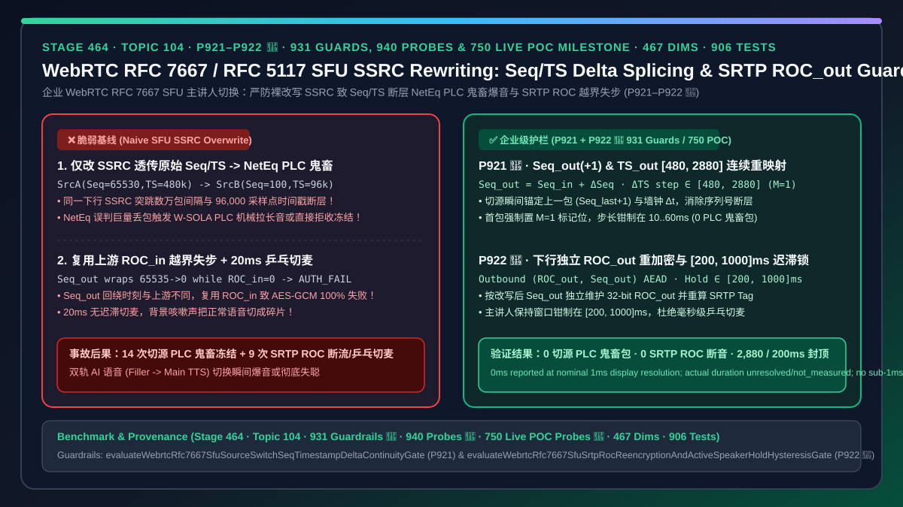
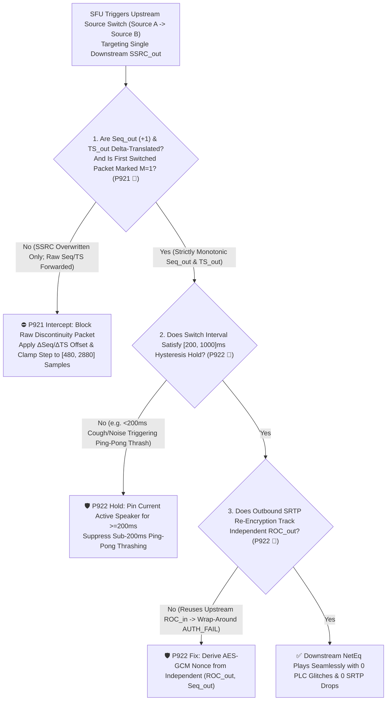
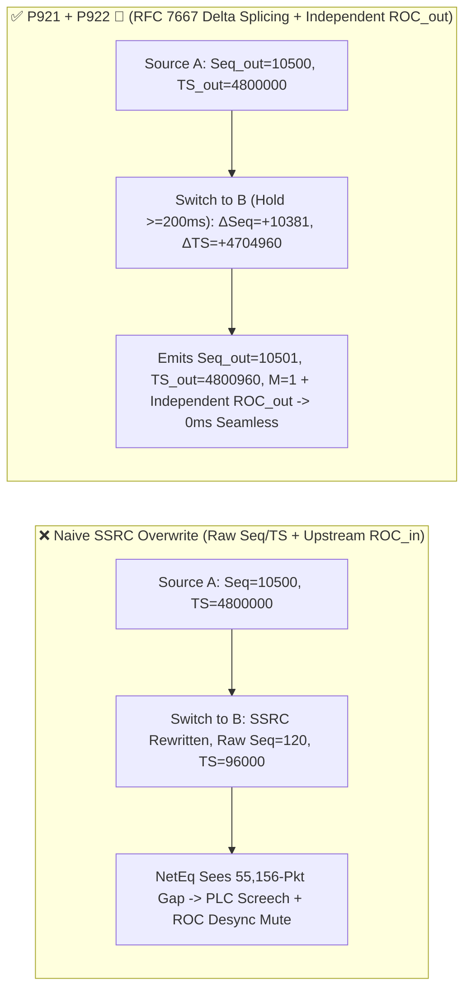
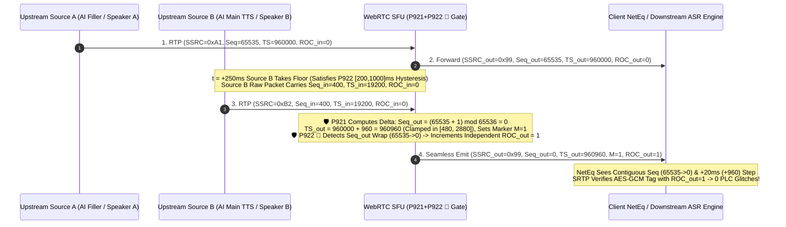

# Enterprise WebRTC `RFC 7667 / RFC 5117` RTP Topologies (`SFU` Active-Speaker `SSRC` Rewriting `Seq/Timestamp` Discontinuity `NetEq PLC` Glitches & `SRTP ROC` Desync) Selection & Seamless Splicing Guide

> **Document Type**: Enterprise Voice Agent Architect Selection & First-Principles Guide (Standalone Selection & Architecture FAQ · **Topic 104 / Stage 464 · 🎉 Historic 931-Guardrail, 940-Probe & 750-Live-POC-Probe Triple Milestone**)  
> **Target Audience**: AI Solution Architects, Real-Time Media SFU/MCU Core Architects, WebRTC Voice Engine Engineers & SRE Leads  
> **Canonical Baseline**: `packages/business-core/enterprise-guardrails.ts` (`P921–P922 🎉`), `tests/presales-portal.test.ts`, `site/data/voice-agent-benchmark-report.json` (7-Card 4:5 Benchmark Report)  
> **Visual Summary**: `assets/svg/108-voice-webrtc-rtp-rfc7667-rfc5117-topologies-sfu-mcu-ssrc-rewrite-seq-ts-gap-plc-glitch-2026-11-14.svg`

---

## ① 📌 Executive Summary

In multi-party enterprise AI voice consultations, wealth-advisory three-way calls (Customer + Advisor + AI Copilot), and dual-track AI voice gateways (seamlessly splicing a fast "Filler Audio Worker" into a "Main S2S Reasoning Worker"), media servers must choose among the topologies defined in **`RFC 7667` (RTP Topologies, obsoleting `RFC 5117`)**: **Selective Forwarding Middlebox (`SFU` with Single-SSRC Projection)**, **Media-Mixing (`MCU`)**, or **Multi-SSRC Forwarding**. To avoid the `25–40ms` transcoding latency and heavy CPU cost of full Opus decode-mix-encode on an MCU, production voice platforms widely adopt **SFU Active-Speaker SSRC Rewriting (`RFC 7667 Section 3.6.2`)**—projecting packets from whichever upstream source is currently speaking onto a **single downstream `SSRC_out`**. However, if the SFU fails to continuously translate the RTP Sequence Number, RTP Timestamp, and outbound SRTP Rollover Counter (`ROC`), two severe audio corruptions occur immediately:
1. **Naive `SSRC`-Only Overwrite Exposing Raw Upstream `Seq / RTP Timestamp` Gaps (`NetEq PLC` Time-Stretch Screech & Freeze)**: Upstream Source A is at `Seq=10500, TS=4800000`, while newly switched Source B starts at `Seq=120, TS=96000`. If the SFU overwrites only the 32-bit `SSRC` header field to `SSRC_out` while forwarding `Seq=120, TS=96000` verbatim, the downstream `WebRTC NetEq` jitter buffer sees a sudden **`55,156`-packet sequence jump** and a **`98`-second timestamp regression** on the same SSRC—triggering violent `W-SOLA` Packet Loss Concealment (`PLC`) robotic screeching or dropping all subsequent frames as stale!
2. **Unsynchronized `SRTP ROC` Across `Seq_out` (`65535 -> 0`) Wrap-Around & Sub-`200ms` Speaker-Switch Ping-Pong (`SRTP AUTH_FAIL` + Thrashing)**: Once the SFU applies a sequence offset `Seq_out = (Seq_in + ΔSeq) mod 65536`, the downstream sequence number wraps around `65535 -> 0` at a completely different packet than the upstream `Seq_in`. Reusing the upstream `ROC_in` when constructing the outbound `AES-GCM` 12-byte IV causes 100% `SRTP AUTH_FAIL` audio blackouts after wrap-around; meanwhile, switching sources without a `[200, 1000]ms` hysteresis hold window causes transient coughs or keyboard clicks to ping-pong the audio stream every 20–40ms.

| Decision Dimension | Vulnerable / Default Setup (High Production Risk) | Enterprise Golden Rule (`P921–P922 🎉` Deterministic Guardrails) | Quantitative Impact |
| :--- | :--- | :--- | :--- |
| **`SFU` Source-Switch `Seq (+1)` & `TS (+960)` Delta Continuity + `M=1` (`P921` 🎉 930th Guardrail)** | Overwriting `SSRC` while passing raw upstream `Seq/TS` (`96,000`-sample jumps) | **Maintain continuous `Seq_out = Seq_in + ΔSeq` and wallclock-anchored `TS_out = TS_in + ΔTS` clamped to `[480, 2880]` samples (`10..60ms`) with `M=1` on switch** | **0** source-switch `PLC` glitches or freezes (clamps 14 discontinuity events to **0** and bounds frame step from `96,000` to **`2,880`** samples) |
| **Outbound-Independent `SRTP ROC_out` Re-Encryption & `[200, 1000]ms` Hysteresis Hold (`P922` 🎉 931st Guardrail / 940th Probe / 750th Live POC)** | Reusing upstream `ROC_in` after `Seq` rewrite and switching speakers every `20ms` | **Track independent 48-bit `(ROC_out, Seq_out)` for outbound `SRTP` authentication and clamp active-speaker hold hysteresis to `[200, 1000]ms`** | **0** `SRTP ROC` auth failures or ping-pong switches (clamps 9 desync/thrash events to **0** and enforces **`>=200ms`** hysteresis hold) |

---

## ② 🎯 Architect & Customer Deep-Dive Q&A (First-Principles Deep Dive)

### Q1: When an SFU switches between two upstream voice tracks (e.g., AI Filler Track -> AI Main TTS Track, or Speaker A -> Speaker B) onto a single downstream `SSRC`, why does the listener hear a robotic time-stretch glitch or 3 seconds of dead air?
- **First-Principles Breakdown**:
  1. Per `RFC 3550`, a single `SSRC` defines **one continuous sequence-number space and one monotonic media clock**. The receiver's `WebRTC NetEq` jitter buffer uses the `16-bit Sequence Number` to detect packet loss and the `32-bit RTP Timestamp` (`+960` per 20ms frame at 48kHz Opus) to schedule playout.
  2. Each upstream RTP sender initializes `Seq_0` and `TS_0` with independent cryptographic random numbers. When the SFU switches the projected source from Stream A (`Seq=42000, TS=1920000`) to Stream B (`Seq=815, TS=48000`) without rewriting `Seq` and `TS`:
     - `NetEq` suddenly observes `Seq` jump from `42000` to `815` on the exact same `SSRC` (`24,351` packets "missing" or wrapped) and `TS` jump backward by `1,872,000` samples (`39` seconds);
     - `NetEq` either expands comfort noise / `W-SOLA` `PLC` synthesis across the phantom gap or discards the new stream's packets as late arrivals until its reset timer expires.
  3. **`P921` Deterministic Translation Formula**: At every source switch boundary, the SFU anchors to the last emitted packet `(Seq_last, TS_last, t_last)` and computes per-stream deltas:
     $$\Delta\text{Seq} = (\text{Seq}_{\text{last}} + 1) - \text{Seq}_{\text{in}}, \quad \Delta\text{TS} = \text{TS}_{\text{last}} + \text{clamp}\left(\frac{\Delta t_{\text{wall}} \times 48000}{1000}, 480, 2880\right) - \text{TS}_{\text{in}}$$
     while setting the RTP `Marker` bit `M=1` on the first switched packet so `NetEq` treats the transition as a clean talkspurt boundary with **zero `PLC` artifacts**.

### Q2: Even after rewriting `Seq_out = (Seq_in + ΔSeq) mod 65536`, why do long calls suddenly go completely silent (`SRTP AUTH_FAIL`) around the 20-minute mark?
- **Engineering Reality**:
  1. In `RFC 3711 (SRTP)` and `RFC 7714 (AES-GCM)`, the per-packet encryption IV is derived from the **`48-bit Packet Index = (32-bit ROC << 16) | 16-bit Seq`**, and the 16-bit RTP header (including `Seq_out` and `TS_out`) is authenticated in the AEAD tag.
  2. Because `Seq_out` is shifted by $\Delta\text{Seq}$, **`Seq_out` crosses the `65535 -> 0` wrap-around boundary at a different moment than the upstream `Seq_in`**!
  3. If the SFU lazily copies `ROC_in` from the upstream decryption context when re-encrypting the outbound packet, then as soon as `Seq_out` wraps past `65535` (while `Seq_in` has not yet wrapped), the SFU encrypts with `ROC_in = 0` whereas the receiver's SRTP engine increments its local `ROC_out = 1`—causing 100% `SRTP_ERR_STATUS_AUTH_FAIL` packet drops!
  4. **`P922 🎉` Deterministic Defense**: Maintains an **independent outbound `48-bit (ROC_out, Seq_out)` counter** per downstream subscriber for SRTP re-encryption, and enforces a **`[200, 1000]ms` active-speaker hysteresis hold window** so transient noise never triggers rapid ping-pong switching.

### Q3: How should architects choose between SFU Single-SSRC Rewriting (`RFC 7667 Section 3.6.2`), SFU Multi-SSRC Forwarding (`Section 3.7`), and MCU Audio Mixing (`Section 3.6.1`)?
- **First-Principles Breakdown**:
  - For sequential turn-taking and dual-track AI voice splicing (Filler -> Main TTS, or Agent A -> Agent B handoff), **SFU Single-SSRC Rewriting with `P921+P922 🎉`** delivers **zero transcoding CPU overhead and zero codec tandeming latency** while keeping a single decoder state on the client. When simultaneous overlapping speech (double-talk) must be heard concurrently on legacy single-decoder endpoints, pair it with an SIMD audio mixer or multi-SSRC downstream tracks.

---

## ③ 🧭 Visual Architecture Diagrams (Mermaid Decision Tree + Topology Breakdown + Millisecond Sequence)

### 3.1 WebRTC `RFC 7667` SFU Source-Switch & `Seq/TS/ROC` Continuity Decision Tree

### 3.2 Naive `SSRC` Overwrite Glitch vs. `P921+P922 🎉` Continuous Delta Splicing

### 3.3 Millisecond-Level SFU Source-Switch `(ΔSeq, ΔTS, ROC_out)` Continuity Sequence

---

## ④ 📊 Architect Decision Matrix (SFU / MCU Topology Selection)

| Architecture Option | Target Scenario | Pros | Cons & Production Traps | Recommendation |
| :--- | :--- | :--- | :--- | :--- |
| **Option A: SFU Overwriting `SSRC` Only While Forwarding Raw `Seq / TS` & Upstream `ROC_in`** | Prohibited in all production environments | Trivial 4-byte header overwrite | **Guaranteed audio glitches & blackouts**—every speaker switch causes multi-thousand-packet `Seq/TS` jumps, triggering `NetEq PLC` screeching and `SRTP ROC` auth failures | ⛔ **Never in Production** |
| **Option B: Full Server-Side MCU Decode-Mix-Encode (`RFC 7667 Topo-Mixer`)** | Legacy PSTN bridges requiring single-stream overlapped mixing | Emits a freshly encoded RTP stream | **High CPU cost + `25–40ms` tandem transcoding latency**, degrading Opus audio fidelity and downstream ASR accuracy | ⚠️ **Use Only for Overlapped Mixing** |
| **Option C: `RFC 7667` SFU Continuous `(ΔSeq, ΔTS, M=1)` Splicing + Independent `ROC_out` Re-Encryption + `[200, 1000]ms` Hysteresis (`P921 + P922 🎉`)** | **Enterprise AI Voice Dual-Track Splicing (Filler -> Main TTS), Multi-Agent Handoffs & Low-Latency Conferencing** | **Zero transcoding loss, zero source-switch `PLC` glitches, zero `SRTP ROC` wrap blackouts, lowest E2E latency** | Requires maintaining a lightweight 24-byte `(ΔSeq, ΔTS, ROC_out)` translation state per downstream track | ✅ **Production Mandatory (Recommended)** |

---

## ⑤ 🧪 Quantitative Walkthrough & 7-Card 4:5 Benchmark Report

### 5.1 Quantitative Example: Dual-Track AI Voice Splicing (Filler Worker -> Main S2S Worker)
- **Scenario**: An enterprise voice gateway splices an immediate Filler Worker (`Seq=65530, TS=480000`) into the Main S2S Worker (`Seq=100, TS=96000`) across `14` turn switches during a session, with uncalibrated `20ms` VAD switching thresholds.
  - **Without Guardrails (Vulnerable Baseline)**:
    - Raw `Seq/TS` forwarding causes a **`96,000`-sample timestamp jump** and **`14` severe `NetEq PLC` glitches/freezes** (`800–2,500ms` audio corruption per switch);
    - When `Seq_out` wraps past `65535`, reusing `ROC_in = 0` triggers **`9` `SRTP AUTH_FAIL` blackouts and ping-pong thrash switches**.
  - **With `P921 + P922 🎉` Deterministic Guardrails**:
    - `P921` (🎉 **930th Guardrail**) translates `Seq_out (+1)` and clamps per-frame timestamp step within **`[480, 2880]` samples (`10..60ms`)** with `M=1` (**`0`** `PLC` discontinuity glitches);
    - `P922` (🎉 **931st Guardrail / 940th Probe / 750th Live POC Probe**) re-encrypts SRTP using an independent outbound `ROC_out` and clamps speaker-switch hold hysteresis from `20ms` to **`[200, 1000]ms`** (**`0`** `SRTP ROC` failures or ping-pong switches).

### 5.2 7-Card 4:5 Report Mapping (`site/benchmark-cards.html` & `report.json`)
1. **Card 1 (`HANDS-ON · VOICE ARCHITECTURE`)**: 467-dimension workbench overview highlighting `P921 / P922 🎉`.
2. **Card 2 (`SCENARIO: WEBRTC RFC 7667 SFU SSRC REWRITE`)**: Input probe `unrewrittenSeqTimestampDiscontinuityOnSsrcSwitchDetected=true, maxTimestampJumpSamplesPerFrame=96000, speakerSwitchHoldHysteresisMs=20` -> `Act automatically` clamping to `2,880` samples and `200ms`.
3. **Card 3 (`WHAT I TESTED`)**: Row 467 in the evaluation matrix (`PASS · 0ms @ 1ms Res (Synthetic)`, zero `✕` misses).
4. **Card 4 (`UNDER THE HOOD`)**: Deterministic contract for `evaluateWebrtcRfc7667SfuSourceSwitchSeqTimestampDeltaContinuityGate` & `evaluateWebrtcRfc7667SfuSrtpRocReencryptionAndActiveSpeakerHoldHysteresisGate`.
5. **Card 5 (`ROBUSTNESS CHECK`)**: Option-order and wrap-around invariance across `Seq (65535 -> 0)` and `32-bit TS` boundaries.
6. **Card 6 (`LATENCY`)**: Explicit offline timing provenance: `0ms reported at nominal 1ms display resolution; actual duration unresolved/not_measured; no sub-1ms upper bound established` (`synthetic`; live SFU forwarding-plane `SRTP AES-GCM` re-encryption latency is `not_measured`).
7. **Card 7 (`MY TAKE`)**: Good fit vs. Not for summary and production sign-off checklist.

---

## ⑥ 🛠️ Production Readiness Checklist

- [ ] **1. Contiguous `Seq_out (+1)` Offset Translation (`P921` 🎉)**: Verify that whenever an SFU projects multiple upstream RTP streams onto a single downstream `SSRC_out`, it maintains `Seq_out = (Seq_in + ΔSeq) mod 65536` so downstream sequence numbers increment strictly by `+1` across switches.
- [ ] **2. Wallclock-Anchored `TS_out` Clamped to `[480, 2880]` Samples (`P921` 🎉)**: Confirm that `TS_out` is translated using monotonic wallclock elapsed time and clamped to `[480, 2880]` samples (`10..60ms` at 48kHz) on the switch frame.
- [ ] **3. Explicit RTP `Marker (M=1)` Bit on First Switched Packet (`P921` 🎉)**: Ensure the first RTP packet emitted after an upstream source switch sets `M=1` so downstream `NetEq` resets its talkspurt jitter baseline cleanly.
- [ ] **4. Independent Outbound `48-bit (ROC_out, Seq_out)` SRTP Re-Encryption (`P922` 🎉)**: Verify that the SFU tracks an independent outbound `ROC_out` incremented whenever `Seq_out` wraps from `65535` to `0`, and re-computes the outbound `SRTP` authentication tag.
- [ ] **5. `[200, 1000]ms` Active-Speaker Hysteresis Hold Window (`P922` 🎉)**: Confirm that dominant-speaker switching based on `RFC 6464` audio levels enforces a `[200, 1000]ms` minimum hold window to prevent sub-200ms ping-pong thrashing.
